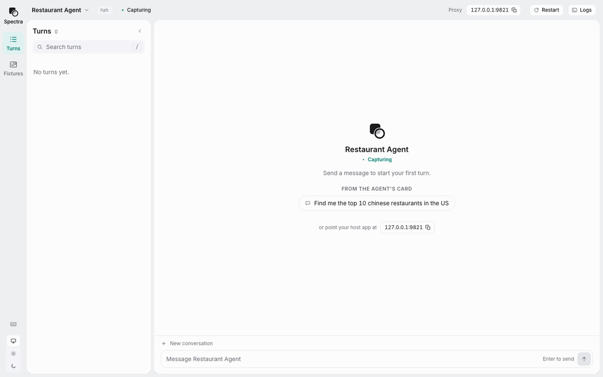
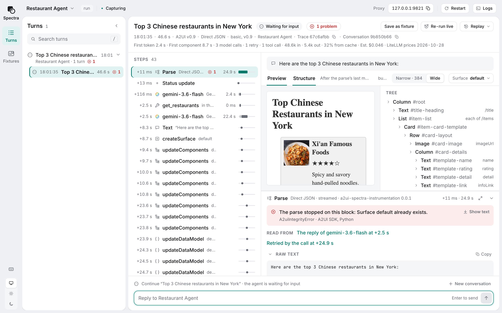
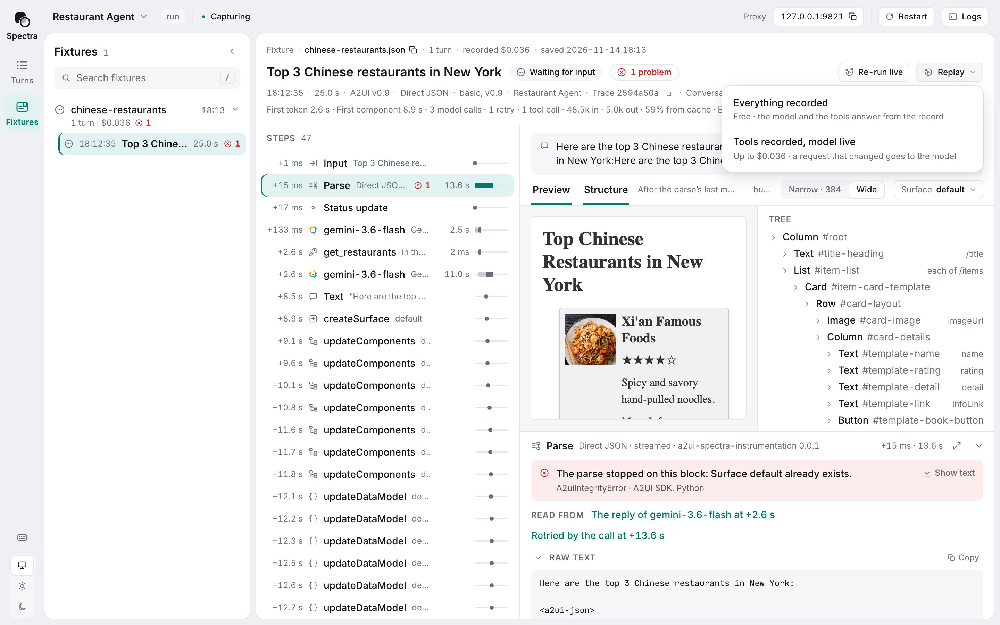
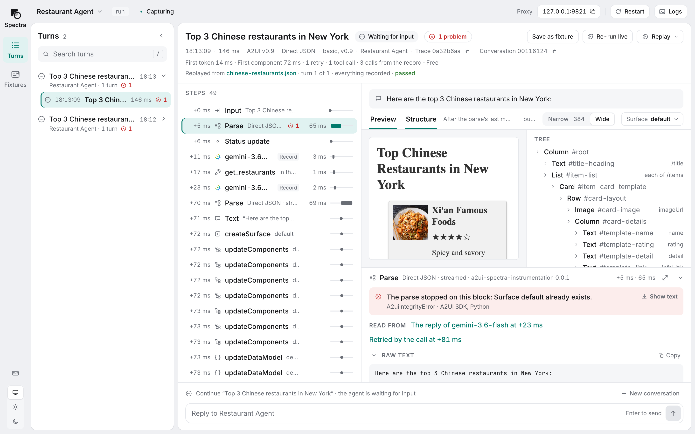

# Spectra for A2UI

A debugging and observation tool for the developer of an [A2UI](https://github.com/a2ui-project/a2ui) agent: attach to the running agent, see every turn, check and preview it, record and replay it.

> **Status:** not released yet. Spectra runs from source; see [`tools/spectra/`](tools/spectra/README.md).



<sub>Upstream's Python restaurant finder on Gemini, at three times speed.</sub>

## Why

A wrong surface can come from any link in a generative UI turn:

1. **The prompt**, built from your catalog.
2. **The model**, calling tools and writing the UI.
3. **The agent SDK**, compiling that text into A2UI messages, and asking the model again when a block fails.
4. **The renderer**, drawing whatever arrives.

The evidence is scattered across logs, the network and the browser, and every rerun costs a model call. Spectra puts the whole chain on one screen and records it, so it runs again for free.

## What you get

<picture>
  <source media="(prefers-color-scheme: dark)" srcset="docs/images/viewer-dark.png">
  
</picture>

<sub>The same turn, closed. Spectra opens it on its one problem, a parse the SDK stopped, linked to the model reply it read and the call that retried it.</sub>

- **See inside the turn.** The exact model request, tokens and cost, every tool call, the raw text and which part of it became which component, and the surface, step by step.
- **Catch mistakes.** Each response is checked against its schema and catalog: unknown components, child ids that point nowhere, loops, bindings the data model never fills.
- **Press the buttons.** The live preview shows the exact action event your agent would receive, and can send it as the next turn.
- **Stay in the loop.** Restart on save, the agent's logs, the last turn re-run with one press, and the preview reloading when your catalog changes.

## Record once, replay for free

Like Ruby's VCR, for model calls. Save any turn as a fixture, a JSON file in your repo, and replay it:

- **Everything recorded: free.** Every model and tool call is answered from the record, and nothing leaves your machine. A broken turn comes back on demand while you fix the code.
- **Tools recorded, model live: tokens only.** After a prompt edit, the model is called only from where the request changed.
- **In CI.** `a2ui-spectra test` replays every fixture and fails when a turn no longer matches its record.

<picture>
  <source media="(prefers-color-scheme: dark)" srcset="docs/images/replay-menu-dark.png">
  
</picture>

<sub>The turn, saved as a fixture. It cost $0.036 to record.</sub>

<picture>
  <source media="(prefers-color-scheme: dark)" srcset="docs/images/replay-passed-dark.png">
  
</picture>

<sub>Replayed: 146 ms instead of 25 s, free, and passed, the parse failure and its retry included.</sub>

```
# the agent's URL from agent.url in a2ui-spectra.json
a2ui-spectra replay a2ui-spectra-fixtures/chinese-restaurants.json -- uv run .
a2ui-spectra test -- uv run .
```

## How it works

Spectra is one local process at the edges every agent stack already has: the wire, the model and tool calls, and OpenTelemetry. So it works with any A2UI agent, in any language and on any framework.

```
   Spectra's message box, or your own host app
        │ A2A
        ▼
 ┌───────────────────── a2ui-spectra, local ──────────────────────┐
 │ wire proxy · model proxy · tool proxy · OpenTelemetry receiver │──▶ the viewer, in your browser
 └────────────────────────────────────────────────────────────────┘
        ▲ the wire     ▲ model calls     ▲ tool calls     ▲ spans
        └──────────────┴─────────────────┴────────────────┘
                 your agent: any language, any framework
```

```
a2ui-spectra run --agent-url http://localhost:10002 -- uv run .   # start your agent under Spectra
a2ui-spectra attach http://localhost:10002                        # or attach to one already running
```

**Your keys stay yours.** Spectra runs on your machine and nothing is deployed. API keys and other credentials are removed from everything it records, before it shows or saves anything.

Add more as you need it:

| Add                                                                                                       | And see                                                                              |
| --------------------------------------------------------------------------------------------------------- | ------------------------------------------------------------------------------------ |
| Nothing                                                                                                   | Turns, checks, the basic catalog's preview, model calls with tokens and cost, replay |
| A config file                                                                                             | Your own catalog's checks, and your tool calls recorded                              |
| The [wrapper](python/a2ui_spectra_instrumentation/README.md) for upstream's agent SDKs, and OpenTelemetry | The A2UI step: raw text to components, retries, parse errors; your framework's spans |
| A [preview adapter](typescript/preview/core/README.md) on your catalog's dev server                       | Your own components, drawn by your own renderer                                      |

## What Spectra supports

- **A2UI:** v0.9, v0.9.1 and v1.0, upstream's current and previous versions in [`versions.json`](https://github.com/a2ui-project/a2ui/blob/main/specification/versions.json). Not v0.8.
- **Transport:** A2A 0.3 and A2A 1.0, over JSON-RPC.
- **Model APIs read in full:** Gemini, OpenAI's Chat Completions and Responses, and Anthropic's Messages. Any other call is recorded raw.
- **Upstream packages:** each agent SDK and renderer at upstream's main, pinned at `0888f88b2` (2026-11-13), and at its published latest.

<details>
<summary><b>v1.0's renamed envelope keys, and which release reads which</b></summary>

<br>

Upstream renamed a v1.0 component's `catalogId`, `accessibility`, `metadata` and `checks` to `@catalogId`, `@accessibility`, `@metadata` and `@checks`. Upstream's main reads both forms and emits the `@` form; the published releases predate the rename.

Spectra reads both. A bare key passes where upstream's transition accepts it, where the component's schema declares no property of that name, and the viewer marks it as the legacy form. A component carrying both forms of a key is rejected. When upstream drops the bare form ([#4082](https://github.com/a2ui-project/a2ui/issues/4082)), so does Spectra.

| Package                                  | Used by                                | Published latest         | Envelope keys in that release                                                   |
| ---------------------------------------- | -------------------------------------- | ------------------------ | ------------------------------------------------------------------------------- |
| `a2ui-agent-sdk`, with `a2ui-adk` (PyPI) | The Python wrapper, from 0.11.0        | 0.11.0, `a2ui-adk` 0.3.0 | Emits the bare keys                                                             |
| `@a2ui/agent` (npm)                      | The TypeScript wrapper, from 0.1.0     | 0.1.0                    | Emits the bare keys                                                             |
| `@a2ui/web_core` (npm)                   | Every preview adapter, `^0.15.0`       | 0.15.0                   | Reads the bare keys only, and refuses an `updateComponents` carrying an `@` key |
| `@a2ui/react` (npm)                      | The React preview adapter, `^0.15.0`   | 0.15.0                   | Reads the bare keys only, through web core 0.15.0                               |
| `@a2ui/lit` (npm)                        | The Lit preview adapter, `^0.15.0`     | 0.15.0                   | Reads the bare keys only, through web core 0.15.0                               |
| `@a2ui/angular` (npm)                    | The Angular preview adapter, `^0.14.0` | 0.14.0                   | Reads the bare keys only, through web core 0.15.0                               |

A preview page on a published renderer reports what that renderer refuses, in its own words: a surface carrying the `@` keys is refused there until npm carries a release that reads them.

</details>

## In this repo

| Package                                                                                                                                                        | What it is                                                           |
| -------------------------------------------------------------------------------------------------------------------------------------------------------------- | -------------------------------------------------------------------- |
| [`tools/spectra/`](tools/spectra/README.md)                                                                                                                    | The `a2ui-spectra` command                                           |
| [`tools/spectra_viewer/`](tools/spectra_viewer/README.md)                                                                                                      | The viewer                                                           |
| [`tools/spectra_basic_preview/`](tools/spectra_basic_preview/README.md)                                                                                        | The built-in preview page for the basic catalogs                     |
| [`typescript/preview/`](typescript/preview/core/README.md)                                                                                                     | The preview protocol's core, and the React, Lit and Angular adapters |
| [`typescript/instrumentation/`](typescript/instrumentation/README.md), [`python/a2ui_spectra_instrumentation/`](python/a2ui_spectra_instrumentation/README.md) | The wrapper, for TypeScript and for Python                           |
| [`specification/turn_record/v0_1/`](specification/turn_record/v0_1/README.md)                                                                                  | The turn record: the file format every fixture is                    |
| [`conformance/`](conformance/README.md)                                                                                                                        | The turn record's shared test data                                   |
| [`samples/preview/`](samples/preview/react/README.md)                                                                                                          | Sample catalog apps, one per preview adapter                         |
