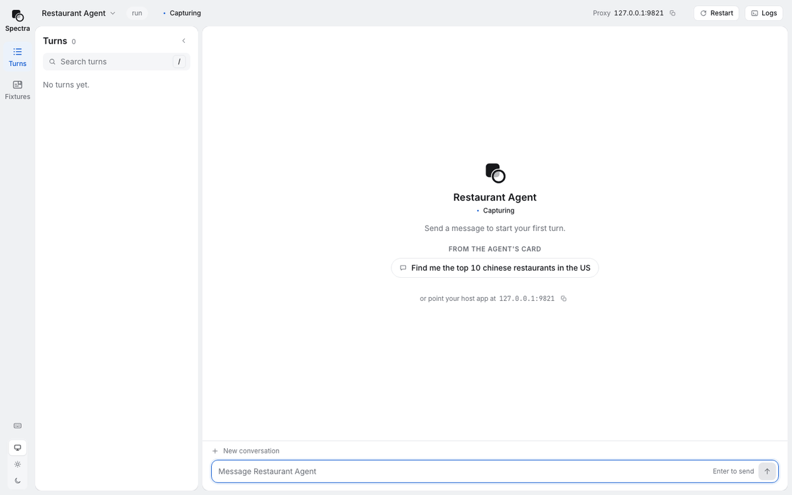
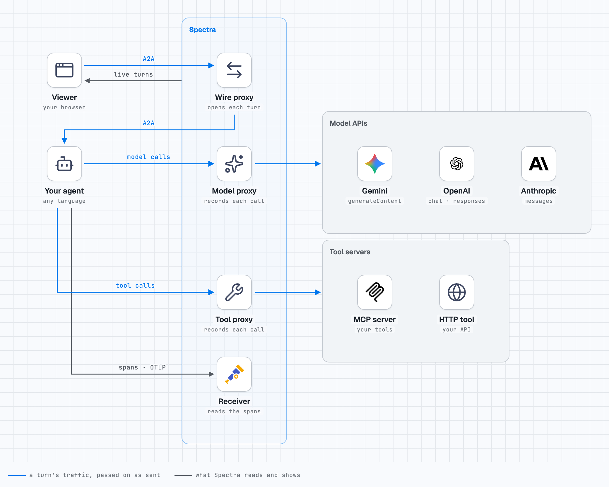

# Spectra for A2UI

A debugging and observation tool for the developer of an [A2UI](https://github.com/a2ui-project/a2ui) agent: attach to the running agent, see every turn, check and preview it, record and replay it.

> **Status:** not released yet. Spectra runs from source; see [`tools/spectra/`](tools/spectra/README.md).

[Install](#install) · [First run](#first-run) · [OpenTelemetry](#opentelemetry-instrumentation) · [Coding agents](#with-a-coding-agent) · [How it works](#how-it-works) · [Design docs](#how-each-part-works)



<sub>Upstream's Python restaurant finder on Gemini, at three times speed.</sub>

## Why

A wrong surface can come from any link in a generative UI turn:

1. **The prompt**, built from your catalog.
2. **The model**, calling tools and writing the UI.
3. **The agent SDK**, compiling that text into A2UI messages, and asking the model again when a block fails.
4. **The renderer**, drawing whatever arrives.

The evidence is scattered across logs, the network and the browser, and every rerun costs a model call. Spectra puts the whole chain on one screen and records it, so it runs again for free.

## What you get

<picture>
  <source media="(prefers-color-scheme: dark)" srcset="docs/images/viewer-dark.png">
  
</picture>

<sub>The same turn, closed. Spectra opens it on its one problem, a parse the SDK stopped, linked to the model reply it read and the call that retried it.</sub>

- **See inside the turn.** The exact model request, tokens and cost, every tool call, the raw text and which part of it became which component, and the surface, step by step.
- **Catch mistakes.** Each response is checked against its schema and catalog: unknown components, child ids that point nowhere, loops, bindings the data model never fills.
- **Press the buttons.** The live preview shows the exact action event your agent would receive, and can send it as the next turn.
- **Replay for free.** Save any turn as a fixture, a JSON file in your repo, and replay it like Ruby's VCR, every model and tool call answered from the record. After a prompt edit, the model is called only from where the request changed. In CI, `a2ui-spectra test` replays them all.
- **Stay in the loop.** Restart on save, the agent's logs, the last turn re-run with one press, and the preview reloading when your catalog changes.

## Install

One binary, the same through every channel, for macOS arm64 and x64, Linux x64 and arm64 on glibc, and Windows x64.

**npm**, with Node 22 or later:

```sh
npx a2ui-spectra
```

**PyPI**, with [uv](https://docs.astral.sh/uv/):

```sh
uvx a2ui-spectra
```

**macOS and Linux**, from the GitHub release into `~/.local/bin`, or `$XDG_BIN_HOME` when it is set, its checksum verified:

```sh
curl -fsSL https://raw.githubusercontent.com/retz8/a2ui-spectra/main/scripts/public/install.sh | sh
```

**Windows**, from the GitHub release into `%LOCALAPPDATA%\Programs\a2ui-spectra\bin` and onto your `PATH`, its checksum verified:

```powershell
irm https://raw.githubusercontent.com/retz8/a2ui-spectra/main/scripts/public/install.ps1 | iex
```

Not supported: Windows on arm64, and Linux on musl, such as Alpine. The binary makes no request of its own: no update check and no usage counts.

<details>
<summary><b>Downloading the binary by hand</b></summary>

<br>

Download your platform's archive and `checksums.txt` from the release page into one folder, and verify the archive: its checksum, then its build provenance attestation with GitHub's `gh`.

```sh
shasum -a 256 --ignore-missing -c checksums.txt     # sha256sum on Linux
gh attestation verify a2ui-spectra-v0.1.0-darwin-arm64.tar.gz --repo retz8/a2ui-spectra
```

```powershell
(Get-FileHash .\a2ui-spectra-v0.1.0-windows-x64.zip).Hash -eq (Select-String windows-x64 .\checksums.txt).Line.Split(' ')[0]
gh attestation verify .\a2ui-spectra-v0.1.0-windows-x64.zip --repo retz8/a2ui-spectra
```

The binaries are not signed with a paid developer identity, and a browser's download carries the download mark. On macOS, clear it on the archive and unpack it with `tar`; if Safari or the Finder unpacked it already, run the first line on `a2ui-spectra` instead.

```sh
xattr -d com.apple.quarantine a2ui-spectra-v0.1.0-darwin-arm64.tar.gz
tar -xzf a2ui-spectra-v0.1.0-darwin-arm64.tar.gz
```

On Windows, unblock the archive, extract it and unblock the binary.

```powershell
Unblock-File .\a2ui-spectra-v0.1.0-windows-x64.zip
Expand-Archive .\a2ui-spectra-v0.1.0-windows-x64.zip
Unblock-File .\a2ui-spectra-v0.1.0-windows-x64\a2ui-spectra.exe
```

A binary installed through `npx`, `uvx` or the install scripts carries no download mark; the install check establishes it on macOS and Windows. Not established: whether Smart App Control on Windows 11, which blocks unsigned code it cannot vouch for and allows no exception for one app, lets the binary run; whether SmartScreen checks it when started from a terminal; and whether Gatekeeper assesses it beyond the mark. The full account, with Apple's and Microsoft's pages, is in [Distribution](docs/design/distribution.md#a-binary-downloaded-by-hand).

</details>

## First run

From your agent's folder, start the agent under Spectra: the URL it serves A2A on, then the command that starts it.

**Python:**

```sh
a2ui-spectra run --agent-url http://localhost:10002 -- uv run .
```

**TypeScript:**

```sh
a2ui-spectra run --agent-url http://localhost:10002 -- node agent.js
```

Through npm or PyPI, put `npx` or `uvx` in front: `npx a2ui-spectra run …`.

The viewer opens in your browser. Send a message from its message box, and the turn arrives step by step. A save in the folder restarts the agent, and Ctrl-C stops both.

**An agent already running:** attach to it, then set the variables Spectra prints in the agent's shell and restart the agent.

```sh
a2ui-spectra attach http://localhost:10002
```

Every command, option and config setting is in [`tools/spectra/`](tools/spectra/README.md).

## OpenTelemetry instrumentation

Out of the box, Spectra sees what goes in and out of your agent. Add the wrapper to see inside the agent SDK, where the model's text becomes your UI:

- **Which part of the reply became which component**, character by character.
- **Why a block failed to parse**, and the retry it cost.
- **The prompt the SDK wrote** from your catalog.

Install it beside your agent, and launch the agent under it.

**Python**, on `a2ui-agent-sdk`:

```sh
uv add --dev a2ui-spectra-instrumentation
a2ui-spectra run --agent-url http://localhost:10002 -- uv run opentelemetry-instrument python agent.py
```

**TypeScript**, on `@a2ui/agent`:

```sh
npm install --save-dev a2ui-spectra-instrumentation
a2ui-spectra run --agent-url http://localhost:10002 -- node --import a2ui-spectra-instrumentation/register agent.js
```

Or switch it on with one line of code: see the [Python](python/a2ui_spectra_instrumentation/README.md) and [TypeScript](typescript/instrumentation/README.md) wrappers' READMEs.

Your framework's own spans, ADK's among them, join the same turn: which step made each call, and the tools that never cross the network. See [the recipe for a Python agent](docs/design/opentelemetry.md#the-recipe-for-a-python-agent).

## With a coding agent

Let your coding agent debug the A2UI agent with you. The skill in [`skills/a2ui-spectra/`](skills/a2ui-spectra/SKILL.md) teaches it Spectra's loop: start the agent under Spectra, send a message or an action, read the turn's calls, parse errors and checks, change the code and send again, then save the turn as a fixture that `a2ui-spectra test` replays. The preview stays yours to look at.

Copy the folder into your coding agent's skills folder. It is in the [Agent Skills](https://agentskills.io/specification) format, and lives in this repository, not in Spectra's packages.

## How it works

Spectra is one local process at the edges every agent stack already has: the wire, the model and tool calls, and OpenTelemetry. So it works with any A2UI agent, in any language and on any framework.

<picture>
  <source media="(prefers-color-scheme: dark)" srcset="docs/design/diagrams/spectra-dark.png">
  
</picture>

**Your keys stay yours.** Spectra runs on your machine and nothing is deployed. API keys and other credentials are removed from everything it records, before it shows or saves anything.

Add more as you need it:

| Add                                                                                        | And see                                                                              |
| ------------------------------------------------------------------------------------------ | ------------------------------------------------------------------------------------ |
| Nothing                                                                                    | Turns, checks, the basic catalog's preview, model calls with tokens and cost, replay |
| A [config file](tools/spectra/README.md#the-config-file)                                   | Your own catalog's checks, and your tool calls recorded                              |
| The [wrapper](#opentelemetry-instrumentation) for upstream's agent SDKs, and OpenTelemetry | The A2UI step: raw text to components, retries, parse errors; your framework's spans |
| A [preview adapter](typescript/preview/core/README.md) on your catalog's dev server        | Your own components, drawn by your own renderer                                      |

## What Spectra supports

- **A2UI:** v0.9, v0.9.1 and v1.0, upstream's current and previous versions in [`versions.json`](https://github.com/a2ui-project/a2ui/blob/main/specification/versions.json). Not v0.8.
- **Transport:** A2A 0.3 and A2A 1.0, over JSON-RPC.
- **Model APIs read in full:** Gemini, OpenAI's Chat Completions and Responses, and Anthropic's Messages. Any other call is recorded raw.
- **Upstream packages:** each agent SDK and renderer at upstream's main, pinned at `0888f88b2` (2026-11-13), and at its published latest.
- **OpenTelemetry, for the wrappers:** OpenTelemetry Python 1.x from 1.39.0, and OpenTelemetry JavaScript's 2.x line, not its 3.x yet. Each range is tested at its floor and at its published latest; the ranges are in the [Python](python/a2ui_spectra_instrumentation/README.md#what-it-supports) and [TypeScript](typescript/instrumentation/README.md#what-it-supports) wrappers' READMEs.

<details>
<summary><b>v1.0's renamed envelope keys, and which release reads which</b></summary>

<br>

Upstream renamed a v1.0 component's `catalogId`, `accessibility`, `metadata` and `checks` to `@catalogId`, `@accessibility`, `@metadata` and `@checks`. Upstream's main reads both forms and emits the `@` form. npm's releases predate the rename; PyPI's of 2026-11-17 emit the `@` form.

Spectra reads both. A bare key passes where upstream's transition accepts it, where the component's schema declares no property of that name, and the viewer marks it as the legacy form. A component carrying both forms of a key is rejected. When upstream drops the bare form ([#4082](https://github.com/a2ui-project/a2ui/issues/4082)), so does Spectra.

| Package                                  | Used by                                | Published latest         | Envelope keys in that release                                                   |
| ---------------------------------------- | -------------------------------------- | ------------------------ | ------------------------------------------------------------------------------- |
| `a2ui-agent-sdk`, with `a2ui-adk` (PyPI) | The Python wrapper, from 0.11.0        | 0.12.0, `a2ui-adk` 0.3.0 | Emits the `@` keys                                                              |
| `@a2ui/agent` (npm)                      | The TypeScript wrapper, from 0.1.0     | 0.1.0                    | Emits the bare keys                                                             |
| `@a2ui/web_core` (npm)                   | Every preview adapter, `^0.15.0`       | 0.15.0                   | Reads the bare keys only, and refuses an `updateComponents` carrying an `@` key |
| `@a2ui/react` (npm)                      | The React preview adapter, `^0.15.0`   | 0.15.0                   | Reads the bare keys only, through web core 0.15.0                               |
| `@a2ui/lit` (npm)                        | The Lit preview adapter, `^0.15.0`     | 0.15.0                   | Reads the bare keys only, through web core 0.15.0                               |
| `@a2ui/angular` (npm)                    | The Angular preview adapter, `^0.14.0` | 0.14.0                   | Reads the bare keys only, through web core 0.15.0                               |

A preview page on a published renderer reports what that renderer refuses, in its own words: a surface carrying the `@` keys is refused there until npm carries a release that reads them.

</details>

## How each part works

The design docs explain each part of Spectra: what it does, the rules it follows and why, and where its code is. Start with [A turn, end to end](docs/design/turn-end-to-end.md).

| Doc                                                         | What it explains                                                                                   |
| ----------------------------------------------------------- | -------------------------------------------------------------------------------------------------- |
| [A turn, end to end](docs/design/turn-end-to-end.md)        | One turn from the message box to the viewer, passing each part once                                |
| [The wire](docs/design/wire.md)                             | The wire proxy and the message box: where A2UI sits in an A2A message, how a turn opens and closes |
| [Model and tool calls](docs/design/model-and-tool-calls.md) | Redirection, the model proxy and the tool proxy, tokens, the estimated cost                        |
| [OpenTelemetry](docs/design/opentelemetry.md)               | The receiver: each framework's spans, and how a span joins its turn                                |
| [The A2UI step](docs/design/a2ui-step.md)                   | The wrappers: the prompt and the parse inside the agent SDK, raw text to components, retries       |
| [The checks](docs/design/checks.md)                         | The four checks and the catalogs they check against                                                |
| [The preview](docs/design/preview.md)                       | The preview protocol, its core and adapters, the built-in page, a press                            |
| [Replay and fixtures](docs/design/replay-and-fixtures.md)   | The record, the two replay modes, the verdict, `replay` and `test`, the store and fixtures         |
| [The agent's process](docs/design/agent-process.md)         | Under `run`: start, restart on save, the agent's output, the stop                                  |
| [The viewer](docs/design/viewer.md)                         | The page: what each area shows and where it comes from                                             |
| [The API](docs/design/api.md)                               | The routes and the live stream, for a script or a coding agent                                     |
| [Distribution](docs/design/distribution.md)                 | The binary, its packages, the install scripts, and what a release verifies                         |

The turn record, the file format every fixture is, is specified in [`specification/turn_record/v0_1/`](specification/turn_record/v0_1/README.md).

## In this repo

| Package                                                                                                                                                        | What it is                                                           |
| -------------------------------------------------------------------------------------------------------------------------------------------------------------- | -------------------------------------------------------------------- |
| [`tools/spectra/`](tools/spectra/README.md)                                                                                                                    | The `a2ui-spectra` command                                           |
| [`tools/spectra_viewer/`](tools/spectra_viewer/README.md)                                                                                                      | The viewer                                                           |
| [`tools/spectra_basic_preview/`](tools/spectra_basic_preview/README.md)                                                                                        | The built-in preview page for the basic catalogs                     |
| [`typescript/preview/`](typescript/preview/core/README.md)                                                                                                     | The preview protocol's core, and the React, Lit and Angular adapters |
| [`typescript/instrumentation/`](typescript/instrumentation/README.md), [`python/a2ui_spectra_instrumentation/`](python/a2ui_spectra_instrumentation/README.md) | The wrapper, for TypeScript and for Python                           |
| [`specification/turn_record/v0_1/`](specification/turn_record/v0_1/README.md)                                                                                  | The turn record: the file format every fixture is                    |
| [`conformance/`](conformance/README.md)                                                                                                                        | The turn record's shared test data                                   |
| [`skills/a2ui-spectra/`](skills/a2ui-spectra/SKILL.md)                                                                                                         | The skill for a coding agent using Spectra                           |
| [`samples/preview/`](samples/preview/react/README.md)                                                                                                          | Sample catalog apps, one per preview adapter                         |

## Development

The repository is Yarn workspaces built with Wireit, and a uv workspace for the Python wrapper. With Node 22, Yarn 4 through Corepack, and uv, from the repository root:

```sh
yarn install
uv sync --all-packages
yarn build:all
yarn test:all
yarn lint:all
yarn format:check:all
node scripts/check_links.mjs
```

Each package's README closes with its own commands. The licence is Apache 2.0, as upstream's.
