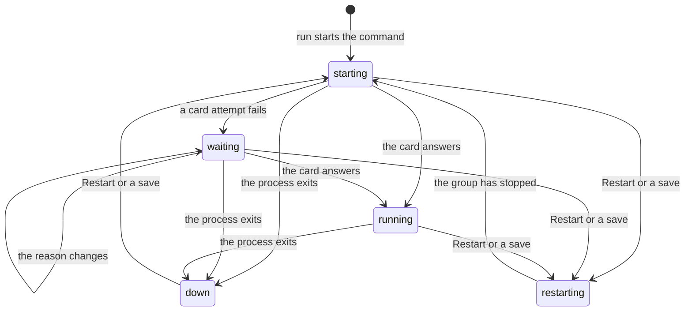

# The agent's process: how Spectra starts, restarts and stops your agent under `run`

This doc explains what Spectra does with your agent's process when you launch it with `a2ui-spectra run -- <command>`: what happens at start and in what order, how the agent is started, restarted from the viewer or on a save, and stopped, what Spectra keeps of the agent's output, and how the agent's process tree is handled on Windows. It is written for the developer of an A2UI agent who uses Spectra and wants to know what Spectra will do to their agent, and why the terminal says what it says. It starts with the problem, follows one restart of upstream's Python restaurant finder, then opens up the rules, and ends with the design decisions and where the code is.

The running example is upstream's Python restaurant finder, `samples/agent/adk/restaurant_finder`, started with its README's command, `uv run .`. Its process is a small tree: `uv` starts Python, and Python runs uvicorn, which serves the agent and its card.

<picture>
  <source media="(prefers-color-scheme: dark)" srcset="diagrams/agent-process-dark.svg">
  
</picture>

## Problem it solves

An agent under development is stopped and started all day. You edit a prompt, restart the agent in one terminal, read its traceback in that terminal, then go back to the browser and send the turn again. Spectra's own picture of the loop is three places, each with its own job: the browser for sending and reading turns, restarting the agent and reading its logs; the terminal for launching Spectra once; and the editor for changing the agent's code, prompt or catalog ([SPEC.md, "Browser, terminal, editor"](../../SPEC.md#browser-terminal-editor)).

Under `a2ui-spectra attach` Spectra watches an agent it did not start, and can do none of this: it cannot restart the agent, it does not see its output, and it does not know when it stops. Under `a2ui-spectra run` Spectra starts the agent's command itself and owns its process. That gives the dev loop its four parts:

1. **Restart** from the viewer, with one press.
2. **Restart on save**: a save in the agent's folder restarts it, unless the agent's own dev server already reloads it.
3. **The logs**: the agent's output, kept beside the turns, in the viewer's logs drawer.
4. **Re-run the last turn** with one press, once the restarted agent is up.

## Five ideas to hold on to

### 1. Spectra outlives the agent

Nothing the agent does ends Spectra. An agent that crashes, exits or never starts leaves Spectra serving, with the agent down and its exit line in the terminal, until you press Restart. Only Ctrl-C or a stop signal ends Spectra. `replay` and `test` keep the opposite rule: an agent that exits mid-run is a failed run ([replay and fixtures](replay-and-fixtures.md)).

### 2. Everything Spectra listens on is up before the agent starts

`run` binds every listener first, the model proxy, the tool proxy, the OpenTelemetry receiver, the wire proxy and the viewer, so a taken port stops Spectra before your command has run, and the agent's first model call finds the proxy already listening. The viewer serves before the agent's card answers, and the card is read again at each start of the command.

### 3. One process group, stopped whole

The command starts in a process group of its own, and everything it starts joins that group: `uv`, the Python it starts, a dev server's children. A stop sends the stop signal to the whole group, waits up to 10 seconds, then force-kills what is left. "Down" means nothing of the group Spectra made is running.

### 4. A restart is the same, whoever asks

Restart in the viewer, `POST /api/agent/restart` and a save of a watched file all ask for the same restart, and it does the same thing in each state the agent is in. Asked for while a restart is already stopping the old process, it adds nothing, and nothing is queued behind it.

### 5. The agent's output is echoed untouched and kept apart from turns

Each chunk the agent writes goes to your terminal as it arrives, on the stream it was written to, and is kept, split into lines, for the viewer. Nothing of the agent's process, its output, its exits or its restarts, goes into a turn record, so a turn recorded under `run` is the same as one recorded under `attach`.

## One restart, end to end

You launch the restaurant finder under Spectra from the sample's folder, open the viewer, and press Restart once the agent is up.

1. **Spectra binds and prints its addresses.** The viewer, the wire proxy, the OpenTelemetry receiver, where turns and fixtures are saved, then what restart on save watches: the sample's folder.
2. **The command starts.** `Starting the agent: uv run . --port 9964`, and the state is `starting`. The agent's environment carries the redirection variables, so its model calls go through the model proxy, and `PYTHONUNBUFFERED=1`, so Python writes each line as it is printed.
3. **The card is waited for.** The first attempt finds nothing listening, `connection refused`, and the state is `waiting`. The line carries a hint about the agent's URL, said until a card has answered once.
4. **The agent comes up.** uvicorn's lines are echoed as uvicorn wrote them, on stderr, with no `a2ui-spectra:` prefix. Its access line for Spectra's card request is on stdout.
5. **The card answers.** `The agent's card answered: Restaurant Agent.`, and the state is `running`. The message box can send.
6. **Restart is pressed.** The state is `restarting`. Spectra cuts the open turns' connections at the wire proxy, sends SIGTERM to the process group, and waits. The signal reaches every process of the group, uvicorn shuts down, and `uv` exits with code 143. The buffer gets a `stopped` divider naming the press and that exit.
7. **The same command starts again**, with the same environment, and the card is waited for, with no hint this time. When it answers, the agent is running again, and you can re-run the turn you were working on.

The terminal, cut from a run of the built binary in upstream's sample folder, `a2ui-spectra run --agent-url http://localhost:9964 --port 9960 --proxy-port 9961 --model-proxy-port 9962 --receiver-port 9963 --no-open -- uv run . --port 9964`, with Restart pressed through `POST /api/agent/restart`, then Ctrl-C. The folder's path and uvicorn's repeated lines are shortened here:

```
a2ui-spectra: The viewer is at http://localhost:9960/
a2ui-spectra: Point a host at the wire proxy: http://127.0.0.1:9961/
a2ui-spectra: The OpenTelemetry receiver is at http://127.0.0.1:9963
a2ui-spectra: Turns are saved in …/restaurant_finder/.a2ui-spectra/turns
a2ui-spectra: Fixtures are saved in …/restaurant_finder/a2ui-spectra-fixtures
a2ui-spectra: A save in …/restaurant_finder restarts the agent. Set watch to false in the config file when the agent reloads itself.
a2ui-spectra: Starting the agent: uv run . --port 9964
a2ui-spectra: Waiting for the agent's card at http://localhost:9964/.well-known/agent-card.json: connection refused. Change the agent's URL with --agent-url, or agent.url in the config file.
…/restaurant_finder/agent.py:185: UserWarning: [EXPERIMENTAL] A2uiInstruction: …
  instruction = A2uiInstruction(
INFO:     Started server process [81200]
INFO:     Waiting for application startup.
INFO:     Application startup complete.
INFO:     Uvicorn running on http://localhost:9964 (Press CTRL+C to quit)
INFO:     ::1:64151 - "GET /.well-known/agent-card.json HTTP/1.1" 200 OK
a2ui-spectra: The agent's card answered: Restaurant Agent.
a2ui-spectra: Restarting the agent: Restart was pressed in the viewer.
INFO:     Shutting down
INFO:     Waiting for application shutdown.
INFO:     Application shutdown complete.
INFO:     Finished server process [81200]
a2ui-spectra: Starting the agent: uv run . --port 9964
a2ui-spectra: Waiting for the agent's card at http://localhost:9964/.well-known/agent-card.json: connection refused.
…
a2ui-spectra: The agent's card answered: Restaurant Agent.
a2ui-spectra: Stopping the agent's process. Press Ctrl-C again to force it.
INFO:     Shutting down
…
INFO:     Finished server process [81298]
```

Spectra exited with 130, 128 plus SIGINT's number. The same run's buffer, as `GET /api/agent/logs` gave it just before the Ctrl-C, with the agent's lines but one left out:

```jsonc
{
  "entries": [
    {
      "n": 1,
      "time": "2026-11-21T04:27:38.949Z",
      "type": "started",
      "command": "uv run . --port 9964",
    },
    // … uvicorn's start-up lines, on stderr
    {
      "n": 8,
      "time": "2026-11-21T04:27:41.980Z",
      "type": "line",
      "stream": "stdout",
      "text": "INFO:     ::1:64151 - \"GET /.well-known/agent-card.json HTTP/1.1\" 200 OK",
    },
    // … uvicorn's shutdown lines, on stderr
    {
      "n": 13,
      "time": "2026-11-21T04:27:42.430Z",
      "type": "stopped",
      "exit": "exited with code 143",
      "cause": {"kind": "press"},
    },
    {
      "n": 14,
      "time": "2026-11-21T04:27:42.430Z",
      "type": "started",
      "command": "uv run . --port 9964",
    },
    // … the second start's lines, up to n 21
  ],
  "lines": 18,
  "cap": 1000,
}
```

The exit is `exited with code 143`, not `was ended by SIGTERM`: the command's own process is `uv`, which exited with 143, 128 plus SIGTERM's number, once Python had ended, rather than being ended by the signal. A command that the signal ends directly reads `was ended by SIGTERM`.

## Inside the machinery

### What `run` does at start, in order

`a2ui-spectra run [--agent-url <url>] [options] -- <command> [args...]`. The command forms and the options are in the [command's README](../../tools/spectra/README.md). At start, `run`, in order:

1. **Reads the command line.** A usage error stops Spectra here.
2. **Reads the config file**, `a2ui-spectra.json` in the working directory, or the file `--config` names. A file that does not read stops Spectra, naming the file, the setting and the problem; the file's general rules are in the [command's README](../../tools/spectra/README.md).
3. **Settles the agent's URL**: `--agent-url`, else the config file's `agent.url` ([the wire](wire.md)). With neither, Spectra stops with a usage error naming both. Then the tool proxy's ports, one per configured tool server.
4. **Opens the store**, `.a2ui-spectra/` in the working directory, and **loads the configured catalogs**; a catalog file that does not load stops Spectra ([the checks](checks.md)).
5. **Says what it read**: `Settings read from <file>` when it read a config file, and `Catalogs configured: <ids>` when there are any. A configured header whose variable is not set is said here too; Spectra carries on, and the message box refuses to send ([the wire](wire.md)).
6. **Checks the tool servers** ([model and tool calls](model-and-tool-calls.md)), then **each path `watch` lists**: one that does not exist stops Spectra with `The watch path <path> does not exist.`
7. **Binds every listener**: the model proxy, the tool proxy's listeners, the OpenTelemetry receiver, the wire proxy, then the viewer's server. A port that is taken stops Spectra before the command has started, naming the option that moves it: `Port 9821 is taken. Choose another port with --proxy-port.` A port the system refuses with an access error, as Windows does for one it has set aside or another program holds with exclusive access, reads `The system would not give Spectra port 9821. Choose another port with --proxy-port.`
8. **Prints the addresses**: the line naming any OpenTelemetry variable it replaced in the agent's environment ([OpenTelemetry](opentelemetry.md)), then `The viewer is at …`, `Point a host at the wire proxy: …`, one line per tool server's listener, `The OpenTelemetry receiver is at …`, `Turns are saved in …` and `Fixtures are saved in …`, whether or not the fixtures folder exists yet.
9. **Says what restart on save watches**, and starts watching ([Restart on save](#restart-on-save)), with the watch of the configured catalog files that no watched folder holds ([the checks](checks.md)).
10. **Starts the command**, `Starting the agent: <command>`, and the card wait.
11. **Opens the browser** at the viewer, unless `--no-open` is given.

From then on Spectra runs until it is stopped. The viewer and the wire proxy serve from step 7, before the card answers. A host turn captured before any card has answered carries no agent name ([the wire](wire.md)).

### The command and its environment

| What                     | Rule                                                                                                                                                                                                                                                                                                                      |
| ------------------------ | ------------------------------------------------------------------------------------------------------------------------------------------------------------------------------------------------------------------------------------------------------------------------------------------------------------------------- |
| How it starts            | Without a shell, the command after `--` and its arguments as given. On Windows it is taken as Bun resolves it, batch files included ([On Windows](#on-windows))                                                                                                                                                           |
| Its working directory    | Spectra's own                                                                                                                                                                                                                                                                                                             |
| Its input                | Empty: `/dev/null` on macOS and Linux, so a read of it ends at once                                                                                                                                                                                                                                                       |
| Its environment          | Spectra's own, with the redirection variables added for the model proxy and each tool server ([model and tool calls](model-and-tool-calls.md)) and the OpenTelemetry receiver's ([OpenTelemetry](opentelemetry.md)). A variable of your own for the agent goes before `a2ui-spectra` on the command line, or in the shell |
| `PYTHONUNBUFFERED=1`     | Set, unless Spectra's own environment sets the variable, when its value is passed on. Python holds its stdout in a block buffer when it is not a terminal, and the agent's stdout is a pipe                                                                                                                               |
| `PYTHONIOENCODING=utf-8` | On Windows only, unless Spectra's environment sets it or `PYTHONUTF8`. Python writes a pipe in the system's ANSI code page there, and Spectra reads the agent's output as UTF-8                                                                                                                                           |
| Its two streams          | Pipes. Each chunk is echoed as it arrives, untouched, on the stream it was written to, stdout to stdout and stderr to stderr, without the `a2ui-spectra:` prefix, and kept ([The agent's output](#the-agents-output))                                                                                                     |
| Its process group        | Its own, so the terminal's Ctrl-C reaches Spectra alone and the agent hears of the stop from Spectra. On Windows, a Job Object ([On Windows](#on-windows))                                                                                                                                                                |

Colour is each tool's own decision for a pipe. uvicorn 0.49.0 colours only when its stdout is a terminal, and reads neither `FORCE_COLOR` nor `NO_COLOR`, so under `run` its lines are plain. A tool that colours a pipe keeps its ANSI codes in your terminal and in the buffer; the viewer strips them when it draws the line.

Spectra's own lines carry the `a2ui-spectra:` prefix, its status lines on stdout and its errors on stderr.

### The card wait

The agent's card is read at each start of the command, and only then. Spectra waits for it with no time limit, at the agent's URL with `/.well-known/agent-card.json` added, sending the configured headers, an attempt every half a second after a miss, each running out after two seconds. The reasons it gives, and what Spectra checks in a card that answers, are the same as under `attach` and are in [the wire](wire.md).

Under `run` the wait ends when the card answers, when the command's own process exits, when a restart stops the process, or when Spectra stops. The wait line is said on the first miss and again whenever the reason changes, and its hint, `Change the agent's URL with --agent-url, or agent.url in the config file.`, only until a card has answered once in the session.

The card is not asked for again until the next start. An agent whose own dev server reloads it keeps the card Spectra last read, the agent's name and the A2A versions the message box speaks included, until Restart is pressed.

### The states

Spectra keeps one state for the agent's process, which `GET /api/agent` gives and the live stream sends as `agent_state` at each change ([the API](api.md)). The message box sends only while the agent is running, and refuses in every other state with a line naming it ([the wire](wire.md)):

| State        | From                                                                             | Until                                                       |
| ------------ | -------------------------------------------------------------------------------- | ----------------------------------------------------------- |
| `starting`   | The command's start                                                              | The first card attempt answers or fails                     |
| `waiting`    | A card attempt that failed, with its reason and the terminal's wait line whole   | The card answers                                            |
| `running`    | The card answering, the process alive                                            | The process exits, or a restart                             |
| `restarting` | A restart of a process still running                                             | The process group has stopped, and the command starts again |
| `down`       | Nothing of the process group running, with the exit line in the terminal's words | A restart                                                   |



The session also records its events, every one, which `GET /api/agent` lists and the stream sends: `agent_restarted`, with the time the restart began and its cause, `{"kind": "press"}` or `{"kind": "save", "file": "prompt_builder.py"}`; and `agent_exited`, with the time and the exit line, for an exit the agent took on its own. A stop a restart makes is not an `agent_exited`. The states and the events carry one `seq`, numbered in one order. This is `GET /api/agent` cut from a run of the built binary on the repository's stub agent, `a2ui-spectra run … -- node stub_agent.js --port 9964 --canned-a2ui`, after a save, a press of Restart, and SIGTERM sent to the stub itself:

```json
{
  "command": "node stub_agent.js --port 9964 --canned-a2ui",
  "state": {"state": "down", "exit": "was ended by SIGTERM", "seq": 15},
  "events": [
    {
      "type": "agent_restarted",
      "seq": 4,
      "time": "2026-11-21T04:20:47.721Z",
      "cause": {"kind": "save", "file": "prompt_builder.py"}
    },
    {
      "type": "agent_restarted",
      "seq": 9,
      "time": "2026-11-21T04:20:48.501Z",
      "cause": {"kind": "press"}
    },
    {
      "type": "agent_exited",
      "seq": 14,
      "time": "2026-11-21T04:20:49.199Z",
      "exit": "was ended by SIGTERM"
    }
  ]
}
```

### An exit

When the command's own process exits and Spectra did not stop it, Spectra stops what is left of its process group, the stop signal then the force-kill after 10 seconds, and only then reports the agent down. This line is cut from the stub agent's run above, at the SIGTERM sent to the stub:

```
a2ui-spectra: The agent's process was ended by SIGTERM. Restart it from the viewer.
```

| The exit line                           | When                                                                                                    |
| --------------------------------------- | ------------------------------------------------------------------------------------------------------- |
| `exited with code 1`                    | The process exited with a code. On Windows the whole code, read past the eight bits Bun 1.4.4 passes on |
| `was ended by SIGTERM`                  | A signal ended it, on macOS and Linux, named as SIGTERM is                                              |
| `could not start: …`                    | The command could not start, with the runtime's reason. Spectra keeps serving, down                     |
| `ended when Spectra asked it to stop`   | On Windows, an end Spectra caused, the agent stopping on the console's Ctrl-Break                       |
| `was ended by Spectra after 10 seconds` | On Windows, an end Spectra caused, the Job Object ended after the grace                                 |
| `was ended by Spectra`                  | On Windows, the Job Object ended at once, when Spectra has no console to send the Ctrl-Break through    |

The terminal's line is `The agent's process <exit line>. Restart it from the viewer.`, with ` before its card answered` after the exit line when the card never answered in that start, as `The agent's process exited with code 1 before its card answered. Restart it from the viewer.`; a command that could not start is said without it. The line is said for an exit the agent took on its own, never for the stop a restart makes. An exit also ends the run of a replay that was running, as a restart does ([What a restart ends](#what-a-restart-ends)).

### The restart

A restart is asked for by Restart in the viewer, by `POST /api/agent/restart`, which answers `202` at once and never waits for the card, or by a save ([Restart on save](#restart-on-save)). It begins with `Restarting the agent: Restart was pressed in the viewer.`, or `Restarting the agent: prompt_builder.py changed.` for a save, and an `agent_restarted` event. Then, by the state it finds:

| The state               | What the restart does                                                                                                                                                                                                                                                                                           |
| ----------------------- | --------------------------------------------------------------------------------------------------------------------------------------------------------------------------------------------------------------------------------------------------------------------------------------------------------------- |
| `running`               | The state goes to `restarting`. Spectra cuts the open turns' connections at the wire proxy, stops the process group, the stop signal then the force-kill after 10 seconds, writes the `stopped` divider with the cause, starts the same command with the same environment, and waits for the card with no limit |
| `starting` or `waiting` | The same: the starting process is stopped, through `restarting`, and the command starts again                                                                                                                                                                                                                   |
| `down`                  | The command starts, and the card is waited for. The ended process's divider was written at its exit, with no cause                                                                                                                                                                                              |
| `restarting`            | Nothing: the restart under way is the one asked for, and none is queued behind it                                                                                                                                                                                                                               |
| Spectra is stopping     | Nothing: nothing is started once Spectra's stop has begun                                                                                                                                                                                                                                                       |

An exit the agent took on its own just before the restart is reported first, its line, its `agent_exited` and the down state, then the restart starts the command. A `stopped` divider waits a quarter of a second at most for the ended process's streams to end, so a stream that something outside the process group still holds open does not hold the restart up; lines arriving later are kept and echoed as they come.

#### What a restart ends

A restart happens at once, with no confirmation; the viewer's Restart says in its tooltip what a press will end ([the viewer](viewer.md)).

- **Every open turn fails**, with the status the wire proxy writes for a broken agent connection ([the wire](wire.md)). The cut reaches the wire only: a cut turn's model and tool calls end by their own rules ([model and tool calls](model-and-tool-calls.md)).
- **A running replay stops**, its remaining turns not sent, with `The agent was restarted.` as the reason; for an exit, the exit's sentence, such as `The agent's process exited with code 1.`, is the reason ([replay and fixtures](replay-and-fixtures.md)). A replay the restart stopped keeps the proxies answering from its record until the agent's process has stopped, so a call the agent makes on its way out, its run going on after the cut, is answered from the record or as a miss and does not reach the provider.
- **Each message box conversation keeps its id and drops its task id**, which named state that lived in the stopped process.

Nothing of the agent's process, its exits or its restarts, goes into a turn record ([the turn record](../../specification/turn_record/v0_1/docs/turn_record.md)).

#### Two waits

- **A non-streaming send can hold the stop to the grace.** With a non-streaming send open on a uvicorn agent, the stop runs to the 10-second grace: uvicorn 0.49.0 goes on waiting for the request's task, which runs until the turn finishes, where a streaming turn's cut ends its wait. The message box streams whenever the card declares streaming, so this is a host app that sends without streaming, or an agent whose card does not declare it.
- **A cut turn can stay open up to five seconds** after the process has gone, the model proxy reading the provider's reply on as it does for any agent that closes its side ([model and tool calls](model-and-tool-calls.md)). Replay refuses meanwhile, as it does for any open turn.

### Restart on save

Under `run` Spectra watches the working directory and restarts the agent on a save. An agent whose own dev server reloads it would be restarted twice, so the config file's `watch` is `false` for it. `attach` has no process to restart, and `replay` and `test` watch nothing.

#### The `watch` setting

`watch`, in the config file, is what restart on save watches. The config file's general rules are in the [command's README](../../tools/spectra/README.md).

```json
{
  "$schema": "https://raw.githubusercontent.com/retz8/a2ui-spectra/main/tools/spectra/src/config.schema.json",
  "watch": [".", "../shared", "!sessions.db"]
}
```

| `watch`             | What is watched                                                                                                                                  |
| ------------------- | ------------------------------------------------------------------------------------------------------------------------------------------------ |
| Left out, or `true` | The working directory, recursively, every file outside the ignore list                                                                           |
| `false`, or `[]`    | Nothing. `false` is for an agent that reloads itself                                                                                             |
| A list              | Everything that is watched. Each entry is a folder, watched recursively, or a single file, relative to the config file's directory when relative |

- **An entry starting with `!`** is excluded from the watch. It is a path, not a pattern.
- **The deepest entry covering a path decides**, so `[".", "!data", "data/prompts"]` watches `data/prompts` and nothing else under `data`. At one depth an exclusion wins over a listing.
- **A listed path that does not exist** stops `run` at start with `The watch path <path> does not exist.` An exclusion that does not exist is not an error, since it may name a file the agent has yet to write.
- **An entry that names no path**, `""` or `"!"`, stops Spectra at start, as any setting that does not read does: `<file>: watch[0] names no path: '!'.`
- **Under `attach`, `replay` and `test`** the setting is read and checked, and has no effect.

Spectra says which at start, before the command starts:

| The line                                                                                                            | When                                                                                 |
| ------------------------------------------------------------------------------------------------------------------- | ------------------------------------------------------------------------------------ |
| `A save in /path/to/agent restarts the agent. Set watch to false in the config file when the agent reloads itself.` | Something is watched; several listed paths are joined with `,` and `or`              |
| `Restart on save is off: watch is false in /path/to/a2ui-spectra.json.`                                             | Nothing is watched: `watch` is `false`, an empty list, or a list of exclusions alone |

#### What a save is

- **The ignore list.** Below a watched folder, these are not watched: every folder whose name starts with a dot, so `.git`, `.venv`, `.wireit` and each tool's cache folder; `node_modules`, `dist`, `build`, `__pycache__` and `venv`; compiled Python files, `.pyc`, `.pyo` and `.pyd`; editors' own files, vim's swap files, backup files ending `~`, JetBrains' safe-write files, Emacs' lock and autosave files, `.DS_Store` and `flycheck_` files; and Spectra's store and its fixtures folder. The file rules follow watchfiles' default filter, and watchexec's for Emacs' autosave files.
- **Hidden files are watched**, so a save of `.env` restarts the agent, and `.gitignore` is not followed.
- **A listed entry that itself names an ignored folder**, such as `dist`, is watched, the ignore list applying below it.
- **Only a file is a save.** A folder made restarts nothing. A path that is gone when the quiet spell ends cannot be told from a removed file, so a folder removed restarts the agent too, unless its name is on the ignore list, and a removed file whose name the ignore list gives a folder, such as `.env` or `build`, restarts nothing.
- **A save restarts the agent 100 ms after the last change**, the quiet spell the fixtures folder's watch and the catalog files' reads use, so an editor's several writes and a branch switch restart once. It does what Restart does in each state ([The restart](#the-restart)); during a restart's cut and stop it adds nothing, and the start that follows reads the files as the save left them.
- **The cause names one file**: the first changed path that still exists when the quiet spell ends, or the first when none does, relative to the working directory when under it and absolute otherwise, and always as `changed`, whether the file was written, created or removed. It is in the terminal's line, on `agent_restarted` as `{"kind": "save", "file": "prompt_builder.py"}`, and on the `stopped` divider.
- **A file the agent writes** beside its source, a session store or a log, would restart it at each write. The terminal names the file in the restart's line, and an exclusion in `watch` leaves it out: `[".", "!sessions.db"]`.
- **A save of the config file** Spectra read, when it lies in a watched folder, restarts nothing: `a2ui-spectra.json changed. Spectra reads it at start, so stop Spectra and start it again to apply it.`

#### How the watch is kept

- **One watch per listed folder.** Each listed folder that no other listed folder holds is watched recursively. A single file listed in `watch` is watched through its folder, not recursively, since a save that replaces the file would end a watch on the file itself.
- **A watch that fails.** A watch that cannot be set up, or that fails while Spectra runs, does not stop Spectra: `Restart on save is off for /path: <the system's reason>. Narrow watch in the config file to the folders that hold the agent's source.` A watched folder that is removed is watched no longer, and is not picked up again when it reappears: `/path is gone, so it is no longer watched. Stop Spectra and start it again to watch it.` Restart in the viewer works throughout.
- **On Linux** the system watches one folder at a time, so the watch walks the whole tree, ignored folders included, one watch per folder in the binary, against the per-user limit `fs.inotify.max_user_watches`. Narrowing `watch` to the folders that hold the agent's source cuts it.
- **One watch for the folders Spectra reads too.** While restart on save watches the folder that holds the fixtures folder, that watch tells the fixtures folder's changes as well, and the fixtures folder has no watch of its own. It tells the changes of the configured catalog files it holds the same way, under an ignored or excluded folder too, where their save restarts nothing and the file is still read again ([the checks](checks.md)). So no watch is opened or closed for them while Spectra runs: on macOS, opening or closing a watch drops the events of every other watch in the process for a moment, in Node as in Bun. Where the fixtures folder has a watch of its own, that watch is reopened when the folder first appears, and a save landing in that moment is lost.
- **Symbolic links.** On macOS a link inside a watched folder is not followed, under Node 22 and in the binary alike: a write in a linked folder, by its real path or through the link, and a write to a linked file's target are not told. Linux is not checked. A linked folder the agent reads is listed in `watch` by its real path.

### The agent's output

Under `run` Spectra keeps what the agent writes, for the viewer's logs drawer. Nothing of it goes into a turn record, and the headless commands, `replay` and `test`, keep nothing: there, the launched agent's output goes to stderr as the agent wrote it ([replay and fixtures](replay-and-fixtures.md)).

- **A line.** Each stream is split on its own. A line ends at a newline, a carriage return just before it dropped; everything else stays as written, ANSI codes and a bare carriage return included. The text is read as UTF-8, a character split across two chunks joined. An unfinished line is held until its newline arrives or the stream ends, and is then a line; the terminal has shown it already.
- **A long line.** A line that reaches 16 KiB is entered as it stands, and what follows continues as the next line, the split never falling inside a character. 16 KiB is where Docker's log copier splits a line.
- **The buffer** is one ordered list of three kinds of entry: `line`, with its `stream`, `stdout` or `stderr`, and its `text`; `started`, with the `command` as launched; and `stopped`, with `exit`, the exit line in the terminal's words, and `cause` when a restart stopped the process. Each entry carries `n`, its number in the buffer's order from 1 for the session, and `time`, the moment it entered the buffer, a line's being the moment it was completed, so the times never go backwards.
- **The cap.** The buffer keeps the last 1,000 output lines, the scrollback of VS Code's integrated terminal. Dividers do not count against it, and a divider leaves when the lines before it have left.
- **The dividers.** `started` is written at every start of the command, the first included. `stopped` is written once for each process that ended, after its last line: with the press or the changed file as its cause when a restart stopped it, and with none when the agent exited on its own. A command that cannot start reads `started`, then `stopped` with its could-not-start line.
- **To the viewer.** `GET /api/agent/logs` gives the buffer, and the live stream sends `agent_log` as entries enter it, the entries one read of the agent's output produced together, with `oldest`, the number of the oldest entry still held, so the cap is applied by Spectra alone ([the API](api.md)). The viewer reads the route on every stream open and merges what the stream gave by `n`.

### In the viewer

Under `run` the page reads the agent's process, its state, its events and its buffer, with the session, and again whenever its live stream comes back. How each part is drawn, the live status, the first screen's three forms, Restart and Logs, the logs drawer and the turn list's restart dividers, is in [the viewer](viewer.md). Two rules tie the page to this doc:

- **The name.** Until a card has answered, the command as launched stands for the agent's name.
- **Re-running the last turn** is Re-run live, in the turn's header: the conversation is sent again up to and including the turn in view, into a new conversation, every model and tool call live ([replay and fixtures](replay-and-fixtures.md)). After a restart it is the one press that brings you back to the turn you were working on. It is off while the message box cannot send, so under `run` in every state but `running`, with the box's reason as its note.

### The terminal's lines

Every line Spectra says about the agent's process, as the code writes it:

| Line                                                                          | When                                                                                                                                                                |
| ----------------------------------------------------------------------------- | ------------------------------------------------------------------------------------------------------------------------------------------------------------------- |
| `Starting the agent: uv run .`                                                | At the launch and at every restart, the command and its arguments as given                                                                                          |
| `Waiting for the agent's card at <card URL>: <reason>.`                       | On the first miss of each start, and whenever the reason changes; with the hint about the agent's URL until a card has answered once                                |
| `The agent's card answered: Restaurant Agent.`                                | Each time a card answers; `The agent's card answered.` for a card with no name. The card check's lines follow when they apply to the new card ([the wire](wire.md)) |
| `Restarting the agent: Restart was pressed in the viewer.`                    | A restart from the viewer or the route                                                                                                                              |
| `Restarting the agent: prompt_builder.py changed.`                            | A restart from a save                                                                                                                                               |
| `The agent's process exited with code 1. Restart it from the viewer.`         | An exit the agent took on its own, with ` before its card answered` when it never answered                                                                          |
| `The agent's process did not stop within 10 seconds, so it was force-killed.` | Whenever the grace runs out, in a restart, after an exit or in Spectra's stop                                                                                       |
| `Stopping the agent's process. Press Ctrl-C again to force it.`               | Spectra's stop begins while the command's own process runs; `Stopping.` otherwise                                                                                   |
| `Forcing the agent's process to stop.`                                        | A second stop while anything of the agent's process group runs, the command's own process or what is left after it exited                                           |
| `Spectra failed while handling the agent's process: <message>`                | An error inside Spectra while it started, restarted or stopped the process                                                                                          |

The restart on save lines are in [Restart on save](#restart-on-save), and the line for a batch file's argument in [On Windows](#on-windows).

### Spectra's stop

Ctrl-C, SIGTERM and SIGHUP stop Spectra on macOS and Linux; on Windows, Ctrl-C, Ctrl-Break and the console window's close ([On Windows](#on-windows)). The first one:

1. **Begins the stop.** `Stopping the agent's process. Press Ctrl-C again to force it.`, or `Stopping.` when the command's own process is not running. The card wait ends, and nothing is started from now on, by a restart or a save.
2. **Closes Spectra's side first**: the watches, the viewer's server, the message box, the wire proxy, the model proxy, a call it cuts off ending as aborted, and the tool proxy; then it waits for the turns still being written.
3. **Stops the agent's process group**, in whatever state the agent is: SIGTERM to the group, then the force-kill after 10 seconds. On Windows the stop signal is a console Ctrl-Break and the group the agent's Job Object.
4. **Closes the OpenTelemetry receiver last**, once the agent has gone, for the spans its exporter flushes as it stops.

A second stop while anything of the agent's process group runs forces it at once, the command's own process or what is left of the group after it exited: `Forcing the agent's process to stop.`, and the group is killed. Spectra exits with 128 plus the number of the signal that began the stop: 130 after Ctrl-C, 143 after SIGTERM, 129 after SIGHUP.

#### Under the npm launcher

Installed from npm, `a2ui-spectra` is the npm launcher, a small Node script that runs the binary of your platform's package with the arguments as given, stays until the binary has ended, then exits with its exit code, or by the signal that ended it ([distribution](distribution.md)).

On macOS and Linux the npm launcher passes SIGTERM and SIGHUP on to the binary, and holds Ctrl-C, which the terminal sends the binary itself. A SIGTERM or SIGHUP sent to the whole process group, as a process manager sends one, therefore reaches the binary twice: directly, and again through the npm launcher. So the npm launcher sets `A2UI_SPECTRA_NPM_LAUNCHER=1` in the binary's environment, and under it:

- **The SIGTERM or SIGHUP that began the stop, arriving again, is the same stop.** It does not force the agent's process to stop, which goes on through its 10-second grace.
- **A second Ctrl-C still forces it**, and so does the other of SIGTERM and SIGHUP.

Without the npm launcher, a second SIGTERM forces the stop as a second Ctrl-C does. The agent's environment does not carry the variable. On Windows the npm launcher holds Ctrl-C, Ctrl-Break and the console's close, which reach the binary directly.

### On Windows

The handling of the agent's process tree below is the compiled binary's. Which Windows Spectra runs on, and the shells it is held to, are in [distribution](distribution.md).

- **The command.** `run`, and `replay` and `test` given a command, take it as Bun resolves it: a bare name is looked for in the working directory, then along `PATH`, as `.exe`, `.cmd`, `.bat`, then `.com`, so `run -- npm run dev` starts `npm.cmd`. A batch file runs through `cmd.exe`, which reads `"`, `%`, `&`, `|`, `<`, `>`, `^` and a line break as its own, so an argument holding one is refused: Spectra does not escape arguments for `cmd.exe`. Such a command, like any that cannot start, leaves the agent down, and the exit line gives Spectra's own reason in place of Bun's. This one is cut from the test `windows/agent_tree.test.ts`, which holds Bun 1.4.4's refusal as the first run on Windows read it: `its argument "a&b" holds "&" that cmd.exe reads as its own, and the command is a batch file, which runs through cmd.exe. Spectra does not escape arguments for cmd.exe: start the program the batch file starts, or a script that passes the argument itself`. The terminal says it as `The agent's process could not start: <the reason>. Restart it from the viewer.`
- **The tree.** The command starts through the Windows launcher, Spectra's own binary started again, detached, so that it leads a process group of its own, in a Job Object Spectra makes, whose processes end when its last handle closes. Spectra puts the Windows launcher into the job before the command starts. The Windows launcher attaches to Spectra's console, starts the command, and leaves the console, so the console's events reach the agent's processes and not it. Every process the command starts is in the job, one whose parent has exited included, and the whole tree ends when Spectra ends, however it ends.
- **The stop.** A stop or a restart asks the tree to stop with a console Ctrl-Break to the Windows launcher's group, waits 10 seconds, then ends the job. An agent receives the Ctrl-Break as SIGBREAK, Node's `process.on('SIGBREAK')` and Python's `signal.SIGBREAK`; without a handler, Node and Python end at once. A process without a console, such as one an agent starts detached, does not receive it, and is ended with the job after the 10 seconds. Under `npm run`, the batch file's `cmd.exe` prints `Terminate batch job (Y/N)?` and, with no input, ends. When Spectra has no console to send the Ctrl-Break through, the job is ended at once.
- **The exit lines.** An end Spectra caused reads `ended when Spectra asked it to stop`, `was ended by Spectra after 10 seconds` when the job was ended after the grace, or `was ended by Spectra` when it was ended at once, in place of `was ended by SIGTERM`. An exit the agent took unasked stays `exited with code N`, with its whole code.
- **Spectra's own stops.** The terminal's Ctrl-C reaches Spectra alone, since the agent's process group ignores it, and the agent hears of the stop from Spectra; a second Ctrl-C forces it. Ctrl-Break and the console window's close are stops too; a Ctrl-Break at the keyboard reaches the agent from the console as well as from Spectra. SIGTERM is not one of them: Windows delivers it to no process, and a SIGTERM listener there never fires. Spectra exits with 128 plus the stop's number: 130 after Ctrl-C, 149 after Ctrl-Break, SIGBREAK being 21, and 129 after the window's close, after which Windows gives a process 5 seconds before it ends it.
- **The environment.** A variable Spectra reads from its own environment is found in any case, and one it sets for the agent replaces yours of that name in any case. `PYTHONIOENCODING=utf-8` is set for the agent as [the table above](#the-command-and-its-environment) says.
- **Paths.** A path Spectra prints is in Windows' own form, with `\` between folders, the file a save names included; a configured catalog file is named as the config file writes it. The config file's paths and the file given to `replay` take either separator, and a fixture's name keeps `/` between folders, as on every platform ([replay and fixtures](replay-and-fixtures.md)).

## When things go wrong

| What happens                                                                    | What you see, and what to do                                                                                                                                                                 |
| ------------------------------------------------------------------------------- | -------------------------------------------------------------------------------------------------------------------------------------------------------------------------------------------- |
| A port Spectra needs is taken                                                   | `Port 9821 is taken. Choose another port with --proxy-port.` before the command starts. Move the port with the option named                                                                  |
| The command cannot start                                                        | The agent is down, `could not start: …`, and Spectra keeps serving. Restart starts the same command, so fix what it needs, or stop Spectra and start it with another command                 |
| The agent crashes                                                               | Down, with the exit line in the terminal, the live status and the first screen; its traceback in the logs drawer. Press Restart after the fix, or save, which restarts it                    |
| The card never answers                                                          | The state stays `waiting`, with the reason. A wrong agent's URL shows here, as `connection refused` or `it answered 404`: change `--agent-url` or `agent.url`                                |
| The agent restarts at each of its own writes                                    | The restart's line names the file it wrote. Exclude it in `watch`: `[".", "!sessions.db"]`                                                                                                   |
| The agent is restarted twice on a save                                          | Its own dev server reloads it too. Set `watch` to `false`                                                                                                                                    |
| A save restarts nothing                                                         | The file is on the ignore list, outside every watched folder, reached through a symbolic link on macOS, or its watch failed and the terminal said so. Restart in the viewer works throughout |
| The watch fails on Linux                                                        | The per-user limit `fs.inotify.max_user_watches` is reached. Narrow `watch` to the folders that hold the agent's source                                                                      |
| A changed config file is not applied                                            | Spectra reads it at start, and says so on a save of it. Stop Spectra and start it again                                                                                                      |
| After a restart, the old agent still answers, and the new one exits on its port | The command put the agent in a group of its own, and its relay of the stop failed. The state reads down with the bind error in the agent's output. Launch the agent's own command directly   |
| A stop or a restart takes 10 seconds                                            | The agent did not stop on SIGTERM, such as uvicorn waiting for a non-streaming request. Press Ctrl-C again to force Spectra's stop                                                           |
| Python's output arrives in bursts                                               | Your own environment sets `PYTHONUNBUFFERED`, and Spectra passes your value on in place of `1`. Set it to `1`, or leave it unset                                                             |
| The agent's output has no colour                                                | The tool colours only a terminal, and the agent's streams are pipes                                                                                                                          |
| On Windows, `could not start: its argument "a&b" holds "&"…`                    | The command is a batch file and an argument holds a character `cmd.exe` reads. Start the program the batch file starts                                                                       |
| Under the npm launcher, a second SIGTERM does not force the stop                | It is the stop's own signal, arriving again through the npm launcher. Press Ctrl-C                                                                                                           |

## Design decisions

| Decision                                                                      | What it buys                                                                                                                                  | What it costs                                                                                                                           |
| ----------------------------------------------------------------------------- | --------------------------------------------------------------------------------------------------------------------------------------------- | --------------------------------------------------------------------------------------------------------------------------------------- |
| Spectra outlives the agent                                                    | A crash leaves the viewer, the turns and the logs where they are, and Restart brings the agent back                                           | Spectra is stopped by hand; the headless commands keep the opposite rule                                                                |
| Every listener binds before the command starts                                | A taken port stops Spectra before the agent has run, and the agent's first model call finds the model proxy listening                         | The viewer serves an agent that is not up yet, and a turn captured before the first card carries no agent name                          |
| The command in a process group of its own, stopped whole                      | `uv`'s Python, a dev server's children and anything else the command started stop with it, and a restart frees the agent's port               | A command that makes a group of its own for the agent is stopped only through its own relay of the signal                               |
| A 10-second grace before the force-kill, as `docker stop` waits               | The agent can finish its shutdown, and its exporter can flush its spans                                                                       | A stop that hangs takes 10 seconds, unless a second Ctrl-C forces it                                                                    |
| One restart for a press and a save, with nothing queued                       | One behaviour to learn, and a burst of saves restarts once                                                                                    | A save during a restart's stop does not restart again; the start that follows reads the files as they are then                          |
| Watch the working directory by default, with an ignore list                   | A save of any source file restarts the agent with no config, and tool folders and editors' files never do                                     | An agent that writes beside its source restarts on its own writes until excluded; on Linux the watch costs one inotify watch per folder |
| The card read at each start only                                              | No polling of the agent                                                                                                                       | An agent its own dev server reloads keeps the card Spectra last read until Restart                                                      |
| Echo each chunk untouched, and keep the lines in a capped buffer              | Your terminal reads as the agent wrote it, and the viewer gets the same lines; 16 KiB per line as Docker splits, 1,000 lines as VS Code keeps | The streams are pipes, so a tool that colours only a terminal prints plain, and Python needs `PYTHONUNBUFFERED`                         |
| Nothing of the agent's process in a turn record                               | A record is the same under `run` and `attach`, and a fixture holds nothing of one machine's session                                           | The logs of a session are gone when Spectra stops                                                                                       |
| Under the npm launcher, the stop's own signal arriving again is the same stop | A process manager's signal to the whole group stops Spectra and the agent cleanly, through the grace                                          | A SIGTERM sent twice on purpose does not force; Ctrl-C does                                                                             |
| A Job Object for the agent's tree on Windows                                  | The whole tree ends when Spectra ends, however it ends, a process whose parent has exited included                                            | Only the compiled binary makes the Windows calls, and a process without a console waits out the grace                                   |

## Known limits

- Spectra stops the process group it made. A command that puts the agent in a group of its own is stopped only through that command's own relay of the signal: wireit 0.15.0-pre.2 does this under the Node restaurant finder's README command, `yarn workspace @a2ui/agent-restaurant-node run start`, starting the agent's `node` detached and relaying the stop to it. When such a command is force-killed after the grace, or dies before relaying, the agent stays on its port: the old agent answers the next card wait, the new process cannot bind the port and exits, and the state reads down with the bind error in the agent's output. Launch the agent's own command directly where the relay is in doubt.
- The card is read at each start of the command alone, so an agent that reloads itself keeps the card Spectra last read until Restart is pressed.
- On macOS a symbolic link inside a watched folder is not followed, and a save in the moment a watch opens is lost. Symbolic links on Linux are not checked.
- On Windows a process without a console, such as one the agent starts detached, does not receive the Ctrl-Break, and is ended with the job after the 10 seconds.
- Run from source under Node on Windows, Spectra stops and restarts the command's own process alone, not the processes it starts, and says so at start: `Under Node on Windows, Spectra stops and restarts the agent's command alone, not the processes it starts. The compiled binary handles the agent's whole process tree.`
- The agent's output is kept for the session only, the last 1,000 lines.

## Trying it

The restaurant finder starts without a model call, so the whole loop can be tried with no key spent. From upstream's `samples/agent/adk/restaurant_finder`, with its environment set up as its README says:

```bash
a2ui-spectra run --agent-url http://localhost:10002 -- uv run .
```

`run` needs the agent's address, from `--agent-url` or the config file's `agent.url`; the restaurant finder serves A2A at `http://localhost:10002`.

Then, in order: wait for `The agent's card answered: Restaurant Agent.`; save `prompt_builder.py` with no change and read `Restarting the agent: prompt_builder.py changed.`; press Restart in the viewer and open Logs to see the two `Stopped` dividers; and press Ctrl-C once, to see the agent's shutdown lines and Spectra's exit.

## Where the code is

| What                                                                                                           | Where                                                                                                                                                                                                                                                                                        |
| -------------------------------------------------------------------------------------------------------------- | -------------------------------------------------------------------------------------------------------------------------------------------------------------------------------------------------------------------------------------------------------------------------------------------- |
| The supervisor: the states, the restart, the exits, the session's events, the card wait at each start          | [`tools/spectra/src/agent_supervisor.ts`](../../tools/spectra/src/agent_supervisor.ts)                                                                                                                                                                                                       |
| Starting the command in its group, the stop with its grace, the exit lines                                     | [`tools/spectra/src/agent_process.ts`](../../tools/spectra/src/agent_process.ts)                                                                                                                                                                                                             |
| The output split into lines, and the buffer with its cap                                                       | [`tools/spectra/src/agent_log.ts`](../../tools/spectra/src/agent_log.ts)                                                                                                                                                                                                                     |
| Restart on save: the rules, the watch, the quiet spell                                                         | [`tools/spectra/src/save_watcher.ts`](../../tools/spectra/src/save_watcher.ts), [`tools/spectra/src/quiet_spell.ts`](../../tools/spectra/src/quiet_spell.ts)                                                                                                                                 |
| The `watch` setting                                                                                            | [`tools/spectra/src/config.ts`](../../tools/spectra/src/config.ts), [`tools/spectra/src/config.schema.json`](../../tools/spectra/src/config.schema.json)                                                                                                                                     |
| `run`'s start in order, Spectra's stop and its signals, the npm launcher's mark                                | [`tools/spectra/src/main.ts`](../../tools/spectra/src/main.ts), for the command line, the config file and the agent's URL; [`tools/spectra/src/session.ts`](../../tools/spectra/src/session.ts)                                                                                              |
| The agent's environment                                                                                        | [`tools/spectra/src/environment.ts`](../../tools/spectra/src/environment.ts)                                                                                                                                                                                                                 |
| The card fetch and the wait                                                                                    | [`tools/spectra/src/agent_card.ts`](../../tools/spectra/src/agent_card.ts)                                                                                                                                                                                                                   |
| The routes `GET /api/agent`, `POST /api/agent/restart` and `GET /api/agent/logs`                               | [`tools/spectra/src/api.ts`](../../tools/spectra/src/api.ts)                                                                                                                                                                                                                                 |
| The process tree on Windows: the Job Object, the Windows launcher, the Win32 calls                             | [`tools/spectra/src/windows/agent_tree.ts`](../../tools/spectra/src/windows/agent_tree.ts), [`tools/spectra/src/windows/launcher.ts`](../../tools/spectra/src/windows/launcher.ts), [`tools/spectra/src/windows/win32.ts`](../../tools/spectra/src/windows/win32.ts)                         |
| The npm launcher                                                                                               | [`tools/spectra/src/npm/launcher.ts`](../../tools/spectra/src/npm/launcher.ts)                                                                                                                                                                                                               |
| The viewer's side: Restart, Re-run's reasons, the first screen's form, the drawer's rows, the restart dividers | [`tools/spectra_viewer/src/model/dev_loop.ts`](../../tools/spectra_viewer/src/model/dev_loop.ts), [`tools/spectra_viewer/src/model/logs.ts`](../../tools/spectra_viewer/src/model/logs.ts), [`tools/spectra_viewer/src/model/restarts.ts`](../../tools/spectra_viewer/src/model/restarts.ts) |
| This doc's diagram, its source and its two exports                                                             | [`docs/design/diagrams/`](diagrams)                                                                                                                                                                                                                                                          |

## Words used in this doc

| Word                 | Meaning                                                                                                                      |
| -------------------- | ---------------------------------------------------------------------------------------------------------------------------- |
| `run`                | `a2ui-spectra run -- <command>`: Spectra starts the agent's command and owns its process                                     |
| `attach`             | `a2ui-spectra attach <agent-url>`: Spectra watches an agent that is already running, which it did not start                  |
| The command          | What follows `--` on `run`'s command line, started as the agent's process                                                    |
| Process group        | The command's own process and every process it starts, signalled together; on Windows, the Job Object that holds them        |
| Job Object           | Windows' container for a group of processes, whose processes all end when its last handle closes                             |
| Supervisor           | The part of Spectra that starts the command, keeps its state, restarts it and stops it                                       |
| The card             | The agent's A2A agent card, at `/.well-known/agent-card.json` under its URL; its answer is how Spectra knows the agent is up |
| The grace            | The 10 seconds a stopped process group gets before it is force-killed                                                        |
| The cut              | Ending the open turns' connections at the wire proxy, the first thing a restart does                                         |
| Quiet spell          | The 100 ms after the last change that a save waits before restarting, so a burst of changes restarts once                    |
| The buffer           | Spectra's list of the agent's output lines and the `started` and `stopped` dividers, the last 1,000 lines                    |
| Divider              | A `started` or `stopped` entry of the buffer, marking a start or an end of the agent's process                               |
| The npm launcher     | The `a2ui-spectra` command an npm install gives, a Node script that runs the platform's binary                               |
| The Windows launcher | Spectra's own binary started again on Windows, to start the command inside the Job Object                                    |
| Stop signal          | SIGTERM on macOS and Linux, a console Ctrl-Break on Windows                                                                  |
