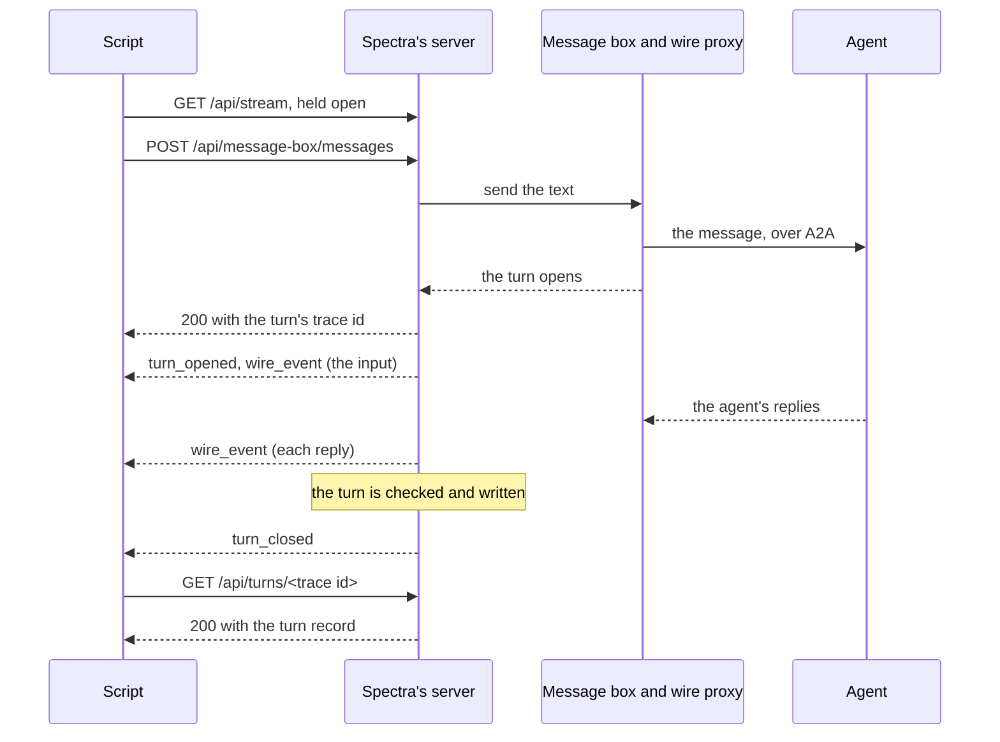

# The API: driving Spectra from a script

This doc explains the routes Spectra's server answers under `/api/` and its live stream. It is written for the developer of an A2UI agent who wants a script, a test harness or a coding agent to drive Spectra: send a message, follow the turn it makes, read its record, save it as a fixture and replay it. The viewer reads everything it shows through the same routes, so the doc also says how the viewer uses them. It starts with the problem and five ideas, follows one message from the send to its record, then gives the reference: who the server answers, the rules every route shares, each route with its request, its answer and its status codes, and the live stream's events and their order. It ends with what goes wrong, the design decisions and where the code is.

The running example is Spectra's own stub agent, [`conformance/stub_agent`](../../conformance/README.md#the-stub-agent), a small agent serving A2A, the Agent2Agent protocol, in its canned A2UI conversation. It answers without a model, so every request and answer below is cut from a real run: its first reply is a form asking for a name, and when the form's Greet button sends its action back, it greets the name.

<picture>
  <source media="(prefers-color-scheme: dark)" srcset="diagrams/api-dark.png">
  
</picture>

## Problem it solves

Spectra sees a turn from several places at once: the wire proxy, the model proxy, the tool proxy and the OpenTelemetry receiver. It checks the turn and writes it to the store. A person sees the result in the viewer. A script needs the same things without a browser:

- to send a message to the agent, or an A2UI action, and know which turn it made;
- to know when that turn has closed, without watching the store's folder;
- to read the turn's record, and the list of turns with their problems counted;
- to save a turn as a fixture and replay it, and to read the verdict;
- under `a2ui-spectra run`, to restart the agent and read its output.

The API is that surface. The viewer has no other way into Spectra: every row of its turn list, every turn view and everything the page asks Spectra to do goes through a route described here, so a script can do whatever the page can.

## Five ideas to hold on to

### 1. The viewer is one caller among others

The page in the browser and a script call the same server, the same routes, with the same answers. No route is the viewer's alone, and the viewer uses no route this doc does not describe. Any number of callers can hold the live stream at once, and each gets every event.

### 2. A route answers what stands now; the stream says what happens next

A `GET` route answers with a snapshot: the turns stored and open, the message box's conversations, the agent's state. The live stream sends each event as it happens, and catches a new subscriber up on the turns still open. A caller that opens the stream first and reads the routes after misses nothing in between, which is what the viewer does each time it connects.

### 3. A send answers when its turn opens

`POST /api/message-box/messages` answers as soon as the wire proxy opens the turn the message made, with the turn's trace id. It does not wait for the agent's reply. Everything after that, the agent's replies, the model and tool calls, the checks and the close, comes on the live stream under that trace id.

### 4. A closed turn's record is a turn record

Once a turn is checked and written, `GET /api/turns/<trace id>` answers with its file from the store: a [turn record](../../specification/turn_record/v0_1/docs/turn_record.md#the-file), the conversation's earlier turns first and this turn last. While the turn is open it has no record, and the route says so with `409`. The events the stream sends are the record's events, in the record's shape.

### 5. Loopback, known names, and changes only as JSON

The server listens on 127.0.0.1 alone. It answers a request only when its `Host` header names the machine itself, or a name the command line allowed. A request that changes anything must say its body is JSON. None of this asks anything of a script on the same machine beyond one header on a `POST`.

## One message, end to end

Spectra runs the stub agent under `run`, its ports moved off the defaults, 9820 to 9824, for this run:

```
a2ui-spectra run --agent-url http://127.0.0.1:9984 --port 9980 --proxy-port 9981 --model-proxy-port 9982 --receiver-port 9983 --no-open -- node conformance/dist/stub_agent/stub_agent.js --port 9984 --canned-a2ui
```

What it printed, the paths shortened:

```
a2ui-spectra: The viewer is at http://localhost:9980/
a2ui-spectra: Point a host at the wire proxy: http://127.0.0.1:9981/
…
a2ui-spectra: Waiting for the agent's card at http://127.0.0.1:9984/.well-known/agent-card.json: connection refused. Change the agent's URL with --agent-url, or agent.url in the config file.
Spectra stub agent at http://127.0.0.1:9984
a2ui-spectra: The agent's card answered: Spectra stub agent.
```



1. **Open the stream.** `curl -N http://localhost:9980/api/stream` holds the stream open; `-N` keeps curl from buffering it. It opens with a comment line, then a heartbeat every two seconds:

   ```
   : Spectra live stream

   event: heartbeat
   data: {}
   ```

2. **Check the box can send.** `GET /api/message-box` answers `{"conversations":[],"a2aVersion":"1.0"}`: no conversations yet, and no `unavailable`, so the box can send, over A2A 1.0.

3. **Send the message.**

   ```bash
   curl -s -X POST http://localhost:9980/api/message-box/messages \
     -H 'content-type: application/json' -d '{"text": "Hello"}'
   ```

   It answers `200` with `{"traceId":"89fa2e3aa418857d11b3d12b6a35dde0"}`. A new conversation has no id yet: the agent names one in its first reply.

4. **Follow the turn.** The stream sends the turn's events as they happen, shortened here:

   ```
   event: turn_opened
   data: {"traceId":"89fa2e3aa418857d11b3d12b6a35dde0","startTime":"2026-11-21T04:20:14.712Z"}

   event: wire_event
   data: {"traceId":"89fa…","event":{…,"name":"wire_input",…,"attributes":{"a2ui.event.kind":"wire_input","a2ui.wire.message":{"role":"user","parts":[{"type":"text","content":"Hello"}]},"a2ui.wire.capabilities":{…}}}}

   event: wire_event
   data: {"traceId":"89fa…","conversationId":"d26bb1a7-cfde-4abb-9cb4-adfc580a8c0d","event":{…,"name":"wire_output",…,"attributes":{"a2ui.event.kind":"wire_output","a2ui.wire.message":{"role":"assistant","parts":[]},…}}}

   event: wire_event
   data: {"traceId":"89fa…","conversationId":"d26bb1a7-…","event":{…,"attributes":{"a2ui.event.kind":"wire_output","a2ui.wire.message":{"role":"assistant","parts":[{"type":"text","content":"What's your name?",…},{"type":"a2ui","content":[{"version":"1.0","createSurface":{"surfaceId":"greeting",…}},…]}]},…}}}

   event: turn_closed
   data: {"traceId":"89fa…","turn":{"events":[{…,"name":"invoke_agent Spectra stub agent",…,"attributes":{"a2ui.event.kind":"turn",…,"a2ui.turn.outcome":"waiting_for_input",…}},…]}}
   ```

   The conversation id arrives with the agent's first reply, and every later event of the turn carries it.

5. **Read the record.** `GET /api/turns/89fa2e3aa418857d11b3d12b6a35dde0` answers with the turn record, its turn event first, then the input, the two replies and the four checks:

   ```jsonc
   {
     "version": "v0.1",
     "turns": [
       {
         "events": [
           {
             "traceId": "89fa2e3aa418857d11b3d12b6a35dde0",
             "spanId": "5a74b0c05ce4e8c1",
             "name": "invoke_agent Spectra stub agent",
             "kind": 3,
             "startTimeUnixNano": "1795234814712014916",
             "endTimeUnixNano": "1795234814744869125",
             "attributes": {
               "a2ui.event.kind": "turn",
               "gen_ai.agent.name": "Spectra stub agent",
               "gen_ai.conversation.id": "d26bb1a7-cfde-4abb-9cb4-adfc580a8c0d",
               "a2ui.turn.outcome": "waiting_for_input",
               "a2ui.turn.protocol_version": "v1.0",
               …
             },
             "status": {"code": 1}
           },
           …
         ]
       }
     ]
   }
   ```

   `GET /api/turns` lists it with the counts the viewer's turn list shows:

   ```json
   {
     "turns": [
       {
         "traceId": "89fa2e3aa418857d11b3d12b6a35dde0",
         "conversationId": "d26bb1a7-cfde-4abb-9cb4-adfc580a8c0d",
         "startTime": "2026-11-21T04:20:14.712Z",
         "outcome": "waiting_for_input",
         "agentName": "Spectra stub agent",
         "durationMs": 32,
         "input": {"text": "Hello"},
         "findings": 0,
         "rejections": 0
       }
     ]
   }
   ```

6. **Continue the conversation.** Once the turn has closed, `GET /api/message-box` names the conversation the box holds:

   ```json
   {
     "conversations": [
       {
         "conversationId": "d26bb1a7-cfde-4abb-9cb4-adfc580a8c0d",
         "turns": ["89fa2e3aa418857d11b3d12b6a35dde0"]
       }
     ],
     "a2aVersion": "1.0"
   }
   ```

   The form's Greet button sends an A2UI action. A script sends it with the conversation's id and the surface's data model, as the viewer does when the button is pressed in the preview:

   ```bash
   curl -s -X POST http://localhost:9980/api/message-box/messages \
     -H 'content-type: application/json' -d '{
       "action": {"version": "1.0", "action": {"name": "greet", "surfaceId": "greeting",
         "sourceComponentId": "greet", "timestamp": "2026-11-21T04:21:00.000Z", "context": {"name": "Ada"}}},
       "dataModel": {"version": "1.0", "surfaces": {"greeting": {"greeting": "Hello!", "name": "Ada"}}},
       "conversationId": "d26bb1a7-cfde-4abb-9cb4-adfc580a8c0d"}'
   ```

   It answers `{"traceId":"0c2700058687af3002baba36ee9ccf75","conversationId":"d26bb1a7-cfde-4abb-9cb4-adfc580a8c0d"}`. The stub's reply on the stream holds "Hello, Ada!", the data model it was sent, echoed as text, and one `updateDataModel` for the surface `greeting`, and the turn closes `completed`.

## Inside the machinery

### Who the server answers

The server serves the viewer's page and its API on one port, `--port`, 9820 by default.

- **It listens on loopback alone,** on 127.0.0.1. Another machine cannot reach it.
- **It answers a request only by its `Host` header.** The names it always answers are `localhost`, `127.0.0.1` and `[::1]`. A name given with `--allow-host`, such as a tunnel's, is answered as well; the option can be repeated, and it is in the command's [options table](../../tools/spectra/README.md). The check applies to every request, the page and its files included.
- **Ports and allowed hosts are command-line only.** The config file has no setting for either.
- **The server exists under `run` and `attach`.** Under `run` it serves from the start, before the agent's command starts; under `attach` it starts once the agent's card has answered. `replay` and `test` run headless, with no server and no API. What each command does at start, in order, is in the [agent's process doc](agent-process.md) and the [wire doc](wire.md).

How a `Host` header is read:

| Step               | Rule                                                                                                                                                                                                                                                                                                                                           |
| ------------------ | ---------------------------------------------------------------------------------------------------------------------------------------------------------------------------------------------------------------------------------------------------------------------------------------------------------------------------------------------- |
| The header's name  | Lowercased, and its port dropped: `LOCALHOST:9980` is `localhost`. A bracketed IPv6 address keeps its brackets, `[::1]:9980` being `[::1]`. One trailing dot is dropped                                                                                                                                                                        |
| A name allowed     | `--allow-host`'s value, trimmed and lowercased, and one trailing dot dropped, as the header's is. A value that is then empty, or holds a `:` outside a bracketed IPv6 address, as a scheme or a port does, a `/`, an `@` or white space, stops Spectra at start with `--allow-host takes a host name without a scheme or port, not '<value>'.` |
| A name not allowed | `403`, as plain text: `Blocked request: this host is not allowed. To allow it, start Spectra with --allow-host <name>.`                                                                                                                                                                                                                        |
| No `Host` header   | Refused. Spectra answers `403`, and the HTTP server itself answers `400` first for an HTTP/1.1 request, which must carry one                                                                                                                                                                                                                   |

### What every route shares

- **Answers are JSON**, `application/json; charset=utf-8`, with `cache-control: no-store` and `x-content-type-options: nosniff`. The host check's `403` and the `415` below are plain text, and the live stream is server-sent events.
- **A refusal is one line,** `{"error": "<line>"}`, written to be shown as it is. A fixture name's clash adds `suggested`.
- **A request that changes anything is JSON.** Any method other than `GET` and `HEAD` needs `content-type: application/json`, parameters after `;` allowed, in any case. Without it the answer is `415`, as plain text, `Only JSON is accepted.`, before the route is looked at: this holds for every path, an unknown one included. curl's `-d` sends `application/x-www-form-urlencoded` unless told otherwise.
- **A body is read up to 64 KiB.** A larger body, or one that is not JSON, is read as no body, and the route answers `400` with its own line.
- **A known path asked with another method** is `405`, `{"error":"GET is not allowed here."}` with the method named. `HEAD` on a route is `405` too.
- **An unknown path under `/api/`** is `404`, `{"error":"Not found."}`. A trace id in a path is 32 lowercase hexadecimal characters; anything else there is an unknown path.
- **A failure no route expected** is `500`, with the failure's message as `error`.
- **Times** are ISO 8601 in UTC to the millisecond, such as `2026-11-21T04:20:14.712Z`. A record's own times stay as the record writes them, nanoseconds as decimal strings.
- **No cross-origin resource sharing (CORS) headers are sent.** A page from another origin cannot read an answer.

### The session and the agent's process

**`GET /api/context`**, the session, as the viewer's context bar, the agent's popover and the first screen show it. Cut from the run above:

```json
{
  "version": "0.1.0",
  "agentUrl": "http://127.0.0.1:9984/",
  "mode": "run",
  "proxyAddress": "http://127.0.0.1:9981/",
  "previewPages": [],
  "fixturesFolder": "a2ui-spectra-fixtures",
  "agentName": "Spectra stub agent",
  "a2aVersions": ["1.0", "0.3"],
  "a2uiExtensions": [],
  "examples": ["Hello"]
}
```

| Field            | When                                        | Meaning                                                                                                                                                                                                                                                              |
| ---------------- | ------------------------------------------- | -------------------------------------------------------------------------------------------------------------------------------------------------------------------------------------------------------------------------------------------------------------------- |
| `version`        | always                                      | This Spectra's version                                                                                                                                                                                                                                               |
| `agentUrl`       | always                                      | The agent's URL Spectra was given, as a URL with its path: `http://127.0.0.1:9984/`                                                                                                                                                                                  |
| `mode`           | always                                      | `"run"` or `"attach"`                                                                                                                                                                                                                                                |
| `proxyAddress`   | always                                      | The wire proxy's address, for a host app to point at                                                                                                                                                                                                                 |
| `previewPages`   | always                                      | The config file's preview pages, in config order                                                                                                                                                                                                                     |
| `fixturesFolder` | always                                      | The fixtures folder's path as shown, relative to the working directory when under it                                                                                                                                                                                 |
| `variables`      | under `attach`                              | The variables and values `attach` prints, each `{"name", "value", "note"}`, the note the comment `attach` prints beside it, where the variable forwards or what it is for: the model proxy's five, then each tool server's in config order, then the receiver's four |
| `shells`         | under `attach`                              | The shells the first screen writes the variables for: `["posix"]` on macOS and Linux, `["powershell", "cmd"]` on Windows                                                                                                                                             |
| `agentName`      | once a card has answered, when it names one | The name on the agent's card                                                                                                                                                                                                                                         |
| `a2aVersions`    | once a card has answered                    | The A2A versions the card states, each once, in card order: those of its JSON-RPC entries of `supportedInterfaces` in A2A 1.0, or its `protocolVersion` in A2A 0.3                                                                                                   |
| `a2uiExtensions` | once a card has answered                    | Each A2UI extension in the card's `capabilities.extensions`, in card order: `version`, the version its URI names, and `catalogIds`, its `supportedCatalogIds`                                                                                                        |
| `examples`       | once a card has answered                    | The first example of each of the card's skills, trimmed, in card order                                                                                                                                                                                               |

What the card states is the card's at start under `attach`. Under `run` it is the latest card's, read at each start of the agent's command, and replaced whole by a later card; before any card has answered, the four card fields are absent. The context has no event of its own: `agent_state` is sent once the context reflects the change.

**`GET /api/agent`**, under `run`, the agent's process. Cut from the run above after one restart:

```json
{
  "command": "node …/conformance/dist/stub_agent/stub_agent.js --port 9984 --canned-a2ui",
  "state": {"state": "running", "seq": 8},
  "events": [
    {
      "type": "agent_restarted",
      "seq": 4,
      "time": "2026-11-21T04:21:59.243Z",
      "cause": {"kind": "press"}
    }
  ]
}
```

- `command`, the command as launched, its arguments as given.
- `state`, the state as it stands, with `seq`:

  | `state`      | Meaning                                                                                                              |
  | ------------ | -------------------------------------------------------------------------------------------------------------------- |
  | `starting`   | From the command's start until the first attempt at the card has failed or answered                                  |
  | `waiting`    | No card yet, with `reason`, why, in the terminal's words, and `line`, the terminal's wait line whole                 |
  | `running`    | The process alive and its card answered once                                                                         |
  | `restarting` | During the cut and the stop of a restart                                                                             |
  | `down`       | Nothing of the process group running, with `exit`, the exit line in the terminal's words after "The agent's process" |

- `events`, every restart of the session and every exit the agent took on its own, oldest first, in the live stream's form with `type`: `agent_restarted` with `seq`, `time` and `cause`, or `agent_exited` with `seq`, `time` and `exit`.

`seq` numbers the state and the events in one order, shared with the stream's `agent_state`, `agent_restarted` and `agent_exited`, so what the route and the stream both gave merges without loss: keep everything with a `seq` above the route's. What each state and each restart does is in the [agent's process doc](agent-process.md).

**`POST /api/agent/restart`**, under `run`, restarts the agent's process. It answers `202` with `{"accepted":true}` at once, never waiting for the card, and the progress comes on the stream. The body is not read, but the request is JSON like every change: the viewer sends `{}`. While a restart is already on its way, another adds nothing and still answers `202`.

**`GET /api/agent/logs`**, under `run`, the agent's output as Spectra's buffer holds it:

```json
{
  "entries": [
    {
      "n": 1,
      "time": "2026-11-21T04:19:52.803Z",
      "type": "started",
      "command": "node …/stub_agent.js --port 9984 --canned-a2ui"
    },
    {
      "n": 2,
      "time": "2026-11-21T04:19:53.019Z",
      "type": "line",
      "stream": "stdout",
      "text": "Spectra stub agent at http://127.0.0.1:9984"
    }
  ],
  "lines": 1,
  "cap": 1000
}
```

`entries` are oldest first, each numbered `n` from 1 for the session, with `time`, the moment it entered the buffer, and its `type`: `line`, with `stream`, `stdout` or `stderr`, and `text`; `started`, a divider with `command`; or `stopped`, a divider with `exit` and, when a restart stopped the process, `cause`. `lines` is how many of the entries are output lines, and `cap` is how many output lines the buffer keeps. How lines are split and the cap applied is in the [agent's process doc](agent-process.md).

Under `attach`, where Spectra did not start the agent, the three agent routes answer `404`:

| Route                     | Line                                                                |
| ------------------------- | ------------------------------------------------------------------- |
| `GET /api/agent`          | `Spectra did not start this agent, so it has no process to report.` |
| `POST /api/agent/restart` | `Spectra did not start this agent, so it cannot restart it.`        |
| `GET /api/agent/logs`     | `Spectra did not start this agent, so it has no logs to report.`    |

### Turns

**`GET /api/turns`** answers `{"turns": [...]}`, newest first by start time. Of turns that started in the same millisecond, the open ones come first, the latest opened first, then the stored ones by their file's path within the store, the later path first. It lists the store's turns, those of earlier runs in the same working directory included, the turns kept in memory after a failed write, and the turns open now. Every turn from every host is there: the message box's, a host app's pointed at the wire proxy, and a replay's.

| Field               | On                                 | Meaning                                                                                                                                                |
| ------------------- | ---------------------------------- | ------------------------------------------------------------------------------------------------------------------------------------------------------ |
| `traceId`           | every turn                         | The turn's trace id                                                                                                                                    |
| `conversationId`    | a turn whose conversation is named | Its conversation, the A2A `contextId`                                                                                                                  |
| `startTime`         | every turn                         | When it started                                                                                                                                        |
| `input`             | a turn whose input has arrived     | The host's input in brief, below                                                                                                                       |
| `open`              | an open turn                       | `true`                                                                                                                                                 |
| `outcome`           | a closed turn                      | The turn's outcome, as [the turn event](../../specification/turn_record/v0_1/docs/turn_record.md#turn) records it                                      |
| `agentName`         | a closed turn naming its agent     | The agent's name                                                                                                                                       |
| `durationMs`        | a closed turn                      | From the turn's start to its end, in milliseconds                                                                                                      |
| `findings`          | a closed turn with check events    | The findings of its four checks together                                                                                                               |
| `rejections`        | a closed turn                      | How many of its A2UI messages web core's message processor rejects that no finding points into, below                                                  |
| `failedCalls`       | a closed turn, when any failed     | How many of its call rows failed, below                                                                                                                |
| `a2uiStepErrors`    | a closed turn, when any            | The A2UI step's errors: each `exception` span event of a `parse` event, a failed `parse` that carries none, and a failed `prompt_generation`, each one |
| `replayDifferences` | a replayed turn, when any          | How many of its verdict's reasons are a different outcome or different A2UI: the reasons other than a miss, which `failedCalls` counts                 |
| `unwritten`         | a turn kept in memory              | `true`: its record was not written to the store and is kept until Spectra stops. It has no file to replay or re-run, and can be saved as a fixture     |
| `newer`             | a stored turn of a newer record    | The record's version, newer than this Spectra reads. The turn carries nothing else of its record, and is not opened, saved as a fixture or replayed    |

A stored turn whose file does not read as a record at all is listed with its trace id, conversation and start time alone.

**A turn's `input`** is `{"text": …}`, the host's first text part that is not blank, its white space collapsed; else `{"action": …}`, the name of the A2UI action it sent, in `action` or v0.8's `userAction`; else `{"partType": …}`, the type of its first part. An open turn has it once its input has arrived.

**A turn's `rejections`** come from feeding the agent's A2UI messages of the conversation's earlier turns, then the turn's own, one by one into upstream web core's message processor in its relaxed validation mode, as the viewer's conversation replay does. Every catalog the registry knows is registered, the catalogs the conversation's hosts sent inline are built from their messages, and a stand-in stands under any other catalog id the messages name. Each of the turn's own messages the processor throws on counts, so a bad property on a configured catalog's component counts as the basic catalog's does, unless a check finding points into the message: then the rejection folds under the finding and is not counted on its own. The count is not recorded in the turn record.

**A turn's `failedCalls`** counts the turn's call rows as the viewer's timeline draws them. Each event a proxy wrote is a row, with the received call spans linked to it; a chain of nested received spans of one kind with no exchange is a row of its own. A row failed when its proxy's event or any span of its chain ended with status `2`, the error, model and tool alike, and it counts once.

The fields of a stored turn are read from its record, and read again when an export to the receiver amends the file or a catalog definition is read again, so the counts follow the definitions in force.

**`GET /api/turns/<trace id>`** answers with a closed turn's record: its file's turn record, the conversation's earlier turns included.

| Status | When                                                     | Line                                                                                                                      |
| ------ | -------------------------------------------------------- | ------------------------------------------------------------------------------------------------------------------------- |
| `200`  | The turn is closed                                       | The record                                                                                                                |
| `409`  | The turn is still open                                   | `The turn is still open, so it has no record yet.`                                                                        |
| `404`  | No turn has the trace id                                 | `No turn has this trace id.`                                                                                              |
| `422`  | The record is of a version newer than this Spectra reads | The newer line, as the turn record's [Versions](../../specification/turn_record/v0_1/docs/turn_record.md#versions) has it |
| `422`  | The stored file does not read as a record at all         | The reason, such as `The file is not JSON: …`                                                                             |

### The message box

The message box is Spectra's own host, which sends to the agent through the wire proxy; what it puts in each request is in the [wire doc](wire.md).

**`GET /api/message-box`**, its state:

| Field            | When                                                                       | Meaning                                                                                                                                                                                                                                                                                                                               |
| ---------------- | -------------------------------------------------------------------------- | ------------------------------------------------------------------------------------------------------------------------------------------------------------------------------------------------------------------------------------------------------------------------------------------------------------------------------------- |
| `conversations`  | always                                                                     | The conversations the box started in this run, a replay's included, oldest first: each one's `conversationId`, once the agent has named one and the box has taken it, after the conversation's first turn closes; `turns`, the trace ids of the turns the box sent in it, oldest first; and `openTurn`, the trace id of its open turn |
| `unavailable`    | while the box cannot send                                                  | The line it refuses a send or a replay with; the lines and the order they apply in are in the [wire doc](wire.md)                                                                                                                                                                                                                     |
| `unsetVariables` | when any                                                                   | The variables the configured headers name that are not set in Spectra's environment                                                                                                                                                                                                                                                   |
| `noJsonRpc`      | while the agent runs and its card lists no A2A JSON-RPC interface, or none | `true`: no turn can start, from the box or from a host app pointed at the wire proxy                                                                                                                                                                                                                                                  |
| `a2aVersion`     | when the card lists an interface the box speaks                            | `"0.3"` or `"1.0"`, the A2A version of the interface the box sends to                                                                                                                                                                                                                                                                 |
| `replay`         | while a replay runs                                                        | `source`, the record's path; `mode`; `turn`, the number of the turn being replayed, `0` before the first opens; and `turns`, the total                                                                                                                                                                                                |

Cut from the run above, while the agent restarted:

```json
{"conversations":[{"conversationId":"d26bb1a7-cfde-4abb-9cb4-adfc580a8c0d","turns":["89fa2e3aa418857d11b3d12b6a35dde0","0c2700058687af3002baba36ee9ccf75"]},…],"unavailable":"Can't send · the agent is restarting","a2aVersion":"1.0"}
```

**`POST /api/message-box/messages`** sends a message:

| Field            | Meaning                                                                                                                                         |
| ---------------- | ----------------------------------------------------------------------------------------------------------------------------------------------- |
| `text`           | The text to send, not blank                                                                                                                     |
| `action`         | An A2UI action message, `{"version": "<its version>", "action": {…}}`, as the viewer builds it from a press in the preview. Never beside `text` |
| `dataModel`      | The data model map, `{"version": "<its version>", "surfaces": {…}}`, of the surfaces that asked for their data model, when given                |
| `conversationId` | The conversation of the box's to continue. Without it, a text starts a new conversation; an action only continues one                           |

It answers `200` once the wire proxy has opened the turn, with `traceId` and, when continuing a conversation, `conversationId`. The refusals, in the order they are checked:

| Status | When                                                              | Line                                                                                                                  |
| ------ | ----------------------------------------------------------------- | --------------------------------------------------------------------------------------------------------------------- |
| `400`  | The body is not JSON, or larger than 64 KiB                       | `The body is not JSON, or is too large.`                                                                              |
| `400`  | Both `text` and `action`                                          | `Send a text or an action, not both.`                                                                                 |
| `400`  | An `action` without a string `version` and an object `action`     | `An action is an A2UI action message: {"version": "<its version>", "action": {…}}.`                                   |
| `400`  | No `action`, and `text` missing or blank                          | `Send {"text": "<the message>"} with some text.`                                                                      |
| `400`  | A `dataModel` without a string `version` and an object `surfaces` | `A dataModel is an A2UI data model: {"version": "<its version>", "surfaces": {…}}.`                                   |
| `400`  | A `conversationId` that is not a string                           | `A conversationId is a string.`                                                                                       |
| `422`  | The box cannot send to the agent                                  | The `unavailable` line, such as `Can't send · the agent is restarting`                                                |
| `409`  | A replay is running                                               | `A replay is running. The message box sends again once it ends.`                                                      |
| `400`  | An action with no `conversationId`                                | `An action continues a conversation the message box started. Send it with that conversationId.`                       |
| `404`  | A conversation the box did not start in this run                  | `The message box did not start this conversation while Spectra runs. Send without a conversation to start a new one.` |
| `409`  | The conversation's last turn is still open                        | `A turn is still open in this conversation. Wait for it to close, or start a new conversation.`                       |
| `502`  | The wire proxy cannot be reached                                  | `The message box could not reach the wire proxy: <the reason>`                                                        |

A conversation is continued by the id the box holds for it, so a conversation started by a host app, or by an earlier run of Spectra, is a `404`. One turn at a time in each conversation: a send in another conversation, or in a new one, goes ahead while one is open.

### Fixtures and replays

The fixtures folder, the name rule, the replay modes and the verdict are in the [replay and fixtures doc](replay-and-fixtures.md). The routes:

**`GET /api/fixtures`** lists the folder. Cut from the run above, after the greeting turn was saved, its conversation's first turn with it:

```json
{
  "folder": "a2ui-spectra-fixtures",
  "fixtures": [
    {
      "name": "greet-ada",
      "path": "a2ui-spectra-fixtures/greet-ada.json",
      "savedAt": "2026-11-21T04:21:32.367Z",
      "turns": [
        {"traceId": "89fa2e3aa418857d11b3d12b6a35dde0", …, "outcome": "waiting_for_input", "input": {"text": "Hello"}, "findings": 0, "rejections": 0},
        {"traceId": "0c2700058687af3002baba36ee9ccf75", …, "outcome": "completed", "input": {"action": "greet"}, "findings": 0, "rejections": 0}
      ]
    }
  ]
}
```

`folder` is the folder's path, relative to the working directory when under it. `fixtures` holds every `.json` file under it, recursively, in path order: `name`, its path relative to the folder without `.json`, `/` between folders; `path`; `savedAt`, the file's modification time; and either `turns`, the record's turns oldest first in `GET /api/turns`' form, or `error`, why the file does not read as a turn record.

**`GET /api/fixtures/<name>`** answers with the fixture's record. A name in a folder keeps its `/`, each segment encoded on its own. Any name the listing gives reads, a file dropped in by hand under a name the save's rule refuses included. `404`, `No fixture is named <name>.`, for an unknown name, or one with an empty, `.` or `..` segment or a `\`; `422`, with the reason, for a file that does not read as a record. A name whose percent-encoding does not decode is a `400`, `The fixture's name in the path does not decode: its percent-encoding is not valid.`

**`POST /api/fixtures`** saves `{"traceId": "…", "name": "…"}`: the stored turn's record whole, the conversation's earlier turns included, as `<name>.json` at the top of the folder. It answers `201` with `name` and `path`, here `{"name":"greet-ada","path":"a2ui-spectra-fixtures/greet-ada.json"}`. A turn kept in memory after a failed write can be saved. The refusals, in order:

| Status | When                                                  | Line                                                                                                                                                           |
| ------ | ----------------------------------------------------- | -------------------------------------------------------------------------------------------------------------------------------------------------------------- |
| `400`  | A body without a string `traceId` and a string `name` | `Save with {"traceId": "<the turn's trace id>", "name": "<the fixture's name>"}.`                                                                              |
| `409`  | The turn is still open                                | `The turn is still open, so it has no record yet.`                                                                                                             |
| `404`  | No turn has the trace id                              | `No turn has this trace id.`                                                                                                                                   |
| `422`  | The record is of a newer version                      | The newer line                                                                                                                                                 |
| `422`  | The stored file does not read as a record at all      | The reason                                                                                                                                                     |
| `400`  | A name outside the rule                               | `A fixture's name uses letters, digits, '-', '_' and '.', and does not start with a dot.`                                                                      |
| `400`  | A name Windows reserves for a device                  | `A fixture's name is not CON, PRN, AUX, NUL, COM1 to COM9 or LPT1 to LPT9, alone or before a dot: Windows reserves them for devices and cannot hold the file.` |
| `409`  | A name the folder holds                               | `a2ui-spectra-fixtures/greet-ada.json exists already.`, with `suggested`, the first free numbered name: `"greet-ada-2"`                                        |
| `500`  | The write failed                                      | The system's reason                                                                                                                                            |

**`POST /api/replays`** starts a replay:

- `source`, either `{"fixture": "<name>"}` or `{"traceId": "<a stored turn's trace id>"}`, a store turn replaying from its file. A fixture source may carry `"turn"`, the recorded trace id of one of the fixture's turns: the record is cut after that turn, in every mode, so the turns sent are the fixture's up to and including it. Without it the whole fixture is sent.
- `mode`, `"recorded"`, `"model_live"` or `"live"`.

It answers `202` once the first turn opens, with that turn's `traceId` and `turns`, how many turns are sent; the rest runs on, and the stream reports it. Cut from the run above, a live replay of the fixture: `{"traceId":"d5253cdd3b0bb362587f79661ec87230","turns":2}`. The refusals, in order:

| Status | When                                                                                                         | Line                                                                                                                                                                                                                     |
| ------ | ------------------------------------------------------------------------------------------------------------ | ------------------------------------------------------------------------------------------------------------------------------------------------------------------------------------------------------------------------ |
| `400`  | Not one source of the two, a `turn` that is not a string or sits beside `traceId`, or another mode           | `Replay with {"source": {"fixture": "<name>"} or {"traceId": "<a turn's trace id>"}, "mode": "recorded", "model_live" or "live"}. A fixture source may carry "turn", the trace id of the turn of the fixture to end at.` |
| `404`  | An unknown fixture                                                                                           | `No fixture is named <name>.`                                                                                                                                                                                            |
| `422`  | A fixture that does not read as a record                                                                     | The reason                                                                                                                                                                                                               |
| `404`  | A `turn` the fixture does not hold                                                                           | `The fixture <name> holds no turn with this trace id.`                                                                                                                                                                   |
| `409`  | A store turn still open                                                                                      | `The turn is still open, so it has no record yet.`                                                                                                                                                                       |
| `404`  | An unknown store turn                                                                                        | `No turn has this trace id.`                                                                                                                                                                                             |
| `422`  | A store turn of a newer record                                                                               | The newer line                                                                                                                                                                                                           |
| `422`  | A store turn whose file does not read as a record at all                                                     | The reason                                                                                                                                                                                                               |
| `422`  | A store turn whose record was not written                                                                    | `The turn's record was not written to the store, so there is no file to replay. Save it as a fixture first.`                                                                                                             |
| `422`  | The box cannot send                                                                                          | The `unavailable` line                                                                                                                                                                                                   |
| `409`  | A replay runs                                                                                                | `A replay is running. Wait for it to end.`                                                                                                                                                                               |
| `409`  | A turn is open anywhere                                                                                      | `A turn is open. Wait for it to close before replaying.`                                                                                                                                                                 |
| `422`  | A record the replay cannot send                                                                              | The reason                                                                                                                                                                                                               |
| `422`  | `recorded` on a record with no model call or tool call the proxies can answer with, judged on the cut record | `The record holds no model call or tool call the proxies can answer with, so there is nothing to serve with everything recorded. Replay it with the model live.`                                                         |
| `502`  | The first turn cannot reach the wire proxy                                                                   | `The message box could not reach the wire proxy: <the reason>`                                                                                                                                                           |

### Catalogs, prices and the config schema

**`GET /api/catalogs`** answers `{"catalogs": [...]}`, the catalog definitions Spectra knows, the built-in ones, then the configured ones in config order. Cut from the run above, each `definition` left out:

```json
{"catalogs":[
  {"id":"https://a2ui.org/specification/v0_9/catalogs/basic/catalog.json","aliases":["https://a2ui.org/specification/v0_9_1/catalogs/basic/catalog.json"],"protocolVersion":"0.9","source":"built-in","title":"A2UI Basic Catalog","definition":{…}},
  {"id":"https://a2ui.org/specification/v1_0/catalogs/basic/catalog.json","aliases":[],"protocolVersion":"1.0","source":"built-in","title":"A2UI Basic Catalog","definition":{…}}
]}
```

Each one's `id`; `aliases`, the other ids it answers to; `protocolVersion`, as web core reads it, `0.9` or `1.0`; `source`, `built-in` or `configured`; `title`, when its definition carries one; and `definition`, the definition itself. A configured one also carries `path`, its file's path as the config file names it; `readTime`, when the definition in force was read; and, while its file's latest read stands failed, `failedRead`, `{"time", "error"}`, the error being the reason without the file's path. A changed catalog file and the registry are in the [checks doc](checks.md).

**`GET /api/prices`** answers the price table as Spectra copied it from LiteLLM: `release`, here `v1.106.6`; its `date`, here `2026-10-28`; `entries`, the table's entries keyed as the release keys them; and `overrides`, the config file's `prices`. The table and how a cost is estimated from it are in the [model and tool calls doc](model-and-tool-calls.md).

**`GET /api/config.schema.json`** answers the JSON Schema the config file is validated against, the copy built into this Spectra. Its `$id` is the schema's raw address on GitHub at `main`, `https://raw.githubusercontent.com/retz8/a2ui-spectra/main/tools/spectra/src/config.schema.json`, the address a config file's `$schema` names for an editor. The config file's general rules are in the command's [README](../../tools/spectra/README.md).

### The live stream

**`GET /api/stream`** answers with server-sent events, the format a browser's `EventSource` reads: `content-type: text/event-stream; charset=utf-8`, `cache-control: no-store`, `x-content-type-options: nosniff`. The stream opens with the comment line `: Spectra live stream`. Each event is an `event:` line naming it and a `data:` line holding its JSON, then a blank line. Events carry no `id:`, so a stream opened again does not resume where the last one stopped: it catches up as a new subscriber does.

**Catching up.** A new subscriber first receives, for each open turn in the order the turns opened:

1. its `turn_opened`, with the conversation id once a reply has named it;
2. its `wire_event`s so far;
3. for each call placed in it, in the order the calls started: its `call_started`, its `call_chunk`s so far, then its `call_ended` when the call has ended, else its latest `call_progress`;
4. one `turn_amended` with every event the receiver placed or changed in it so far, the latest of each span id, when there are any.

Then every event as it comes. Closed turns, the agent's state, the agent's output and a running replay are not caught up: read them from `GET /api/turns`, `GET /api/agent`, `GET /api/agent/logs` and `GET /api/message-box`.

**The events.**

| Event              | Data                                                | When, and what it carries                                                                                                                                                                                                                                                                                                              |
| ------------------ | --------------------------------------------------- | -------------------------------------------------------------------------------------------------------------------------------------------------------------------------------------------------------------------------------------------------------------------------------------------------------------------------------------- |
| `turn_opened`      | `traceId`, `conversationId`, `startTime`            | A turn opened at the wire proxy. The conversation id when the host's request names one, or, for a subscriber catching up, once a reply has named it                                                                                                                                                                                    |
| `wire_event`       | `traceId`, `conversationId`, `event`                | Each [wire input and wire output event](../../specification/turn_record/v0_1/docs/turn_record.md#wire_input-and-wire_output) as it is captured; the conversation id once the host's request or a reply has named it                                                                                                                    |
| `call_started`     | `traceId`, `event`                                  | A model or tool call placed in the turn, its event as it stands at its start: its start time, its request and the names read from it. For a notification the tool server initiated, `call_ended` follows at once                                                                                                                       |
| `call_chunk`       | `traceId`, `spanId`, `chunk`                        | Each response chunk of a call as it arrives, in the record's `a2ui.http.response.chunk` shape, as [the exchange](../../specification/turn_record/v0_1/docs/turn_record.md#the-exchange) has it: for a tool call, each chunk of a POST's streamed reply and each carrier message that attaches to it                                    |
| `call_progress`    | `traceId`, `spanId`, `attributes`                   | For a model call read in full and streamed, the names its reader reads from the chunks so far: the output messages, the finish reasons and the usage as far as the stream has given them. At most ten times a second while chunks arrive, and once more at the last chunk, before `call_ended`                                         |
| `call_ended`       | `traceId`, `event`                                  | The call's complete event, as the record holds it                                                                                                                                                                                                                                                                                      |
| `turn_closed`      | `traceId`, `turn`                                   | Once the turn is checked and its write has finished, whether or not the write succeeded. `turn` is the turn's own events with its calls, the spans placed in it and its [check events](../../specification/turn_record/v0_1/docs/turn_record.md#check), as the record holds it                                                         |
| `turn_amended`     | `traceId`, `events`                                 | For each turn an export to the receiver touched, open or written, the events it added or changed, in the record's shape: the spans placed, a span whose attached log records changed its translation, the proxies' calls whose links grew, and the turn event when its capture paths changed. Replace each by its span id, or add it   |
| `replay_started`   | `source`, `mode`, `turns`                           | A replay started: the record's path, the mode, and how many turns are sent                                                                                                                                                                                                                                                             |
| `replay_turn`      | `traceId`, `recordedTurn`, `turn`, `turns`          | A replayed turn opened: its trace id, the recorded turn it stands for, and its number of the total                                                                                                                                                                                                                                     |
| `replay_ended`     | `source`, `mode`, `verdict`, `turns`                | The record's verdict and each turn's: `traceId`, `recordedTurn`, `verdict` and `unconsumed`, how many of the recorded turn's calls were never asked for; a turn the replay stopped before carries `recordedTurn` and `notSent`, the reason. A live replay's has no `verdict`, a turn sent being its `traceId` and `recordedTurn` alone |
| `agent_state`      | `state`, `seq`, with `reason` and `line`, or `exit` | Under `run`, the agent's process's state whole, at each change, in `GET /api/agent`'s form. Sent once the context and the message box's state reflect it, so on this event `GET /api/context` and `GET /api/message-box` are current                                                                                                   |
| `agent_restarted`  | `seq`, `time`, `cause`                              | Under `run`, a restart of the agent's process, with the time it began and its cause: `{"kind": "press"}` for Restart in the viewer or the restart route, `{"kind": "save", "file"}` for a save, with the changed file                                                                                                                  |
| `agent_exited`     | `seq`, `time`, `exit`                               | Under `run`, an exit the agent took on its own, with its time and its exit line                                                                                                                                                                                                                                                        |
| `agent_log`        | `entries`, `oldest`                                 | Under `run`, the entries one read of the agent's output put into the buffer, together, a divider alone, in `GET /api/agent/logs`' form; and `oldest`, the number of the oldest entry the buffer still holds. Drop every entry below it, and the cap is the buffer's                                                                    |
| `fixtures_changed` | `{}`                                                | After a quiet spell once a file joined, changed in or left the fixtures folder. Read `GET /api/fixtures` again                                                                                                                                                                                                                         |
| `catalogs_changed` | `{}`                                                | After a configured catalog file was read again and the read changed the listing, the definition replaced or the read failed. Read everything read at connect again                                                                                                                                                                     |
| `heartbeat`        | `{}`                                                | Every two seconds, so a reader can tell a stream that went silent, such as one a proxy holds open after Spectra stopped, from one that is quiet                                                                                                                                                                                        |

A replay's verdict reaches each replayed turn's record through `turn_amended`, carrying the turn event with the verdict on it.

**Their order.**

- **A turn:** `turn_opened`; the `wire_event` of the input, then each reply's as it comes, with `call_started`, `call_chunk`, `call_progress` and `call_ended` for each call between them; `turn_closed`. A `turn_amended` comes whenever an export to the receiver touches the turn, before or after `turn_closed`: spans that arrive late amend a written turn.
- **A send:** the send's answer and the turn's `turn_opened` leave at about the same moment, on two connections, so a script may read either first. A script that opened the stream before sending has the turn's events whichever it reads first.
- **A replay:** `replay_started`; for each turn, `turn_opened`, the `wire_event` of its input, then `replay_turn`, the rest of the turn's events, `turn_closed` and, in the two recorded modes, the `turn_amended` carrying its verdict; `replay_ended` after the last.
- **A restart,** cut from the run above:

  ```
  event: agent_restarted
  data: {"seq":4,"time":"2026-11-21T04:21:59.243Z","cause":{"kind":"press"}}

  event: agent_state
  data: {"state":"restarting","seq":5}

  event: agent_log
  data: {"entries":[{"n":3,"time":"2026-11-21T04:21:59.297Z","type":"stopped","exit":"was ended by SIGTERM","cause":{"kind":"press"}}],"oldest":1}

  event: agent_log
  data: {"entries":[{"n":4,"time":"2026-11-21T04:21:59.298Z","type":"started","command":"node …/stub_agent.js --port 9984 --canned-a2ui"}],"oldest":1}

  event: agent_state
  data: {"state":"starting","seq":6}

  event: agent_state
  data: {"state":"waiting","reason":"connection refused","line":"Waiting for the agent's card at http://127.0.0.1:9984/.well-known/agent-card.json: connection refused.","seq":7}

  event: agent_log
  data: {"entries":[{"n":5,"time":"2026-11-21T04:21:59.629Z","type":"line","stream":"stdout","text":"Spectra stub agent at http://127.0.0.1:9984"}],"oldest":1}

  event: agent_state
  data: {"state":"running","seq":8}
  ```

### How the viewer uses it

The viewer's way of reading the API is a recipe a script can follow:

1. It opens `GET /api/stream`. When the page loads and on each open of the stream, it reads `GET /api/context`, `GET /api/turns`, `GET /api/message-box` and `GET /api/catalogs` together, and under `run` `GET /api/agent` once the context names the mode; then `GET /api/prices` until it has them, `GET /api/fixtures` with `GET /api/fixtures/<name>` for each fixture that is new or whose `savedAt` changed, and under `run` `GET /api/agent/logs`, once per open. What the stream said while those were on their way is newer than their answers: the agent's state and events are merged by `seq`, the log entries by `n`.
2. On `agent_state`, `catalogs_changed` and `turn_closed` it reads the routes of step 1 again; on `fixtures_changed`, `GET /api/fixtures` and the fixtures' records as in step 1; on `replay_turn` and `replay_ended`, `GET /api/message-box`; on `turn_amended` for a turn the page holds in no form, that turn's record. After its own send or replay it reads `GET /api/message-box`, and after a save `GET /api/fixtures`.
3. It reads `GET /api/message-box` every five seconds, as a check that the server answers; when the check fails, it drops the stream.
4. It opens the stream again two seconds after the stream closed or was dropped, and drops it when seven seconds pass with no event, heartbeat included.
5. It reads a closed turn's record with `GET /api/turns/<trace id>` once, when a pane of the page needs it, such as the turn opened in it. A `409` leaves the record to be asked for again.

What the page does with each answer is in the [viewer doc](viewer.md).

## When things go wrong

| What happens                                                       | What you see, and what to do                                                                                                                                  |
| ------------------------------------------------------------------ | ------------------------------------------------------------------------------------------------------------------------------------------------------------- |
| The request reaches Spectra under another name, such as a tunnel's | `403`, `Blocked request: this host is not allowed. To allow it, start Spectra with --allow-host <name>.` Start Spectra with `--allow-host` and the name       |
| A `POST` without `content-type: application/json`                  | `415`, `Only JSON is accepted.` curl's `-d` alone sends a form type; add `-H 'content-type: application/json'`                                                |
| The agent is starting, restarting, down or unreachable by its card | `422` with the box's line, such as `Can't send · the agent is restarting`. `GET /api/message-box` gives it as `unavailable`; wait for `agent_state` `running` |
| The record is asked for before the turn closed                     | `409`, `The turn is still open, so it has no record yet.` Wait for the turn's `turn_closed`                                                                   |
| The send's answer has no `conversationId`                          | The message started a new conversation. Take the id from the turn's `wire_event`s or `turn_closed`, or from `GET /api/message-box` once the turn has closed   |
| A send names a conversation from an earlier run, or a host app's   | `404`: the box continues only the conversations it started in this run                                                                                        |
| A send in a conversation whose turn is open                        | `409`. Wait for `turn_closed`, or send without `conversationId` to start a new conversation                                                                   |
| The agent routes under `attach`                                    | `404`, `Spectra did not start this agent, …`                                                                                                                  |
| `curl` shows nothing on the stream                                 | curl buffers by default; pass `-N`                                                                                                                            |
| The stream goes quiet for longer than two seconds                  | No heartbeat means Spectra stopped, or a proxy in between holds the connection open. Open the stream again and read the routes                                |
| Connection refused                                                 | Spectra is not running on that port, `attach` is still waiting for the agent's card, or the command is `replay` or `test`, which serve no API                 |

## Design decisions

| Decision                                                                  | What it buys                                                                                                                                                                                                                                                                                                                  | What it costs                                                                                                           |
| ------------------------------------------------------------------------- | ----------------------------------------------------------------------------------------------------------------------------------------------------------------------------------------------------------------------------------------------------------------------------------------------------------------------------- | ----------------------------------------------------------------------------------------------------------------------- |
| One server for the page and the API, on one port                          | One address to open, to allow and to forward through a tunnel                                                                                                                                                                                                                                                                 | The page's files and the API share the host check and the port                                                          |
| The viewer reads only the routes this doc describes                       | A script or a coding agent can do everything the page does, with the same answers                                                                                                                                                                                                                                             | The routes carry what the page needs, such as the turn list's counts, worked out on the server                          |
| Snapshots from the routes, events from one stream                         | Each route is a plain request; the stream holds no history and catches up only on open turns                                                                                                                                                                                                                                  | A caller reads the routes after opening the stream, and merges the two                                                  |
| A send answers when its turn opens                                        | The caller has the trace id at once, before the agent has replied, to follow the turn on the stream                                                                                                                                                                                                                           | The answer does not hold the result: the caller waits for `turn_closed`                                                 |
| No event ids on the stream                                                | Spectra keeps no log of past events                                                                                                                                                                                                                                                                                           | A stream that dropped does not resume; the caller catches up from the routes                                            |
| The turn list's counts worked out on the server, from each record         | The list shows each turn's problems without the caller reading every record                                                                                                                                                                                                                                                   | Each stored record is read and fed to web core's message processor, again when the file or a catalog definition changes |
| Listen on 127.0.0.1, and answer only the loopback names and those allowed | A page on another site that points its own name at 127.0.0.1 is refused: its requests carry that name in `Host`                                                                                                                                                                                                               | Reaching Spectra under another name, a tunnel's included, needs `--allow-host`                                          |
| Changes only as JSON, and no CORS headers                                 | A form on another site cannot change anything: a browser sends a cross-origin JSON body only after a [preflight](https://fetch.spec.whatwg.org/#cors-preflight-fetch), which Spectra never grants, and a form's types are the [safelisted](https://fetch.spec.whatwg.org/#cors-safelisted-request-header) form and text types | Every `POST` carries the content type, `restart` included; a page from another origin cannot use the API                |
| A refusal is one line in `error`                                          | The viewer shows the line as it comes, and a script can print it                                                                                                                                                                                                                                                              | A script branches on the status code, not on the text                                                                   |

## Known limits

- **No authentication.** Any process on the machine can call the API; through a tunnel and `--allow-host`, anyone who can reach the tunnel can.
- **No resume.** The stream keeps no history and sends no ids. A caller that drops reads the routes again.
- **The box continues only its own conversations of this run.** A conversation a host app started, or one from an earlier run of Spectra, cannot be continued through the API.
- **One turn at a time in a conversation,** and no replay while any turn is open or another replay runs.
- **A body over 64 KiB is refused,** an action with a large data model included.
- **No route stops Spectra,** and under `attach` there is no route for the agent's process.
- **IPv4 alone.** The server binds 127.0.0.1; `[::1]`, the IPv6 loopback address, is answered as a `Host` name, not listened on.

## Where the code is

| What                                                                      | Where                                                                                                                                                                      |
| ------------------------------------------------------------------------- | -------------------------------------------------------------------------------------------------------------------------------------------------------------------------- |
| The routes, their answers and refusals, the live stream and its heartbeat | [`tools/spectra/src/api.ts`](../../tools/spectra/src/api.ts)                                                                                                               |
| The server: loopback, the host check's refusal, JSON only                 | [`tools/spectra/src/server.ts`](../../tools/spectra/src/server.ts)                                                                                                         |
| Reading a `Host` header, and the loopback names                           | [`tools/spectra/src/host_check.ts`](../../tools/spectra/src/host_check.ts)                                                                                                 |
| Reading `--allow-host`                                                    | [`tools/spectra/src/args.ts`](../../tools/spectra/src/args.ts)                                                                                                             |
| The live events, the open turns and catching up                           | [`tools/spectra/src/turn_hub.ts`](../../tools/spectra/src/turn_hub.ts)                                                                                                     |
| The session's context, and when the server starts                         | [`tools/spectra/src/session.ts`](../../tools/spectra/src/session.ts), [`tools/spectra/src/a2a/card.ts`](../../tools/spectra/src/a2a/card.ts)                               |
| The message box's state, a send, a replay and their refusals              | [`tools/spectra/src/message_box.ts`](../../tools/spectra/src/message_box.ts)                                                                                               |
| The turn list's fields                                                    | [`tools/spectra/src/listing.ts`](../../tools/spectra/src/listing.ts)                                                                                                       |
| The agent's process and its output buffer                                 | [`tools/spectra/src/agent_supervisor.ts`](../../tools/spectra/src/agent_supervisor.ts), [`tools/spectra/src/agent_log.ts`](../../tools/spectra/src/agent_log.ts)           |
| The fixtures folder, the name rule and a save                             | [`tools/spectra/src/fixtures/fixtures.ts`](../../tools/spectra/src/fixtures/fixtures.ts)                                                                                   |
| The catalog listing and the price table's answer                          | [`tools/spectra/src/catalog/registry.ts`](../../tools/spectra/src/catalog/registry.ts), [`tools/spectra/src/prices.ts`](../../tools/spectra/src/prices.ts)                 |
| The viewer's calls, and how it reads the routes and the stream            | [`tools/spectra_viewer/src/api.ts`](../../tools/spectra_viewer/src/api.ts), [`tools/spectra_viewer/src/state/spectra.ts`](../../tools/spectra_viewer/src/state/spectra.ts) |
| The tests of the routes and the host check                                | [`tools/spectra/src/api.test.ts`](../../tools/spectra/src/api.test.ts), [`tools/spectra/src/host_check.test.ts`](../../tools/spectra/src/host_check.test.ts)               |
| The stub agent of the running example                                     | [`conformance/stub_agent/stub_agent.ts`](../../conformance/stub_agent/stub_agent.ts)                                                                                       |
| This doc's diagram, its source and its two exports                        | [`docs/design/diagrams/`](diagrams)                                                                                                                                        |

## Words used in this doc

| Word               | Meaning                                                                                                 |
| ------------------ | ------------------------------------------------------------------------------------------------------- |
| Turn               | One exchange between a host and the agent, from the host's request to the agent's last reply            |
| Trace id           | A turn's id, 32 lowercase hexadecimal characters, its name in every route and event                     |
| Open turn          | A turn the wire proxy has opened and Spectra has not yet checked and written                            |
| Conversation       | The turns that share an A2A `contextId`, the id the agent names                                         |
| A2A                | The Agent2Agent protocol the agent serves, which carries its A2UI messages                              |
| Message box        | Spectra's own host, which sends messages and actions to the agent through the wire proxy                |
| Wire proxy         | Spectra's proxy in front of the agent, which opens each turn and captures what crosses it               |
| Turn record        | The file format of a turn, the contract every capture path writes and every fixture is                  |
| Store              | The folder Spectra writes each closed turn's record to, `.a2ui-spectra/turns` in the working directory  |
| Fixture            | A turn record saved under a name in the fixtures folder, for replay and the test command                |
| Live stream        | `GET /api/stream`, the events of Spectra's turns and of the agent's process as they happen              |
| Server-sent events | The format of a stream of named events over one HTTP response, which a browser reads with `EventSource` |
| Catching up        | What a new subscriber to the live stream receives first: the open turns' events so far                  |
| `Host` header      | The name a request was addressed to, which the server checks before answering                           |
| Loopback           | The machine's own network address, 127.0.0.1, which no other machine can reach                          |
| `seq`              | The number that orders the agent's process's states and events, shared by the routes and the stream     |
