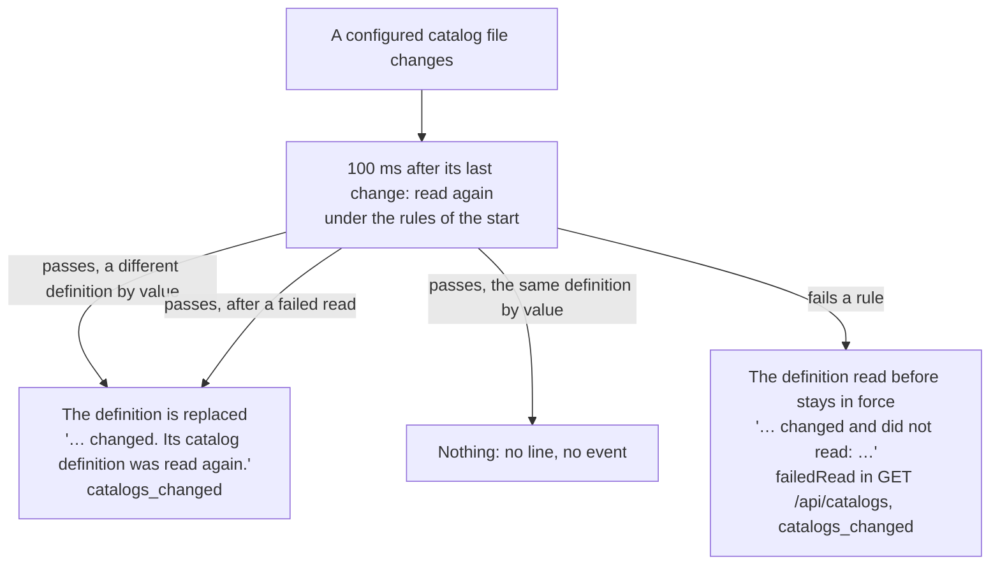

# The checks: how Spectra judges a turn's A2UI

This doc explains how Spectra judges the A2UI an agent sends: the four checks every closed turn gets, the catalog registry they judge against, what happens when a configured catalog file changes while Spectra runs, how a v1.0 component's envelope keys are read during upstream's rename, and the messages upstream's web core refuses. It is written for the developer of an A2UI agent who uses Spectra and wants to know why a turn shows the problems it shows, and what Spectra needs to judge their own catalog. It starts with the problem, follows one turn of upstream's Python restaurant finder through the four checks, then opens up each check, the registry and a changed catalog file, and ends with the design decisions and where the code is.

The running example is upstream's Python restaurant finder, `samples/agent/adk/restaurant_finder`, in its booking turn: you asked for "Top 2 Chinese restaurants in New York", pressed Book on Xi'an Famous Foods, and the agent answered with its booking form. The form's Dietary Requirements field binds `/dietary`, which the form's data model never fills, and the binding check says so twice. The restaurant finder uses the basic catalog alone and speaks v0.9, so the parts it does not exercise, a configured catalog and v1.0's envelope keys, are shown on the repository's stub agent.

<picture>
  <source media="(prefers-color-scheme: dark)" srcset="diagrams/checks-dark.svg">
  
</picture>

## Problem it solves

An agent's A2UI can be wrong in ways the host does not report. Upstream's web core, the state library its web renderers share, refuses some messages outright, such as an `updateComponents` whose component fails its catalog's schema, and takes others whose mistake shows only as a missing piece of the surface, such as a child id that points nowhere or a binding that finds no value in the data model. What you notice depends on the host you test with, and on whether you look at the right corner of the surface.

Spectra judges every turn the same way, at its close, and answers four questions:

1. **Schema:** is the response A2UI, and does each message match the schema of its protocol version?
2. **Catalog:** does each component, and each function call and theme, match its catalog's definition?
3. **Structure:** does every child id point to an existing component, is there exactly one root that reaches every component the turn sent, and does nothing loop back on itself?
4. **Bindings:** is every path the UI binds to filled by the data model?

To answer the second, third and fourth, Spectra has to know the catalogs. The basic catalogs are built in; your own catalog is a `catalog.json` you name in the config file, or one the host sends inline. The catalog registry holds them all, and reads a configured file again when you save it.

## Six ideas to hold on to

### 1. Every closed turn gets four check events, written once

At a turn's close Spectra runs the four checks and writes one `check` event per check into the turn record, after the turn's own events: the schema check, then the catalog, structural and binding checks. A turn with no protocol version gets none. The events are written once: they are not rewritten when spans arrive late or a catalog file changes, and a fixture carries the findings it was saved with.

### 2. The schema check judges each message alone; the other three judge the conversation

The schema check validates each A2UI message the agent sent against its protocol version's schema, with any catalog accepted. The catalog, structural and binding checks need the surfaces as a host holds them, so Spectra feeds the conversation's A2UI, the earlier turns first, through upstream's web core message processor, and judges the surfaces that stand at the turn's close.

### 3. Upstream decides, wherever upstream has an answer

The schemas are upstream's, copied unchanged. The state of a surface, its child references and which properties are bindings are upstream web core's, at the pin. A v1.0 component's envelope keys are read as web core reads them, by Spectra's own reading held to web core's by a differential test. What web core refuses to let into a surface is a finding in web core's own words.

### 4. A finding points at the value that is wrong

Each finding carries a code, a sentence and, when it can, a `path`: a JSON Pointer from the turn object to the offending value, such as a component's unknown property or a binding with no value. The viewer puts the finding on the step of the message it points into and marks that line.

### 5. A surface Spectra cannot judge is skipped, and says why

A check never guesses. A surface whose catalog has no definition, or that no `createSurface` created, is listed as skipped with its reason, and the turn reads "not fully checked" rather than clean.

### 6. The legacy form is read, listed and not a problem

On a v1.0 component, Spectra reads a bare `catalogId`, `accessibility`, `metadata` or `checks` exactly where upstream's web core reads it as the `@` key during upstream's rename. Such a component is listed as being in the legacy form, and judged as if it had written the `@` key. Carrying both forms of a key is a finding, as it is in web core.

## One turn, end to end

The restaurant finder runs under `a2ui-spectra run`. You ask for two Chinese restaurants in New York, and the agent paints its list. You press Book under Xi'an Famous Foods: the host sends the agent the A2UI action `book_restaurant`, and the agent answers with one wire output holding a sentence and three A2UI messages, a `createSurface`, an `updateComponents` and an `updateDataModel` for the surface `booking-form`. The turn closes.

1. **The store reads the conversation.** The turn names a conversation, so the store reads that conversation's earlier turn, the list, before the turn is checked and written.
2. **The protocol version.** The first message declares `v0.9`, so the turn is checked as v0.9, and the four events carry `v0.9`.
3. **The schema check.** Each of the three messages is validated against upstream's v0.9 `server_to_client.json`. All three pass.
4. **The conversation is fed.** The list turn's four messages, then the booking turn's three, go one by one into web core's message processor, with the registry's catalogs registered. The `createSurface` names the v0.9 basic catalog, `https://a2ui.org/specification/v0_9/catalogs/basic/catalog.json`, which is built in. Web core takes every message.
5. **The catalog check.** Each of the nine components is validated against its type's definition in the v0.9 basic catalog, and the surface's theme, `primaryColor` and `font`, against the catalog's theme. All pass.
6. **The structural check.** From `root`, a Column, every child id resolves and every component is reached. It passes.
7. **The binding check.** The data model at the close holds `title`, `address`, `restaurantName`, `partySize`, `reservationTime` and `imageUrl`. Two bindings read `/dietary`: the Dietary Requirements TextField's `value`, and the `dietary` entry of the Submit Reservation Button's action context. Each is a finding.
8. **The events are written.** Four check events follow the turn's own events in the record. The two findings join the turn's problems, beside the failed parse the agent retried earlier in the turn, and the viewer puts both on the `updateComponents` step, each marking its line.

The binding check's event, with the component and the data model it judged. This is cut from [`conformance/test_data/turn_record/v0_1/full_record_restaurant_finder.json`](../../conformance/test_data/turn_record/v0_1/full_record_restaurant_finder.json), the shared test data's record of two turns of the restaurant finder, whose A2UI comes from the sample's `examples/0.9/booking_form.json`. The checks' own test, `src/check/checks.test.ts`, runs the four checks on this record and holds their result equal to the events it carries.

```jsonc
// The booking turn's binding check event, its attributes
{
  "a2ui.event.kind": "check",
  "a2ui.check.name": "binding",
  "a2ui.check.passed": false,
  "a2ui.check.protocol_version": "v0.9",
  "a2ui.check.findings": [
    {
      "code": "BINDING_PATH_UNFILLED",
      "surfaceId": "booking-form",
      "path": "/events/9/attributes/a2ui.wire.message/parts/2/content/updateComponents/components/6/value",
      "message": "The data model has no value at /dietary."
    },
    {
      "code": "BINDING_PATH_UNFILLED",
      "surfaceId": "booking-form",
      "path": "/events/9/attributes/a2ui.wire.message/parts/2/content/updateComponents/components/7/action/event/context/dietary",
      "message": "The data model has no value at /dietary."
    }
  ],
  "a2ui.check.skipped": []
}
// Event 9, part 2: the updateComponents, its seventh component
{"id": "dietary-field", "component": "TextField", "label": "Dietary Requirements", "value": {"path": "/dietary"}}
// Event 9, part 3: the updateDataModel
{"version": "v0.9", "updateDataModel": {"surfaceId": "booking-form", "path": "/", "value": {
  "title": "Book a Table at Xi'an Famous Foods", "address": "81 St Marks Pl, New York, NY 10003",
  "restaurantName": "Xi'an Famous Foods", "partySize": "2", "reservationTime": "", "imageUrl": "…"}}}
```

The first finding's `path` runs from the turn object to its tenth event, the wire output, its third part, the part's content, the component at index 6 and its `value`: the binding object itself.

## Inside the machinery

### When the checks run

- **At each turn's close**, under `attach` and `run`, and under `replay` and `test`, whose replayed turns are checked as any turn and report beside the verdict without deciding it; [replay-and-fixtures.md](replay-and-fixtures.md) has the verdict.
- **After the store has read the conversation's earlier turns**, from the latest record of the conversation the turn names. A turn that names no conversation is checked alone.
- **On the agent's A2UI alone.** The messages are the A2UI parts of the turn's wire outputs, in order, each element of a part holding an array judged on its own. The host's messages are not checked.
- **The protocol version** is the first version the agent's messages declare, in the record's form, `1.0` written `v1.0`, a declared string that is not a version number passed over; else the turn event's `a2ui.turn.protocol_version`. With neither, the turn gets no check events. All four events carry the version the schema check chose.
- **Findings are ordered** by the message and the value they point at, those with no path last.
- **A check that fails** with an error of its own, such as a configured definition whose own schemas do not compile, leaves the turn unchecked, and the terminal says `The checks failed on turn <trace id>: <the error>. The turn is written unchecked.`.
- **Written once.** A turn amended later, by spans placed after it was written ([opentelemetry.md](opentelemetry.md)) or by its replay's verdict, keeps its check events; the checks are not run again. A changed catalog file does not rewrite them either.

The check event's attributes, the skipped-surface and legacy-form entries, the finding's shape, the `path` convention and the codes are the turn record's contract: [the `check` event](../../specification/turn_record/v0_1/docs/turn_record.md#check).

### The schema check

Each message is validated against the schema of the version it declares, with Ajv on JSON Schema 2020-12, strict mode off as upstream's own schema tests run it, and formats not checked, where upstream's own schema tests load `ajv-formats`:

| The message declares | The schema                                                                                |
| -------------------- | ----------------------------------------------------------------------------------------- |
| `v0.9`               | upstream's `specification/v0_9/json/server_to_client.json`                                |
| `v0.9.1`             | upstream's `specification/v0_9_1/json/server_to_client.json`                              |
| `1.0`, for v1.0      | upstream's `specification/v1_0/json/agent_to_renderer.json`, with its `common_types.json` |

The schemas are copied unchanged from upstream at the pin, as [the note on the copied schemas](../../tools/spectra/src/check/schemas/README.md) lists. Each one's reference to `catalog.json` is bound to a stand-in that accepts any component, any function and any theme, so the schema check judges the protocol alone and leaves the catalog to the catalog check.

What it finds, each finding carrying the `surfaceId` of the message's first payload that names one:

| Code                         | When                                                                                                     | The sentence, from the code                                                                                             |
| ---------------------------- | -------------------------------------------------------------------------------------------------------- | ----------------------------------------------------------------------------------------------------------------------- |
| `SCHEMA_NOT_AN_OBJECT`       | The content, or an element of an array, is not a JSON object                                             | `The A2UI content is not a JSON object.`                                                                                |
| `SCHEMA_VERSION_MISSING`     | The message has no `version` string                                                                      | `The message declares no version.`                                                                                      |
| `SCHEMA_VERSION_UNSUPPORTED` | Any other version, at the message's `version`                                                            | `The message declares v0.8; Spectra checks v0.9, v0.9.1, 1.0.`                                                          |
| `VALIDATION_FAILED`          | The message names none of its version's message types, or several, at the message                        | `The message names none of <version>'s message types: …` or `The message names more than one message type: …`           |
| `VALIDATION_FAILED`          | The message fails the schema of the message type it names: one finding per error, at the offending value | Ajv's words, with the property named for an additional or unevaluated one: `must NOT have additional properties: extra` |
| `SCHEMA_VERSIONS_MIXED`      | The agent's messages in one turn declare more than one version, with no path                             | `The agent's messages in this turn declare more than one version: …`                                                    |

A v1.0 message declares `"version": "1.0"`. One declaring `v1.0`, as messages did before upstream settled the bare `1.0`, is `SCHEMA_VERSION_UNSUPPORTED`, and web core refuses it too. A turn with a known version and no A2UI from the agent passes with no findings.

### The conversation, fed through web core

The catalog, structural and binding checks read one conversation, built once per turn:

- **What goes in.** The agent's A2UI messages of the conversation's earlier turns, then the turn's own, one by one into upstream web core's message processor in its relaxed validation mode, each as a copy.
- **The catalogs registered.** Every catalog the registry knows; the catalogs the conversation's hosts sent inline, in any of their messages so far; and a stand-in, a catalog with no component schemas, under each other catalog id a message writes under a `catalogId` key, or a v1.0 `@catalogId` key, at any depth, v1.0's when the message declares v1.x and v0.9's otherwise. Web core's relaxed mode lets any component and any function through a stand-in.
- **A refused message.** When the processor throws on a message, the message keeps web core's refusal, its error code and its sentence, and the surface stays as web core left it.
- **What the checks read.** The surfaces as they stand at the close; the turn's own messages, each with web core's refusal when there was one; the surfaces the turn's messages name, in order of first naming; every surface a `createSurface` of the conversation named, accepted or not; the surfaces the turn deleted that are gone at the close; each surface's catalog id, from the last `createSurface` naming it; and the message that carried each standing component.

### The catalog check

Each component the agent sent in an `updateComponents`, and in a v1.0 `createSurface`, is validated against its catalog's definition with Ajv: the real definition bound where the schema check binds the stand-in, beside the common types of the definition's own protocol version. Each message is read in its own version's family, v0.9 for `v0.9` and `v0.9.1`, v1.0 for `1.0`: its binding and call keys, its theme and, on v1.0, its envelope keys.

- **A component's catalog** is the one its surface's `createSurface` named, whether or not web core accepted that message, since the check judges each message as sent. On v1.0, a component's own `@catalogId` names its catalog instead, followed whatever the surface's catalog; how a bare `catalogId` is read is in [the envelope keys](#a-v10-components-envelope-keys) below.
- **Cut to the component's own type.** A component is validated against the branch of its type alone, so it reads the errors of its own type, never those of every other component a union would try. In a 1.0 definition the branch is joined with the common types' `ComponentCommon`, no property beyond them is allowed, and a component may not be a `Surface`.
- **Function calls.** Web core's behaviour tree over the component's schema finds each function call, in a dynamic property, an action's event context, its user message and its `functionCall`, a check rule's condition and, in turn, a call's arguments. Each call is validated against its own function's branch, joined in a 1.0 definition with `FunctionCommon`. A v1.0 call is judged in the catalog its own `catalogId` names, else in the surface's, whatever catalog the component is in, as web core runs it. A system function, whose name starts with `@`, belongs to no catalog and is judged where the component is, `@index` in a 1.0 definition against the common types' own definition of it. A call naming a catalog with no definition is not judged, and its surface is listed as skipped with that catalog id.
- **The theme.** A v0.9 surface's `createSurface` theme is validated against the catalog's `$defs.theme`, when the catalog defines one.
- **A surface the check cannot judge** is skipped: `not_created` when no `createSurface` of the conversation named it, `no_definition` when its catalog id resolves to no definition. A surface the turn deleted is passed over.

| Code                | When                                                                                                         | The sentence, from the code                                         |
| ------------------- | ------------------------------------------------------------------------------------------------------------ | ------------------------------------------------------------------- |
| `COMPONENT_UNKNOWN` | A component type the catalog does not define, at its `component`                                             | `The catalog <id> defines no component '<type>'.`                   |
| `FUNCTION_UNKNOWN`  | A function the catalog does not define, at the call's `call` or `@call`                                      | `The catalog <id> defines no function '<name>'.`                    |
| `VALIDATION_FAILED` | A component, function call or theme that fails its definition, one finding per error, at the offending value | Ajv's words, such as `must have required property 'url'`            |
| `VALIDATION_FAILED` | A v1.0 component carrying both forms of an envelope key, at the bare key                                     | `Component '<id>' cannot specify both '@<key>' and legacy '<key>'.` |

### A v1.0 component's envelope keys

Upstream renamed a v1.0 component's `catalogId`, `accessibility`, `metadata` and `checks` to `@catalogId`, `@accessibility`, `@metadata` and `@checks`. During the transition its core SDKs and renderers read the bare keys as well, while the specification, the catalogs and the agent SDKs emit the `@` form alone; the bare form's removal is upstream's open issue [#4082](https://github.com/a2ui-project/a2ui/issues/4082). Which upstream release reads or emits which form is in the root README's collapsed block on v1.0's renamed envelope keys, under [What Spectra supports](../../README.md#what-spectra-supports).

Spectra reads the keys as upstream web core reads them at the pin, in `typescript/core/web_core/src/catalog/component_envelope.ts`:

- **The `@` keys** are the envelope keys. `@catalogId` names the component's catalog, followed whatever the surface's catalog.
- **A bare key is the envelope key** where the component's schema declares no property of that name of its own, and a bare `checks` only on a component whose schema takes checks. The schema is read for the shape of each declaration: a `checks` declared as an array of check rules, or an `accessibility` declared as the accessibility attributes, is the envelope key under its bare name, and a bare name declared any other way is the component's own property, judged as that property.
- **Such a component is in the legacy form.** It is listed in the catalog check event's `a2ui.check.legacy_form`, with its surface, its id, the bare keys in the order it writes them, and its `path`. A component whose id is not a string is not listed, and is judged all the same. The legacy form by itself is not a finding.
- **The value under a bare key is judged as the `@` key's**, in the catalog check and in the binding check, and each finding's `path` runs through the bare key as written.
- **A bare `catalogId`** is decided by the component's schema in the surface's catalog. On a surface whose catalog has no definition it is not followed, and the component is neither checked nor listed.
- **A component whose type its catalog does not define** is judged on its type alone: `COMPONENT_UNKNOWN`, its bare keys not read. A bare `catalogId` on a type the surface's catalog does not define is still followed, since no schema there declares it.
- **Both forms of a key** on one component, where the bare key is not the component's own property, is a `VALIDATION_FAILED` at the bare key in web core's sentence, and the rest of the component is validated with the `@` key's value. Web core refuses the whole `updateComponents` for it.
- **A key is carried** when its value is not `undefined`; a `null` counts.
- **v0.9 and v0.9.1** keep the bare `accessibility` and `checks` as the envelope keys. They have no legacy form, and an `@` key there is not an envelope key.

A differential test holds Spectra's reading to web core's message processor, case by case, and fails on the bare names once upstream removes its fallback. When upstream removes it, Spectra removes its own.

The repository's stub agent sends a v1.0 booking form on the basic catalog, its envelope keys in the form its message asks for. With "both" in the message, the TextField and the DateTimeInput carry a bare `checks`, the Button a bare `accessibility`, and the ChoicePicker both `checks` and `@checks`. The attributes of the catalog check event Spectra wrote, cut from a run of the built binary attached to `node dist/stub_agent/stub_agent.js --v1-booking`, with the message "Book a table, both" sent from the message box:

```json
{
  "a2ui.event.kind": "check",
  "a2ui.check.name": "catalog",
  "a2ui.check.passed": false,
  "a2ui.check.protocol_version": "v1.0",
  "a2ui.check.findings": [
    {
      "code": "VALIDATION_FAILED",
      "surfaceId": "booking",
      "path": "/events/3/attributes/a2ui.wire.message/parts/2/content/updateComponents/components/3/checks",
      "message": "Component 'time' cannot specify both '@checks' and legacy 'checks'."
    }
  ],
  "a2ui.check.skipped": [],
  "a2ui.check.legacy_form": [
    {
      "surfaceId": "booking",
      "componentId": "name",
      "keys": ["checks"],
      "path": "/events/3/…/updateComponents/components/1"
    },
    {
      "surfaceId": "booking",
      "componentId": "date",
      "keys": ["checks"],
      "path": "/events/3/…/updateComponents/components/2"
    },
    {
      "surfaceId": "booking",
      "componentId": "submit",
      "keys": ["accessibility"],
      "path": "/events/3/…/updateComponents/components/4"
    }
  ]
}
```

The ChoicePicker is not listed in the legacy form: a key carried in both forms is the finding. Web core refused the `updateComponents`, so the same turn's structural check found `ROOT_MISSING`, "The surface 'booking' has no component with the id 'root': web core refused the updateComponents that carried one.". Sent as "Book a table, bare", the same form passes all four checks with the same three legacy-form entries.

### The structural check

Each surface the turn's messages name is walked as it stands at the close in web core's state, from `root` over the catalog's child references, which web core reads from the catalog's schemas.

| Code                                  | When                                                                                                | Where, and the sentence                                                                                                                                                                                                                               |
| ------------------------------------- | --------------------------------------------------------------------------------------------------- | ----------------------------------------------------------------------------------------------------------------------------------------------------------------------------------------------------------------------------------------------------- |
| `CHILD_NOT_FOUND`                     | A child id no component in the surface defines                                                      | At the child id, when this turn carried the parent: `The component '<id>' names a child '<child>' that no component in the surface '<surface>' defines.`                                                                                              |
| `COMPONENT_UNREACHABLE`               | A component this turn's messages carried that the walk from `root` never reaches                    | At the component: `The component '<id>' in the surface '<surface>' is not reachable from 'root'.`                                                                                                                                                     |
| `ROOT_MISSING`                        | No component with the id `root`                                                                     | No path: `The surface '<surface>' has no component with the id 'root'.`, adding `: web core refused the updateComponents that carried one.` when web core refused an `updateComponents` of the turn on that surface carrying a component with that id |
| `CYCLIC_REFERENCE`                    | Web core refused an `updateComponents` for a component that reaches itself                          | At the message's `updateComponents`, in web core's words                                                                                                                                                                                              |
| `DUPLICATE_COMPONENT_ID`              | Web core refused an `updateComponents` giving one id to two components                              | At the message's `updateComponents`: `Duplicate component ID: 'root'`                                                                                                                                                                                 |
| `UNALLOWED_PARENT`, `UNALLOWED_CHILD` | Web core refused an `updateComponents` breaking a v1.0 catalog's composition rule; A2UI's own codes | At the message's `updateComponents`, in web core's words                                                                                                                                                                                              |
| `SURFACE_NOT_CREATED`                 | A surface the turn's messages name that no `createSurface` of the conversation created              | On the first message of the turn naming it, at its message type: `No createSurface in the conversation created the surface '<surface>'.`                                                                                                              |

- **What an earlier turn left** is not reported again: a component an earlier turn carried and left unreachable gives no finding, while one this turn sends again, still unreached, does. A dangling child of a component an earlier turn carried has no path, and its sentence names the component and the surface.
- **Skipped:** `not_created` for a surface a `createSurface` named that has no state at the close, such as one whose `createSurface` web core refused; `no_definition` for a surface whose catalog has no definition, since without the catalog's schemas there are no child references to walk.
- A surface the turn deleted is passed over, and a surface the turn did not touch is not checked again.

### The binding check

Each surface the turn touched is walked from `root` over its child references, as it stands at the close, and every binding of every component reached is looked up in the surface's data model. A component the root does not reach is left to the structural check.

- **Which values are bindings** is said by web core's behaviour tree over the catalog entry's schema: dynamic properties; an action's event context and its user message; an action's function call; a function call's arguments; a check rule's condition; a template's list path; and the values under a v1.0 component's envelope keys, the bare ones in the legacy form included. A binding is `{"path": …}` before v1.0 and `{"@path": …}` from v1.0 on.
- **A value is there** when its key is present, whatever it holds.
- **A template** draws its component once per item of its list. The list path must hold an array; the template's component is visited once per item, its relative paths resolved against the item, and a binding unfilled in some items is one finding naming how many. A relative path outside a template resolves against the root.
- **Skipped:** `not_created` when the surface has no state, `no_definition` when its catalog has no definition, and, with that catalog's id, when a component reached comes from another catalog that has no definition.

| Code                     | When                                                           | The sentence, from the code                                                                |
| ------------------------ | -------------------------------------------------------------- | ------------------------------------------------------------------------------------------ |
| `BINDING_PATH_UNFILLED`  | A bound path with no value, at the binding object              | `The data model has no value at /dietary.`                                                 |
| `BINDING_PATH_UNFILLED`  | The same inside a template, in some of its items               | `The data model has no value at name in 2 of 3 items, the first at /items/1/name.`         |
| `BINDING_PATH_UNFILLED`  | A template's list path with no value, at the template's `path` | `The data model has no value at /items.`                                                   |
| `BINDING_LIST_NOT_ARRAY` | A template's list path whose value is not an array             | `The data model's value at /items is not a list, so the template 'item' draws no items.`   |
| `BINDING_PATH_UNFILLED`  | A binding of a component an earlier turn carried, with no path | `The data model has no value at /title, bound by the component 'root' in the surface 's'.` |

The sentences with `/items`, `/title` and `name` are cut from the binding check's tests, `src/check/binding_check.test.ts`.

### The messages web core refuses

Web core's message processor refuses some messages outright: a component that fails its catalog's schema, a cycle, a duplicate id, a message of a version it does not take. A refused message is a problem of its own unless a check already explains it.

- **What counts.** Each of the turn's own messages the processor throws on, the conversation's earlier turns fed first, in the conversation the checks read. So a bad property on a configured catalog's component is refused as one on a basic catalog's component is, and one on a stand-in's is let through.
- **Folding.** A refusal of a message a finding points into, a finding whose `path` is the message's or runs inside it, folds under that finding and is not counted on its own. Every other refusal is a problem of its own, on the step of the message it names, in web core's sentence and with its code.
- **Not recorded.** The count is worked out at each reading, against the definitions in force, and is not in the turn record. The turn listing carries it as `rejections` ([api.md](api.md)), and the viewer feeds its own copy of web core the same way to mark each refused message.

In the run of the next section, the stub agent's slider carries a `max` that the configured catalog does not define. The catalog check finds it, web core refuses the `updateComponents`, and the structural check finds `ROOT_MISSING`. The refusal folds under the catalog finding: the turn listing gives `"findings": 2, "rejections": 0`.

### How findings become problems

How each problem is drawn is in [viewer.md](viewer.md). The rules that decide them are these:

- **A finding** is a problem on the step of the message its `path` points into. A finding with no path, or whose path points into no message, is a problem of the whole turn, on the outcome.
- **A skipped surface** is not a problem. A turn with no problems and a skipped surface reads "not fully checked".
- **The legacy form** is not a problem: it is not counted, the turn list's problem count and the keys that step through problems pass it, and a turn with only the legacy form opens as a clean turn does. A catalog check event without `a2ui.check.legacy_form` reads as one with none, and a stored turn is shown as its record says.
- **A turn with no check events** reads "Not checked · no schema check", whether it names no protocol version or its checks failed. Its schema check's row reads "Not run: the turn names no A2UI version" when none of its A2UI messages states a version, and "Not run: the record holds no check events" when one does, since such a turn was checked when it closed and its record holds none of the checks' events. A turn whose schema check passed with no A2UI from the agent, and that has no problems, reads "Not checked · no A2UI in this turn".
- **The turn list's count** adds the turn's findings and its refusals that did not fold to its other problems, such as failed calls and the A2UI step's errors ([a2ui-step.md](a2ui-step.md#what-spectra-does-with-the-spans)).

### The catalog registry

The registry holds every catalog definition Spectra knows. Web core's message processor takes its catalogs from it, for the checks, the turn listing's refusal count and the viewer's Structure. The message box advertises its ids to the agent, as they stand at each send ([wire.md](wire.md)), and `GET /api/catalogs` lists it ([api.md](api.md)).

| Source     | What                                                                                                                                                                                                                                                                                                                                                                                                      |
| ---------- | --------------------------------------------------------------------------------------------------------------------------------------------------------------------------------------------------------------------------------------------------------------------------------------------------------------------------------------------------------------------------------------------------------- |
| Built in   | The v0.9 basic catalog, `https://a2ui.org/specification/v0_9/catalogs/basic/catalog.json`, copied from upstream at the pin, which also answers to the v0.9.1 basic catalog URL, `https://a2ui.org/specification/v0_9_1/catalogs/basic/catalog.json`, the name upstream's v0.9.1 protocol document gives it; and the v1.0 basic catalog, `https://a2ui.org/specification/v1_0/catalogs/basic/catalog.json` |
| Configured | The files the config file's `catalogs` names, in order, each under its own `catalogId`, read at start and [read again when it changes](#a-changed-catalog-file)                                                                                                                                                                                                                                           |
| Inline     | The catalogs a host sends in its capabilities, under `inlineCatalogs` of each version's key, built from the conversation's host messages each time the conversation is fed                                                                                                                                                                                                                                |

- **A catalog id resolves** in that order: built in, configured, inline. An id that resolves nowhere gets a stand-in catalog with no component schemas, which web core's relaxed mode lets any component through; the checks skip its surface with `no_definition`, and the viewer shows the surface unnested.
- **An inline catalog** takes its protocol version from the key it sits under, v0.9's for `v0.9` and `v0.9.1`, v1.0's for v1.0. Each id is built once, the first definition under it kept. An inline item with no `catalogId`, one whose id is built in or configured, and one web core cannot load are left out. Web core reads the legacy v0.9 shape, with `functions` as a list, a `theme` map and no `$defs`, as it does a file.
- **A configured definition** is built through web core's `Catalog.fromJson`, schema only: the processor nests and validates with it, and runs none of its functions.

### The config file's `catalogs`

```json
{
  "$schema": "https://raw.githubusercontent.com/retz8/a2ui-spectra/main/tools/spectra/src/config.schema.json",
  "catalogs": ["./catalogs/catalog.json"]
}
```

`catalogs` is a list of paths to catalog definition files, each carrying its own `catalogId`, relative to the config file's directory when relative. Where the config file is found, that it is read strictly and that the command line takes precedence are in [the command's README](../../tools/spectra/README.md).

At start, each file is read under these rules, in order. A file that breaks one stops Spectra with one line naming the file by its full path:

| The file                                                                                                                                                                                                            | The line                                                                                           |
| ------------------------------------------------------------------------------------------------------------------------------------------------------------------------------------------------------------------- | -------------------------------------------------------------------------------------------------- |
| Does not exist                                                                                                                                                                                                      | `The catalog <file> does not exist.`                                                               |
| Cannot be read                                                                                                                                                                                                      | `<file> cannot be read: <the system's reason>.`                                                    |
| Is not valid JSON                                                                                                                                                                                                   | `<file> is not valid JSON: <the JSON parser's message>.`                                           |
| Does not hold an object                                                                                                                                                                                             | `<file> must hold a JSON object.`                                                                  |
| Has no `catalogId` string, or an empty one                                                                                                                                                                          | `<file> names no catalogId.`                                                                       |
| Names a `protocolVersion` web core reads as 1.0 or later, such as `1.0`, `1.0.1` or `v1.0`, and fails upstream's catalog definition meta-schema, copied at the pin, which holds the version itself to numbers alone | `<file> is not a 1.0 catalog definition: <the errors>.`                                            |
| Names no `protocolVersion`, or one web core reads as before 1.0, such as `0.9` or `1.0.0-rc.1`, and is not a JSON Schema document                                                                                   | `<file> is not a JSON Schema: <the errors>.`                                                       |
| Cannot be built by web core's `Catalog.fromJson`                                                                                                                                                                    | `<file> cannot be loaded as a catalog: <web core's error>.`                                        |
| Names a component in its `components` map that is not listed under `$defs.anyComponent`, which web core would drop                                                                                                  | `<file>: the component '<name>' is not listed under $defs.anyComponent, so it would not be known.` |
| Names a function in its `functions`, as a map or as the legacy list, that is not listed under `$defs.anyFunction`, which web core would drop                                                                        | `<file>: the function '<name>' is not listed under $defs.anyFunction, so it would not be known.`   |
| Claims a basic catalog's id, the v0.9.1 URL included                                                                                                                                                                | `<file> claims the basic catalog's id '<id>'.`                                                     |
| Carries an id another configured file carries                                                                                                                                                                       | `<file> carries the catalog id '<id>', which <the other file> already carries.`                    |

Spectra then prints the ids of the catalogs configured. Both lines are cut from runs of the built binary attached to the stub agent, the first with the preview samples' catalog, `samples/preview/catalog.json`, copied with `CustomSlider` left out of `$defs.anyComponent`, the second with it whole; the scratch folder's path is shortened:

```
a2ui-spectra: …/catalogs/catalog.json: the component 'CustomSlider' is not listed under $defs.anyComponent, so it would not be known.
a2ui-spectra: Catalogs configured: https://github.com/retz8/a2ui-spectra/blob/main/samples/preview/catalog.json
```

### A changed catalog file

Under `attach` and `run` each configured catalog file is watched, and read again when it changes; `replay` and `test` watch nothing. The config file itself is still read once, at start.



- **The read** comes 100 ms after the file's last change, the quiet spell that restart on save and the fixtures folder's watch use, under the rules that judge the file at start. A file that is gone at that moment did not read, and is read again when it reappears.
- **A file that passes** replaces its definition, whatever changed in it. A new `catalogId` or `protocolVersion` is taken: the old id is no longer known, and the message box advertises the ids in force from its next message on. The terminal says `./catalogs/catalog.json changed. Its catalog definition was read again.`, the file named as the config file names it, and with a new id, `Its catalog id is now <new>, no longer <old>.` after it.
- **A file that fails** any rule of the start, a file whose id another configured file or a basic catalog carries included, keeps the definition read before: `./catalogs/catalog.json changed and did not read: <the reason>. The definition read before stays in force.` The reason is the start's own without the file's path, and the JSON parser's own message for a file that is not valid JSON. The failed read is on the file's entry of `GET /api/catalogs`, as `failedRead` with its time and its reason, until a later read succeeds, and the viewer shows it in the agent's popover ([viewer.md](viewer.md)). At start nothing of this applies: a file that fails stops Spectra.
- **A read that changes nothing**, the same definition by value, as after a save with no edit or a formatter's rewrite, says nothing: no line, no event, and the time of the definition in force stays. A read that clears a failed one is said as a good read, and moves the time as one.
- **The live stream** says `catalogs_changed` after each read that changed the listing, a failed read included, and the viewer reads again everything it reads at connect.
- **What follows the definition in force.** The checks of every turn closed from then on, a turn open at the change included, since a turn is checked at its close. A turn already written keeps its check events as written. What is worked out from the registry at each reading follows the definition in force for every turn, the written ones included: the turn listing's `rejections`, the viewer's Structure and data model, and its link from the raw text to the components. So an earlier turn's findings may come from the definition before while its tree is nested with the one in force, and a turn naming an id that is no longer known is drawn through the stand-in catalog; replaying the turn live checks it anew.
- **Where the watch sits.** A catalog file in a folder [restart on save](agent-process.md) watches is told through that watch and has none of its own. Under an ignored or excluded folder too, its save restarts nothing and the file is still read again; elsewhere in a watched folder its save restarts the agent as any file's does, beside the read. Any other file, under `attach`, with `watch` off, or outside every watched folder, has its folder watched, not recursively, one watch per folder, opened at start.
- **A watch that fails.** A folder's watch that cannot be set up, or fails while Spectra runs, does not stop Spectra: `Changes to the catalog files in /path are not read: <the system's reason>. Stop Spectra and start it again to read a changed definition.` A folder that is removed is watched no longer, and is not picked up when it reappears: `/path is gone, so its catalog files are no longer read again. Stop Spectra and start it again to watch it.`
- **A save that can be missed.** On macOS, opening a watch drops the events of every other watch in the process for a moment. Where the fixtures folder has its own watch, under `attach`, and under `run` when restart on save does not watch the folder that holds it, that watch is reopened when the fixtures folder first appears. A catalog file saved in that moment is not read again until its next save. It can happen once in a repository, at its first Save as fixture.
- **Symbolic links.** A catalog path that is a symbolic link is watched by the link's folder, so on macOS a write to its target is not told. Name the real path in the config file.

The run behind these lines: the built binary attached to the stub agent, `node dist/stub_agent/stub_agent.js --canned-a2ui`, which paints a custom slider when the host offers the preview samples' catalog. The configured copy of that catalog started without the slider's `max`, so the first turn's catalog check found `must NOT have unevaluated properties: max` at the slider's `max`. Then the file was saved four times: with `max` back, which the next turn passed; cut short, `{"catalogId": `; whole again, laid out anew; and under a new `catalogId`. The terminal said:

```
a2ui-spectra: ./catalogs/catalog.json changed. Its catalog definition was read again.
a2ui-spectra: ./catalogs/catalog.json changed and did not read: JSON Parse error: Unexpected EOF. The definition read before stays in force.
a2ui-spectra: ./catalogs/catalog.json changed. Its catalog definition was read again.
a2ui-spectra: ./catalogs/catalog.json changed. Its catalog definition was read again. Its catalog id is now https://example.com/catalogs/sample/v2/catalog.json, no longer https://github.com/retz8/a2ui-spectra/blob/main/samples/preview/catalog.json.
```

While the cut-short file stood, the file's entry of `GET /api/catalogs` read, its `definition` left out here:

```json
{
  "id": "https://github.com/retz8/a2ui-spectra/blob/main/samples/preview/catalog.json",
  "aliases": [],
  "protocolVersion": "0.9",
  "source": "configured",
  "path": "./catalogs/catalog.json",
  "readTime": "2026-11-21T04:21:54.982Z",
  "title": "Spectra Sample Catalog",
  "failedRead": {"time": "2026-11-21T04:21:55.895Z", "error": "JSON Parse error: Unexpected EOF"}
}
```

## When things go wrong

| What happens                                                                       | What you see, and what to do                                                                                                                                                                             |
| ---------------------------------------------------------------------------------- | -------------------------------------------------------------------------------------------------------------------------------------------------------------------------------------------------------- |
| The turn's surface uses your own catalog, and Spectra does not know it             | The turn reads "not fully checked", the surface skipped with `no_definition` and its catalog id. Name the catalog's `catalog.json` in the config file's `catalogs`, or have the host send it inline      |
| Every v1.0 message is `SCHEMA_VERSION_UNSUPPORTED`, "The message declares v1.0; …" | The agent writes `"version": "v1.0"`. v1.0 messages declare `"1.0"`; web core refuses the other form too                                                                                                 |
| A v0.8 agent                                                                       | Each message is `SCHEMA_VERSION_UNSUPPORTED`, and the event carries `v0.8`. Spectra checks v0.9, v0.9.1 and v1.0                                                                                         |
| `ROOT_MISSING`, "… web core refused the updateComponents that carried one."        | Web core refused the message that would have built the surface. The finding or refusal on that message says why                                                                                          |
| A surface skipped with `not_created`                                               | No `createSurface` in the conversation named it, or web core refused the one that did. Look at the `createSurface`'s own problem, or at `SURFACE_NOT_CREATED`                                            |
| Spectra stops at start on a catalog file                                           | The line names the file and the rule it broke, from the table under [the config file's `catalogs`](#the-config-files-catalogs)                                                                           |
| `The checks failed on turn …: The definition of <id> does not compile: …`          | A configured or inline definition whose own schemas Ajv cannot compile. The turn is written unchecked and reads "Not checked"                                                                            |
| A saved catalog file is not read again                                             | A line in the terminal says why when a watch failed or its folder went. Otherwise the save fell in the moment of a new watch on macOS, or the path is a symbolic link: save again, or name the real path |
| An earlier turn's findings no longer match the catalog                             | Its check events were written against the definition at its close. Replay the turn live to check it anew                                                                                                 |

## Design decisions

| Decision                                                                                                               | What it buys                                                                                                          | What it costs                                                                                                     |
| ---------------------------------------------------------------------------------------------------------------------- | --------------------------------------------------------------------------------------------------------------------- | ----------------------------------------------------------------------------------------------------------------- |
| Check each turn at its close and write the result into the turn record                                                 | A fixture carries the findings it was saved with, and a script reads them from the record without Spectra running     | A turn keeps the findings of the definitions in force at its close; a changed catalog does not re-check it        |
| The schema check is standard JSON Schema, against each version's schemas copied from upstream                          | The protocol verdict is upstream's own, and the schema check needs no catalog                                         | The copies have to be moved with every move of the pin                                                            |
| The A2UI-specific checks reuse upstream's web core: its state, child references and behaviour tree                     | A surface is judged as upstream's renderers hold it, and a refusal is in web core's words                             | The checks follow web core at the pin, its relaxed mode included, and change when it does                         |
| Cut each component, and each function call, to its own type's branch                                                   | A component reads the errors of its own type only, not every branch of a union                                        | Spectra builds the cut itself, for v0.9 and v1.0 apart                                                            |
| Judge the conversation at the close, the earlier turns fed first                                                       | A turn that updates an earlier turn's surface is judged on the whole surface                                          | A finding about a component an earlier turn carried has no path to mark; its sentence names the component instead |
| Skip a surface that cannot be judged, with its reason                                                                  | No finding is guessed; a turn on an unknown catalog reads "not fully checked", not clean                              | A custom catalog's surfaces are not judged until the catalog is configured or sent inline                         |
| Read the v1.0 envelope keys as web core does, the legacy form listed and not a finding                                 | An agent on a release from before the rename stays clean, and the viewer still says which components use the old form | One more attribute on the catalog check event, and a reading kept in step with web core by a differential test    |
| Findings as JSON Pointers from the turn object                                                                         | The viewer marks the exact line, and a finding's place survives saving and replaying the record                       | A pointer runs through the record's own layout, events and parts included                                         |
| A stand-in catalog, with no component schemas, under a catalog id no definition answers to, in web core's relaxed mode | The conversation is still fed and its surfaces still stand, so the viewer draws them                                  | A surface on a stand-in is drawn unnested, and the checks that need its catalog skip it                           |
| The refusal count is worked out at each reading, not recorded                                                          | It follows the definitions in force                                                                                   | A written turn's count can differ from what was seen at its close                                                 |
| Read a configured catalog file again when it changes, keeping the last good definition on a failed read                | Editing a catalog needs no restart, and a half-saved file never empties it                                            | A watch per folder, and the macOS moment when a new watch drops another's events                                  |

## Known limits

- The host's own A2UI messages, such as an action, are not checked.
- Formats in the schemas, such as `uri`, are not checked.
- v0.8 is not checked. A turn in v0.8 gets four events, its schema check failing every message.
- The message box sends no catalog inline, so an inline catalog comes from your own host only.
- The config file is read once, at start. Only the catalog files it names are read again.
- A catalog path that is a symbolic link is not read again when its target changes on macOS.

## Trying it without a model

The repository's stub agent has two behaviours for the checks, run from `conformance/` after its build:

```bash
node dist/stub_agent/stub_agent.js --port 10013 --flawed-booking   # a v0.9 booking form with known mistakes
node dist/stub_agent/stub_agent.js --port 10013 --v1-booking       # a v1.0 booking form; send "bare" or "both"
a2ui-spectra attach http://localhost:10013                         # then send a message from the box
```

The Flawed Booking Agent's form has a Button with a property its catalog does not define, an `updateComponents` to a surface never created, and an `updateDataModel` that names no surface; its second turn binds a path its data model never fills. The four checks on its recording find `VALIDATION_FAILED` in the schema check and in the catalog check, and `ROOT_MISSING` and `SURFACE_NOT_CREATED` in the structural check.

The checks' tests run in the tool's test target, `yarn workspace a2ui-spectra test`, among them the four checks on every recording of the A2A capture suite's coverage roster, under [`conformance/test_data/a2a_capture/v0_1/`](../../conformance/test_data/a2a_capture/v0_1).

## Where the code is

| What                                                                                           | Where                                                                                                                                                                                                                                                                                                                         |
| ---------------------------------------------------------------------------------------------- | ----------------------------------------------------------------------------------------------------------------------------------------------------------------------------------------------------------------------------------------------------------------------------------------------------------------------------- |
| The contract: the `check` event, its findings, skipped surfaces, legacy-form entries and codes | [`specification/turn_record/v0_1/docs/turn_record.md`](../../specification/turn_record/v0_1/docs/turn_record.md#check)                                                                                                                                                                                                        |
| The four checks run at a turn's close, and the events they become                              | [`checks.ts`](../../tools/spectra/src/check/checks.ts), [`check_event.ts`](../../tools/spectra/src/check/check_event.ts), [`tools/spectra/src/recorder.ts`](../../tools/spectra/src/recorder.ts)                                                                                                                              |
| The schema check                                                                               | [`schema_check.ts`](../../tools/spectra/src/check/schema_check.ts)                                                                                                                                                                                                                                                            |
| The conversation fed through web core, and the refusal count                                   | [`conversation.ts`](../../tools/spectra/src/check/conversation.ts), [`rejections.ts`](../../tools/spectra/src/check/rejections.ts)                                                                                                                                                                                            |
| The catalog check, the envelope keys, and the dynamic values the behaviour tree finds          | [`catalog_check.ts`](../../tools/spectra/src/check/catalog_check.ts), [`envelope.ts`](../../tools/spectra/src/check/envelope.ts), [`dynamic.ts`](../../tools/spectra/src/check/dynamic.ts)                                                                                                                                    |
| The structural and binding checks                                                              | [`structural_check.ts`](../../tools/spectra/src/check/structural_check.ts), [`binding_check.ts`](../../tools/spectra/src/check/binding_check.ts)                                                                                                                                                                              |
| Pointers, and the skipped list                                                                 | [`pointers.ts`](../../tools/spectra/src/check/pointers.ts), [`skipped.ts`](../../tools/spectra/src/check/skipped.ts)                                                                                                                                                                                                          |
| The schemas and basic catalogs copied from upstream                                            | [`tools/spectra/src/check/schemas/`](../../tools/spectra/src/check/schemas), and [its note](../../tools/spectra/src/check/schemas/README.md)                                                                                                                                                                                  |
| The catalog registry, and the watch of the catalog files                                       | [`tools/spectra/src/catalog/registry.ts`](../../tools/spectra/src/catalog/registry.ts), [`tools/spectra/src/catalog/watch.ts`](../../tools/spectra/src/catalog/watch.ts), and restart on save's watch, which tells the catalog files it holds, [`tools/spectra/src/save_watcher.ts`](../../tools/spectra/src/save_watcher.ts) |
| Reading a changed file again, and its terminal line                                            | [`tools/spectra/src/catalog/registry.ts`](../../tools/spectra/src/catalog/registry.ts), which reads the file again and words the line, and [`tools/spectra/src/session.ts`](../../tools/spectra/src/session.ts), which runs the reads one at a time, prints the line and tells the live stream                                |
| The turn listing's `findings` and `rejections`                                                 | [`tools/spectra/src/listing.ts`](../../tools/spectra/src/listing.ts)                                                                                                                                                                                                                                                          |
| The viewer: findings and refusals as problems, the check state, the legacy form                | [`problems.ts`](../../tools/spectra_viewer/src/model/problems.ts), [`check_state.ts`](../../tools/spectra_viewer/src/model/check_state.ts), [`legacy_form.ts`](../../tools/spectra_viewer/src/model/legacy_form.ts)                                                                                                           |
| The viewer: its own feed through web core, and its catalogs                                    | [`replay.ts`](../../tools/spectra_viewer/src/model/replay.ts), [`catalogs.ts`](../../tools/spectra_viewer/src/model/catalogs.ts)                                                                                                                                                                                              |
| The stub agent                                                                                 | [`conformance/stub_agent/stub_agent.ts`](../../conformance/stub_agent/stub_agent.ts)                                                                                                                                                                                                                                          |
| This doc's diagram, its source and its two exports                                             | [`docs/design/diagrams/`](diagrams)                                                                                                                                                                                                                                                                                           |

## Words used in this doc

| Word               | Meaning                                                                                                                                                                                    |
| ------------------ | ------------------------------------------------------------------------------------------------------------------------------------------------------------------------------------------ |
| Check event        | One check's result in the turn record: its name, whether it passed, its protocol version, its findings and, per check, its skipped surfaces and legacy form                                |
| Finding            | One thing a check found wrong: a code, a sentence, and the surface and the `path` when it has them                                                                                         |
| Problem            | What the viewer counts and marks on a turn: a finding, a refusal that did not fold, a failed call and the others it lists                                                                  |
| Web core           | Upstream's `@a2ui/web_core`, the state and validation library its web renderers share; Spectra uses it at the pin                                                                          |
| Relaxed mode       | Web core's validation mode that lets through components and functions their catalog does not define, components the root does not reach, a missing root and a child id that points nowhere |
| Refusal            | A message web core's message processor throws on, with web core's code and sentence                                                                                                        |
| Conversation       | The turns that share a conversation id; its A2UI, fed in order, builds the surfaces a turn is judged on                                                                                    |
| Catalog definition | A catalog's `catalog.json`: its components, functions and theme as JSON Schema, under its `catalogId`                                                                                      |
| Catalog registry   | Every catalog definition Spectra knows: built in, configured and inline                                                                                                                    |
| Stand-in catalog   | A catalog with no component schemas, registered under an id no definition answers to                                                                                                       |
| Envelope keys      | The keys a v1.0 component carries beside its own properties: `@catalogId`, `@accessibility`, `@metadata` and `@checks`                                                                     |
| Legacy form        | A v1.0 component writing an envelope key under its bare name, as before upstream's rename, where upstream's web core still reads it                                                        |
| JSON Pointer       | A path to one value inside a JSON document, such as `/events/9/attributes/…/value`                                                                                                         |
| Turn record        | The file format of a turn, the contract every capture path writes and every fixture is                                                                                                     |
