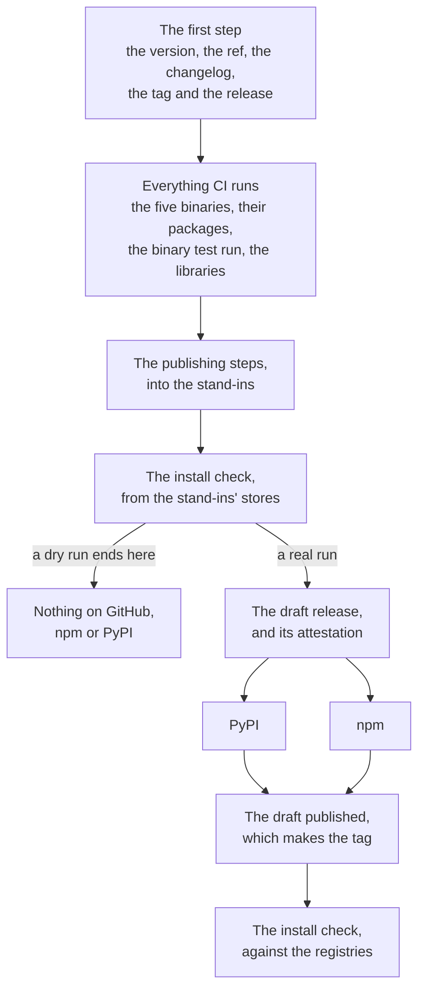

# Distribution: how the binary is built, released and verified

This doc explains how `a2ui-spectra` reaches your machine: the one binary built for five platforms, the packages that carry it on npm, PyPI and GitHub releases, the install scripts, what a release verifies before anything is published, and how you verify a download yourself. It is written for the developer of an A2UI agent who uses Spectra and wants to know what they are installing and how far to trust it. It starts with the problem, follows one release, `0.1.0`, from the build to a binary on a Mac, then opens up each channel and the release workflow, gives the full account of a binary downloaded by hand, and ends with the design decisions and where the code is.

How the binary is built, packaged and released is this doc's subject, so the commands that do it are here too. The commands and options of `a2ui-spectra` itself are in the [command's README](../../tools/spectra/README.md).

<picture>
  <source media="(prefers-color-scheme: dark)" srcset="diagrams/distribution-dark.png">
  
</picture>

## Problem it solves

Spectra is one program, written in TypeScript, that you run beside your agent. You should not need Node, a build or a clone of this repository to run it, and your agent's language should not decide how you get it: a Python developer reaches for `uvx`, a TypeScript developer for `npx`, and someone in CI for a script or a file they download.

That leaves five questions:

1. **What runs.** A program written for Node has to run where Node is not installed, on macOS, Linux and Windows, on Intel and on Arm.
2. **How it arrives.** npm, PyPI and a release page each have their own package format, and each must give you the same program.
3. **What a version means.** Spectra ships the binary and six libraries, the preview core, three preview adapters and two wrappers. You need to know which of them must match.
4. **What was tested.** A release has to install and run on all five platforms before you can install it, and what you install has to be what was tested.
5. **How far to trust a file.** The binaries are not signed with a paid developer identity. You need a way to check that a file is the one the release workflow built, and to know what your operating system does with an unsigned binary.

## Five ideas to hold on to

### 1. One binary per platform, the same bytes in every channel

Bun compiles Spectra, with the viewer's page embedded, into one file per platform. The npm platform package, the wheel and the release archive of a platform each hold that same file, and the release's checks compare its SHA-256 in every one of them with the binary that was built.

### 2. Built once, tested, then published as tested

A release is one workflow run. It builds the five binaries once, runs the tool's whole test target against each on its own platform, publishes the packages into stand-in registries, installs them from there on all five platforms as you would, and only then publishes those same files to npm, PyPI and GitHub.

### 3. The binary makes no request of its own

There is no update check and no usage count. The requests that leave Spectra are the agent's card, the agent's turns, and what its proxies forward for the agent.

### 4. One version for every package, and no compatibility claim

The binary and the six libraries of a release carry one version and are released together from one tag. The version says which release a package came from, not what it works with: the binary judges a wrapper by the [turn record version](../../specification/turn_record/v0_1/docs/turn_record.md#versions) its spans state, as the [A2UI step doc](a2ui-step.md#5-each-span-states-the-turn-record-version-it-follows) explains, and a preview page by the preview protocol version it announces, as the [preview doc](preview.md) explains. Nothing in Spectra compares package versions.

### 5. No paid signing: a checksum, an attestation and the download mark

The macOS binaries carry an ad-hoc signature and the Windows binary is unsigned. A release's integrity rests on its checksums and its build provenance attestation, which you can check yourself. Installed through `npx`, `uvx` or the install scripts, the binary carries no download mark. Downloaded by hand through a browser, it does, and you clear it.

## One release, end to end

The release is `0.1.0`, and you are on a Mac with Apple silicon.

1. **The version is set.** One commit on `main` writes `0.1.0` into the nine places that carry it and moves the changelog's entries into a section `## 0.1.0`.
2. **The workflow is started by hand,** with the version, as a confirmation, and the dry-run switch off. Its first step refuses unless the version is the committed one, the run was dispatched from `main`, `CHANGELOG.md` holds a section for it that is not empty, and neither the tag `v0.1.0` nor a release of it exists.
3. **Everything CI runs, runs.** One macOS runner builds the five binaries, makes the binary's packages and checks them; the binary test run runs the tool's test target against each platform's binary on its own runner; the libraries are packed and checked.
4. **The stand-ins are filled.** The publishing steps publish the npm placeholders, the seven PyPI files and the eleven npm packages into a stand-in npm registry and a stand-in Python index on one runner, then run again and find every file already there.
5. **The install check runs,** on the five platforms, from the stand-ins' stores: `npx`, `uvx` and the install script, each as the root README writes it.
6. **The files are published.** The draft release receives the five archives and `checksums.txt`, and the archives are attested. PyPI and npm receive their files through trusted publishing. The draft is published, which makes the tag.
7. **The install check runs again,** against npm, PyPI and GitHub themselves.
8. **You install it.** `uvx a2ui-spectra` fetches the macOS arm64 wheel from PyPI and runs the binary in its scripts folder. Or you download `a2ui-spectra-v0.1.0-darwin-arm64.tar.gz` from the release page, check it against `checksums.txt` and its attestation, clear its download mark and unpack it.

The release notes are the changelog's section, with the preview protocol's lines added. This is the end of what the first step prints for `0.1.0`, from `node tools/spectra/scripts/release.mjs first-step --version 0.1.0 --ref refs/heads/main --dry-run --notes notes.md` run on `main`:

```
- `a2ui-spectra-instrumentation`, the wrapper reporting the A2UI step, on npm for `@a2ui/agent` 0.1.0 or later, on OpenTelemetry JavaScript's 2.x line with `@opentelemetry/api` `>=1.3.0 <1.10.0`, and on PyPI for `a2ui-agent-sdk` 0.11.0 or later, with OpenTelemetry `>=1.39.0,<2`.

### The preview protocol

This release speaks preview protocol 2.
```

When the preview protocol differs from the release before, the notes say so and name it: preview pages need the release's preview adapters, and a page on an earlier adapter has no preview.

## The platforms

| Platform    | npm platform package        | Wheel tag                                               | Release archive                               |
| ----------- | --------------------------- | ------------------------------------------------------- | --------------------------------------------- |
| macOS arm64 | `a2ui-spectra-darwin-arm64` | `py3-none-macosx_13_0_arm64`                            | `a2ui-spectra-v<version>-darwin-arm64.tar.gz` |
| macOS x64   | `a2ui-spectra-darwin-x64`   | `py3-none-macosx_13_0_x86_64`                           | `a2ui-spectra-v<version>-darwin-x64.tar.gz`   |
| Linux x64   | `a2ui-spectra-linux-x64`    | `py3-none-manylinux_2_17_x86_64.manylinux2014_x86_64`   | `a2ui-spectra-v<version>-linux-x64.tar.gz`    |
| Linux arm64 | `a2ui-spectra-linux-arm64`  | `py3-none-manylinux_2_17_aarch64.manylinux2014_aarch64` | `a2ui-spectra-v<version>-linux-arm64.tar.gz`  |
| Windows x64 | `a2ui-spectra-windows-x64`  | `py3-none-win_amd64`                                    | `a2ui-spectra-v<version>-windows-x64.zip`     |

These are the five platforms upstream's `a2ui` command ships for, named as it names them. The wheels are tagged from the binaries' floors, macOS 13.0 and glibc 2.17.

- **Windows on arm64 is not supported.** The PowerShell install script refuses it, and the npm launcher says the platform is not supported.
- **Linux on musl, such as Alpine, is not supported:** the binary needs glibc. The shell install script and the npm launcher each refuse it in one line, and the Linux platform packages state `"libc": ["glibc"]`.
- **On Windows,** Spectra is held to PowerShell and cmd on Windows x64. Git Bash is not tested, and WSL runs the Linux binary. How the agent's process tree is started and stopped on Windows is in the [agent's process doc](agent-process.md).

## Inside the machinery

### The binary

`bun build --compile` compiles the tool's TypeScript, `tools/spectra/src/cli.ts`, into one executable per platform, with Bun's runtime inside it. Bun is pinned as a dev dependency, at 1.4.4.

- **What it embeds.** The viewer's build, with the built-in preview page for the basic catalogs under `preview/`, so the page you open is served from inside the binary. The binary also holds upstream's schemas and catalogs, copied unchanged, OpenTelemetry's protocol code and LiteLLM's price table, as [the notices](#the-third-party-notices) list.
- **What it does not load.** A compiled Bun program would read `.env` and `bunfig.toml` from its working directory by default. The build switches both off, so the binary reads neither from your agent's folder.
- **Where it is built.** On one macOS runner, from one build of the viewer, for all five platforms. Bun cross-compiles each binary onto its platform's runtime, the npm package `@oven/bun-<target>` at the pinned Bun version. The build fetches each runtime package from the npm registry itself, checks it against npm's published integrity value held in `scripts/bun_runtimes.json`, and stops on a package that does not match. A move to another Bun version stops the build, naming both versions, until the five integrity values at the new version are written in.
- **How it is signed.** Bun signs the macOS arm64 binary ad hoc, and the build signs the macOS x64 binary ad hoc with `codesign`; the build then verifies both signatures and stops on one that is not ad hoc. The Windows binary is unsigned. An ad-hoc signature names no developer, as the macOS arm64 binary of `yarn build:binaries` shows under `codesign --display --verbose=2`:

```
Format=Mach-O thin (arm64)
CodeDirectory v=20400 size=733374 flags=0x20002(adhoc,linker-signed) hashes=22915+0 location=embedded
Signature=adhoc
Info.plist=not bound
TeamIdentifier=not set
```

- **Its size.** At `0.1.0` the binaries are 95 MB for macOS arm64, 104 MB for macOS x64, 115 MB for each Linux and 121 MB for Windows x64, as `yarn build:binaries` built them; the archives are 44 to 57 MB.
- **What it asks of the network.** Nothing of its own: no update check and no usage counts. The agent's card, the agent's turns from the message box, and what the wire proxy, the model proxy and the tool proxy forward for the agent are the requests that leave it.

### The binary's packages

One command makes every package of the binary from the five binaries, on macOS. It takes no version: each package is stamped with the version in `src/version.ts`, and the command first checks that the Mac's own binary prints it. Every package and archive carries the repository's `LICENSE` and the build's `THIRD_PARTY_NOTICES.md`. Each npm package's manifest names the repository, with `tools/spectra` as its folder, and the issues page, and each wheel names the repository and the issues page as its project's addresses.

| Channel | File                                                                          | What it holds                                                                                                                                                                                                                                                          |
| ------- | ----------------------------------------------------------------------------- | ---------------------------------------------------------------------------------------------------------------------------------------------------------------------------------------------------------------------------------------------------------------------- |
| npm     | The launcher, `a2ui-spectra-<version>.tgz`                                    | The launcher script as the `a2ui-spectra` command, the command's README, `LICENSE` and the notices. Its manifest names the five platform packages as optional dependencies, each pinned to the version, asks for Node 22 or later and has no install script            |
| npm     | Five platform packages, `a2ui-spectra-<platform>-<version>.tgz`               | The binary, executable, with `LICENSE` and the notices and no README. Its manifest states the platform's `os` and `cpu`, and `"libc": ["glibc"]` on Linux, so npm installs only the one that fits                                                                      |
| PyPI    | Five wheels, `a2ui_spectra-<version>-<tag>.whl`                               | The binary alone, in the wheel's scripts folder, so installing the wheel puts `a2ui-spectra` on your path. Built by hatchling through `uv build`, tagged per platform, with the command's README as its description and `LICENSE` and the notices as its licence files |
| GitHub  | Five archives, `a2ui-spectra-v<version>-<platform>.tar.gz`, `.zip` on Windows | Flat: the binary, `LICENSE`, `THIRD_PARTY_NOTICES.md` and `README.md`, with no folder around them and, in the `.tar.gz` files, no owner and no macOS metadata                                                                                                          |
| GitHub  | `checksums.txt`                                                               | The SHA-256 of each archive, in `sha256sum`'s format                                                                                                                                                                                                                   |

The README each package carries is the command's own, with every relative link and image written as a GitHub address at the version's tag, so that it reads the same on npm, on PyPI and in an archive. A relative link that does not resolve stops the packing.

The Linux x64 platform package's manifest, as `yarn build:packages` writes it into `dist/packages/npm/a2ui-spectra-linux-x64-0.1.0.tgz`:

```json
{
  "name": "a2ui-spectra-linux-x64",
  "version": "0.1.0",
  "description": "The a2ui-spectra binary for Linux x64, which the a2ui-spectra package runs; install a2ui-spectra.",
  "license": "Apache-2.0",
  "repository": {
    "type": "git",
    "url": "git+https://github.com/retz8/a2ui-spectra.git",
    "directory": "tools/spectra"
  },
  "bugs": {"url": "https://github.com/retz8/a2ui-spectra/issues"},
  "os": ["linux"],
  "cpu": ["x64"],
  "libc": ["glibc"],
  "files": ["a2ui-spectra", "THIRD_PARTY_NOTICES.md"],
  "preferUnplugged": true
}
```

The macOS arm64 wheel of the same build, listed by `unzip -l`:

```
 94592354  02-02-2020 00:00   a2ui_spectra-0.1.0.data/scripts/a2ui-spectra
   158803  02-02-2020 00:00   a2ui_spectra-0.1.0.dist-info/METADATA
      102  02-02-2020 00:00   a2ui_spectra-0.1.0.dist-info/WHEEL
    11358  02-02-2020 00:00   a2ui_spectra-0.1.0.dist-info/licenses/LICENSE
   195499  02-02-2020 00:00   a2ui_spectra-0.1.0.dist-info/licenses/THIRD_PARTY_NOTICES.md
      551  02-02-2020 00:00   a2ui_spectra-0.1.0.dist-info/RECORD
```

And the release's `checksums.txt`, from `dist/packages/release/` of the same build:

```
2c0a96433d49d14f2948066da5b5a7500bbea77fdc97ab4c92e366be808a8f4a  a2ui-spectra-v0.1.0-darwin-arm64.tar.gz
77e8f67e37fad02b1b7ffa49106e7705de0f240503344305396a39a5c3602b83  a2ui-spectra-v0.1.0-darwin-x64.tar.gz
42f5c06d7597b60a0e51dd2a2cd171c3deb7fc9dd3ae5dd7d54777e0b235ca75  a2ui-spectra-v0.1.0-linux-arm64.tar.gz
48cc02f4f13f1b79edb60ddecb9e59e21b0d035c6b7f7048cd6361c9ad934389  a2ui-spectra-v0.1.0-linux-x64.tar.gz
5b45aee22c43d58ea17ad8258163227ff168b14136823fcd80e603e2eecf85bd  a2ui-spectra-v0.1.0-windows-x64.zip
```

### The npm launcher

`npx a2ui-spectra` installs the launcher and, of its five optional dependencies, the one platform package whose `os`, `cpu` and `libc` fit. The launcher is one script that imports nothing outside Node's own modules and fetches nothing. It finds the platform package's binary and runs it with your arguments.

- **It stays until the binary has ended,** then exits with the binary's exit code, or by the signal that ended it.
- **On macOS and Linux** it passes SIGTERM and SIGHUP on to the binary and holds Ctrl-C, which the terminal sends the binary itself. Spectra counts a SIGTERM or SIGHUP that reaches it both directly and through the launcher as one stop. What that means for the agent's stop is in the [agent's process doc](agent-process.md).
- **On Windows** every console event reaches the binary directly, and the launcher holds Ctrl-C, Ctrl-Break and the console window's close.
- **On every platform** it sets `A2UI_SPECTRA_NPM_LAUNCHER=1` in the binary's environment, which is how Spectra knows it runs under the launcher; Spectra removes it before it starts the agent, so the agent's environment does not carry it.
- **Where there is no binary to run,** it says why in one line and exits 1: on a platform outside the five, on Linux with musl, and when the platform package is missing, as it is after an install with `--omit=optional`.

The line on musl, as the launcher's test, `src/npm/launcher.test.ts`, expects it:

```
a2ui-spectra: Linux with musl is not supported. a2ui-spectra runs on Linux with glibc.
```

### The names

The command, its npm launcher and its PyPI package are named `a2ui-spectra`. Every other package takes it as its prefix: the platform packages `a2ui-spectra-<platform>`, the two wrappers `a2ui-spectra-instrumentation`, one on npm and one on PyPI, the preview core `a2ui-spectra-preview` and the adapters `a2ui-spectra-preview-<framework>`. Spectra is aimed at moving into upstream's `tools/` folder, where it becomes `@a2ui/spectra`, and how it ships from there is upstream's decision.

Each npm name is first created by a placeholder, published by hand before the first release: version `0.0.0-placeholder` under the dist-tag `placeholder`, holding a manifest, `LICENSE` and a README saying that the first release is on its way and naming the repository. A trusted publisher is configured on a package that already exists, so the placeholder comes first and the release workflow publishes the release after it. After the first release each placeholder is deprecated, with a message naming the release. If npm shows you `0.0.0-placeholder`, install `0.1.0` or later.

### The version

A release's version is set in one place, `tools/spectra/src/version.ts`, which the binary prints on `--version`. A version is three numbers, with no pre-release part. The places that carry it are the seven released packages' alone:

| Package                                 | Where it states the version                                               |
| --------------------------------------- | ------------------------------------------------------------------------- |
| The binary, on all its channels         | `tools/spectra/src/version.ts` and `tools/spectra/package.json`           |
| The preview core and the three adapters | Each one's `package.json` under `typescript/preview/`                     |
| The TypeScript wrapper                  | `typescript/instrumentation/package.json`                                 |
| The Python wrapper                      | `python/a2ui_spectra_instrumentation/pyproject.toml` and its `version.py` |

The workspace packages that are never published state `0.0.0`. `yarn set:version <version>`, from `tools/spectra/`, writes the version into the nine places and brings the root `uv.lock` along; `yarn check:version` fails when a place states another version, and CI runs it. On `main` today it prints:

```
The 9 places that carry the version state 0.1.0.
```

**What the version does not claim.** It does not say which wrapper, preview adapter or turn record a binary works with. A wrapper is judged by the turn record version its spans state, and a preview page by the preview protocol version it announces; when Spectra does not speak the one it meets, it names the side to upgrade. A binary and libraries of different releases can be used together, as far as those contracts agree.

### The libraries' packs

The six libraries you add to your own project are packed by one command, `yarn pack:libraries`, into the files a registry receives. Each is packed at the version its manifest states, which must be the one `src/version.ts` sets, from a copy outside the workspace, and each names the repository and the issues page.

| Library                                                                                                                                                          | Registry | File                                                                                       | What it holds                                                                                                                                                                                                                                                         |
| ---------------------------------------------------------------------------------------------------------------------------------------------------------------- | -------- | ------------------------------------------------------------------------------------------ | --------------------------------------------------------------------------------------------------------------------------------------------------------------------------------------------------------------------------------------------------------------------- |
| The preview core `a2ui-spectra-preview`; the adapters `a2ui-spectra-preview-react`, `-lit` and `-angular`; the TypeScript wrapper `a2ui-spectra-instrumentation` | npm      | `<name>-<version>.tgz`, as `npm pack` writes it                                            | The packed manifest, `LICENSE`, the library's README, its built JavaScript with source maps, and its `.d.ts` files without declaration maps. No `src/`, no test and no `.tsbuildinfo`. An adapter's manifest states the preview core at the release's version exactly |
| The Python wrapper `a2ui-spectra-instrumentation`                                                                                                                | PyPI     | The sdist, `a2ui_spectra_instrumentation-<version>.tar.gz`                                 | `pyproject.toml`, `README.md`, `LICENSE` and `src/`                                                                                                                                                                                                                   |
| The Python wrapper                                                                                                                                               | PyPI     | The wheel, `a2ui_spectra_instrumentation-<version>-py3-none-any.whl`, built from the sdist | The module, with `LICENSE` under `dist-info/licenses/`                                                                                                                                                                                                                |

A packed npm manifest is the library's own without `private`, `scripts`, `wireit` and `devDependencies`; a field the command neither keeps nor drops stops it. The libraries bundle nothing, so no pack carries a third-party notices file. CI packs and checks the libraries on every run, and only the release workflow uploads the packs for publishing, as it does the binary's packages.

### The install scripts

The shell script for macOS and Linux and the PowerShell script for Windows are served from this repository's `main` on raw GitHub, and the root README's [install section](../../README.md#install) gives the one line that runs each:

```sh
curl -fsSL https://raw.githubusercontent.com/retz8/a2ui-spectra/main/scripts/public/install.sh | sh
```

```powershell
irm https://raw.githubusercontent.com/retz8/a2ui-spectra/main/scripts/public/install.ps1 | iex
```

They are upstream's install scripts for its `a2ui` command, `scripts/public/install_cli.sh` and `install_cli.ps1` at the pin, changed in their names, their release tags, the two origins they read, the shell script's message on musl, the PowerShell script's refusal of Windows on arm64 and their version check, which takes three plain numbers alone, as a release's version is. Each, in order:

1. **Detects the platform.** The shell script stops on an operating system other than macOS and Linux, pointing a Windows user to the PowerShell command, on an architecture other than x64 and arm64, and on Linux with musl. The PowerShell script stops on any Windows that is not x64, read from the native architecture, so a 32-bit PowerShell on Windows on arm64 is refused too; an x64 PowerShell under emulation there reads its architecture as x64, and is refused by the processor's identifier, which names an ARM processor.
2. **Chooses the release.** By default the latest: it reads the repository's releases list, 100 a page and up to five pages, and takes the first release whose tag starts with `v` and that is neither a draft nor a pre-release. A list it cannot read, as under GitHub's rate limit, or one with no such release, stops it with the line that names a version explicitly. `A2UI_SPECTRA_VERSION` names one instead, with or without the `v`. A version holding anything but letters, digits, dots and hyphens, or holding `..`, is refused before anything is downloaded, and so is one that is not three plain numbers, `x.y.z` with no pre-release, no fourth number and no leading zero, as the release's own version is.
3. **Downloads the platform's archive** from the release, `<origin>/<repository>/releases/download/v<version>/<archive>`.
4. **Verifies its SHA-256** against the release's `checksums.txt`: through `sha256sum` or `shasum` in the shell script, and `Get-FileHash` in PowerShell. A mismatch, a `checksums.txt` that does not list the archive, a `checksums.txt` that cannot be downloaded, or a machine with neither `sha256sum` nor `shasum`, stops it, nothing installed. `A2UI_SPECTRA_SKIP_CHECKSUM=1` skips the check, with a warning.
5. **Installs the binary,** extracted from the archive, which must hold it, copied beside the one it replaces and moved into place, so that a binary already there is replaced whole. On Windows the binary already there is first moved aside, so that it is replaced even while it runs. It needs no `sudo`.
6. **Puts it on your path,** or says how. The shell script edits no shell file: when the folder is not on `PATH` it prints the lines that add it, into `~/.zshrc` or `~/.bashrc` when your shell is zsh or bash, and the binary's full path to run it directly. The PowerShell script adds the folder to your user `PATH` in the registry, keeping any `%VARIABLE%` in it unexpanded, and to the session that ran it, and tells Windows the environment changed, so a terminal opened after it finds `a2ui-spectra` too.

| Variable                      | What it sets                                                         | Default                                                                                     |
| ----------------------------- | -------------------------------------------------------------------- | ------------------------------------------------------------------------------------------- |
| `A2UI_SPECTRA_VERSION`        | The version to install, `0.1.0` or `v0.1.0`; `latest` is the default | The latest release                                                                          |
| `A2UI_SPECTRA_INSTALL_DIR`    | The folder to install into                                           | `$XDG_BIN_HOME`, else `~/.local/bin`; on Windows `%LOCALAPPDATA%\Programs\a2ui-spectra\bin` |
| `A2UI_SPECTRA_REPO`           | The GitHub repository, `owner/repo`                                  | `retz8/a2ui-spectra`                                                                        |
| `A2UI_SPECTRA_GITHUB_URL`     | The origin of the release's files                                    | `https://github.com`                                                                        |
| `A2UI_SPECTRA_GITHUB_API_URL` | The origin of the releases list                                      | `https://api.github.com`                                                                    |
| `A2UI_SPECTRA_SKIP_CHECKSUM`  | `1` skips the SHA-256 check                                          | The check runs                                                                              |

Set a variable for the script in the pipe, `curl -fsSL … | A2UI_SPECTRA_VERSION=0.1.0 sh`, or in PowerShell first, `$env:A2UI_SPECTRA_VERSION = '0.1.0'`. The two origins are what the release's checks use to serve the script a stand-in for GitHub.

The shell script installing the macOS arm64 archive of a `yarn build:packages` build, served by a local stand-in named by `A2UI_SPECTRA_GITHUB_URL`, with `A2UI_SPECTRA_VERSION=0.1.0` and `A2UI_SPECTRA_INSTALL_DIR` set; the folder is shortened:

```
Downloading a2ui-spectra (v0.1.0) for darwin-arm64...
Verifying cryptographic SHA-256 checksum...
✓ SHA-256 checksum verified.
Installing to …/bin/a2ui-spectra...
✓ Successfully installed a2ui-spectra (v0.1.0) to …/bin/a2ui-spectra

⚠️  Action Required: …/bin is not currently in your PATH.
Add it to your shell configuration file to run 'a2ui-spectra' from anywhere:

  echo 'export PATH="…/bin:$PATH"' >> ~/.bashrc
  source ~/.bashrc
```

The installed binary carried no extended attribute, and printed `0.1.0` on `--version`.

### The release workflow

A release is made by one GitHub Actions workflow, `.github/workflows/release.yml`, started by hand with the version and a dry-run switch, which is on by default. Each step is one command of `tools/spectra/scripts/release.mjs`. Some steps around it are done by hand, once before the first release and at each release.



**The first step** refuses the run unless the version given is the committed version, the changelog holds one section for it that is not empty, and, on a real run, the run was dispatched from `main` and neither the tag nor a published release of the version exists. A dry run is started from any branch. A version that is not the committed one, as the first step prints it for `--version 0.2.0 --dry-run` on `main`:

```
release first-step: The dry run is refused:
- The version given, 0.2.0, is not the committed version, 0.1.0. The version changes only through a `set:version` commit on main.
- CHANGELOG.md holds no section `## 0.2.0`.
```

**Everything CI runs** runs from the same definition CI calls, `.github/workflows/checks.yml`, with the binary's packages and the libraries' packs uploaded to the run; the publishing jobs publish those files and build nothing. The run's summary names each npm package bundled into the binary that resolves to a local patch of upstream's code; a real run refuses while there is one, so no release ships upstream code that upstream has not published.

**The publishing steps, into the stand-ins.** The stand-ins are Verdaccio for npm and pypiserver for PyPI, each a local process on one runner that holds what is published to it and asks no other registry for anything. The npm placeholders go in first, then the seven PyPI files, then the eleven npm packages in their order: each platform package before the launcher, the preview core before each adapter, then the TypeScript wrapper. A second pass finds every file already there. The stand-ins' stores are uploaded to the run.

**Publishing,** on the stand-ins and on the registries alike, asks the registry first whether each file's version is there: a file held with the same checksum is skipped, and one held with another checksum fails the step before anything is published. A failed job is run again in the same run, and publishes only what is missing.

**A real run,** once the install check from the stand-ins has passed:

| Step              | What it does                                                                                                                                                                                                                                                                             |
| ----------------- | ---------------------------------------------------------------------------------------------------------------------------------------------------------------------------------------------------------------------------------------------------------------------------------------- |
| The draft release | Created holding the five archives and `checksums.txt`, at the run's commit, with the release notes. A draft an earlier attempt left is completed with what it lacks when every file it holds has the run's checksum, and refused otherwise                                               |
| The attestation   | GitHub's build provenance attestation of the five archives, each archive a subject, by the checksums in `checksums.txt`                                                                                                                                                                  |
| PyPI              | The seven files through trusted publishing, each with PyPI's attestation                                                                                                                                                                                                                 |
| npm               | The eleven packages through trusted publishing, each with npm's provenance                                                                                                                                                                                                               |
| The release       | The draft published, which makes the tag `v<version>` at the run's commit. With release immutability switched on in the repository's settings, one of the steps done by hand before the first release, a published release is immutable, so the archives and the tag cannot change after |
| The install check | Again, on the five platforms, against npm, PyPI and GitHub themselves                                                                                                                                                                                                                    |

Trusted publishing means no token is stored for npm or PyPI: each registry trusts this workflow, in its `release` environment, to publish its packages.

**A published file that is wrong is not replaced.** The version is abandoned: deprecated on npm and yanked on PyPI, and the next patch version, with its own changelog section, carries the fix.

### What a release verifies

| Check                 | Where it runs                                                                                                              | What it holds                                                                                                                                                                                                                                                                                                                                                                                                                                                                                                                                                              |
| --------------------- | -------------------------------------------------------------------------------------------------------------------------- | -------------------------------------------------------------------------------------------------------------------------------------------------------------------------------------------------------------------------------------------------------------------------------------------------------------------------------------------------------------------------------------------------------------------------------------------------------------------------------------------------------------------------------------------------------------------------- |
| The binaries' build   | One macOS runner                                                                                                           | Each Bun runtime against its integrity value, and both macOS signatures                                                                                                                                                                                                                                                                                                                                                                                                                                                                                                    |
| The binary's packages | The same runner                                                                                                            | For all five platforms, each npm package, wheel and archive holds exactly its files, the binary with the built binary's SHA-256 and its executable bit; each wheel's tag, every stated version, the repository and the issues page are right; each README's links are GitHub addresses that resolve; `checksums.txt` verifies. Then the Mac's own are installed as you would install them: the launcher and its platform package by npm, the wheel through `uvx`, and the archive by the shell install script from a stand-in for GitHub, each printing the version        |
| The binary test run   | Each platform's own runner: macOS arm64, macOS x64 in three parts on three runners, Linux x64, Linux arm64 and Windows x64 | The tool's whole test target against that platform's binary, built on the Mac. The install scripts' suite is among it, run as you run the scripts, piped: every case of the shell script under `/bin/sh` and the good install also under `dash` and `bash`, and every case of the PowerShell script under `powershell.exe` and `pwsh.exe`. On Windows each test starts Spectra in a console of its own and sends it Ctrl-C, Ctrl-Break and the window's close as a terminal would; a workflow started by hand, `Windows`, builds the five binaries and runs that job alone |
| The libraries' packs  | Linux x64                                                                                                                  | Each pack holds exactly its files, byte for byte; its manifest states the version, the repository and the issues page, and refers to nothing in the workspace; every export and every import resolves inside the pack or to a declared dependency or peer. Then each is installed outside the workspace: the preview core and the TypeScript wrapper by npm and imported under Node, each adapter into a catalog app's project of its own after its peers, and the wheel by uv, its OpenTelemetry entry point found                                                        |
| The version           | Linux x64                                                                                                                  | The nine places state one version                                                                                                                                                                                                                                                                                                                                                                                                                                                                                                                                          |
| The install check     | Each platform's own runner, from the stand-ins and again from the registries                                               | Below                                                                                                                                                                                                                                                                                                                                                                                                                                                                                                                                                                      |

CI runs every check but the install check on each push to `main` and each pull request; only the release workflow uploads the packages for publishing.

**The install check** is `.github/workflows/install_check.yml`, each install one run of `tools/spectra/scripts/install_check.mjs`. It reads the four commands from the root README's install section and runs them as written: `npx` under Node 22 and under the newest Node LTS line, `uvx` with uv at its latest, and the install script, on Windows under `powershell.exe` and under `pwsh.exe`. Each install runs in a fresh folder outside the checkout, with an empty npm cache and an empty uv cache of its own and no user configuration, the registries named by environment alone; the script installs into its default folder. Each must:

1. print the committed version on `--version`;
2. serve one turn under `run`: Spectra launches the conformance suite's stub agent with its canned A2UI conversation, `--no-open`, one message goes through the message box's API, and the turn closes waiting for input carrying the canned surface's three A2UI messages;
3. stop as you stop it at a terminal, with a Ctrl-C to the foreground process group on macOS and Linux and a console Ctrl-C on Windows: Spectra says it is stopping the agent, the command and every process holding its output exit within 30 seconds, and the stub agent's process is gone within 10 seconds after;
4. on macOS and Windows, leave no download mark on any installed binary, `com.apple.quarantine` or the `Zone.Identifier` stream, checked after a mark written on a scratch file in the same folder was read back, so that the folder is one that can hold a mark. macOS's `spctl --status` is printed too.

From the stand-ins, each runner starts them on the run's stores, on loopback, the npm registry with no user and none to be created and the Python index taking an upload from no one, so that nothing can be published to either, and the script's command reads the commit's install script and the run's archives from a stand-in for GitHub the check serves, the raw GitHub origin of the command changed to the stand-in's. Each install's line, with the Node, npm and uv versions it resolved, is in the run's summary.

Against the real registries the check is also started by hand, outside any release, from the Actions tab or with `gh workflow run install_check.yml --ref main`. It substitutes nothing, and each install must print the committed version at the ref, so it fails between the commit that sets a version and that version's release. CI does not run it; a test in the tool's test target, `src/install_check.test.ts`, reads the root README's install section as the check does.

## Verifying a download yourself

Two checks tell you a file is the one the release workflow built. Both take the archive, not the binary inside it.

**The checksum.** Download the archive and `checksums.txt` from the release page into one folder, then:

```sh
shasum -a 256 --ignore-missing -c checksums.txt      # macOS
sha256sum --ignore-missing -c checksums.txt          # Linux
```

```powershell
(Get-FileHash .\a2ui-spectra-v0.1.0-windows-x64.zip).Hash -eq (Select-String windows-x64 .\checksums.txt).Line.Split(' ')[0]
```

`shasum` checks every file `checksums.txt` lists that is in the folder and passes over the others under `--ignore-missing`. Run on the macOS arm64 archive and `checksums.txt` of a `yarn build:packages` build:

```
a2ui-spectra-v0.1.0-darwin-arm64.tar.gz: OK
```

`Get-FileHash` computes SHA-256 by default, and the PowerShell line prints `True` when the two match. A checksum tells you the file matches the list beside it on the same page; the attestation tells you who made the file.

**The build provenance attestation.** With GitHub's command-line tool, `gh`:

```sh
gh attestation verify a2ui-spectra-v0.1.0-darwin-arm64.tar.gz --repo retz8/a2ui-spectra
```

`gh` fetches the attestations for the file's digest through GitHub's API and checks that one was signed for this repository, with the SLSA provenance predicate. The attestation links the archive to the workflow that built it, the repository, the commit and the event that started the run. `--signer-workflow retz8/a2ui-spectra/.github/workflows/release.yml` also holds the signer to the release workflow. The five archives are the attestation's subjects, so the binary you extract does not verify on its own, and neither does `checksums.txt`; verify the archive.

**The registries' own provenance.** Each npm package shows its provenance on npmjs.com, and each PyPI file its attestation on pypi.org. With release immutability switched on in this repository's settings, which is done by hand before the first release, a GitHub release is immutable once published: its files and its tag cannot be changed, and GitHub makes a release attestation of its own.

## A binary downloaded by hand

The binaries are not signed with a paid developer identity: the macOS binaries carry an ad-hoc signature and are not notarised, and the Windows binary is unsigned. This section is the full account of what that means for a binary you download through a browser, and of what is established about it and what is not. Every statement about macOS and Windows here rests on Apple's and Microsoft's own documentation, listed under [The pages this rests on](#the-pages-this-rests-on).

### The download mark

| System  | The mark                                                                                                                                       | Who writes it                                                                                                                                                                               | What reads it                                                                                                                                                                                                                                                                  |
| ------- | ---------------------------------------------------------------------------------------------------------------------------------------------- | ------------------------------------------------------------------------------------------------------------------------------------------------------------------------------------------- | ------------------------------------------------------------------------------------------------------------------------------------------------------------------------------------------------------------------------------------------------------------------------------ |
| macOS   | The extended attribute `com.apple.quarantine`                                                                                                  | User-level apps, such as Safari, on a new download; the Finder's Archive Utility passes it on to what it unpacks. `curl` and `scp` do not write it, and `tar` and `unzip` do not pass it on | Gatekeeper. Running a quarantined app always invokes it, and it asks before opening downloaded software the first time. It checks that software comes from an identified developer, is notarised by Apple and has not been altered. When else it runs, Apple does not document |
| Windows | The `Zone.Identifier` alternate data stream, which Microsoft calls the Mark of the Web: `[ZoneTransfer]` with `ZoneId=3` for the Internet zone | Windows, on files from the internet such as browser downloads and email attachments, on NTFS file systems only                                                                              | SmartScreen in the Windows Shell, which scans a file carrying the mark when it is opened through Windows Explorer, and warns when the file is not one of a list of well-known, frequently downloaded files                                                                     |

How you install decides whether the binary carries the mark:

| How you install                           | The mark                                                                           |
| ----------------------------------------- | ---------------------------------------------------------------------------------- |
| `npx a2ui-spectra`                        | None                                                                               |
| `uvx a2ui-spectra`                        | None                                                                               |
| The install script                        | None                                                                               |
| The archive, downloaded through a browser | The archive carries it, and on macOS so does a binary the Finder or Safari unpacks |

The first three are established by the install check, as the table [below](#what-is-established-and-what-is-not) says.

### Clearing the mark

Verify the archive first, as [above](#verifying-a-download-yourself). Then, on macOS, clear the mark on the archive and unpack it with `tar`, which does not pass a mark on:

```sh
xattr -d com.apple.quarantine a2ui-spectra-v0.1.0-darwin-arm64.tar.gz
tar -xzf a2ui-spectra-v0.1.0-darwin-arm64.tar.gz
./a2ui-spectra --version
```

When Safari or the Finder has unpacked the archive already, the binary carries the mark itself: `xattr -d com.apple.quarantine a2ui-spectra`. `xattr -p com.apple.quarantine <file>` prints a file's mark, and `xattr <file>` lists every extended attribute it has.

On Windows, unblock the archive, extract it, and unblock the binary:

```powershell
Unblock-File .\a2ui-spectra-v0.1.0-windows-x64.zip
Expand-Archive .\a2ui-spectra-v0.1.0-windows-x64.zip
Unblock-File .\a2ui-spectra-v0.1.0-windows-x64\a2ui-spectra.exe
.\a2ui-spectra-v0.1.0-windows-x64\a2ui-spectra.exe --version
```

`Unblock-File` removes the `Zone.Identifier` stream, as the Unblock checkbox on the file's Properties does, and does nothing to a file that is not blocked. `Expand-Archive` extracts into a folder named after the archive. `Get-Item <file> -Stream Zone.Identifier` shows whether a file carries the mark.

Apple also documents opening a blocked app from System Settings, Privacy & Security, Open Anyway, available for about an hour after the attempt. That route is written for apps; clearing the mark is the route this doc gives for the binary.

### What is established, and what is not

| Statement                                                                                                    | Status          | What it rests on                                                                                                                                                                                                                                                                                                                                                                                                                                                                                                                                                                                                                                                                                                                                                                                                                                                                                                                                                                                     |
| ------------------------------------------------------------------------------------------------------------ | --------------- | ---------------------------------------------------------------------------------------------------------------------------------------------------------------------------------------------------------------------------------------------------------------------------------------------------------------------------------------------------------------------------------------------------------------------------------------------------------------------------------------------------------------------------------------------------------------------------------------------------------------------------------------------------------------------------------------------------------------------------------------------------------------------------------------------------------------------------------------------------------------------------------------------------------------------------------------------------------------------------------------------------- |
| A binary installed through `npx`, `uvx` or the install script carries no download mark, on macOS and Windows | Established     | The install check on the macOS arm64, macOS x64 and Windows x64 runners, from the stand-ins, in the dry run on `42337b3`, run 44842797434, each after a mark written beside the binary read back; and a run of the install check by hand on a maintainer's Mac, Apple M1 Pro on macOS 27.2.1, from the stores of the dry run 44839798931, macOS arm64 alone                                                                                                                                                                                                                                                                                                                                                                                                                                                                                                                                                                                                                                          |
| Gatekeeper's assessments were on where that ran                                                              | Established     | `spctl --status` printed assessments enabled on both macOS runners and on the maintainer's Mac                                                                                                                                                                                                                                                                                                                                                                                                                                                                                                                                                                                                                                                                                                                                                                                                                                                                                                       |
| Linux                                                                                                        | Not applicable  | Linux has no download mark the install check reads                                                                                                                                                                                                                                                                                                                                                                                                                                                                                                                                                                                                                                                                                                                                                                                                                                                                                                                                                   |
| Gatekeeper beyond quarantine: whether Gatekeeper ever assesses an unmarked, unnotarised binary at launch     | Not established | Apple documents that running a quarantined app always invokes Gatekeeper, and that the other times it runs are not documented and change over time                                                                                                                                                                                                                                                                                                                                                                                                                                                                                                                                                                                                                                                                                                                                                                                                                                                   |
| SmartScreen at a launch from a terminal                                                                      | Not established | Microsoft documents SmartScreen in the Windows Shell scanning a file carrying the Mark of the Web when it is opened through Windows Explorer, and says nothing of a program started from a terminal. On a GitHub Actions `windows-latest` runner, the hand-download trial's run 44869323269 started a binary carrying `Zone.Identifier` with `ZoneId=3` from Windows PowerShell and from PowerShell 7, and it ran and printed `0.1.0`; a runner is not a desktop Windows 11, so this is not taken as established                                                                                                                                                                                                                                                                                                                                                                                                                                                                                     |
| Smart App Control on Windows 11                                                                              | Not established | Microsoft documents that in enforcement mode Smart App Control runs an app only when its cloud service predicts it safe or it is signed with a certificate from a certificate authority in the Trusted Root Program, that unknown, unsigned code is blocked, and that no single app can be exempted. The Windows binary is unsigned, and has not been run under it                                                                                                                                                                                                                                                                                                                                                                                                                                                                                                                                                                                                                                   |
| The clearing steps, on an archive and binary marked as a browser marks a download                            | Established     | On Windows, the hand-download trial, `.github/workflows/hand_download_trial.yml`, run 44869323269 on `bd8c245`, under Windows PowerShell and PowerShell 7 on its own run's archive and `checksums.txt`: the checksum line printed `True`; the binary, marked, ran, `Unblock-File` removed its `Zone.Identifier` stream, and it ran again; the archive, marked, went through the README's three lines and its binary carried no stream and ran. On macOS, on the maintainer's Mac, Apple M1 Pro on macOS 27.2.1 with Gatekeeper's assessments enabled: the release build's macOS arm64 archive, marked with `com.apple.quarantine`, verified by `shasum -a 256 --ignore-missing -c`, cleared and unpacked as the README says, gave a binary with no extended attribute that ran and printed `0.1.0`; the binary itself, marked, was refused at launch, and once cleared with `xattr -d` a copy of it ran, while the same file stayed held at launch as long as Gatekeeper's prompt for it stayed open |
| The clearing steps, on an archive downloaded through a browser from the release page                         | Not established | No release page holds the archives before the first release; the trial on a browser's download is the release's                                                                                                                                                                                                                                                                                                                                                                                                                                                                                                                                                                                                                                                                                                                                                                                                                                                                                      |

What this means for you: on macOS and Windows, prefer `npx`, `uvx` or the install script. On a Windows 11 machine with Smart App Control on, Microsoft's documentation leaves no exception for one app; whether it lets this binary run has not been tried.

## The third-party notices

Every package and archive of the binary carries `THIRD_PARTY_NOTICES.md`, written once per build from what the build bundled. It opens with Spectra's own licence, Apache 2.0, then lists:

1. **Every npm package that contributed a file to the binary,** as the builds report it: Bun's metafile of each of the five binaries, counting an input that put bytes into the output, and the `bundle-report.json` of each Vite build, the viewer's and the built-in preview page's. Each package comes with its version, its licence, its licence text and its NOTICE file when it has one, read from the installed package. At `0.1.0` there are 76, the viewer's fonts among them, `@fontsource-variable/inter`, `@fontsource-variable/jetbrains-mono` and `@fontsource/material-icons`.
2. **A text kept by hand** for a package that ships no licence text, with where it came from. At `0.1.0` three need one: `@lit-labs/ssr-dom-shim` 1.6.0 and `@bufbuild/protobuf` 2.16.0, each the licence of its source repository at that version's tag, `@bufbuild/protobuf` with the licence header of its varint code too, taken from the package itself, which the binary's build does not keep; and `react-remove-scroll-bar` 2.3.8, the licence its repository added after that version was published, since the version states MIT and holds no text.
3. **What no bundler reports,** kept by hand: A2UI's schemas and catalogs, copied unchanged under Apache 2.0; code generated from OpenTelemetry's protocol files at v1.11.1, under Apache 2.0; LiteLLM's price table from release v1.106.6, trimmed to its Gemini, Anthropic and OpenAI entries, under MIT; and Bun's own `LICENSE.md` at the pinned version's tag.

The build stops on a bundled package with no licence text and none kept by hand, on a text kept by hand that no bundled package needs, as after a version's change, on a Bun section of another version than the pinned one, and on a LiteLLM section other than the price table's notice.

The libraries bundle nothing, so they carry no notices file; each carries `LICENSE`.

### The LGPL parts

Spectra is Apache 2.0, and so is everything it ships of its own. The binary also holds Bun's runtime, and Bun's licence, carried whole in the notices, says what Bun links. Two parts are under the LGPL:

- **JavaScriptCore and WebKit,** under LGPL-2, linked statically into Bun.
- **`tinycc`,** under LGPL v2.1, one of the libraries Bun links, listed in the notices' table of them.

For the first, the notices carry Bun's statement of what LGPL-2 asks of a statically linked program, where Bun's patched WebKit is, and the steps to relink Bun with changes. This is the start of it, cut from `tools/spectra/scripts/notices_by_hand.md`, the source of that part of the notices:

```
## JavaScriptCore

Bun statically links JavaScriptCore (and WebKit) which is LGPL-2 licensed. WebCore files from WebKit are also licensed under LGPL2. Per LGPL2:
…
You can find the patched version of WebKit used by Bun here: <https://github.com/oven-sh/webkit>.
```

Whether a binary holding LGPL code fits upstream's distribution is for upstream's maintainers to weigh when Spectra moves into upstream's `tools/` folder.

## When things go wrong

| What happens                                                                    | What you see                                                                                                                                             |
| ------------------------------------------------------------------------------- | -------------------------------------------------------------------------------------------------------------------------------------------------------- |
| `npx a2ui-spectra` on Windows on arm64, or another platform outside the five    | `a2ui-spectra: This platform, <platform> <arch>, is not supported. a2ui-spectra runs on macOS arm64, macOS x64, Linux x64, Linux arm64 and Windows x64.` |
| `npx a2ui-spectra` on Linux with musl                                           | `a2ui-spectra: Linux with musl is not supported. a2ui-spectra runs on Linux with glibc.`                                                                 |
| The launcher installed with `--omit=optional`                                   | One line naming the missing platform package, and to install `a2ui-spectra` again with its optional dependencies                                         |
| The shell script on Alpine or another musl Linux                                | `Error: musl-based Linux (e.g. Alpine) is not supported; the a2ui-spectra binary requires glibc.`                                                        |
| The shell script on Windows                                                     | The operating system is refused, with the PowerShell command to use instead                                                                              |
| The PowerShell script on Windows on arm64                                       | `Unsupported Windows architecture: ARM64. The a2ui-spectra binary requires an x64 host.`                                                                 |
| The script cannot read the releases list, as under GitHub's rate limit          | It stops, saying so, with the command that names the version: set `A2UI_SPECTRA_VERSION`                                                                 |
| The archive's SHA-256 does not match `checksums.txt`                            | It stops, printing the expected and the actual SHA-256; nothing is installed                                                                             |
| `checksums.txt` cannot be downloaded                                            | It stops, naming `A2UI_SPECTRA_SKIP_CHECKSUM=1` as the bypass                                                                                            |
| The install folder is not on `PATH`, on macOS or Linux                          | The line to add for your shell, and the binary's full path to run it directly                                                                            |
| On Windows, `a2ui-spectra` is not found in a terminal opened before the install | That terminal keeps its old `PATH`; open a new one                                                                                                       |
| macOS refuses a binary downloaded through a browser                             | Clear its mark, as [Clearing the mark](#clearing-the-mark) says                                                                                          |
| Windows warns about a file downloaded through a browser                         | Unblock it, as [Clearing the mark](#clearing-the-mark) says                                                                                              |
| `gh attestation verify` on the extracted binary or on `checksums.txt` fails     | The attestation's subjects are the five archives: verify the archive                                                                                     |

## Design decisions

| Decision                                                                                               | What it buys                                                                                                                       | What it costs                                                                                                        |
| ------------------------------------------------------------------------------------------------------ | ---------------------------------------------------------------------------------------------------------------------------------- | -------------------------------------------------------------------------------------------------------------------- |
| One binary per platform, compiled by Bun, the viewer embedded, as Temporal's command embeds its web UI | No Node, no build and no second download to run Spectra; one file to check                                                         | A binary of 95 to 121 MB; Bun's runtime brings its LGPL parts                                                        |
| The five platforms upstream's `a2ui` command ships for                                                 | Spectra is built for the same five targets as upstream's own command                                                               | No Windows on arm64, which upstream's PowerShell script admits for its x64 binary, and no Linux on musl              |
| On npm, one optional package per platform and no install script, as Biome ships                        | Nothing runs at install, so an install under `--ignore-scripts` works; npm installs only your platform's package                   | An install with `--omit=optional` has no binary, and the launcher needs Node 22                                      |
| On PyPI, one wheel per platform holding only the binary, as Ruff ships                                 | `uvx a2ui-spectra` runs with no Node at all                                                                                        | Five wheels per release, each tagged from a floor                                                                    |
| Install scripts that behave as upstream's `a2ui` command's do                                          | The same steps, variables and folders as upstream's command's scripts, under Spectra's names; no `sudo`                            | A script checks the SHA-256 alone, not the attestation                                                               |
| Build once, test those files on every platform, publish those files                                    | What you install is the file that was tested                                                                                       | All five binaries come from one macOS runner, cross-compiled                                                         |
| Publish into stand-ins and install from them before anything is published                              | An install that fails on any platform stops the release while nothing is public                                                    | A stand-in is not the registry, so the install check runs again after the publish                                    |
| Skip a file already published with the same checksum, refuse one with another                          | A failed run is run again safely                                                                                                   | A wrong published file is never replaced: its version is abandoned                                                   |
| Trusted publishing on npm and PyPI                                                                     | No stored token; the registries' own provenance on every file                                                                      | A new npm name first needs a placeholder published by hand                                                           |
| No paid signing; checksums and a build provenance attestation                                          | No developer programme or certificate to keep; anyone can check a file against the workflow that built it                          | A binary downloaded through a browser carries the download mark you clear yourself, and Smart App Control is untried |
| One version for the release, and no compatibility claim in it                                          | The contracts, the turn record version and the preview protocol version, decide what works together, and say which side to upgrade | The version number tells you nothing about compatibility                                                             |
| No request of the binary's own                                                                         | Spectra works offline and sends nothing about you anywhere                                                                         | No update notice: you learn of a new release from the release page or the registries                                 |
| The third-party notices generated from what each build bundled                                         | The notices match the binary exactly, package for package                                                                          | A bundled package without a licence text stops the build until one is kept by hand                                   |

## Known limits

- Windows on arm64 and Linux on musl are not supported, and Git Bash on Windows is not tested.
- Homebrew and `dart pub global` are not channels yet.
- The binaries are not signed with a paid developer identity, and the macOS binaries are not notarised.
- The install scripts verify the SHA-256 against `checksums.txt` from the same release, not the attestation; verify the attestation yourself where it matters.
- The binary never tells you a newer release exists.
- Until the first release, the real run's draft, attestation, trusted publishing and publication have not run; dry runs have run everything before them.

## Building and checking it yourself

From `tools/spectra/`, on macOS:

```bash
yarn build:binaries     # the five binaries, into dist/binaries/
yarn build:packages     # their npm packages, wheels and archives, into dist/packages/
yarn check:packages     # every file checked, and this Mac's installed as an adopter would
```

On any platform:

```bash
yarn build:binary       # the host's binary alone, into dist/a2ui-spectra
yarn pack:libraries     # the six libraries' packs, into dist/libraries/
yarn check:libraries    # each pack checked, and installed outside the workspace
yarn check:version      # the nine places state one version
yarn set:version <version>  # writes a version into the nine places
yarn pack:placeholders  # the eleven npm placeholders, into dist/placeholders/
```

A dry run of the release, from any branch, and the install check against the real registries:

```bash
gh workflow run release.yml --ref <branch> -f version=<version> -f dry-run=true
gh workflow run install_check.yml --ref main
```

A dry run touches nothing on GitHub, npm or PyPI: no tag, no draft and no attestation.

## Where the code is

| What                                                          | Where                                                                                                                                                                                                                                                                                                                   |
| ------------------------------------------------------------- | ----------------------------------------------------------------------------------------------------------------------------------------------------------------------------------------------------------------------------------------------------------------------------------------------------------------------- |
| The five binaries: the runtimes checked, the signatures       | [`tools/spectra/scripts/build_binaries.mjs`](../../tools/spectra/scripts/build_binaries.mjs), [`bun_runtimes.json`](../../tools/spectra/scripts/bun_runtimes.json)                                                                                                                                                      |
| The platforms, the files' names, the version read             | [`tools/spectra/scripts/packages.mjs`](../../tools/spectra/scripts/packages.mjs)                                                                                                                                                                                                                                        |
| The binary's packages, and their check                        | [`build_packages.mjs`](../../tools/spectra/scripts/build_packages.mjs), [`check_packages.mjs`](../../tools/spectra/scripts/check_packages.mjs), the wheel's project [`tools/spectra/wheel/`](../../tools/spectra/wheel)                                                                                                 |
| The npm launcher                                              | [`tools/spectra/src/npm/launcher.ts`](../../tools/spectra/src/npm/launcher.ts)                                                                                                                                                                                                                                          |
| The third-party notices                                       | [`notices.mjs`](../../tools/spectra/scripts/notices.mjs), [`notices_by_hand.md`](../../tools/spectra/scripts/notices_by_hand.md), [`licences_by_hand/`](../../tools/spectra/scripts/licences_by_hand)                                                                                                                   |
| The version                                                   | [`tools/spectra/src/version.ts`](../../tools/spectra/src/version.ts), [`tools/spectra/scripts/version.mjs`](../../tools/spectra/scripts/version.mjs)                                                                                                                                                                    |
| The libraries' packs, and their check                         | [`libraries.mjs`](../../tools/spectra/scripts/libraries.mjs), [`pack_libraries.mjs`](../../tools/spectra/scripts/pack_libraries.mjs), [`check_libraries.mjs`](../../tools/spectra/scripts/check_libraries.mjs)                                                                                                          |
| The install scripts, and their suite                          | [`scripts/public/install.sh`](../../scripts/public/install.sh), [`scripts/public/install.ps1`](../../scripts/public/install.ps1), [`tools/spectra/src/install_scripts.test.ts`](../../tools/spectra/src/install_scripts.test.ts)                                                                                        |
| The release workflow and its steps                            | [`.github/workflows/release.yml`](../../.github/workflows/release.yml), [`tools/spectra/scripts/release.mjs`](../../tools/spectra/scripts/release.mjs), [`tools/spectra/src/release_steps.test.ts`](../../tools/spectra/src/release_steps.test.ts), [`.github/actions/publish-npm/`](../../.github/actions/publish-npm) |
| Everything CI runs, the binaries' job and the binary test run | [`.github/workflows/checks.yml`](../../.github/workflows/checks.yml), [`binaries.yml`](../../.github/workflows/binaries.yml), [`windows_binary_test.yml`](../../.github/workflows/windows_binary_test.yml), and `Windows`, [`windows.yml`](../../.github/workflows/windows.yml)                                         |
| The hand-download trial                                       | [`.github/workflows/hand_download_trial.yml`](../../.github/workflows/hand_download_trial.yml)                                                                                                                                                                                                                          |
| The README on runners: its Windows lines, and the refusals    | [`.github/workflows/readme_on_runners.yml`](../../.github/workflows/readme_on_runners.yml), [`tools/spectra/scripts/github_stand_in.mjs`](../../tools/spectra/scripts/github_stand_in.mjs)                                                                                                                              |
| The stand-ins and the placeholders                            | [`tools/spectra/scripts/stand_ins.mjs`](../../tools/spectra/scripts/stand_ins.mjs), [`placeholders.mjs`](../../tools/spectra/scripts/placeholders.mjs)                                                                                                                                                                  |
| The install check                                             | [`.github/workflows/install_check.yml`](../../.github/workflows/install_check.yml), [`tools/spectra/scripts/install_check.mjs`](../../tools/spectra/scripts/install_check.mjs), [`tools/spectra/src/install_check.test.ts`](../../tools/spectra/src/install_check.test.ts)                                              |
| The release notes' source                                     | [`CHANGELOG.md`](../../CHANGELOG.md)                                                                                                                                                                                                                                                                                    |
| This doc's diagram, its source and its two exports            | [`docs/design/diagrams/`](diagrams)                                                                                                                                                                                                                                                                                     |

## The pages this rests on

Each page was read for this doc, and each row says what it says that the doc relies on.

| Page                                                                                                                                                                                                                                                 | What it says                                                                                                                                                                                                                                                                                                                                                                           |
| ---------------------------------------------------------------------------------------------------------------------------------------------------------------------------------------------------------------------------------------------------- | -------------------------------------------------------------------------------------------------------------------------------------------------------------------------------------------------------------------------------------------------------------------------------------------------------------------------------------------------------------------------------------- |
| Apple Support, [Safely open apps on your Mac](https://support.apple.com/en-us/102445)                                                                                                                                                                | Gatekeeper is designed to ensure only trusted software runs; outside the App Store, macOS checks the Developer ID signature, and from macOS Catalina requires software to be notarised by default; an app not notarised can be opened from Privacy & Security, Open Anyway                                                                                                             |
| Apple, Mac User Guide, [Open a Mac app from an unknown developer](https://support.apple.com/guide/mac-help/open-a-mac-app-from-an-unknown-developer-mh40616/mac)                                                                                     | The Open Anyway steps; the button is available for about an hour after the attempt                                                                                                                                                                                                                                                                                                     |
| Apple Platform Security, [Gatekeeper and runtime protection in macOS](https://support.apple.com/guide/security/gatekeeper-and-runtime-protection-sec5599b66df/web)                                                                                   | Gatekeeper verifies that software is from an identified developer, is notarised and has not been altered, and requests approval before opening downloaded software the first time; users can override it unless a device management service restricts it                                                                                                                               |
| Apple Platform Security, [Protecting against malware in macOS](https://support.apple.com/guide/security/protecting-against-malware-sec469d47bd8/web)                                                                                                 | Gatekeeper with notarisation prevents the launch of malware; XProtect checks an app at its first launch                                                                                                                                                                                                                                                                                |
| Apple Developer Forums, Apple Developer Technical Support, [Resolving Trusted Execution Problems](https://developer.apple.com/forums/thread/706442)                                                                                                  | User-level apps such as Safari quarantine a new download by setting `com.apple.quarantine`; Archive Utility passes it on, `curl` and `scp` do not set it, `tar` and `unzip` do not pass it on; running a quarantined app always invokes Gatekeeper, and when else it runs is not documented and changes over time; `xattr` removes the attribute from a download before it is unpacked |
| Apple Developer, [Quarantine attribute in macOS apps uploaded to App Store Connect](https://developer.apple.com/news/upcoming-requirements/?id=02182025a)                                                                                            | Names `com.apple.quarantine` as the quarantine extended file attribute                                                                                                                                                                                                                                                                                                                 |
| `xattr(1)` and `shasum(1)`, the manual pages macOS 27.2.1 installs                                                                                                                                                                                   | `xattr -p` prints an attribute, `xattr -d` removes it, `xattr` lists a file's attributes; `shasum -a 256 -c` checks SHA-256 sums from a file, and `--ignore-missing` passes over files not present                                                                                                                                                                                     |
| Microsoft Learn, [Unblock-File](https://learn.microsoft.com/en-us/powershell/module/microsoft.powershell.utility/unblock-file)                                                                                                                       | It removes the `Zone.Identifier` alternate data stream, whose value `3` says the file came from the internet; it does what the Unblock button in Properties does; on a file not blocked it does nothing; `Get-Item -Stream Zone.Identifier` finds the stream                                                                                                                           |
| Microsoft Learn, [[MS-FSCC]: Zone.Identifier Stream Name](https://learn.microsoft.com/en-us/openspecs/windows_protocols/ms-fscc/6e3f7352-d11c-4d76-8c39-2516a9df36e8)                                                                                | The stream's name and its text form, `[ZoneTransfer]` and `ZoneId=3`                                                                                                                                                                                                                                                                                                                   |
| Microsoft Learn, [Macros from the internet are blocked by default in Office](https://learn.microsoft.com/en-us/microsoft-365-apps/security/internet-macros-blocked)                                                                                  | Windows adds the Mark of the Web to files from an untrusted location such as browser downloads and email attachments, on NTFS only; the ZoneId values, `3` the Internet; `Unblock-File` removes it                                                                                                                                                                                     |
| Microsoft Learn, [Microsoft Defender SmartScreen](https://learn.microsoft.com/en-us/windows/security/operating-system-security/virus-and-threat-protection/microsoft-defender-smartscreen/)                                                          | SmartScreen checks downloaded files against a list of well-known, frequently downloaded files and warns when a file is not on it, and checks the reputation of the signature a file is signed with                                                                                                                                                                                     |
| Microsoft Support, [SmartScreen deprecation in Internet Explorer and IE Mode in Windows 11](https://support.microsoft.com/en-us/kb/5071357)                                                                                                          | A file tagged with the Mark of the Web is scanned by SmartScreen in the Windows Shell when it is opened through Windows Explorer; the "Check apps and files" setting controls it                                                                                                                                                                                                       |
| Microsoft Learn, [Smart App Control](https://learn.microsoft.com/en-us/windows/apps/develop/smart-app-control/overview)                                                                                                                              | It runs an app only when Microsoft's app intelligence predicts it safe or it is signed with a certificate from a certificate authority in the Trusted Root Program; unknown, unsigned code is blocked; its evaluation and enforcement modes                                                                                                                                            |
| Microsoft Support, [Smart App Control Frequently Asked Questions](https://support.microsoft.com/en-us/topic/what-is-smart-app-control-285ea03d-fa88-4d56-882e-6698afdb7003)                                                                          | It is on Windows 11; there is no way to bypass it for an individual app; it is turned off in Windows Security, and recent updates turn it on again without a clean installation                                                                                                                                                                                                        |
| Microsoft Learn, [Get-FileHash](https://learn.microsoft.com/en-us/powershell/module/microsoft.powershell.utility/get-filehash) and [Expand-Archive](https://learn.microsoft.com/en-us/powershell/module/microsoft.powershell.archive/expand-archive) | `Get-FileHash` computes SHA-256 by default, compared with a published hash by `-eq`; `Expand-Archive` extracts into a folder named after the archive by default                                                                                                                                                                                                                        |
| GitHub CLI manual, [gh attestation verify](https://cli.github.com/manual/gh_attestation_verify)                                                                                                                                                      | It verifies an artifact's integrity and provenance from its signed attestations, needs `--owner` or `--repo`, fetches the attestations through GitHub's API, enforces the SLSA provenance predicate by default, and takes `--signer-workflow`                                                                                                                                          |
| GitHub Docs, [Using artifact attestations to establish provenance for builds](https://docs.github.com/en/actions/how-tos/secure-your-work/use-artifact-attestations/use-artifact-attestations)                                                       | Verifying a binary with `gh attestation verify <file> -R <owner>/<repo>`                                                                                                                                                                                                                                                                                                               |
| GitHub Docs, [Artifact attestations](https://docs.github.com/en/actions/concepts/security/artifact-attestations)                                                                                                                                     | An attestation links an artifact to its workflow, repository, commit and triggering event; a public repository's use Sigstore's public-good instance; an attestation is not a guarantee that an artifact is secure                                                                                                                                                                     |
| GitHub Docs, [Immutable releases](https://docs.github.com/en/code-security/supply-chain-security/understanding-your-software-supply-chain/immutable-releases)                                                                                        | A published immutable release's files and tag cannot be changed, and GitHub generates a release attestation                                                                                                                                                                                                                                                                            |

## Words used in this doc

| Word                         | Meaning                                                                                                                         |
| ---------------------------- | ------------------------------------------------------------------------------------------------------------------------------- |
| Binary                       | `a2ui-spectra`, the one executable per platform that Bun compiles, with the viewer inside                                       |
| Launcher                     | The npm package `a2ui-spectra`'s script, which runs the binary of your platform's package                                       |
| Platform package             | One of the five npm packages, `a2ui-spectra-<platform>`, that holds the binary                                                  |
| Wheel                        | A Python package file; Spectra's hold the binary alone, one per platform                                                        |
| Archive                      | One of the five files on the release page, `.tar.gz` or `.zip`, holding the binary, `LICENSE`, the notices and the README       |
| Ad-hoc signature             | A macOS code signature that names no developer                                                                                  |
| Notarisation                 | Apple's malware scan of software distributed outside the App Store, which Gatekeeper checks                                     |
| Build provenance attestation | A signed statement, made by GitHub Actions, that a file was built by a given workflow in a given repository at a given commit   |
| Trusted publishing           | npm's and PyPI's way of letting one workflow publish a package without a stored token                                           |
| Stand-in registry            | A local npm registry or Python index on a runner, published into before anything is published                                   |
| Install check                | An install of the binary on each platform as you install it, from the stand-ins or from the registries                          |
| Binary test run              | The tool's whole test target run against each platform's binary on that platform                                                |
| Placeholder                  | The `0.0.0-placeholder` version that first created each npm name                                                                |
| Download mark                | What the operating system writes on a downloaded file: `com.apple.quarantine` on macOS, the `Zone.Identifier` stream on Windows |
| Mark of the Web              | Microsoft's name for the `Zone.Identifier` stream                                                                               |
| Gatekeeper                   | macOS's check of downloaded software before it opens                                                                            |
| SmartScreen                  | Microsoft Defender SmartScreen, Windows' reputation check of downloaded files                                                   |
| Smart App Control            | A Windows 11 feature that runs only apps predicted safe or signed with a trusted certificate                                    |
