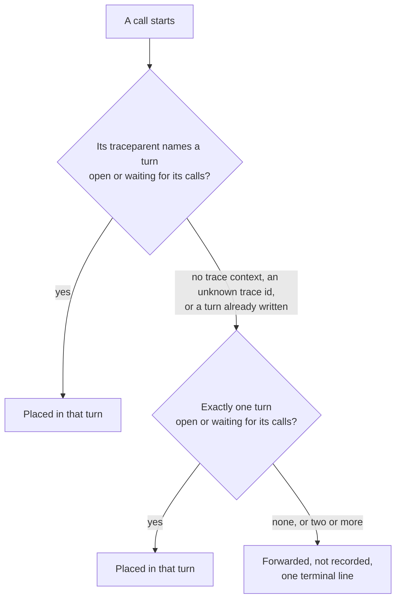

# Model and tool calls: how Spectra sees what the agent asks its model and its tools

This doc explains how Spectra sees the calls an A2UI agent makes to its model provider and to its tool servers: how the calls are redirected through Spectra's model proxy and tool proxy, how each is read, stripped of its credentials and placed in its turn, and how the viewer works out the tokens, the prompt cache use, the estimated cost and the prefix break from what was recorded. It is written for the developer of an A2UI agent who uses Spectra and wants to know what happens between their agent and its model, and what the numbers in the viewer are made of. It starts with the problem, follows the model calls of one turn of upstream's Python restaurant finder from the environment variable to the estimated cost, then opens up the redirection, the two proxies, the placement and the viewer's arithmetic, and ends with the design decisions and where the code is.

The running example is upstream's Python restaurant finder, `samples/agent/adk/restaurant_finder`, on ADK and google-genai, asked to "Book a table for 2 at the first one tomorrow at 7pm" after "Top 2 Chinese restaurants in New York". The turn makes three streamed calls to `gemini-3.6-flash`: the first asks for the `get_restaurants` tool, the second carries its result and answers with a booking form, and the third is the sample asking again after its parser rejected that form with "Surface booking-form already exists.". The restaurant finder's `get_restaurants` is a function in the agent's process, so it never crosses the network and the tool proxy has nothing to see; the tool proxy's examples come from Spectra's own tool server, in the tool capture suite.

<picture>
  <source media="(prefers-color-scheme: dark)" srcset="diagrams/model-and-tool-calls-dark.png">
  
</picture>

## Problem it solves

An agent's model and tool calls leave its process as HTTP requests: to Gemini's, OpenAI's or Anthropic's API, and to the MCP servers and HTTP tools it uses. What crosses there is what decides the turn:

- the exact model request: the system prompt, with the UI section the A2UI SDK generated inside it, the tool definitions, the model id and its settings, and every message;
- the raw reply, chunk by chunk, before any SDK has parsed it;
- the token counts, the share read from the prompt cache, and what the call cost;
- each tool call, with its arguments and its result.

Spectra's wire proxy sees none of this: it sits between the host and the agent. The agent's OpenTelemetry spans see some of it, depending on which instrumentations the agent runs and in which dialect they write. A developer chasing a wrong answer, a slow turn or a cache that keeps missing needs the request as it went out.

Spectra puts two proxies at that edge, the model proxy and the tool proxy, and reaches them without a change to the agent's code: `a2ui-spectra run` sets the environment variables the agent's clients read their base URLs from, each pointing at a proxy, and `a2ui-spectra attach` prints them for the agent's shell. Each proxy forwards what it is given as it was given, and records a copy, credentials removed, in the turn the call belongs to. What the record holds is what the network carried; the viewer works out the rest from it each time the turn is shown.

## Five ideas to hold on to

### 1. Redirection, not interception

Spectra does not sit in the operating system's network path. It points the agent's clients at itself through the variables they already read: `GOOGLE_GEMINI_BASE_URL` for google-genai and ADK, `OPENAI_BASE_URL` for OpenAI's SDKs, `ANTHROPIC_BASE_URL` for Anthropic's, LiteLLM's two, and for each tool server the variable the config file names. A client that reads none of them, such as one whose endpoint is written in the code, is not reached until it reads one.

### 2. Each proxy forwards as received and keeps a copy

The request goes on with its headers and body as the agent wrote them, the `Host` header set to the real target and the headers of the connection itself left out, and the reply comes back as the provider wrote it, a stream chunk by chunk as it arrives. Credentials are never removed from what is forwarded. They are removed from the copy, before the live stream, the API or the store sees it.

### 3. Read in full where the API is known, raw everywhere else

Five requests on the providers' own hosts are read in full into OpenTelemetry's GenAI names: the model, the settings, the system prompt, the messages, the tools, the reply and the token counts. Every other call, on those hosts or any other, is recorded raw, as the HTTP exchange alone. Spectra reads an API only where it can be sure which API it is.

### 4. A call belongs to the turn its trace context names, else to the one open turn

A call carrying a turn's trace id joins that turn. Without one, it joins the turn that is open when it starts, if exactly one is. A call that fits neither is forwarded and not recorded, and the terminal says why.

### 5. Tokens are recorded; cost and the prefix break are worked out when shown

The record holds the token counts as the provider reported them. The estimated cost, the hit ratio and the prefix break are worked out in the viewer each time the turn is shown, from the record and from the price table Spectra carries. A new price table, or a price in the config file, reprices every record already saved.

## One turn, end to end

The restaurant finder runs under `a2ui-spectra run`, and the booking message is sent from the message box.

1. **The variables are set.** Before the agent's command starts, `run` binds the model proxy and sets the five base-URL variables in the agent's environment, each pointing at its own prefix on the model proxy, with the OpenTelemetry receiver's variables beside them. Under `attach` Spectra prints the same lines for the agent's shell, cut here from `a2ui-spectra attach http://127.0.0.1:9914 --port 9910 --proxy-port 9911 --model-proxy-port 9912 --receiver-port 9913 --no-open`, run with the built binary against the conformance workspace's stub agent on port 9914, with no config file and none of the variables set in Spectra's own environment:

   ```
   a2ui-spectra: To see model and tool calls, set these in the agent's shell and restart it:
   export GOOGLE_GEMINI_BASE_URL=http://127.0.0.1:9912/GOOGLE_GEMINI_BASE_URL  # forwards to https://generativelanguage.googleapis.com
   export OPENAI_BASE_URL=http://127.0.0.1:9912/OPENAI_BASE_URL  # forwards to https://api.openai.com/v1
   export ANTHROPIC_BASE_URL=http://127.0.0.1:9912/ANTHROPIC_BASE_URL  # forwards to https://api.anthropic.com
   export ANTHROPIC_API_BASE=http://127.0.0.1:9912/ANTHROPIC_API_BASE  # forwards to https://api.anthropic.com
   export GEMINI_API_BASE=http://127.0.0.1:9912/GEMINI_API_BASE  # forwards to https://generativelanguage.googleapis.com/v1beta, or /v1alpha for a gemini-3 model
   export OTEL_EXPORTER_OTLP_ENDPOINT=http://127.0.0.1:9913  # for Spectra's OpenTelemetry receiver
   export OTEL_EXPORTER_OTLP_PROTOCOL=http/protobuf  # for Spectra's OpenTelemetry receiver
   export OTEL_INSTRUMENTATION_GENAI_CAPTURE_CONTENT=SPAN_ONLY  # for Spectra's OpenTelemetry receiver
   export OTEL_INSTRUMENTATION_GENAI_CAPTURE_MESSAGE_CONTENT=true  # for Spectra's OpenTelemetry receiver
   a2ui-spectra: If the agent's shell already sets one of the model or tool variables to another address, start Spectra with that value set as well, so the proxy forwards there.
   ```

2. **The agent calls Gemini.** ADK's google-genai client reads `GOOGLE_GEMINI_BASE_URL` and posts each request under the prefix: `/GOOGLE_GEMINI_BASE_URL/v1beta/models/gemini-3.6-flash:streamGenerateContent?alt=sse` on the model proxy. The proxy takes the prefix off and forwards the rest to the prefix's target, `https://generativelanguage.googleapis.com/v1beta/models/gemini-3.6-flash:streamGenerateContent?alt=sse`, with the request's headers and body as sent, the key in `x-goog-api-key` included.
3. **The call is placed.** Before forwarding, the proxy asks which turn the call belongs to. The booking turn is the one open turn, so the call joins it. An agent launched under `opentelemetry-instrument` with its HTTP server and HTTP client instrumented also carries the turn's trace id in the request's `traceparent`, which names the turn whatever else is open.
4. **The reply streams back.** Gemini answers with server-sent events. Each passes on to the agent as it arrives, and a copy of each is recorded as a chunk. The path and the host name Gemini's `streamGenerateContent` on its own host, so the Gemini reader reads the request and the reply into the GenAI names.
5. **The turn waits for its calls.** The wire closes the turn when the agent's last reply has arrived. The turn is checked and written only once its three calls have ended, with the calls among its events by start time.
6. **The viewer works it out.** For each call, the tokens and the share read from the cache, the estimated cost from the price table's entry for `gemini/gemini-3.6-flash`, and the prefix break against the earlier calls of the same model in the conversation.

The second call, as the model proxy records it. This is cut from the model capture case `gemini_restaurant_finder_google_genai`, [`conformance/test_data/model_capture/v0_1/gemini/restaurant_finder_google_genai.json`](../../conformance/test_data/model_capture/v0_1/gemini/restaurant_finder_google_genai.json), which the model capture suite writes by sending the restaurant finder's recorded traffic through the model proxy. The system prompt, the messages, the tool definitions, the request body, the reply and the chunks are shortened here, and four of the request's headers are left out. The expected record leaves out what Spectra makes rather than reads off the traffic, the times, the time to the first chunk, `server.address`, `server.port` and the `host` and `content-length` headers, so its timestamps are placeholders.

```jsonc
// The model_call event's name and attributes, as recorded
{
  "name": "generate_content gemini-3.6-flash",
  "attributes": {
    "a2ui.event.kind": "model_call",
    "gen_ai.operation.name": "generate_content",
    "gen_ai.provider.name": "gcp.gemini",
    "gen_ai.request.model": "gemini-3.6-flash",
    "gen_ai.request.stream": true,
    "gen_ai.system_instructions": [{"type": "text", "content": "You are a helpful restaurant finding assistant. Your final output MUST be an A2UI UI definition.\n\n## UI Description:…"}],
    "gen_ai.input.messages": [{"role": "user", "parts": [{"type": "text", "content": "Top 2 Chinese restaurants in New York"}]}, …],
    "gen_ai.tool.definitions": [{"type": "function", "name": "get_restaurants", …}],
    "http.request.method": "POST",
    "url.full": "https://generativelanguage.googleapis.com/v1beta/models/gemini-3.6-flash:streamGenerateContent?alt=sse",
    "http.request.header.x-goog-api-key": ["REMOVED"],
    "http.request.header.x-goog-api-client": ["google-genai-sdk/2.10.0 gl-python/3.14.3 google-adk/2.3.0 gl-python/3.14.3"],
    "a2ui.http.request.body": {"contents": […], "systemInstruction": {…}, "tools": […], "generationConfig": {}},
    "http.response.header.content-type": ["text/event-stream"],
    "http.response.status_code": 200,
    "gen_ai.response.id": "q1Tlasy_DZSi1e8P8N_C6AQ",
    "gen_ai.response.model": "gemini-3.6-flash",
    "gen_ai.response.finish_reasons": ["stop"],
    "gen_ai.usage.input_tokens": 15437,
    "gen_ai.usage.cache_read.input_tokens": 12979,
    "gen_ai.usage.output_tokens": 3353,
    "gen_ai.usage.reasoning.output_tokens": 2416,
    "gen_ai.output.messages": [{"role": "assistant", "parts": [{"type": "text", "content": "Here is the booking form to reserve a table for 2 at Xi'an Famous Foods:\n\n<a2ui-json>…"}], "finish_reason": "stop"}]
  }
}
// The last of its 41 chunks, where Gemini reports the usage
{
  "a2ui.http.response.chunk.body": {
    "candidates": [{"content": {"parts": [{"text": "", "thoughtSignature": "EohPCoVPAW…"}], "role": "model"}, "finishReason": "STOP", "index": 0}],
    "usageMetadata": {"promptTokenCount": 15437, "candidatesTokenCount": 937, "totalTokenCount": 18790, "cachedContentTokenCount": 12979, "thoughtsTokenCount": 2416, "serviceTier": "standard", …},
    "modelVersion": "gemini-3.6-flash",
    "responseId": "q1Tlasy_DZSi1e8P8N_C6AQ"
  }
}
```

The output tokens are Gemini's `candidatesTokenCount` plus its `thoughtsTokenCount`, 937 and 2,416, and the reasoning tokens are the 2,416 alone. The key the agent sent in `x-goog-api-key` reached Gemini and is `REMOVED` in the record.

What the viewer works out for the three calls, from the record and the price table's entry `gemini/gemini-3.6-flash`, $0.75 per million input tokens, $0.075 per million read from the cache and $3.75 per million output tokens, reasoning included:

| Call                       | Input  | Read from the cache | Output, reasoning included | Hit ratio | Estimated cost | Prefix break                             |
| -------------------------- | ------ | ------------------- | -------------------------- | --------- | -------------- | ---------------------------------------- |
| The `get_restaurants` call | 15,037 | 0                   | 149, 122 of them reasoning | 0%        | $0.012         | The first call of the model              |
| The booking form           | 15,437 | 12,979              | 3,353, 2,416 reasoning     | 84%       | $0.015         | Shares all of the earlier call's request |
| The retry                  | 18,884 | 15,436              | 2,414, 1,459 reasoning     | 82%       | $0.013         | Shares all of the earlier call's request |

The second call's cost is its 2,458 uncached input tokens at the input rate, its 12,979 cached ones at the cache read rate and its 3,353 output tokens at the output rate: $0.0018 + $0.00097 + $0.0126, $0.015 to two significant figures. Over the turn, the viewer counts 3 model calls, 49.4k tokens in and 5.9k out, 58% of the input from the cache, and an estimated $0.040, with the price table's date, 2026-10-28. Each call's request holds the one before it whole, the retry adding the rejected reply and the sample's request to try again, and from the second call on Gemini read most of the input from its cache.

## Inside the machinery

### Redirection

The model proxy listens on loopback at `http://127.0.0.1:<model-proxy-port>`, 9822 unless `--model-proxy-port` moves it, with one path prefix per base-URL variable, named after the variable: `http://127.0.0.1:9822/GOOGLE_GEMINI_BASE_URL`, and so on for the five. A call under a prefix is forwarded to that prefix's target followed by the rest of its path and its query. A request under no prefix is answered `404` with one line naming the five prefixes, as [What the agent and the terminal are told](#what-the-agent-and-the-terminal-are-told) shows.

Each target is what the variable's client would have resolved from the original values in Spectra's own environment, else the provider's own API:

| Variable                 | Read by                                      | Forwards to the original value of                                                                                                                                              |
| ------------------------ | -------------------------------------------- | ------------------------------------------------------------------------------------------------------------------------------------------------------------------------------ |
| `GOOGLE_GEMINI_BASE_URL` | Google's Python and JavaScript SDKs, and ADK | Itself, else `https://generativelanguage.googleapis.com`                                                                                                                       |
| `OPENAI_BASE_URL`        | OpenAI's SDKs                                | Itself, else `OPENAI_API_BASE`, else `https://api.openai.com/v1`                                                                                                               |
| `ANTHROPIC_BASE_URL`     | Anthropic's SDKs                             | Itself, else `https://api.anthropic.com`                                                                                                                                       |
| `ANTHROPIC_API_BASE`     | LiteLLM's `anthropic/` route                 | Itself, else `ANTHROPIC_BASE_URL`, else `https://api.anthropic.com`. An original ending in `/v1/messages`, which LiteLLM appends itself, has it dropped                        |
| `GEMINI_API_BASE`        | LiteLLM's `gemini/` route                    | Itself, else `https://generativelanguage.googleapis.com/v1alpha` for a model whose name, in the call's path, contains `gemini-3`, and `…/v1beta` otherwise, LiteLLM's own rule |

The rules of an original value:

- It is read from Spectra's own environment, trimmed, with its trailing slashes dropped. A blank value counts as unset.
- A value that points at the model proxy itself, left over from an earlier `attach`, counts as unset: `http://` on `127.0.0.1`, `localhost` or `[::1]` at the model proxy's port.
- `OPENAI_API_BASE` is read as an original and never set. No Vertex AI variable is set: Vertex AI is not redirected.
- On Windows a variable Spectra reads from its own environment is found in any case, and one it sets for the agent replaces the developer's of that name in any case.

**Tool servers.** MCP defines no standard variable for a server's URL, so the config file's `tools` names, for each server, the variable the agent reads its URL from and the URL. Each server has its own listener on the tool proxy, at `http://127.0.0.1:<port>`, the first on `--tool-proxy-port`, 9824 unless moved, and each further one on the next port, in config order. The listener stands for the server's origin: a request to its `/<path>` is forwarded to the server's origin followed by the same path and query. The server's variable is set to the listener's origin followed by the server's path and query, so an original of `http://127.0.0.1:8000/sse` gives `FLOOR_PLAN_SERVER_URL=http://127.0.0.1:9824/sse`, and a query the agent needs, a token included, stays in the value. Relative URLs in the server's replies, MCP's `endpoint` event included, resolve against the listener and stay on it. When Spectra's own environment sets the variable to a value that is not blank and not the tool proxy itself, an `http://` address on `127.0.0.1`, `localhost` or `[::1]` at one of the tool proxy's ports, that value is the server's URL instead of the config file's; a value that is not a URL starting with `http://` or `https://` stops Spectra at start.

**Under `run`.** The five variables and each tool server's variable are set in the agent's environment, replacing any of the same name, and so are the OpenTelemetry receiver's four: `OTEL_EXPORTER_OTLP_ENDPOINT`, the receiver's origin, `OTEL_EXPORTER_OTLP_PROTOCOL=http/protobuf`, and the GenAI conventions' two content capture switches, each switch unless Spectra's own environment sets it, when its value is passed on. Which endpoint and protocol variables Spectra replaces, and the line it prints when it does, are the receiver's, in [the OpenTelemetry doc](opentelemetry.md). When Spectra launched the agent's command, under `run` or under `replay` and `test` given a command, every turn lists `model_proxy` among its capture paths, and `tool_proxy` too when the config file names a tool server.

**Under `attach`.** Spectra prints at start, once the agent's card has answered, the line "To see model and tool calls, set these in the agent's shell and restart it:", then one POSIX `export` line per variable ending in a comment naming where it forwards, credentials removed from the comment and not from the value: the model proxy's five, each tool server's in config order, then the receiver's four, each ending in `# for Spectra's OpenTelemetry receiver`; and last the line saying that if the agent's shell already sets one of the model or tool variables to another address, Spectra is to be started with that value set as well, so the proxy forwards there. On Windows the lines are two blocks, one for PowerShell under `# In PowerShell:`, `$env:NAME = 'value'` with the same comment, and one for cmd under `rem In cmd:`, `set "NAME=value"` with no comment, as cmd takes everything after `=` as the value. The viewer's first screen shows the same lines, as [the viewer doc](viewer.md) describes. A turn lists `model_proxy` only when a call through the model proxy was placed in it, and `tool_proxy` only when a call through the tool proxy was.

**Under both,** Spectra prints one line per tool server with its addresses. Cut from the tool servers' test, [`tools/spectra/src/tool_proxy/servers.test.ts`](../../tools/spectra/src/tool_proxy/servers.test.ts), for two servers on ports 9823 and 9824, the second's URL carrying a token:

```
The tool proxy for FLOOR_PLAN_SERVER_URL is at http://127.0.0.1:9823, forwarding to http://127.0.0.1:8000
The tool proxy for CIRCLECI_MCP_URL is at http://127.0.0.1:9824, forwarding to https://mcp.circleci.com
export FLOOR_PLAN_SERVER_URL=http://127.0.0.1:9823/sse  # forwards to http://127.0.0.1:8000/sse
export CIRCLECI_MCP_URL=http://127.0.0.1:9824/v1/mcp?token=secret  # forwards to https://mcp.circleci.com/v1/mcp?token=REMOVED
```

An agent that hardcodes its model endpoint needs a line of code to read the variable instead, and so does one that hardcodes a tool server's URL. Tools that are plain functions in the agent's process, as the restaurant finder's `get_restaurants` is, are not seen at the network edge: they run live during a replay, and are seen through OpenTelemetry where the framework emits spans for them. A tool server that redirection does not reach behaves the same way.

### The config file's settings

The two settings of this part. Where the file is found, that it is read strictly and that the command line takes precedence are in [the command's README](../../tools/spectra/README.md). The model providers have no setting: each prefix's target comes from Spectra's own environment, as above.

```json
{
  "tools": [{"variable": "FLOOR_PLAN_SERVER_URL", "url": "http://127.0.0.1:8000/sse"}],
  "prices": {"my-gemini-tune": {"input": 0.75, "output": 3.75, "cacheRead": 0.075}}
}
```

**`tools`**, the agent's tool servers, a list of `{"variable", "url"}` and nothing else:

- `variable` is the environment variable the agent reads the server's URL from: a POSIX name, letters, digits and underscores not starting with a digit; named once across the list; and none of the model proxy's five. Each breach stops Spectra at start, with the file's name and one of these lines, as the code writes them:
  - `tools[<i>].variable must be a variable name of letters, digits and underscores, not starting with a digit, not '<name>'.`
  - `tools[<i>].variable is <name>, one of the model proxy's variables; a tool server needs a variable of its own.`
  - `tools[<i>].variable <name> names another tool server already; each needs its own.`
- `url` is the server's URL, starting with `http://` or `https://`; anything else stops Spectra at start. When Spectra's own environment sets the variable, that value is the URL instead, as above.
- The servers take consecutive ports from `--tool-proxy-port`. Ports past 65535 stop Spectra at start with a line asking for a lower `--tool-proxy-port`; a range holding another of Spectra's ports, with a line naming the option that holds it, such as `--port`.

**`prices`**, prices for the viewer's estimated cost, keyed by the model id as the call requested it, each in USD per million tokens:

- `input` and `output` are required; `cacheRead` and `cacheWrite` are optional, and the cache tokens a price lacks a rate for are priced as input. Each is a number of 0 or more, and no other key is taken.
- `input` prices the input tokens neither read from nor written to the cache. `output` prices every output token, reasoning included: an entry here has no reasoning price and no tiers.
- An entry replaces the price table's entry for that model whole, never merging with it, and prices a model the table does not know.

### The model proxy

**Forwarding.** The proxy holds each request until its body has been read, then forwards it to its target with the headers and body as received, with three changes: `Host` is set to the target's, `content-length` is set to the body's length when the request has a body, and the headers that belong to one connection, `Connection` and those it names, `Keep-Alive`, `Proxy-Authenticate`, `Proxy-Authorization`, `Proxy-Connection`, `TE`, `Trailer`, `Transfer-Encoding` and `Upgrade`, are not passed on. The reply passes back with its status and its headers as received, the same connection headers left out, and a streamed reply chunk by chunk as it arrives.

**The five requests read in full**, on the providers' own hosts:

| API                       | Host                                | Request                                                                                |
| ------------------------- | ----------------------------------- | -------------------------------------------------------------------------------------- |
| Gemini                    | `generativelanguage.googleapis.com` | `POST /{version}/models/{model}:generateContent`, and `:streamGenerateContent?alt=sse` |
| OpenAI's Chat Completions | `api.openai.com`                    | `POST /v1/chat/completions`                                                            |
| OpenAI's Responses        | `api.openai.com`                    | `POST /v1/responses`                                                                   |
| Anthropic's Messages      | `api.anthropic.com`                 | `POST /v1/messages`                                                                    |

The Gemini path is also read without its version, as `/models/{model}:…`, the form LiteLLM sends under a base that holds the version. A `streamGenerateContent` without `alt=sse`, Gemini's `countTokens`, and any other path or method on these hosts are recorded raw. A Gemini request is read in both spellings of every field the reader takes, the camel case and the snake case, as the Gemini API takes either: the system instruction, the generation settings and each of their keys, the tools and their function declarations, `parameters` and `parameters_json_schema`, the function call and function response parts, inline and file data, and the thought signature. google-genai sends `parameters_json_schema`, and LiteLLM `system_instruction`, `function_declarations`, `function_call` and `function_response`. A Gemini response is read in camel case, as the API answers.

**The event.** Each call becomes a `model_call` event under the turn event, `kind` `3`, named `{operation} {model}`, or by its HTTP method when it is recorded raw. A call read in full carries the GenAI names read from the request and the response:

- `gen_ai.operation.name`, `generate_content` for Gemini and `chat` for the others;
- `gen_ai.provider.name`, `gcp.gemini`, `openai` or `anthropic`, and on every OpenAI call `openai.api.type`, `chat_completions` or `responses`;
- the model, the settings and `gen_ai.request.stream`;
- the system prompt, the messages and the tool definitions, in the shapes of the GenAI schemas the turn record copies; a value that does not fit its schema is left out, and stays in the exchange's body;
- the response's id, model and messages, and its finish reasons, normalised to the copied output-messages schema's values;
- the token counts as each provider reports them, a count the provider does not report left out.

The attributes, their types and the exact rules of a failed call are the turn record's [`model_call`](../../specification/turn_record/v0_1/docs/turn_record.md#model_call), and the GenAI conventions' release they follow is its [pinned conventions](../../specification/turn_record/v0_1/docs/turn_record.md#pinned-conventions).

**Tokens.** Each provider counts differently, and the record holds one meaning for each name:

| Name                                    | Gemini                                            | OpenAI, both APIs                                            | Anthropic                                                                          |
| --------------------------------------- | ------------------------------------------------- | ------------------------------------------------------------ | ---------------------------------------------------------------------------------- |
| `gen_ai.usage.input_tokens`             | `promptTokenCount` plus `toolUsePromptTokenCount` | `prompt_tokens`, or `input_tokens` in Responses, as reported | `input_tokens`, `cache_read_input_tokens` and `cache_creation_input_tokens` summed |
| `gen_ai.usage.cache_read.input_tokens`  | `cachedContentTokenCount`                         | `cached_tokens` in the input tokens' details                 | `cache_read_input_tokens`                                                          |
| `gen_ai.usage.cache_write.input_tokens` | None                                              | None                                                         | `cache_creation_input_tokens`                                                      |
| `gen_ai.usage.output_tokens`            | `candidatesTokenCount` plus `thoughtsTokenCount`  | `completion_tokens`, or `output_tokens` in Responses         | `output_tokens`                                                                    |
| `gen_ai.usage.reasoning.output_tokens`  | `thoughtsTokenCount`                              | `reasoning_tokens` in the output tokens' details             | `thinking_tokens` in `output_tokens_details`                                       |

So the input tokens always include the cached ones, and the output tokens always include the reasoning ones. A streamed reply's counts are read from its chunks as the stream gives them.

**Finish reasons** are normalised to `stop`, `length`, `content_filter`, `tool_call` and `error`:

| API              | Read as                                                                                                                                                                                                                    |
| ---------------- | -------------------------------------------------------------------------------------------------------------------------------------------------------------------------------------------------------------------------- |
| Gemini           | `STOP` as `stop`; `MAX_TOKENS` as `length`; `SAFETY`, `RECITATION`, `BLOCKLIST`, `PROHIBITED_CONTENT`, `SPII`, `IMAGE_SAFETY`, `IMAGE_PROHIBITED_CONTENT` and `IMAGE_RECITATION` as `content_filter`; any other as `error` |
| Chat Completions | `stop`, `length` and `content_filter` as themselves; `tool_calls` and `function_call` as `tool_call`; any other as `error`                                                                                                 |
| Responses        | `completed` as `tool_call` when the output holds a tool call, else `stop`; `incomplete` as `content_filter` when its reason is that, else `length`; `failed` and `cancelled` as `error`                                    |
| Anthropic        | `end_turn`, `stop_sequence` and `pause_turn` as `stop`; `max_tokens` and `model_context_window_exceeded` as `length`; `tool_use` as `tool_call`; `refusal` as `content_filter`; any other as `error`                       |

**The exchange**, on every event, read in full or raw: the method, `url.full`, the request headers as forwarded and the response headers as received, the status, the server, and the bodies when they are JSON, `text/*` or form-encoded, parsed when JSON. A body of any other content type is left out, its `content-type` and `content-length` headers kept. A body in `gzip`, `deflate` or `br` is decoded to be read; one in another encoding is passed on and not read. A streamed response, one answered with `text/event-stream`, is recorded as one `a2ui.http.response.chunk` span event per server-sent event, with the event's data, its `event` field and its `id`. The exchange's attributes are the turn record's [exchange](../../specification/turn_record/v0_1/docs/turn_record.md#the-exchange).

**The time to the first chunk.** On the five requests read in full, `gen_ai.response.time_to_first_chunk` is the seconds from the request to the first event that carries output, text, a refusal, reasoning, audio, an image, or a tool call's name or arguments, as the GenAI conventions define a chunk. An empty start event, or one carrying only usage, roles, ids, signatures or status, is not one. A reply that did not stream, and a call recorded raw, have none.

**Credentials** are removed at capture, before the live stream, the API or the store sees the event. A removed value becomes `REMOVED`, the name kept:

| Where                       | Removed                                                                                                                                                                                    |
| --------------------------- | ------------------------------------------------------------------------------------------------------------------------------------------------------------------------------------------ |
| Request headers             | `authorization`, `proxy-authorization`, `x-api-key`, `x-goog-api-key`, `api-key` and `cookie`, and any header whose name contains `key`, `token`, `secret`, `auth`, `password` or `cookie` |
| Response headers            | `set-cookie`                                                                                                                                                                               |
| URL parameters              | `key`, `api_key` and `access_token`, and any parameter whose name contains `key`, `token`, `secret`, `auth`, `password` or `cookie`                                                        |
| The URL's user and password | `user:pass@` becomes `REMOVED@`                                                                                                                                                            |

The names are compared without regard to case. Bodies are recorded as sent.

**Passed on unrecorded.** A token request, one whose form-encoded body carries `grant_type`, or whose JSON object body carries it as a string, as Anthropic's `/v1/oauth/token` takes it, carries credentials in its body and gets them in its reply: it is passed on and not recorded, with one terminal line. A WebSocket upgrade is passed on as a tunnel, unrecorded, with one line too, `A WebSocket upgrade, <origin><path>, was passed on unrecorded.` The tool proxy does the same with both.

**A failed call** has the status code `2`, with `error.type` naming the failure:

| What happened                                                                                                                                                          | `error.type`                                     | What else                                                                                                                                                                                                                                                                                   |
| ---------------------------------------------------------------------------------------------------------------------------------------------------------------------- | ------------------------------------------------ | ------------------------------------------------------------------------------------------------------------------------------------------------------------------------------------------------------------------------------------------------------------------------------------------- |
| The provider answers 400 or above                                                                                                                                      | The status, such as `"429"`                      | The reply is passed on unchanged. On the five requests read in full, the provider's message from the body is the status message                                                                                                                                                             |
| An error inside a 2xx stream: Anthropic's `event: error`, OpenAI Responses' `error` event or `response.failed`, an error object in a Gemini or Chat Completions stream | The error's own type, such as `overloaded_error` | The chunks so far are kept                                                                                                                                                                                                                                                                  |
| The provider cannot be reached                                                                                                                                         | The error's code, such as `ECONNREFUSED`         | The agent gets a `502` with one plain-text line, `a2ui-spectra's model proxy could not reach <host>: <the error>`, and the event has no response attributes                                                                                                                                 |
| The reply breaks partway                                                                                                                                               | The break's code, else `ECONNRESET`              | The break is passed on to the agent, and the chunks before it are kept                                                                                                                                                                                                                      |
| The agent closes the connection before the response ends                                                                                                               | `aborted`                                        | The reply is read on for five seconds, since an agent may leave once it has the content, before the stream's last event, as the ADK samples do through LiteLLM. A reply that ends by then is complete, read in full; one that has not ends the call at the close, with the chunks before it |
| Spectra stops                                                                                                                                                          | `aborted`                                        | The call ends at the stop                                                                                                                                                                                                                                                                   |

A request the proxy answers from a record during a replay, and one that matches nothing there, are [the replay doc](replay-and-fixtures.md)'s.

#### What the agent and the terminal are told

These lines are cut from a run of the built binary, `a2ui-spectra run --agent-url http://127.0.0.1:9914 --port 9910 --proxy-port 9911 --model-proxy-port 9912 --receiver-port 9913 --no-open -- node conformance/dist/stub_agent/stub_agent.js --port 9914`, started with `GOOGLE_GEMINI_BASE_URL=http://127.0.0.1:1` in Spectra's environment, a port nothing listens on, and three requests sent to the model proxy with curl while no turn was open: one under no prefix, a Gemini request under `GOOGLE_GEMINI_BASE_URL`, and a token request under `ANTHROPIC_BASE_URL`. What curl was answered, the first two:

```
a2ui-spectra's model proxy forwards calls under one of its prefixes: http://127.0.0.1:9912/GOOGLE_GEMINI_BASE_URL, http://127.0.0.1:9912/OPENAI_BASE_URL, http://127.0.0.1:9912/ANTHROPIC_BASE_URL, http://127.0.0.1:9912/ANTHROPIC_API_BASE, http://127.0.0.1:9912/GEMINI_API_BASE.
a2ui-spectra's model proxy could not reach 127.0.0.1:1: connect ECONNREFUSED 127.0.0.1:1
```

And what Spectra's terminal said of the second and the third:

```
a2ui-spectra: A model call to 127.0.0.1:1, POST /v1beta/models/gemini-3.6-flash:generateContent at 2026-11-21T04:32:25.637Z was not placed in a turn: no turn is open. It is not recorded.
a2ui-spectra: A token request, POST https://api.anthropic.com/v1/oauth/token, was passed on unrecorded.
```

The Gemini request was forwarded although it could not be placed, which is how it met the closed port; the token request went on to Anthropic's own host, the original of `ANTHROPIC_BASE_URL` being unset.

### Placing a call in its turn

Each proxy asks where a call belongs before it forwards it.



- **The trace context** is the request's `traceparent` header, or for an MCP message its `params._meta.traceparent`. The wire proxy gives each turn its trace id, as [the wire doc](wire.md) describes, and an agent whose HTTP server and HTTP client are instrumented carries it on to its calls.
- **A trace id naming a written turn** is stale context, as an MCP client's writer task carries the turn its session opened in into every later turn's requests. The call is placed as one without trace context.
- **A turn waiting for its calls** is one whose wire has closed while a call placed in it is still running. It counts with the open turns, for a call carrying its trace id and for a call placed by elimination alike.
- **A call that cannot be placed** is forwarded but not recorded, and the terminal gets one line saying what it was, when, and why, as cut in [What the agent and the terminal are told](#what-the-agent-and-the-terminal-are-told). The reason is `no turn is open`, or the count, such as `2 turns are open`; for a stale trace id it names the written turn first, `its turn <trace id> is already written and no turn is open`.

A turn is checked and written once the calls placed in it have ended, its model and tool calls alike; its end time stays the agent's last reply. The calls join the turn's events by start time. When Spectra stops, a call it cuts off ends at the stop, with an error status and `error.type` `aborted`. How the receiver's spans of the same call link to a proxy's event is [the OpenTelemetry doc](opentelemetry.md)'s.

### The tool proxy

The tool proxy forwards each request to its tool server as received, with the model proxy's three changes, and passes the reply back as received, a stream event by event as it arrives. Credentials are removed from what is recorded, by the model proxy's rules, never from what is forwarded. `Mcp-Session-Id`, HTTP+SSE's `session_id` or `sessionId` parameter and `WWW-Authenticate` fall outside those rules and are kept.

Each request is read for what it is, by its content, with nothing declared in the config file, in this order:

| Request                                                                                                              | Read as                                                                                  |
| -------------------------------------------------------------------------------------------------------------------- | ---------------------------------------------------------------------------------------- |
| A token request                                                                                                      | Passed on unrecorded, as the model proxy does                                            |
| A body that is one JSON object with `"jsonrpc": "2.0"`                                                               | An MCP message                                                                           |
| A `DELETE` carrying `Mcp-Session-Id`                                                                                 | MCP's session end, an event named `DELETE`                                               |
| A `GET` answered with `text/event-stream` whose first event is `endpoint`, or whose request carries `Mcp-Session-Id` | A carrier stream: not an event of its own; its messages attach to the events they answer |
| Anything else, a JSON-RPC batch array included                                                                       | An HTTP tool request, recorded raw                                                       |

One server may mix them, an MCP endpoint beside a `/health` route. A server that speaks JSON-RPC 2.0 but not MCP is read as MCP.

**MCP messages.** Each is one `tool_call` event under the turn event, `kind` `3`, or `kind` `2` for an operation the server initiated:

- **A client's request or notification** is its POST's exchange, named `{mcp.method.name} {target}`, the target the tool name, the prompt name or the resource URI, else the method alone. Under streamable HTTP its reply is the response body, or chunks when it is a stream. Under HTTP+SSE its reply arrives on the carrier as a chunk on the event, and the session's `initialize` starts when the carrier opened, the `endpoint` event its first chunk.
- **What the server sends on a carrier:** a response attaches to its request's event, and `notifications/progress` to the request whose progress token it names; any other notification is an event of its own at its arrival; a server's request is an event of its own until the client's POST carrying the response arrives, that POST's exchange on it. Everything inside a POST's own streamed reply is a chunk on that POST's event. A response no request is waiting for, and a client's response to a request that came inside a POST's reply, are events named `response`.
- **The attributes:** `mcp.method.name`, `jsonrpc.request.id`, `mcp.session.id`, `mcp.protocol.version`, the version the session's `initialize` negotiated, which the proxy remembers from everything it forwards, else the request's `MCP-Protocol-Version`; under HTTP+SSE, `a2ui.mcp.stream.url`, the session's `GET` stream URL with credentials removed, on every event of the session; for `tools/call`, `gen_ai.operation.name` `execute_tool`, `gen_ai.tool.name`, `gen_ai.tool.call.arguments` and `gen_ai.tool.call.result`; `mcp.resource.uri` for `resources/read` and `gen_ai.prompt.name` for `prompts/get`; `server.address` and `server.port`, the original server's. The session id is read from `Mcp-Session-Id`, else from the endpoint URL's `session_id` or `sessionId` parameter.
- **A failed call:** a JSON-RPC error has the status code `2`, its code in `error.type` and `rpc.status_code` and its message as the status message; a `tools/call` result with `isError` has `error.type` `tool_error` with the status code `1` kept, and no `gen_ai.tool.call.result`; a status of 400 or above, a server that cannot be reached, a stream that breaks and an agent that closes early are as for the model proxy, the `502` line naming the tool proxy; a request the client cancels with `notifications/cancelled` ends at the notification as `cancelled`; one whose carrier closes, or that Spectra's stop cuts off, ends as `aborted`. A POST's streamed reply that breaks after the server sent an event id leaves its request waiting for the reply on a resumed stream.

The full rules, one event per message, are the turn record's [`tool_call`](../../specification/turn_record/v0_1/docs/turn_record.md#tool_call).

**An HTTP tool request** is a `tool_call` event with the exchange only, named `{method} {path}`, the path without its query, a streamed reply as one chunk per server-sent event, and a status of 400 or above as the status code `2` with `error.type` the status.

**What is not recorded.** Calls are placed in their turns as the model proxy's are. MCP housekeeping before any turn is open, such as a session's `initialize`, is forwarded and not recorded, one terminal line per message, and the proxy still remembers the session's protocol version and id from it. An HTTP+SSE carrier that closes before any request was posted on it leaves no event and one line, as the code writes it: `The tool server at <the server's origin> closed an HTTP+SSE stream before any request was posted on it; nothing is recorded.` An HTTP+SSE server that announces an absolute endpoint URL is passed on unchanged, and the terminal says once per server that its calls do not pass through the tool proxy: `The tool server at <the server's origin> announces an absolute endpoint, <url>; its calls will not pass through the tool proxy.`

A `tools/call` over HTTP+SSE, as the tool proxy records it. This is cut from the tool capture case `tools` over HTTP+SSE, [`conformance/test_data/tool_capture/v0_1/tools/http_sse.json`](../../conformance/test_data/tool_capture/v0_1/tools/http_sse.json), which the tool capture suite writes by running the MCP SDK's own client through the tool proxy to Spectra's own tool server; the suite writes the origin, the request id and the session as placeholders in angle brackets, and the event's own ids and times, some headers and `server.address` are left out here.

```jsonc
{
  "name": "tools/call echo",
  "kind": 3,
  "attributes": {
    "a2ui.event.kind": "tool_call",
    "mcp.method.name": "tools/call",
    "jsonrpc.request.id": "<id-3>",
    "gen_ai.operation.name": "execute_tool",
    "gen_ai.tool.name": "echo",
    "gen_ai.tool.call.arguments": {"text": "hello"},
    "mcp.session.id": "<session-1>",
    "mcp.protocol.version": "2025-11-25",
    "a2ui.mcp.stream.url": "<origin>/sse",
    "http.request.method": "POST",
    "url.full": "<origin>/messages?sessionId=<session-1>",
    "a2ui.http.request.body": {
      "method": "tools/call",
      "params": {"name": "echo", "arguments": {"text": "hello"}},
      "jsonrpc": "2.0",
      "id": "<id-3>",
    },
    "http.response.status_code": 202,
    "gen_ai.tool.call.result": {"content": [{"type": "text", "text": "{\"text\":\"hello\"}"}]},
  },
  // The reply, as it arrived on the session's GET stream
  "events": [
    {
      "name": "a2ui.http.response.chunk",
      "attributes": {
        "a2ui.http.response.chunk.body": {
          "result": {"content": [{"type": "text", "text": "{\"text\":\"hello\"}"}]},
          "jsonrpc": "2.0",
          "id": "<id-3>",
        },
        "a2ui.http.response.chunk.event": "message",
      },
    },
  ],
  "status": {"code": 1},
}
```

The POST itself was answered `202 Accepted`; the result came on the carrier and was attached to the request's event by its id.

### Tokens and the hit ratio

The viewer reads a call's tokens from its record as they are: Input, Output, Reasoning and Cache read on every API, and Cache write on Anthropic's. The hit ratio is the cache read tokens over the input tokens, the share of the input read from the cache; a call with no input tokens has none. How a call's usage line says them is in [the viewer doc](viewer.md#a-model-calls-detail).

A call the model proxy recorded raw has no tokens of its own. When received spans are linked to it, or when the call is seen through the agent's spans alone, its tokens, its model and its provider are read from the spans instead, the token counts together from one span. Its provider `gcp.gemini` reads as Gemini and `gcp.gen_ai` as Google, and both are priced from the table's `gemini` entries.

Across the turn, the header's second line counts, from the turn's calls so far:

- the time from the turn's start to the first model call's first recorded chunk, or its end when it did not stream or is seen through spans alone. This counts the first chunk of any kind, where a call's own time to the first token is `gen_ai.response.time_to_first_chunk`, the first chunk carrying output;
- the time to the first A2UI message;
- the model calls, those recorded raw and those seen through spans alone included, and the retries among them, as [the A2UI step doc](a2ui-step.md#what-spectra-does-with-the-spans) works them out;
- the tool calls, leaving out MCP housekeeping and the calls of `a2ui-adk`'s toolset, which show as their parses;
- the input and output tokens summed over the ended calls that carry input tokens, those seen through spans included, and the share read from the cache when the turn read any;
- the estimated cost of the priced calls, how many calls have no price, and how many were recorded raw.

A call still in flight counts among the calls, and its tokens and cost join once it ends. On a replayed turn the line counts the live calls alone and adds how many came from the record; with no live model call it reads "free", with no tokens and no price table's date.

### The estimated cost and the price table

**The table.** Spectra carries LiteLLM's price table, `model_prices_and_context_window.json`, copied at LiteLLM's release `v1.106.6`, published 2026-10-28, and trimmed to the entries whose `litellm_provider` is `gemini`, `anthropic` or `openai`, each entry as the release has it. The NOTICE beside it carries the release, its date and LiteLLM's MIT licence. The binary serves the table, its release and date, and the config file's `prices` at `GET /api/prices`, which [the API doc](api.md) describes, and the viewer reads it once when it connects.

**The price a call is matched to,** first that applies:

1. The config file's `prices` entry for the call's model id as requested.
2. The table's entry of the call's provider, `gemini` for `gcp.gemini` and `gcp.gen_ai`, `openai` and `anthropic`, whose key, as written or less a `gemini/` prefix, is the model id as requested. So `gemini-3.6-flash` from Gemini's path meets `gemini/gemini-3.6-flash`, and a LiteLLM span's `gemini/gemini-3.6-flash` meets it as written.
3. The same, with the model id as the response named it.

Nothing is stripped from or added to a model id beyond that, and a model neither the config nor the table knows has no price: the call's usage line says "no price for" the model, and the turn counts it among the calls with no price. A call with no input tokens, such as one recorded raw with no spans or a call that failed before its usage, has no cost at all.

**The rates.** The uncached input, the input tokens less the cache read and cache write tokens, is priced at the input rate; the cache reads and writes at their own rates, a cache rate the entry lacks being the input rate; the reasoning tokens at the entry's reasoning rate, `output_cost_per_reasoning_token`, when it has one, and the rest of the output at the output rate. An entry with no reasoning rate prices all output tokens at the output rate. A config price is per million tokens, and has no reasoning rate.

**Thresholds.** When a call's input tokens exceed one of an entry's thresholds, a key such as `input_cost_per_token_above_200k_tokens`, each of the four rates the entry prices above it, input, output, cache read and cache write, is priced at that rate, the highest threshold exceeded winning, as LiteLLM's own calculation does. Anthropic's `claude-haiku-5-5`, for one, has its input, output, cache read and cache write rates above 100,000 input tokens.

**What is not applied.** Service tiers, such as the `standard` tier Gemini named in the excerpt's last chunk, and the batch, flex and priority rates, are not applied, nor is Anthropic's one-hour cache write rate: the names read from a call carry neither the tier nor the write's lifetime, though a raw chunk may, as Gemini's does.

**The figure.** A cost reads in dollars to two significant figures and at most four decimals, `$0.024`, `$0.20`, `$0.0009`; a call cheaper than $0.00005 reads `$0.0000`, and a cost of nothing at all `$0`. Its note names where the price came from: "LiteLLM prices" with the table's date, or "Price from the config". On the turn, "Prices from the config" stands when every priced call used a config price. A call served from a record during a replay reads "Free · served from the record". The estimate is computed in the viewer each time the turn is shown and is never written into the record.

### The prefix break

Providers cache a request's prefix. The prefix break says where a model call's request stops sharing its prefix with the earlier call of the same model in the conversation, and what differs there, so a cache that missed can be traced to the line that changed.

- **The request as segments,** in cache order: one per tool definition, as its JSON; one for the system prompt; then one per input message, its parts' text joined, text and reasoning as text and any other part, a tool call or a tool result, as its JSON. Each message segment carries its role.
- **The candidates:** the model calls the model proxy read in full, with the same model id as requested, that started before the call, in this turn and the conversation's earlier turns. A call recorded raw, or seen through spans alone, has no prefix break.
- **The comparison:** segments are compared in order, whole while they match, part, role and text, then character by character inside the first that differs. The candidate sharing the most characters wins, the latest on a tie.
- **The four outcomes:** no candidate, "First gemini-3.6-flash call in this conversation"; the earlier request is a prefix of this one, its last segment perhaps going on, "Shares all of the earlier call's request"; this request is held whole in the earlier one, "Shares all of its request with the call at" its time; or a break, "Prefix breaks in" the tool definitions, the system prompt or message N, "against the call at" its time, with the line around the break as each call has it.
- **In a replay,** a call that matched nothing in the record is compared with the source record's calls of the same model alone, and with none reads "No recorded call of" the model "to compare with."; a live call of a replay with the model live, and every call of a re-run, with the conversation's calls and the source record's together; a call served from the record with the conversation's, as on any turn. [The replay doc](replay-and-fixtures.md) has the replays themselves.

The restaurant finder's calls never break: each request holds the one before it. A break shows in the model capture case `anthropic_cache_write_then_read`, [`conformance/test_data/model_capture/v0_1/anthropic/cache_write_then_read.json`](../../conformance/test_data/model_capture/v0_1/anthropic/cache_write_then_read.json), a scripted pair of calls to `claude-haiku-5-5` with `cache_control` on the same long system prompt. The first call's user message is "One Sichuan restaurant in New York, please." and the second's "One Cantonese restaurant in New York, please.". The second call's prefix breaks in message 1, after "One ", where `Sichuan` became `Cantonese`, and its usage agrees: the first call wrote 7,588 of its 7,610 input tokens to the cache and the second read the same 7,588, the system prompt that comes before the break. At the table's `claude-haiku-5-5` rates the two calls are estimated at $0.0015 and $0.0003, the 7,588 tokens costing $0.00095 written to the cache in the first and $0.000076 read from it in the second.

How the break's sentence and its marker are drawn in the request is in [the viewer doc](viewer.md).

## What it covers

| Area                          | Covered                                                                                                                                                                                                        | Not yet                                                                                                                                    |
| ----------------------------- | -------------------------------------------------------------------------------------------------------------------------------------------------------------------------------------------------------------- | ------------------------------------------------------------------------------------------------------------------------------------------ |
| Model providers               | Four APIs read in full on the providers' own hosts: Gemini, OpenAI's Chat Completions and Responses, and Anthropic's Messages. Every other call, on another host or another path, is recorded and replayed raw | Other hosts of those APIs, such as Vertex AI, Azure OpenAI and Amazon Bedrock                                                              |
| Reaching model and tool calls | Redirection through environment variables; it does not reach Vertex AI                                                                                                                                         | Spectra as a forward proxy for the agent's HTTPS, with a locally trusted certificate, as mitmproxy does, for what redirection cannot reach |
| Tools                         | MCP over streamable HTTP and over HTTP+SSE; HTTP tools. Tools that are plain functions in the agent's process run live during replay                                                                           | MCP over stdio                                                                                                                             |

Upstream's three core samples exercise these paths: the Python restaurant finder calls Gemini through google-genai under ADK; the custom-components example, `samples/agent/adk/custom-components-example`, calls Gemini through LiteLLM's `gemini/` route, or Claude through its `anthropic/` route, with an MCP server over HTTP+SSE; and the TypeScript restaurant finder, `samples/agent/node/restaurant_finder`, calls Gemini through `@google/genai`.

## When nothing shows up

| What happens                                                                                               | What you see                                                                                                                                                                                                                          |
| ---------------------------------------------------------------------------------------------------------- | ------------------------------------------------------------------------------------------------------------------------------------------------------------------------------------------------------------------------------------- |
| Under `attach`, the agent's shell does not have the variables                                              | The turn has no model or tool calls. Set the lines `attach` printed in the agent's shell and restart the agent                                                                                                                        |
| The agent hardcodes its model endpoint or a tool server's URL                                              | No call of that client reaches a proxy. Change the code to read the variable                                                                                                                                                          |
| The agent calls Vertex AI, or a host of the APIs other than the providers' own                             | Vertex AI is not redirected, so nothing shows. A call through a prefix to another host, such as a gateway, is recorded raw: its exchange, no tokens of its own                                                                        |
| The agent's shell already points a base-URL variable at a gateway                                          | Under `attach`, start Spectra with that value set too, so the prefix forwards to the gateway rather than to the provider                                                                                                              |
| A call starts when no turn is open, or while two turns are open and it carries no trace context            | `… was not placed in a turn: no turn is open. It is not recorded.`, or `2 turns are open`. Launch the agent under `opentelemetry-instrument` so its calls carry the turn's trace id                                                   |
| A model id the price table does not have                                                                   | "No price for" the model on the call, and the turn counts it among the calls with no price. Add the model to the config file's `prices`                                                                                               |
| A tool server's variable is not named in the config file's `tools`                                         | Its calls go straight to the server and are not seen                                                                                                                                                                                  |
| An HTTP+SSE server announces an absolute endpoint                                                          | `The tool server at … announces an absolute endpoint, …; its calls will not pass through the tool proxy.` Only the carrier passes through                                                                                             |
| The agent's tools are functions in its own process                                                         | No tool calls at the network edge. They show through the agent's spans when its framework emits them, as [the OpenTelemetry doc](opentelemetry.md) describes                                                                          |
| A reply in an encoding other than `gzip`, `deflate` or `br`, such as `zstd`                                | The call is forwarded and recorded without its body or chunks, so a call to a known API has no reply or tokens                                                                                                                        |
| A tool server variable in Spectra's environment holds something that is not an `http://` or `https://` URL | Spectra stops at start: `Spectra's environment sets <variable> to '<value>', which is not a URL. Unset it, or set it to the tool server's URL.`, or for another scheme, `…; a tool server's URL must start with http:// or https://.` |

## Design decisions

| Decision                                                                               | What it buys                                                                                                                             | What it costs                                                                                                         |
| -------------------------------------------------------------------------------------- | ---------------------------------------------------------------------------------------------------------------------------------------- | --------------------------------------------------------------------------------------------------------------------- |
| Redirect through the base-URL variables the clients already read                       | No certificate to trust and no system proxy to set; `run` reaches every client that reads its variable with no code change               | A client that reads no variable is not reached, Vertex AI among them; a hardcoded endpoint needs a line of code       |
| One model proxy port, one path prefix per variable                                     | One port for every provider, and each prefix knows its own target, so two clients pointed at different originals stay apart              | A request under no prefix is refused; the prefix is part of the URL the agent sees                                    |
| Each prefix forwards to what its client would have resolved from Spectra's environment | An agent already pointed at a gateway or another original keeps going there                                                              | The original has to be in Spectra's own environment; under `attach` it is set twice                                   |
| One tool proxy listener per tool server, standing for its origin                       | Paths and relative URLs, MCP's `endpoint` event among them, stay on the proxy with nothing rewritten                                     | A port per server, taken in config order, and the variable has to be named in the config file                         |
| Forward as received; remove credentials only from the copy                             | The agent's calls behave as they do without Spectra, its keys included                                                                   | A credential in a body, or under a header or parameter name outside the rules, reaches the record                     |
| Read four APIs in full on the providers' own hosts, and record everything else raw     | The GenAI names are read only where Spectra is sure which API it is, and every call is still recorded and replayable                     | The same APIs on another host, a gateway or Azure, show the exchange alone, unless the agent's spans supply the names |
| Record the input tokens with the cached ones, and the output with the reasoning        | One meaning for each count across the three providers, so the hit ratio and the cost are worked out the same way                         | Anthropic's and Gemini's own figures are summed, so the record's input is not the provider's `input_tokens`           |
| Place a call by its trace context, else in the one open turn                           | Works with no configuration for an agent serving one turn at a time, and separates concurrent turns once the agent carries trace context | Without trace context, a call made while two turns are open is not recorded                                           |
| A turn waits for the calls placed in it                                                | A written turn holds every call it made, a stream still running when the wire closed included                                            | The turn is written later than its last reply                                                                         |
| Read on for five seconds after the agent closes early                                  | An agent that leaves once it has the content, as the ADK samples do through LiteLLM, still gets a complete call                          | A cut call can hold its turn open up to five seconds                                                                  |
| Work out the cost and the prefix break in the viewer, from a copied price table        | A record holds what happened; a newer table, or a config price, reprices every record already saved                                      | The cost is an estimate at the table's release, with no tiers; the binary carries a copy of LiteLLM's table           |

## Known limits

- Vertex AI is not redirected, and other hosts of the four APIs, Azure OpenAI and Amazon Bedrock among them, are recorded raw.
- The proxies listen on loopback, so the agent runs on the same machine as Spectra.
- MCP over stdio is not seen; tools that are functions in the agent's process are not seen at the network edge, and run live during a replay.
- A credential in a request or response body is recorded as sent, except in a token request, which is not recorded at all.
- A body in an encoding other than `gzip`, `deflate` or `br` is not read.
- MCP housekeeping before any turn is open, such as an `initialize` at the agent's start, is not recorded, which [the replay doc](replay-and-fixtures.md) describes for a replay.
- The estimated cost applies no service tier, no batch, flex or priority rate and no one-hour cache write rate, and a config price has no reasoning rate and no thresholds.

## Trying it without a model

The model capture suite sends recorded model traffic, each case a HAR file, through the model proxy to a stand-in provider that answers as the provider did, and compares the record with the expected one; the tool capture suite runs client scenarios through the tool proxy to Spectra's own tool server: the MCP SDK's own client over streamable HTTP, streamable HTTP answering with JSON, and HTTP+SSE, and plain HTTP requests to the server's HTTP tool routes. Both run in the tool's test target:

```bash
yarn workspace a2ui-spectra test   # the tool's test target, the model and tool capture suites among it
```

The cases are listed in [`conformance/model_capture/capture_v0_1.yaml`](../../conformance/model_capture/capture_v0_1.yaml) and [`conformance/tool_capture/capture_v0_1.yaml`](../../conformance/tool_capture/capture_v0_1.yaml), and their records are under [`conformance/test_data/model_capture/v0_1/`](../../conformance/test_data/model_capture/v0_1) and [`conformance/test_data/tool_capture/v0_1/`](../../conformance/test_data/tool_capture/v0_1).

## Where the code is

| What                                                                         | Where                                                                                                                                                                                                                                                                                                                                                                                        |
| ---------------------------------------------------------------------------- | -------------------------------------------------------------------------------------------------------------------------------------------------------------------------------------------------------------------------------------------------------------------------------------------------------------------------------------------------------------------------------------------- |
| The contract: `model_call`, `tool_call` and the exchange                     | [`specification/turn_record/v0_1/docs/turn_record.md`](../../specification/turn_record/v0_1/docs/turn_record.md#model_call)                                                                                                                                                                                                                                                                  |
| The base-URL variables, their targets and the lines `attach` prints          | [`tools/spectra/src/model_proxy/redirection.ts`](../../tools/spectra/src/model_proxy/redirection.ts), [`tools/spectra/src/paste.ts`](../../tools/spectra/src/paste.ts)                                                                                                                                                                                                                       |
| Spectra's environment and the agent's, on Windows in any case                | [`tools/spectra/src/environment.ts`](../../tools/spectra/src/environment.ts)                                                                                                                                                                                                                                                                                                                 |
| The OpenTelemetry receiver's variables                                       | [`tools/spectra/src/receiver/variables.ts`](../../tools/spectra/src/receiver/variables.ts)                                                                                                                                                                                                                                                                                                   |
| The model proxy: forwarding, the event, a failed call                        | [`tools/spectra/src/model_proxy/proxy.ts`](../../tools/spectra/src/model_proxy/proxy.ts)                                                                                                                                                                                                                                                                                                     |
| The exchange, the credentials removed, token requests and WebSocket upgrades | [`exchange.ts`](../../tools/spectra/src/model_proxy/exchange.ts), [`credentials.ts`](../../tools/spectra/src/model_proxy/credentials.ts), [`forwarding.ts`](../../tools/spectra/src/model_proxy/forwarding.ts), in `tools/spectra/src/model_proxy/`                                                                                                                                          |
| The readers of the four APIs, and which chunks carry output                  | [`tools/spectra/src/model_proxy/readers/`](../../tools/spectra/src/model_proxy/readers)                                                                                                                                                                                                                                                                                                      |
| The tool servers, their ports and variables, and the tool proxy              | [`servers.ts`](../../tools/spectra/src/tool_proxy/servers.ts), [`proxy.ts`](../../tools/spectra/src/tool_proxy/proxy.ts), [`mcp.ts`](../../tools/spectra/src/tool_proxy/mcp.ts), in `tools/spectra/src/tool_proxy/`                                                                                                                                                                          |
| The `tools` and `prices` settings and their schema                           | [`tools/spectra/src/config.ts`](../../tools/spectra/src/config.ts), [`tools/spectra/src/config.schema.json`](../../tools/spectra/src/config.schema.json)                                                                                                                                                                                                                                     |
| Placing a call in its turn, and holding the turn for its calls               | [`tools/spectra/src/placement.ts`](../../tools/spectra/src/placement.ts)                                                                                                                                                                                                                                                                                                                     |
| The price table, its release and its NOTICE                                  | [`tools/spectra/src/prices.ts`](../../tools/spectra/src/prices.ts), [`tools/spectra/src/prices/`](../../tools/spectra/src/prices)                                                                                                                                                                                                                                                            |
| The viewer: a call's tokens, hit ratio and failure                           | [`tools/spectra_viewer/src/model/model_calls.ts`](../../tools/spectra_viewer/src/model/model_calls.ts)                                                                                                                                                                                                                                                                                       |
| The viewer: the price a call is matched to and its estimated cost            | [`tools/spectra_viewer/src/model/cost.ts`](../../tools/spectra_viewer/src/model/cost.ts)                                                                                                                                                                                                                                                                                                     |
| The viewer: the prefix break                                                 | [`tools/spectra_viewer/src/model/prefix.ts`](../../tools/spectra_viewer/src/model/prefix.ts)                                                                                                                                                                                                                                                                                                 |
| The viewer: the header's second line, and a call read from its spans         | [`tools/spectra_viewer/src/model/turn_calls.ts`](../../tools/spectra_viewer/src/model/turn_calls.ts), [`tools/spectra_viewer/src/model/call_rows.ts`](../../tools/spectra_viewer/src/model/call_rows.ts)                                                                                                                                                                                     |
| The model and tool capture suites: their cases and harnesses                 | [`conformance/model_capture/`](../../conformance/model_capture), [`conformance/tool_capture/`](../../conformance/tool_capture), [`tools/spectra/src/model_proxy/capture.conformance.test.ts`](../../tools/spectra/src/model_proxy/capture.conformance.test.ts), [`tools/spectra/src/tool_proxy/capture.conformance.test.ts`](../../tools/spectra/src/tool_proxy/capture.conformance.test.ts) |
| This doc's diagram, its source and its two exports                           | [`docs/design/diagrams/`](diagrams)                                                                                                                                                                                                                                                                                                                                                          |

## Words used in this doc

| Word              | Meaning                                                                                                                                                                                 |
| ----------------- | --------------------------------------------------------------------------------------------------------------------------------------------------------------------------------------- |
| Redirection       | Pointing the agent's clients at Spectra's proxies through the environment variables they read their base URLs and server URLs from                                                      |
| Base-URL variable | An environment variable a model client reads its endpoint from, such as `GOOGLE_GEMINI_BASE_URL`                                                                                        |
| Prefix            | The first path segment on the model proxy, named after a base-URL variable, which decides where a call forwards                                                                         |
| Original          | The address a variable held, or would have resolved to, in Spectra's own environment: where the proxy forwards                                                                          |
| Read in full      | A call on one of the four APIs, on its provider's own host, read into the GenAI names                                                                                                   |
| Recorded raw      | A call recorded as its HTTP exchange alone                                                                                                                                              |
| Exchange          | The method, URL, headers, status and bodies a proxy records on a call                                                                                                                   |
| Chunk             | One server-sent event of a streamed reply, recorded as an `a2ui.http.response.chunk` span event                                                                                         |
| Carrier           | MCP's `GET` stream, under HTTP+SSE or streamable HTTP, on which the server sends replies and its own messages                                                                           |
| Housekeeping      | Every MCP message other than a `tools/call`, `resources/read` or `prompts/get` request, such as `initialize`, `tools/list`, a notification, a response of its own and the session's end |
| Trace context     | The W3C `traceparent` a request carries, naming the trace, and so the turn, it belongs to                                                                                               |
| Hit ratio         | The share of a call's input tokens read from the prompt cache                                                                                                                           |
| Price table       | LiteLLM's `model_prices_and_context_window.json`, as Spectra carries it, trimmed to Gemini's, OpenAI's and Anthropic's entries                                                          |
| Prefix break      | Where a model call's request stops sharing its prefix with the earlier call of the same model in the conversation                                                                       |
| GenAI conventions | OpenTelemetry's semantic conventions for generative AI, whose names the turn record uses for model and tool calls                                                                       |
