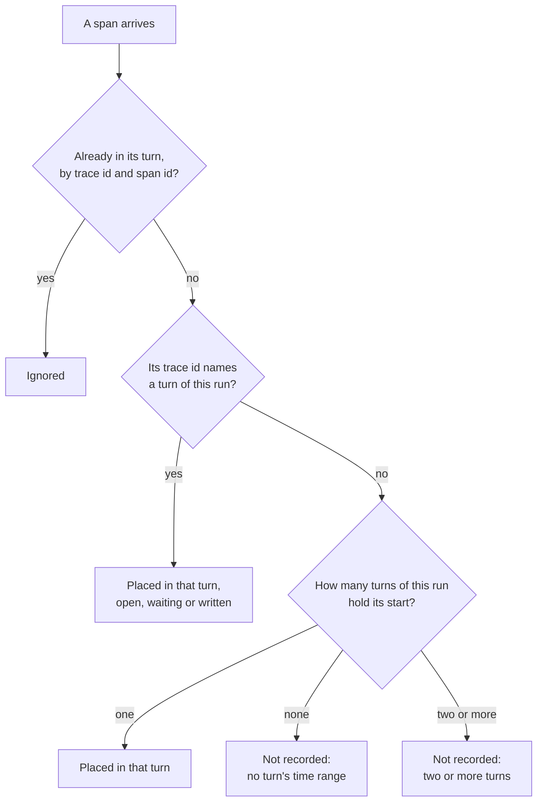
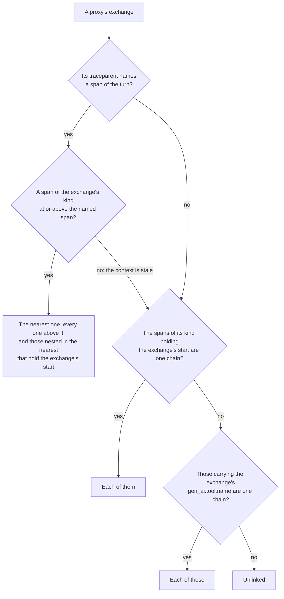

# OpenTelemetry: how Spectra reads the agent's own spans

This doc explains Spectra's OpenTelemetry receiver: how it takes the spans and log records the agent's process exports, reads each one in its producer's dialect, places it in its turn, links it to a proxy's record of the same call, and amends a turn already written when spans arrive late. It is written for the developer of an A2UI agent who uses Spectra and wants to know what the receiver makes of their agent's telemetry, and why a span lands where it does. It starts with the problem, follows one turn of upstream's Python restaurant finder from its exports to its record, then opens up the receiver's rules, and ends with the design decisions and where the code is.

The running example is upstream's Python restaurant finder, `samples/agent/adk/restaurant_finder`, launched under `opentelemetry-instrument` with [the recipe for a Python agent](#the-recipe-for-a-python-agent) and asked "Top 2 Chinese restaurants in New York". Its export requests and the record Spectra wrote from them are committed as the receiver capture case `adk_trace_context`, and every excerpt of that run below is cut from it. The spans of the A2UI step, which the wrapper sends, reach the same receiver; what they carry and how they are read is in [The A2UI step](a2ui-step.md).

<picture>
  <source media="(prefers-color-scheme: dark)" srcset="diagrams/opentelemetry-dark.svg">
  
</picture>

## Problem it solves

Spectra's model proxy and tool proxy see each call at the network edge: the exact request and the exact response. They do not see what happens inside the agent's process:

- which step of the agent's framework made a call, under which agent, and in what order;
- a tool that is a plain function in the agent's process, which never crosses the network, or a tool server that redirection does not reach;
- a model call the proxies do not reach, such as one to Vertex AI, which is not redirected, or one to an endpoint written into the agent's code;
- the log records the framework writes while it works.

Agent frameworks already report all of this through OpenTelemetry, the open standard for traces and logs: a span for each operation, with a start, an end, attributes and events, exported in batches over OTLP, OpenTelemetry's own protocol. The receiver takes those exports. Four things stand between an export and a turn:

1. **Producers speak different dialects.** OpenTelemetry's GenAI semantic conventions name a model call's attributes, but ADK, tested at 2.3.0, records content under its own `gcp.vertex.agent.*` names by default, OpenInference uses its own `llm.*` and `input.value` names, and OpenLLMetry mostly follows the current conventions. Some put the messages on the span, and some in log records beside it.
2. **A span names its trace, not its turn.** It carries the turn's trace id only when the agent's HTTP server reads the `traceparent` the wire proxy adds to each turn's request, and passes it down.
3. **Spans arrive late.** An exporter sends the spans that have ended every few seconds, so the last spans of a turn often arrive after the turn has closed and been written to disk.
4. **A call is seen twice.** A model call the model proxy recorded is also a span, or a chain of nested spans, in the agent's tree.

## Five ideas to hold on to

### 1. Every span is kept as it arrived

Each span placed in a turn becomes one event of the turn record, whatever produced it. Every attribute it carried is kept under `a2ui.received.attributes`, exactly as received. Nothing is filtered by kind or by scope: an HTTP server's span is kept as faithfully as a model call's.

### 2. The dialect is read off the span, and translated into the record's names

The receiver tells a producer's dialect from the span itself, by its instrumentation scope, its OpenInference span kind or its GenAI operation name, with nothing to configure. It writes the turn record's names, which are the GenAI conventions' own, beside the received attributes, so a call read from spans reads like a call the model proxy read.

### 3. A span joins its turn by trace id, else by time

A span carrying a turn's trace id belongs to that turn. Any other span belongs to the one turn of the run whose time range holds its start. With the HTTP server instrumentation reading the wire proxy's `traceparent`, the agent's whole tree carries the turn's trace id and is placed exactly; without it, spans are still placed while one turn at a time is running.

### 4. A call seen twice is linked, not merged

A proxy's record of a call and the agent's spans of the same call stay separate events, each a statement of what one capture path saw. The receiver links them both ways, through trace context when the call carried it, else through time, and the viewer shows them as one call.

### 5. A late span amends its turn

A span that arrives after its turn was written is added to the turn in the store. The turn's end stays the agent's last reply, and its checks are not run again.

## One turn, end to end

The restaurant finder runs under `a2ui-spectra run`, launched through `opentelemetry-instrument` with the OpenTelemetry distro, the OTLP HTTP exporter and the instrumentations `opentelemetry-bootstrap` lists for its environment, the Click instrumentation switched off. "Top 2 Chinese restaurants in New York" is sent through the wire proxy.

1. **The agent exports to the receiver.** `run` set `OTEL_EXPORTER_OTLP_ENDPOINT` to the receiver, the protocol to `http/protobuf` and the two content capture switches in the agent's environment, so the distro's exporters send every span and log record to the receiver.
2. **The turn's trace id enters the agent.** The wire proxy opens the turn with trace id `80e23b6d06a383e256e2f1f04184919e` and puts it in the request's `traceparent`. Starlette's server instrumentation reads it, so the agent's server span, `POST /`, belongs to that trace, and so does every span under it: a2a-sdk's request handlers, ADK's `invocation`, `invoke_agent restaurant_agent`, `call_llm`, `generate_content gemini-3.6-flash`, `execute_tool get_restaurants`, and aiohttp's client span `POST` for each request to Gemini.
3. **The trace id leaves on the model call.** The aiohttp instrumentation writes its own span into the `traceparent` of the request to Gemini, which goes through the model proxy: `00-80e23b6d06a383e256e2f1f04184919e-4897d829015a7ad2-01`. The model proxy records the exchange in the turn, headers included.
4. **Log records arrive before their spans.** The first export, 0.1 seconds into the turn, is a log export: `generate_content`'s `gen_ai.system.message` and `gen_ai.user.message`, ADK's content written as log records. Their span ends 2.1 seconds into the turn and arrives in an export at 6.1 seconds. The receiver holds the log records until it does, then keeps them as the span's span events and reads the span with them.
5. **Each span is read in its dialect.** ADK's spans carry the scope `gcp.vertex.agent`, so they are read as ADK's: `call_llm` from its own `gcp.vertex.agent.llm_request` and `gcp.vertex.agent.llm_response`, `generate_content` from its log records, `execute_tool get_restaurants` from its `gcp.vertex.agent.tool_call_args` and `gcp.vertex.agent.tool_response`. Starlette's, aiohttp's and a2a-sdk's spans have no dialect and are framework spans.
6. **Each span is placed by its trace id.** Every span of the tree carries the turn's trace id. The root, `POST /`, takes the turn event as its parent; every other span keeps its own.
7. **The model call is linked.** The exchange's `traceparent` names aiohttp's `POST`, a framework span. The nearest model call span above it is `generate_content`, and above that `call_llm`: the exchange is linked to both, and each of them back to it.
8. **The rest of the turn's spans arrive late.** The turn's last reply comes 33.2 seconds in, and the turn is written. An export at 36.2 seconds brings 82 more of its spans, and the receiver amends the turn's file with them.
9. **What fell outside is said once.** Two requests for the agent's card were answered before the turn opened. Starlette's six spans of those two requests carry traces of their own and start before the turn, so the terminal prints one line for them, as the case lists it without the `a2ui-spectra: ` prefix:

```
The receiver did not record 6 spans from opentelemetry.instrumentation.starlette, which started from 2026-10-31T07:21:42.312Z to 2026-10-31T07:21:43.492Z: their start falls in no turn's time range.
```

The model proxy's call and ADK's `call_llm` of steps 3, 5 and 7, as the turn record holds them. This is cut from [`conformance/test_data/receiver_capture/v0_1/adk_trace_context/expected.json`](../../conformance/test_data/receiver_capture/v0_1/adk_trace_context/expected.json), the record Spectra served for that run, and shortened:

```jsonc
// The model proxy's call
{
  "spanId": "342ffd963bc9f95d",
  "parentSpanId": "269b6fd1a0c41b01",
  "name": "generate_content gemini-3.6-flash",
  "attributes": {
    "a2ui.event.kind": "model_call",
    "gen_ai.operation.name": "generate_content",
    "gen_ai.provider.name": "gcp.gemini",
    "gen_ai.request.model": "gemini-3.6-flash",
    …
    "http.request.header.traceparent": ["00-80e23b6d06a383e256e2f1f04184919e-4897d829015a7ad2-01"],
    …
  },
  "links": [
    {"traceId": "80e23b6d06a383e256e2f1f04184919e", "spanId": "b173d184b4c7d8d7"},
    {"traceId": "80e23b6d06a383e256e2f1f04184919e", "spanId": "9a8e323dcdf956d9"}
  ]
}
// ADK's call_llm, as the receiver wrote it
{
  "spanId": "b173d184b4c7d8d7",
  "parentSpanId": "89ab41feefbff74d",
  "name": "call_llm",
  "attributes": {
    "a2ui.event.kind": "model_call",
    "otel.scope.name": "gcp.vertex.agent",
    "otel.scope.version": "2.3.0",
    "a2ui.received.dialect": "adk",
    "gen_ai.request.model": "gemini-3.6-flash",
    "gen_ai.usage.input_tokens": 15021,
    "gen_ai.usage.output_tokens": 113,
    …
    "gen_ai.conversation.id": "666773ce-d0f5-496a-bec6-b7785cf3cabf",
    …
    "gen_ai.input.messages": [{"role": "user", "parts": [{"type": "text", "content": "Top 2 Chinese restaurants in New York"}]}],
    …
    "gen_ai.output.messages": [{"role": "assistant", "parts": [{"type": "tool_call", "id": "call_170434", "name": "get_restaurants", "arguments": {"location": "New York", "cuisine": "Chinese", "count": 2}}, …], "finish_reason": "stop"}],
    "a2ui.received.attributes": {
      "gen_ai.system": "gcp.vertex.agent",
      …
      "gcp.vertex.agent.session_id": "666773ce-d0f5-496a-bec6-b7785cf3cabf",
      …
      "gcp.vertex.agent.llm_request": "{\"model\": \"gemini-3.6-flash\", \"config\": {…",
      "gcp.vertex.agent.llm_response": "{\"model_version\":\"gemini-3.6-flash\",\"content\":{\"parts\":[{\"function_call\":{…",
      …
    }
  },
  "links": [{"traceId": "80e23b6d06a383e256e2f1f04184919e", "spanId": "342ffd963bc9f95d"}]
}
```

`call_llm` carries no `gen_ai.provider.name`: ADK writes the literal `gcp.vertex.agent` as its `gen_ai.system`, which names no provider ([OpenTelemetry finding 22](../../_dev/otel-findings.md#22-adk-writes-the-literal-gcpvertexagent-as-gen_aisystem-and-the-deprecated-name-only)). Its conversation id is ADK's session id, `gcp.vertex.agent.session_id`.

## Inside the machinery

### What the receiver takes

The receiver listens on loopback, at `http://127.0.0.1:9823` by default; `--receiver-port` moves it, as the [command's README](../../tools/spectra/README.md) has it. It runs under `run`, `attach`, `replay` and `test` alike, and the terminal names it at start:

```
a2ui-spectra: The OpenTelemetry receiver is at http://127.0.0.1:9923
```

That line is cut from a run of the built binary with `--receiver-port 9923`.

| Request                                                                       | Answer                                                                                                     |
| ----------------------------------------------------------------------------- | ---------------------------------------------------------------------------------------------------------- |
| `POST /v1/traces` or `POST /v1/logs`, read                                    | `200` with an empty export response in the request's own encoding: no bytes in protobuf, `{}` in OTLP/JSON |
| `POST /v1/metrics`                                                            | `200`, and the metrics are dropped                                                                         |
| A body that does not unzip, or does not decode as its signal's export request | `400`, with the reason, such as `resourceSpans[0].scopeSpans[0].spans[0].traceId is not 16 bytes of hex.`  |
| A content type other than protobuf or OTLP/JSON                               | `415`, `Send application/x-protobuf or application/json.`                                                  |
| Another method on one of the three paths                                      | `405`, such as `GET is not allowed here.`                                                                  |
| Another path                                                                  | `404`, `a2ui-spectra's OpenTelemetry receiver takes POST /v1/traces, /v1/logs and /v1/metrics.`            |

The answers' texts are cut from requests sent to that run's receiver with `curl`.

- **Two encodings.** Protobuf is `application/x-protobuf` or `application/protobuf`; OTLP/JSON is `application/json`. A content type is read in any case and its parameters are ignored, and a body whose `Content-Encoding` names gzip is unzipped first; one that does not unzip is answered `400`, `The body is not gzip: …`. The protobuf messages are decoded with code generated from OTLP's `.proto` files, copied from `open-telemetry/opentelemetry-proto` at v1.11.1. Both encodings are read into OTLP/JSON's shape: trace and span ids as lowercase hex, times as decimal strings, enums as integers.
- **Read leniently where OTLP/JSON allows two forms, strictly where the shape is wrong.** A 64-bit integer may be a string or a number; an id in either case of hex is lowercased. A span whose trace id is not 16 bytes or whose span id is not 8 bytes refuses the whole export request, `400`. In OTLP/JSON, so does a link without them, or a parent span id that is not 8 bytes; in protobuf such a link is dropped, and such a parent is no parent.
- **No partial reading.** An export request is read whole, or answered `400` and nothing of it is taken.
- **What is never recorded of an export request:** its headers; the resource it carries, such as `service.name` and the SDK's version; an instrumentation scope's own attributes and the schema URLs; and a span's or a link's trace state and flags.
- **Nothing is passed on.** Exports go to the receiver alone; Spectra forwards them to no collector.
- **At Spectra's stop,** an export in flight is answered, and a connection held open past a second is cut.

### The agent's variables

`a2ui-spectra run` sets four variables in the agent's environment, as `replay` and `test` do when they start the agent's command, and `a2ui-spectra attach` prints the same four at start to set in the agent's shell before restarting it; under `attach` the viewer's first screen shows them too, as [The viewer](viewer.md) has it. These lines are cut from `attach` run against the repository's stub agent with `--receiver-port 9923`:

```
export OTEL_EXPORTER_OTLP_ENDPOINT=http://127.0.0.1:9923  # for Spectra's OpenTelemetry receiver
export OTEL_EXPORTER_OTLP_PROTOCOL=http/protobuf  # for Spectra's OpenTelemetry receiver
export OTEL_INSTRUMENTATION_GENAI_CAPTURE_CONTENT=SPAN_ONLY  # for Spectra's OpenTelemetry receiver
export OTEL_INSTRUMENTATION_GENAI_CAPTURE_MESSAGE_CONTENT=true  # for Spectra's OpenTelemetry receiver
```

| Variable                                                                                                        | Value                                                             | When Spectra's own environment sets it                                                               |
| --------------------------------------------------------------------------------------------------------------- | ----------------------------------------------------------------- | ---------------------------------------------------------------------------------------------------- |
| `OTEL_EXPORTER_OTLP_ENDPOINT`                                                                                   | The receiver's origin; each exporter adds its signal's path       | Replaced, when it names another address                                                              |
| `OTEL_EXPORTER_OTLP_PROTOCOL`                                                                                   | `http/protobuf`                                                   | Replaced, when it names another protocol                                                             |
| `OTEL_EXPORTER_OTLP_TRACES_ENDPOINT`, `OTEL_EXPORTER_OTLP_LOGS_ENDPOINT`, `OTEL_EXPORTER_OTLP_METRICS_ENDPOINT` | Not set                                                           | Replaced with the receiver's origin and the signal's path, such as `http://127.0.0.1:9823/v1/traces` |
| `OTEL_EXPORTER_OTLP_TRACES_PROTOCOL`, `OTEL_EXPORTER_OTLP_LOGS_PROTOCOL`, `OTEL_EXPORTER_OTLP_METRICS_PROTOCOL` | Not set                                                           | Replaced with `http/protobuf`                                                                        |
| `OTEL_INSTRUMENTATION_GENAI_CAPTURE_CONTENT`                                                                    | `SPAN_ONLY`, the name and value the pinned GenAI conventions give | Kept as Spectra's environment sets it                                                                |
| `OTEL_INSTRUMENTATION_GENAI_CAPTURE_MESSAGE_CONTENT`                                                            | `true`, the older name the instrumentations in use read           | Kept as Spectra's environment sets it                                                                |

- **The protocol variable moves Python onto HTTP.** Python's auto-configuration, `opentelemetry-instrument`, exports over gRPC unless the protocol variable says otherwise, and the receiver reads OTLP over HTTP alone.
- **The content capture switches** let an instrumentation record the messages, which the GenAI conventions leave off by default. The conventions name the variable only as an example and give it no values, so producers read it differently: ADK reads `true` as content in log records, not on the span ([OpenTelemetry finding 21](../../_dev/otel-findings.md#21-the-content-capture-variable-is-named-only-as-an-example-with-no-values)). The receiver reads content from both places.
- **A replaced variable is said once,** at start, under `run`, and under `replay` and `test` when they start the agent's command, with any credentials in a URL removed. This line is cut from a run of the built binary started with `OTEL_EXPORTER_OTLP_PROTOCOL=grpc` and `OTEL_EXPORTER_OTLP_TRACES_ENDPOINT=http://localhost:4318/v1/traces` in its environment:

  ```
  a2ui-spectra: In the agent's environment, Spectra replaced OTEL_EXPORTER_OTLP_PROTOCOL from grpc and OTEL_EXPORTER_OTLP_TRACES_ENDPOINT from http://localhost:4318/v1/traces, so that its exports reach Spectra's OpenTelemetry receiver. They are not passed on.
  ```

  An endpoint equal to the receiver's own, a trailing slash aside, is not called replaced, so values left in a shell by an earlier `attach` pass silently.

The model providers' variables `run` sets beside these, and the forms `attach` prints for PowerShell and cmd on Windows, are in [Model and tool calls](model-and-tool-calls.md). The trace context the wire proxy adds to each turn's request is in [The wire](wire.md).

### The recipe for a Python agent

A Python agent needs three things added to its run, and nothing added to its code:

1. **The OpenTelemetry distro and the OTLP HTTP exporter,** `opentelemetry-distro` and `opentelemetry-exporter-otlp-proto-http`, which make an agent launched under `opentelemetry-instrument` export its spans and log records.
2. **The instrumentations `opentelemetry-bootstrap -a requirements` lists** for the agent's environment. Among them, the HTTP server instrumentation reads the wire proxy's `traceparent`, so the agent's tree carries the turn's trace id, and the HTTP client instrumentation puts a `traceparent` on the calls through the proxies, which links them.
3. **Launching under `opentelemetry-instrument`.**

```
uv run --with opentelemetry-distro --with opentelemetry-exporter-otlp-proto-http \
  opentelemetry-bootstrap -a requirements > otel-requirements.txt
OTEL_PYTHON_DISABLED_INSTRUMENTATIONS=click \
  a2ui-spectra run --agent-url http://localhost:10002 -- \
  uv run --with opentelemetry-distro --with opentelemetry-exporter-otlp-proto-http \
  --with-requirements otel-requirements.txt opentelemetry-instrument python .
```

- **An agent whose server runs inside a Click command,** as upstream's ADK samples do, needs `OTEL_PYTHON_DISABLED_INSTRUMENTATIONS=click` beside the bootstrap set. The Click instrumentation's span around the whole command makes each request's server span an internal one under it, which drops the incoming `traceparent`.
- **a2a-sdk does not read the incoming `traceparent` itself** ([OpenTelemetry finding 23](../../_dev/otel-findings.md#23-a2a-sdk-does-not-read-an-incoming-traceparent)): without the HTTP server instrumentation, its request handler's span starts a trace of its own, and the agent's spans are placed by time.
- **ADK exports to an endpoint set in the environment only inside its own CLI server,** `adk web` or `adk api_server`. An agent that serves A2A itself, as the restaurant finder does, switches an exporter on by launching under `opentelemetry-instrument`, or with one call to ADK's `maybe_set_otel_providers()`.
- **The wrapper is not in the bootstrap set.** `opentelemetry-bootstrap` lists only instrumentations from OpenTelemetry's contrib repository ([OpenTelemetry finding 25](../../_dev/otel-findings.md#25-opentelemetry-bootstrap-cannot-suggest-an-instrumentation-from-outside-contrib)), so the wrapper is added by name, as [Switching it on](a2ui-step.md#switching-it-on) has it.

### The event a span becomes

Every span placed in a turn becomes one event of the turn record, shaped as the turn record's [events](../../specification/turn_record/v0_1/docs/turn_record.md#events) are:

- **As received:** its trace and span ids, its parent, its name, its OTLP span kind, its start and end, its status, and its own span events and links. A parent id of zeros is no parent; a span kind outside OTLP's six values is `0`; a status code other than `1` or `2` is `0`. Two span events are fitted to the names the record types, as the turn record's [A2UI step's span events](../../specification/turn_record/v0_1/docs/turn_record.md#the-a2ui-steps-span-events) gives them: on an `exception` event, a value of `exception.type`, `exception.message`, `exception.stacktrace`, `a2ui.parse.block.start`, `a2ui.parse.block.end` or `a2ui.parse.error.details` without the record's type is left out, and an `a2ui.parse.chunk` event keeps its `a2ui.parse.chunk.end` alone, or is left out when that does not fit.
- **Its attributes:** `a2ui.event.kind`; `otel.scope.name`, the instrumentation scope, and `otel.scope.version` when the producer gave one; `a2ui.received.dialect`, when it has one; the names translated from its dialect; and `a2ui.received.attributes`, every attribute as received. A translated name never takes the place of one of the receiver's own.
- **Attribute values** become plain values: a key-value list an object, an array a list, an integer beyond what JSON numbers hold exactly a decimal string, a double that is not finite its text, such as `NaN`, bytes as base64, and a value left empty `null`. Of two attributes with one key, the later is kept.
- **Its kind** is `model_call`, `tool_call` or `framework_span`, by its dialect. A span of the A2UI step is read by its own `a2ui.event.kind` before any dialect, as [What Spectra does with the spans](a2ui-step.md#what-spectra-does-with-the-spans) has it.
- **A stated retry.** A `model_call` span of any dialect carrying `a2ui.retry.attempt`, an integer of 1 or more, has it copied onto the event, beside its links as received.

The turn record's [received-span attributes](../../specification/turn_record/v0_1/docs/turn_record.md#received-span-attributes) and [`framework_span`](../../specification/turn_record/v0_1/docs/turn_record.md#framework_span) are the contract for these names.

### The three dialects

| Dialect         | Read when                            | `model_call`                                                  | `tool_call`                                                                                                                 | Any other span                                    |
| --------------- | ------------------------------------ | ------------------------------------------------------------- | --------------------------------------------------------------------------------------------------------------------------- | ------------------------------------------------- |
| `adk`           | The scope is `gcp.vertex.agent`      | `call_llm`, `generate_content` and `generate_content {model}` | `execute_tool` and `execute_tool {name}`, but not `execute_tool (merged)`, ADK's wrapper around tool calls run side by side | A `framework_span`, the conventions' names copied |
| `openinference` | `openinference.span.kind` is present | `LLM`, `EMBEDDING`                                            | `TOOL`                                                                                                                      | A `framework_span`, nothing translated            |
| `genai`         | `gen_ai.operation.name` is present   | `chat`, `generate_content`, `text_completion`, `embeddings`   | `execute_tool`                                                                                                              | A `framework_span`, the conventions' names copied |

The rows are tried in this order, so an OpenInference span that also carries `gen_ai.operation.name` is read as OpenInference's. A span of none of them has no `a2ui.received.dialect` and is a `framework_span` with nothing translated, such as an HTTP server's span or a2a-sdk's.

**ADK,** as tested at 2.3.0:

- On every span, the names the pinned conventions define are copied as written. `gcp.vertex.agent.session_id` is the conversation, `gen_ai.conversation.id`, unless the span names one. `gen_ai.system` `gemini` and `vertex_ai` are read as the provider `gcp.gemini` and `gcp.vertex_ai`; the literal `gcp.vertex.agent` on `call_llm` names no provider ([OpenTelemetry finding 22](../../_dev/otel-findings.md#22-adk-writes-the-literal-gcpvertexagent-as-gen_aisystem-and-the-deprecated-name-only)).
- `call_llm`: its `gcp.vertex.agent.llm_request`, ADK's model, config and contents, is read as a Gemini API request by the model proxy's Gemini reader, for the settings, the system instructions, the input messages and the tool definitions; its `gcp.vertex.agent.llm_response` for the output messages and the finish reason. The request's operation, model, provider and streaming are not taken from it.
- `generate_content`: the conventions' names, content parsed when it arrives as a JSON string; then the content of its per-message log records, `gen_ai.system.message`, `gen_ai.user.message`, `gen_ai.assistant.message`, `gen_ai.tool.message` and `gen_ai.choice`; then, under `OTEL_SEMCONV_STABILITY_OPT_IN=gen_ai_latest_experimental`, its `gen_ai.client.inference.operation.details` log record, the last one when there are several, whose conventions' names win. A per-message log record whose content is `<elided>`, content that was not captured, adds no message.
- `execute_tool`: `gcp.vertex.agent.tool_call_args` as the arguments and `gcp.vertex.agent.tool_response` as the result, each kept when it is an object.

**OpenInference,** as tested with its LiteLLM instrumentation at 0.1.52:

- An `LLM` span is `chat`, an `EMBEDDING` span `embeddings`. The model is `llm.model_name`, or `embedding.model_name` for an embedding; the token counts are `llm.token_count.prompt`, `llm.token_count.completion`, `llm.token_count.prompt_details.cache_read`, `llm.token_count.prompt_details.cache_write` and `llm.token_count.completion_details.reasoning`, read as the input, output, cache read, cache write and reasoning tokens; the settings, streaming among them, come from `llm.invocation_parameters`.
- The flattened `llm.input_messages.*` and `llm.output_messages.*` are rebuilt into Chat Completions messages and read by the model proxy's Chat Completions reader, a system message becoming the system instructions; each `llm.tools.*.tool.json_schema` is a tool definition; `llm.finish_reason` is the first output message's.
- `llm.provider` is read as the conventions' provider: `google` as `gcp.gen_ai`, `mistralai` as `mistral`, `azure` as `azure.ai.openai`, `aws` as `aws.bedrock`, `xai` as `x_ai`, `moonshot` as `moonshot_ai`, and `openai`, `anthropic`, `cohere`, `deepseek`, `groq` and `perplexity` as themselves; any other value is kept as it is.
- A `TOOL` span's `tool.name`, `input.value` and `output.value` are the tool, its arguments and its result.

**The GenAI conventions,** as OpenLLMetry writes them, tested with its LiteLLM instrumentation at 0.62.4:

- Every name the pinned conventions define is copied as written: those of `open-telemetry/semantic-conventions-genai` at its release `v0.1.0`, the turn record's [pinned conventions](../../specification/turn_record/v0_1/docs/turn_record.md#pinned-conventions); the names that release removed, which a producer on older conventions still sends, `gen_ai.prompt.variable.<key>` among them; and the core conventions' `error.type`. A content name arriving as a JSON string is parsed.
- `gen_ai.system` stands for the provider when the span names none.
- The per-message log records and the operation details log record are read as ADK's `generate_content`'s are.

An excerpt of the OpenInference span from the custom-components example, `samples/agent/adk/custom-components-example`, the upstream sample on LiteLLM, which the restaurant finder is not. It is cut from [`conformance/test_data/receiver_capture/v0_1/openinference/expected.json`](../../conformance/test_data/receiver_capture/v0_1/openinference/expected.json) and shortened:

```jsonc
// Translated
"a2ui.received.dialect": "openinference",
"gen_ai.operation.name": "chat",
"gen_ai.request.model": "gemini/gemini-3.6-flash",
"gen_ai.provider.name": "gcp.gen_ai",
"gen_ai.usage.input_tokens": 20289,
"gen_ai.input.messages": [{"role": "user", "parts": [{"type": "text", "content": "Who is Alex Jordan?"}]}],
"gen_ai.response.finish_reasons": ["tool_call"],
// As received, under a2ui.received.attributes
"llm.model_name": "gemini/gemini-3.6-flash",
"llm.provider": "google",
"llm.input_messages.1.message.role": "user",
"llm.input_messages.1.message.content": "Who is Alex Jordan?",
"llm.finish_reason": "tool_calls",
"llm.token_count.prompt": 20289,
"openinference.span.kind": "LLM"
```

### What every dialect shares

- **The cache write count.** `gen_ai.usage.cache_creation.input_tokens`, which the Python conventions package, OpenLLMetry and LiteLLM write, is read as the pinned conventions' `gen_ai.usage.cache_write.input_tokens` when the span carries no such name ([OpenTelemetry finding 20](../../_dev/otel-findings.md#20-the-python-conventions-package-names-the-cache-write-cache_creation-where-the-conventions-name-it-cache_write)).
- **Finish reasons** are normalised as the model proxy's readers normalise them, in `gen_ai.response.finish_reasons` and in each output message. A value the conventions' output messages schema allows, `stop`, `length`, `content_filter`, `tool_call`, `compaction` or `error`, stays. A provider's own value is read through that provider's map, Gemini's for `gcp.gemini`, `gcp.vertex_ai` and `gcp.gen_ai`, OpenAI's for `openai` and every `azure.` provider, Anthropic's for `anthropic`; with any other provider, through OpenAI's, Anthropic's and Gemini's maps in turn. Each map is matched without regard to case, so Gemini's `STOP` and `stop` read alike. Any other value is `error`. An empty reason, which ADK writes for a response with none, is dropped.
- **Each translated name is fitted to the record.** The four content names, `gen_ai.system_instructions`, `gen_ai.input.messages`, `gen_ai.output.messages` and `gen_ai.tool.definitions`, are kept when they fit the GenAI schemas the turn record copies, its [copied schemas](../../specification/turn_record/v0_1/docs/turn_record.md#copied-schemas). The names the record types on [`model_call`](../../specification/turn_record/v0_1/docs/turn_record.md#model_call) and [`tool_call`](../../specification/turn_record/v0_1/docs/turn_record.md#tool_call) are kept when they have its type, the tool call's arguments and result when they are objects, read from their JSON text. Every other name is kept as it is. A value left out stays in `a2ui.received.attributes`.

### Log records

A log record carrying span context is kept as one of its span's span events:

| Of the span event | From the log record                                                                                                                                                                                       |
| ----------------- | --------------------------------------------------------------------------------------------------------------------------------------------------------------------------------------------------------- |
| Its time          | The log's time, else the time it was observed                                                                                                                                                             |
| Its name          | The log's event name, from its own field or its `event.name` attribute, else its severity text, else empty                                                                                                |
| Its attributes    | The log's attributes as received, with `a2ui.received.log.body`, `a2ui.received.log.severity_number` and `a2ui.received.log.severity_text`, each when the log has it, a severity number of `0` being none |

- A span's own events and its log records are kept in time order, log records of the same time in their arrival order.
- The span is read again with each log record that joins it, so content a producer writes in log records reaches the translated names, as ADK's `generate_content` shows.
- A log record whose span has not arrived is held until it does, as in the running example's step 4. It then goes wherever its span goes, into a turn or into the terminal's line of what was not recorded.
- A log record without span context, its trace id or span id missing, all zeros or of the wrong length, is not recorded.

The record's side of this is the turn record's [where events come from](../../specification/turn_record/v0_1/docs/turn_record.md#where-events-come-from).

### Placing a span



- **By trace id.** A span carrying a turn's trace id belongs to that turn, whether the turn is open, waiting for its calls or written.
- **By time.** Any other span belongs to the turn of this run whose time range holds its start, when exactly one does. A turn's range runs from its start to the agent's last reply, both included; an open turn's runs to the present.
- **One clock.** Spectra stamps a turn's start and end, and each proxy's call, with the wall clock, the clock an agent stamps its spans with, read finer than its milliseconds through the monotonic clock, so a span's times and Spectra's compare on one clock. Each reading is later than the one before, unless the wall clock itself steps back by more than two milliseconds, which the readings follow.
- **Only this run's turns.** A turn an earlier run left in the store is never a span's turn, whatever trace id the span carries.
- **Its parent.** A span keeps its own parent. In a tree carrying the turn's trace id, a span with no parent, or whose parent is neither the turn event nor a span placed in the turn, is the tree's root and takes the turn event as its parent.
- **Its place in the turn.** The received spans follow the turn's own events, the turn event, the wire events and the proxies' calls, in order of their start, and come before the check events, so placing a span moves no event a check's finding points at.
- **The capture paths.** `otel_receiver` joins the turn's `a2ui.turn.capture_paths` once a span is placed in it, and `a2ui_step` beside it once a `prompt_generation` or `parse` event is among its spans; a span of the A2UI step written as a framework span does not add it.
- **A span already in its turn,** by its trace id and span id, is ignored.

A `prompt_generation` span that falls in no turn is the one exception to placing by time: it is kept for the run and placed by its text, as [What Spectra does with the spans](a2ui-step.md#what-spectra-does-with-the-spans) has it. The turn record's [placement](../../specification/turn_record/v0_1/docs/turn_record.md#placement) is the contract.

### Late spans

What the receiver does with a placed span depends on where its turn stands:

| The turn                                  | What happens                                                                                                                                                                                                         |
| ----------------------------------------- | -------------------------------------------------------------------------------------------------------------------------------------------------------------------------------------------------------------------- |
| Open, or closed and waiting for its calls | The span is held with the turn, and the events it adds or changes go out on the live stream at once as one `turn_amended`. A proxy's call goes out again only once its links make it differ from what the proxy sent |
| Being written                             | The spans placed so far are written with it, each with its links                                                                                                                                                     |
| Written                                   | The turn is amended in the store: its own file, and each later file of its conversation that embeds it, each written again once, atomically. The events it changed go out on the live stream as one `turn_amended`   |

An amended turn keeps its end time, the agent's last reply, and its check events: the checks are not run again. The spans are placed after the turn's own events and before its check events, as when it was first written. Each amendment rebuilds the links the receiver made, so a span that arrives later can join a chain already linked.

A file that cannot be written keeps the amended turn in memory until Spectra stops, and the terminal says so once per amendment, as `The spans received for turn <trace id> could not be written: <reason>. The amended turn is kept in memory until Spectra stops.`

What `turn_amended` carries is in [The API](api.md), and how the page follows it is in [The viewer](viewer.md).

### Links between a proxy's exchange and a span

An exchange is a call a proxy recorded as a client: a model proxy's or a tool proxy's call with its HTTP request. A model proxy's exchange is linked to `model_call` spans, a tool proxy's to `tool_call` spans.



| Rule                                            | What it says                                                                                                                                                                                                                                                                                          | The receiver capture case it is recorded in                                                                       |
| ----------------------------------------------- | ----------------------------------------------------------------------------------------------------------------------------------------------------------------------------------------------------------------------------------------------------------------------------------------------------- | ----------------------------------------------------------------------------------------------------------------- |
| Trace context                                   | The exchange's trace context is its `traceparent` header, else an MCP request's `params._meta.traceparent`. The span it names, when that span is of the exchange's kind, else the nearest span of that kind above it, is the same call, and so is every span of that kind above that one in the chain | `adk_trace_context`: aiohttp's `POST` named, `generate_content` and `call_llm` linked                             |
| A span the instrumentation did not make current | A span of the kind nested in the nearest one and holding the exchange's start joins the chain, when all of them still nest one inside the next. A LiteLLM span its instrumentation did not make current around the request sits beside the HTTP client span the `traceparent` names                   | `openinference`: `acompletion` beside aiohttp's span, inside `call_llm` and `generate_content`                    |
| Time                                            | Without trace context, the spans of the kind whose time range holds the exchange's start are the same call, when they are one chain, each nested in the next                                                                                                                                          | `nesting_chain`: `call_llm`, `generate_content` and `acompletion` linked by time                                  |
| Stale context                                   | When the span the `traceparent` names has no span of the kind at or above it, the exchange is linked by time, as one without trace context                                                                                                                                                            | `adk_mcp_stale_context`: the first turn's `tools/call` names `invoke_agent`                                       |
| Calls side by side                              | When the spans holding the exchange's start are not one chain, those carrying the exchange's `gen_ai.tool.name` are taken, when they are one chain, as tool calls run side by side hold each other's exchanges; otherwise the exchange stays unlinked                                                 | `adk_mcp_stale_context`: `execute_tool get_issue` and `execute_tool list_comments`                                |
| Several exchanges                               | One span links back to each exchange its range holds, as when the SDK retried inside it                                                                                                                                                                                                               | `several_exchanges`: a `503`, then google-genai's retry, both linked to one `call_llm` and one `generate_content` |

- **Both ways.** Each exchange links to each span it is the same call as, and each span back to it, beside the links the span carried as received.
- **Rebuilt each time.** The receiver's links are made again whenever the turn is assembled, so a span that arrives later joins its chain; a link the receiver did not make is kept.
- **Stale context exists.** The MCP Python SDK sends every request of a session from one task, which puts the span current when the session opened, such as the first turn's `invoke_agent`, into each request's `traceparent` ([OpenTelemetry finding 24](../../_dev/otel-findings.md#24-the-mcp-clients-writer-task-carries-the-sessions-opening-span-into-every-request)). The time rule is what links those calls.

The turn record's [links](../../specification/turn_record/v0_1/docs/turn_record.md#links) is the contract. How a proxy's call is placed in its turn is in [Model and tool calls](model-and-tool-calls.md).

### What is not recorded

| What                                                                                       | Why it is not recorded                                                |
| ------------------------------------------------------------------------------------------ | --------------------------------------------------------------------- |
| A span carrying no trace id of this run's turns, whose start falls in no turn's time range | It belongs to no turn, such as the card fetches before the first turn |
| Such a span whose start falls in the time ranges of two or more turns                      | Its turn cannot be told                                               |
| The log records of a span not recorded                                                     | They go with their span                                               |
| A log record without span context                                                          | It belongs to no span                                                 |
| A log record whose span never arrives                                                      | It is held and never placed; nothing is said                          |
| Metrics, an export request's headers, and the resource an export carries                   | The record holds a turn's events alone                                |

The terminal says what was not recorded once per export request and reason, counting spans and log records together and naming their scopes and when they started. These lines are printed by the receiver capture case `unplaced`, derived from the restaurant finder's recording with a second turn overlapping the first, and by `adk_mcp_stale_context`, as the cases list them in [`capture_v0_1.yaml`](../../conformance/receiver_capture/capture_v0_1.yaml), without the `a2ui-spectra: ` prefix every line of Spectra's carries:

```
The receiver did not record 1 span from gcp.vertex.agent, which started at 2026-10-31T07:20:30.507Z: their start falls in the time ranges of two or more turns.
The receiver did not record 4 log records from uvicorn.error, which started from 2026-11-01T03:08:24.580Z to 2026-11-01T03:08:24.582Z: they carry no span context.
The receiver did not record 3 spans and 1 log record from opentelemetry.instrumentation.starlette and uvicorn.access, which started at 2026-11-01T03:08:24.650Z: their start falls in no turn's time range.
```

A scope with no name is named `no scope`.

### What the viewer reads from a call's spans

The viewer reads the received spans of a turn into its calls; how it shows them, the "From the agent's spans" section of a call's detail among them, is in [The viewer](viewer.md).

- **One call.** A call a proxy recorded and the received spans linked to it are one call. Received spans of one kind, `model_call` or `tool_call`, that nest one inside the next are one chain: a span and the nearest span of its kind above it are one chain when that span holds no other span of the kind. A chain linked to no proxy's call is a call read from spans only, such as ADK's `call_llm` around its `generate_content` with no proxy in between. Framework spans are not calls.
- **What fills a call.** A call the proxy read in full, a model call read into the GenAI names or an MCP request, is shown from the proxy's reading. A call read from spans only, or one the proxy recorded raw, takes its usage, request and response from its chain: each name from the innermost span that carries it, and the token counts together from the innermost span that has input tokens.
- **Its source** is named by the span's dialect: ADK spans, OpenInference spans or GenAI spans, and received spans for a span of no dialect.
- **Its provider and its estimated cost** are read from the chain too, as [Model and tool calls](model-and-tool-calls.md) has it.

## When things go wrong

| What happens                                                                               | Why, and what to do                                                                                                                                                                                                                                                                                                         |
| ------------------------------------------------------------------------------------------ | --------------------------------------------------------------------------------------------------------------------------------------------------------------------------------------------------------------------------------------------------------------------------------------------------------------------------- |
| No spans arrive at all                                                                     | The agent exports nothing. Launch a Python agent under `opentelemetry-instrument` with the distro and the exporter; an ADK agent that serves A2A itself exports only under it, or after a call to `maybe_set_otel_providers()`. Under `attach`, set the four variables `attach` printed in the agent's shell and restart it |
| The agent exports over gRPC under `attach`                                                 | The receiver reads OTLP over HTTP alone. Set `OTEL_EXPORTER_OTLP_PROTOCOL=http/protobuf` as `attach` printed it; under `run` it is set                                                                                                                                                                                      |
| `The receiver did not record … their start falls in no turn's time range.`                 | The spans started before the turn or after its last reply, and carry no turn's trace id: card fetches, the agent's start, work after the reply                                                                                                                                                                              |
| `The receiver did not record … their start falls in the time ranges of two or more turns.` | Two turns ran at once, and the spans carry no turn's trace id. Add the HTTP server instrumentation, so the agent's tree carries its turn's trace id                                                                                                                                                                         |
| `The receiver did not record … they carry no span context.`                                | The log records were written outside any span, such as a server's own logging                                                                                                                                                                                                                                               |
| The agent's spans are placed by time, not under the turn event                             | Nothing reads the incoming `traceparent`: a2a-sdk does not, so add the HTTP server instrumentation; for an agent inside a Click command, set `OTEL_PYTHON_DISABLED_INSTRUMENTATIONS=click`                                                                                                                                  |
| A call shows twice, once from the proxy and once from spans                                | The call carried no `traceparent` and the spans holding its start are not one chain. Add the HTTP client instrumentation from the bootstrap set                                                                                                                                                                             |
| ADK's `generate_content` span, or an OpenLLMetry span, carries no messages                 | The content capture switches were off for the agent. Under `run` they are set unless Spectra's own environment sets them otherwise; under `attach`, set them as printed                                                                                                                                                     |
| The exporter's request is answered `415`                                                   | It sent a content type other than protobuf or OTLP/JSON                                                                                                                                                                                                                                                                     |
| The exporter's request is answered `400`                                                   | The body is not an OTLP export request of its path's signal; the answer names what did not decode                                                                                                                                                                                                                           |
| `Port 9823 is taken. Choose another port with --receiver-port.`                            | Another process holds the receiver's port                                                                                                                                                                                                                                                                                   |
| `The spans received for turn … could not be written: …`                                    | The store could not write the amended file. The amended turn is kept in memory until Spectra stops                                                                                                                                                                                                                          |
| The agent's own collector receives nothing under `run`                                     | Spectra replaced the endpoint and said so at start; exports are not passed on                                                                                                                                                                                                                                               |
| `The receiver wrote 1 span from a2ui-spectra-instrumentation, … as a framework_span: …`    | A span of the A2UI step missing a required attribute, or following a turn record version this Spectra does not read, as [The A2UI step](a2ui-step.md#what-spectra-does-with-the-spans) explains                                                                                                                             |

## Design decisions

| Decision                                                                  | What it buys                                                                                                                   | What it costs                                                                                                               |
| ------------------------------------------------------------------------- | ------------------------------------------------------------------------------------------------------------------------------ | --------------------------------------------------------------------------------------------------------------------------- |
| Take OpenTelemetry, which the agent's framework already emits             | The view from inside the agent's process with no change to its code: framework steps, in-process tools, calls the proxies miss | The agent needs an exporter, and in Python the bootstrap set for trace context                                              |
| Keep every attribute as received, and translate beside it                 | Nothing a producer sent is lost, and a better reader can be written later against the same record                              | Each event carries the span twice, in the producer's names and in the record's                                              |
| Read the dialect off the span, with nothing to configure                  | Several producers in one process each read in their own names, in any combination                                              | A reader per dialect, written against a tested producer version; a producer that renames its scope or names falls out of it |
| Translate into the GenAI conventions' names, fitted to the copied schemas | A call read from spans reads like one the model proxy read, and the viewer shows both alike                                    | A value that does not fit is left out of the translated names, though kept as received                                      |
| Place by trace id, else by time                                           | With trace context, a tree lands in its turn exactly; without it, spans still land while one turn at a time runs               | Overlapping turns lose the spans without trace context, and spans outside every turn are not recorded                       |
| Link a proxy's exchange and its spans, never merge them                   | Each capture path stays a statement of what it saw, and a call is one call in the viewer                                       | Rules for chains, for stale context and for tool calls side by side, each grounded in a recorded case                       |
| Amend a written turn when its spans arrive late                           | An exporter's batch delay loses nothing, and the turn's end and checks stay as they were                                       | A written file is written again, with every later file of its conversation; a turn from an earlier run is never amended     |
| Keep log records as span events of their span                             | Content a producer writes in log records is read with its call                                                                 | A log record without span context, or whose span never arrives, is lost                                                     |
| Read OTLP over HTTP alone, and set the protocol for the agent             | One listener, both encodings, and Python's auto-configuration follows the variable                                             | An exporter that speaks only gRPC cannot reach the receiver                                                                 |
| Pass nothing on                                                           | Spectra stays one local process with no collector to configure                                                                 | Under `run`, an agent's own collector receives nothing while it runs under Spectra                                          |
| Say what was not recorded, once per export request and reason             | The terminal stays readable with a chatty exporter, and nothing is dropped silently                                            | The line counts and names scopes; it does not list the spans                                                                |

## Known limits

- The receiver reads OTLP over HTTP; there is no OTLP/gRPC receiver.
- Three dialects are read: ADK's, OpenInference's and the GenAI conventions'. A producer of none of them is kept as framework spans, and its calls are not read from spans.
- The readers are written against ADK 2.3.0, OpenInference's LiteLLM instrumentation 0.1.52 and OpenLLMetry's LiteLLM instrumentation 0.62.4, the versions the receiver capture cases were recorded with. The `adk_mcp_stale_context` case was recorded on ADK 2.9.1.
- OpenInference's spans other than `LLM`, `EMBEDDING` and `TOOL`, such as its agent and chain spans, carry nothing translated.
- Without trace context, spans are placed only while one turn's time range holds them, so a host sending turns side by side needs the HTTP server instrumentation.
- A turn an earlier run left in the store is never amended, and spans that arrive after Spectra stops are lost.
- A log record whose span never arrives is never recorded, and nothing is said.
- The resource an export carries, such as `service.name`, is not recorded.

## Trying it without a model

The receiver capture suite posts the export requests recorded from live runs to the receiver, opening and closing each turn of the expected record as the run did, and compares the turns the receiver writes with the expected record, exactly, and the lines it prints:

```bash
yarn workspace a2ui-spectra test   # the tool's test target, the receiver capture suite among it
```

Each case is a folder under [`conformance/test_data/receiver_capture/v0_1/`](../../conformance/test_data/receiver_capture/v0_1), holding `exports.json`, the run's export requests in arrival order, each with its path, its arrival time and its OTLP/JSON body, and `expected.json`, the turns as written. The cases are listed, each with a sentence on what it proves, in [`conformance/receiver_capture/capture_v0_1.yaml`](../../conformance/receiver_capture/capture_v0_1.yaml):

| Case                                                                                  | Agent and what it adds                                                                                                                     |
| ------------------------------------------------------------------------------------- | ------------------------------------------------------------------------------------------------------------------------------------------ |
| `adk_time_window`                                                                     | The restaurant finder with the distro and the exporter alone: ADK's tree placed by time, `generate_content`'s content from its log records |
| `adk_trace_context`                                                                   | The same with the bootstrap set: the tree under the turn event, the model calls linked through `traceparent`                               |
| `adk_operation_details`                                                               | The same with `OTEL_SEMCONV_STABILITY_OPT_IN=gen_ai_latest_experimental`: the operation details log record                                 |
| `openinference`, `openllmetry`                                                        | The custom-components example on LiteLLM, with each producer's LiteLLM instrumentation                                                     |
| `nesting_chain`                                                                       | The custom-components example with no trace context: a chain linked by time                                                                |
| `several_exchanges`                                                                   | The restaurant finder with its first Gemini call answered `503`: one span linked to two exchanges                                          |
| `adk_mcp_stale_context`                                                               | A2UIVerse's Linear agent under the tool proxy: stale MCP trace context, tool calls side by side                                            |
| `logs_before_span`, `unplaced`                                                        | Derived from `adk_time_window`: log records held for their span; spans in two turns' ranges and in none                                    |
| `a2ui_step_spans`, `a2ui_step_malformed`, `stated_retry`, `prompt_generation_by_text` | Derived by hand: the A2UI step's spans, as [The A2UI step](a2ui-step.md) describes                                                         |

How the live cases were recorded, with which versions, is in [`conformance/README.md`](../../conformance/README.md).

## Where the code is

| What                                                                                      | Where                                                                                                                                                                                                                                                                                      |
| ----------------------------------------------------------------------------------------- | ------------------------------------------------------------------------------------------------------------------------------------------------------------------------------------------------------------------------------------------------------------------------------------------ |
| The contract: received spans, their attributes, log records, links, placement             | [`specification/turn_record/v0_1/docs/turn_record.md`](../../specification/turn_record/v0_1/docs/turn_record.md#where-events-come-from)                                                                                                                                                    |
| The listener: the port, the paths, the encodings, the answers                             | [`tools/spectra/src/receiver/listener.ts`](../../tools/spectra/src/receiver/listener.ts)                                                                                                                                                                                                   |
| Decoding protobuf and OTLP/JSON, and the spans and log records read from them             | [`tools/spectra/src/receiver/otlp.ts`](../../tools/spectra/src/receiver/otlp.ts), and the copied `.proto` files in [`tools/spectra/proto/`](../../tools/spectra/proto)                                                                                                                     |
| The three dialects and their readers                                                      | [`tools/spectra/src/receiver/dialects.ts`](../../tools/spectra/src/receiver/dialects.ts)                                                                                                                                                                                                   |
| The pinned conventions' names, fitting to the copied schemas, finish reasons              | [`tools/spectra/src/receiver/genai.ts`](../../tools/spectra/src/receiver/genai.ts), with the schemas in [`genai_schemas/`](../../tools/spectra/src/receiver/genai_schemas)                                                                                                                 |
| The event a span becomes, and a log record as a span event                                | [`tools/spectra/src/receiver/received_event.ts`](../../tools/spectra/src/receiver/received_event.ts)                                                                                                                                                                                       |
| Placing, holding log records, late spans, the lines of what was not recorded              | [`tools/spectra/src/receiver/receiver.ts`](../../tools/spectra/src/receiver/receiver.ts)                                                                                                                                                                                                   |
| A turn with its spans: parents, order, capture paths, the links to the proxies' exchanges | [`tools/spectra/src/receiver/assemble.ts`](../../tools/spectra/src/receiver/assemble.ts)                                                                                                                                                                                                   |
| The variables `run` sets and `attach` prints, and the replaced line                       | [`tools/spectra/src/receiver/variables.ts`](../../tools/spectra/src/receiver/variables.ts)                                                                                                                                                                                                 |
| The turns of a run and their time ranges                                                  | [`tools/spectra/src/placement.ts`](../../tools/spectra/src/placement.ts)                                                                                                                                                                                                                   |
| The clock Spectra stamps turns and calls with                                             | [`tools/spectra/src/clock.ts`](../../tools/spectra/src/clock.ts)                                                                                                                                                                                                                           |
| Amending a written turn's files                                                           | [`tools/spectra/src/store/store.ts`](../../tools/spectra/src/store/store.ts)                                                                                                                                                                                                               |
| The viewer's calls and chains, read from the spans                                        | [`tools/spectra_viewer/src/model/call_rows.ts`](../../tools/spectra_viewer/src/model/call_rows.ts)                                                                                                                                                                                         |
| The receiver capture suite: its cases, its data and its harness                           | [`conformance/receiver_capture/`](../../conformance/receiver_capture), [`conformance/test_data/receiver_capture/`](../../conformance/test_data/receiver_capture), [`tools/spectra/src/receiver/capture.conformance.test.ts`](../../tools/spectra/src/receiver/capture.conformance.test.ts) |
| This doc's diagram, its source and its two exports                                        | [`docs/design/diagrams/`](diagrams)                                                                                                                                                                                                                                                        |

## Words used in this doc

| Word                  | Meaning                                                                                                                |
| --------------------- | ---------------------------------------------------------------------------------------------------------------------- |
| OpenTelemetry         | The open standard for traces, logs and metrics, with an SDK and instrumentations in each language                      |
| OTLP                  | OpenTelemetry's protocol for exporting telemetry; the receiver reads it over HTTP, in protobuf or in OTLP/JSON         |
| Span                  | OpenTelemetry's record of one operation, with a start, an end, attributes and events                                   |
| Log record            | One log entry an OpenTelemetry logger exports, which may carry the trace and span it was written in                    |
| Span context          | A span's trace id and span id, which a log record carries when it was written inside the span                          |
| Trace context         | The trace id and the parent span id passed between processes, in W3C's `traceparent` header                            |
| Export request        | One `POST` of a batch of spans or log records from the agent's exporter to the receiver                                |
| Instrumentation scope | The name, and the version, of the library that made a span, such as `gcp.vertex.agent`                                 |
| Producer              | A library that emits spans: an agent framework, a model client's instrumentation, an HTTP instrumentation, the wrapper |
| Dialect               | The names a producer writes a model or tool call in: ADK's, OpenInference's or the GenAI conventions'                  |
| GenAI conventions     | OpenTelemetry's semantic conventions for generative AI, the names the turn record uses for model and tool calls        |
| Translated names      | The record's names the receiver writes beside the received attributes, read from the span's dialect                    |
| Framework span        | A received span that is neither a model call nor a tool call nor a span of the A2UI step                               |
| Exchange              | A call a proxy recorded as a client, with its HTTP request and response                                                |
| Chain                 | Received spans of one kind nested one inside the next, read together as one call                                       |
| Time range of a turn  | From the turn's start to the agent's last reply, or to the present while the turn is open                              |
| Bootstrap set         | The instrumentations `opentelemetry-bootstrap -a requirements` lists for a Python environment                          |
| ADK                   | Google's Agent Development Kit, the framework upstream's Python samples are built on                                   |
| Turn record           | The file format of a turn, the contract every capture path writes and every fixture is                                 |
