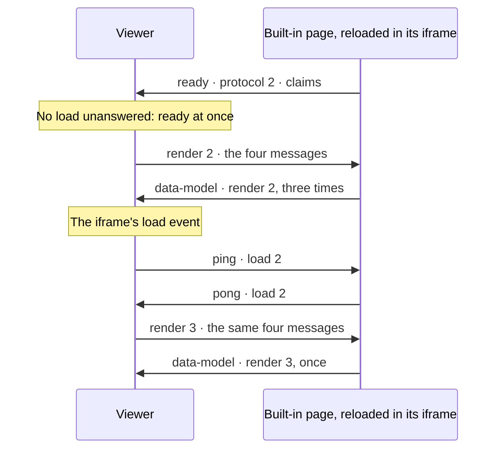

# The preview: how Spectra draws a surface with your catalog's own renderer

This doc explains how Spectra's preview draws a surface and lets you press it: the preview protocol between the viewer and a preview page, the framework-free core and the React, Lit and Angular adapters that run it on a page, the built-in page for the basic catalogs, what a press sends, the two preview widths, how a page reloads from its catalog's dev server, and what happens when the viewer and a page speak different versions of the protocol. It is written for the developer of an A2UI agent who uses Spectra and wants to know what the preview does with their catalog and what it reports. It starts with the problem, follows one press on upstream's Python restaurant finder from the render to the action waiting in the composer, then opens up the protocol, the routing of a surface to a page and the adapters, and ends with the design decisions and where the code is.

The running example is upstream's Python restaurant finder, `samples/agent/adk/restaurant_finder`, asked for "Top 2 Chinese restaurants in New York". It answers with a surface on the v0.9 basic catalog, two restaurant cards each with a Book Now button, which Spectra's built-in page draws with no setup. What the example does not reach, a custom catalog drawn on an adopter's own page, is shown with the sample catalog apps in [`samples/preview/`](../../samples/preview/react/README.md).

<picture>
  <source media="(prefers-color-scheme: dark)" srcset="diagrams/preview-dark.svg">
  
</picture>

## Problem it solves

A2UI separates what a UI is from how it looks. A catalog has a definition, `catalog.json`, which names its components and their properties as JSON Schema and which Spectra's checks read, and an implementation for each renderer it supports. A catalog renders only through a renderer it is implemented for. The basic catalog is implemented in every upstream renderer; a custom catalog usually in one, the one the adopter's host uses.

So Spectra can check a surface against the definition, but it cannot draw a custom catalog by itself: the components' code lives in the adopter's app, on their framework and their version of upstream's renderer. A surface drawn by any other code would not be the surface the user sees, and a control pressed in it would not make the action the agent receives.

The preview answers this by letting the catalog supply its own renderer. The adopter adds a preview adapter as a dev dependency, puts a small page on the catalog's dev server and names its URL in Spectra's config file. Spectra's viewer loads that page in an iframe and speaks the preview protocol to it: A2UI messages go in; render errors, the surface's data model and actions come out. The basic catalogs need none of this: Spectra carries a page for them, built the same way.

Without a page for its catalog, a surface has no preview and its controls cannot be pressed. Everything else, the checks, the tree, the data model, the model and tool calls, works.

## Five ideas to hold on to

### 1. The catalog brings its renderer

The adapter takes upstream's renderer and web core as peer dependencies, so the page runs on the framework and the renderer versions the adopter's real host uses, with the adopter's own components. Spectra ships no copy of the adopter's renderer, and the preview draws what the host would draw.

### 2. A page says what it draws

When a page starts it sends `ready`, carrying its claims: each catalog it renders, by its id and the protocol version its definition targets, taken from the catalog objects the page passes to its renderer. The adopter declares nothing. The viewer sends a surface to the first page, in config order and the built-in page last, whose claims cover every catalog the surface's messages name.

### 3. Every render carries the whole surface

A render is every A2UI message that names the surface, the conversation's earlier turns' and then the turn's own up to the step selected, in order. The page applies only what is new when the list extends the one it applied last, and starts over otherwise. A page that has just loaded needs nothing but the next render, and selecting any step in any turn draws the surface as it stood there.

### 4. A page is judged by its protocol number

In every version of the protocol a page announces itself with the same message type carrying its `protocol` number. The viewer reads the number before anything else. A page of another version has no preview, everything else works, and the viewer names which side to upgrade.

### 5. A press is shown before it is sent

Pressing a control in the preview does not reach the agent at once. The viewer turns the page's action into the exact message the agent would receive, with the data models it carries, and puts it in the composer as a pending action, to be sent, copied or discarded.

## One press, end to end

The excerpts below are cut from one run of the built binary, `a2ui-spectra attach` against the repository's stub agent, with the two turns of the restaurant finder's full record, [`conformance/test_data/turn_record/v0_1/full_record_restaurant_finder.json`](../../conformance/test_data/turn_record/v0_1/full_record_restaurant_finder.json), written into its store, so that the viewer shows the restaurant finder's turns without calling a model. The preview protocol's messages were recorded in Chromium as they crossed between the viewer and the built-in page.

1. **The pages load.** At connect the viewer reads the config file's preview pages from the session and loads each in an iframe of its own, then the built-in page, served by Spectra under `/preview/` on the viewer's own origin. Each page's address carries the viewer's origin in the `a2ui-spectra-viewer` query parameter: `http://localhost:9940/preview/?a2ui-spectra-viewer=http%3A%2F%2Flocalhost%3A9940`. This run configures no page, so the built-in page is the only one.
2. **The page says it is ready.** The React adapter starts the core, which sends:

   ```json
   {
     "type": "a2ui-spectra-preview/ready",
     "protocol": 2,
     "claims": [
       {
         "catalogId": "https://a2ui.org/specification/v0_9/catalogs/basic/catalog.json",
         "protocolVersion": "0.9"
       },
       {
         "catalogId": "https://a2ui.org/specification/v0_9_1/catalogs/basic/catalog.json",
         "protocolVersion": "0.9"
       },
       {
         "catalogId": "https://a2ui.org/specification/v1_0/catalogs/basic/catalog.json",
         "protocolVersion": "1.0"
       }
     ]
   }
   ```

   At the iframe's load the viewer asks which document is there, `{"type": "a2ui-spectra-preview/ping", "load": 1}`, and the page answers `{"type": "a2ui-spectra-preview/pong", "load": 1}`. The page is ready.

3. **The surface is routed.** You select the first turn's last step. Its surface, `default`, is made by four messages: a `createSurface` naming the v0.9 basic catalog at `v0.9`, an `updateComponents` with 13 components, and two `updateDataModel`s. The built-in page claims that catalog at a compatible version, so the viewer sends it the render, shortened here:

   ```json
   {
     "type": "a2ui-spectra-preview/render",
     "render": 1,
     "surfaceId": "default",
     "messages": [
       {
         "version": "v0.9",
         "createSurface": {
           "surfaceId": "default",
           "catalogId": "https://a2ui.org/specification/v0_9/catalogs/basic/catalog.json",
           "theme": {"primaryColor": "#FF0000", "font": "Roboto"},
           "sendDataModel": true
         }
       },
       {
         "version": "v0.9",
         "updateComponents": {
           "surfaceId": "default",
           "components": [
             {"id": "root", "component": "Column", "children": ["title-heading", "item-list"]}
           ]
         }
       },
       {
         "version": "v0.9",
         "updateDataModel": {
           "surfaceId": "default",
           "path": "/title",
           "value": "Top 2 Chinese Restaurants in New York"
         }
       },
       {
         "version": "v0.9",
         "updateDataModel": {
           "surfaceId": "default",
           "path": "/items",
           "value": [
             {"name": "Xi'an Famous Foods", "address": "81 St Marks Pl, New York, NY 10003"}
           ]
         }
       }
     ]
   }
   ```

   The `updateComponents` is cut to its first component of 13, and the list in `/items` to the first of its two restaurants and two of its six keys.

4. **The page draws it.** The core makes a new message processor, feeds the four messages into it one at a time and mounts the surface. As the messages fill the data model, the page sends it three times under render 1: `{}` after the `createSurface`, then with the title, then with the title and the two restaurants.
5. **You press Book Now on the first card.** Web core's processor dispatches the Button's action, and the page sends it with the surface's data model at that moment:

   ```json
   {
     "type": "a2ui-spectra-preview/action",
     "render": 1,
     "action": {
       "name": "book_restaurant",
       "surfaceId": "default",
       "sourceComponentId": "template-book-button",
       "timestamp": "2026-11-21T04:22:26.677Z",
       "context": {
         "restaurantName": "Xi'an Famous Foods",
         "imageUrl": "http://localhost:10002/static/shrimpchowmein.jpeg",
         "address": "81 St Marks Pl, New York, NY 10003"
       }
     },
     "dataModel": {
       "title": "Top 2 Chinese Restaurants in New York",
       "items": [{"name": "Xi'an Famous Foods", "address": "81 St Marks Pl, New York, NY 10003"}]
     }
   }
   ```

   The data model is shortened as the render's is.

6. **The action waits in the composer.** The viewer finds the render the press names, render 1, with the turn and step it was sent for, and builds the message the agent would receive: the A2UI action message in the surface's version, `v0.9`, and, since the surface set `sendDataModel`, its data model under `a2uiClientDataModel`, v0.9's key. The composer shows it in the turn record's form, its data models folded:

   ```text
   Action “book_restaurant”
   from Button template-book-button on surface default
   ```

   ```json
   {
     "role": "user",
     "parts": [
       {
         "type": "a2ui",
         "content": [
           {
             "version": "v0.9",
             "action": {
               "name": "book_restaurant",
               "surfaceId": "default",
               "sourceComponentId": "template-book-button",
               "timestamp": "2026-11-21T04:22:26.677Z",
               "context": {
                 "restaurantName": "Xi'an Famous Foods",
                 "imageUrl": "http://localhost:10002/static/shrimpchowmein.jpeg",
                 "address": "81 St Marks Pl, New York, NY 10003"
               }
             }
           }
         ]
       }
     ],
     "metadata": {
       "a2uiClientDataModel": {"version": "v0.9", "surfaces": {"default": {"…": "2 keys"}}}
     }
   }
   ```

   The composer folds the data model to `{ … 2 keys }`, written here as JSON. The part's content is a list of the one message because the message box speaks A2A 1.0 to the agent of this run; to an agent on A2A 0.3 it is the message itself.

7. **Sending it.** An action continues only a conversation the message box started. This turn came from the store, so here the composer says why it cannot be sent: "Started by another host or in an earlier run · an action can only be sent in a conversation the message box started". In a conversation the box started, Send sends it as the next turn, as [the wire doc](wire.md) describes. The `wire_input` of the record's second turn is the same press, made in the recorded run, as the restaurant finder received it, its part's content the message itself rather than a list. Its attributes, shortened:

   ```json
   {
     "a2ui.event.kind": "wire_input",
     "a2ui.wire.message": {
       "role": "user",
       "parts": [
         {
           "type": "a2ui",
           "content": {
             "version": "v0.9",
             "action": {
               "name": "book_restaurant",
               "surfaceId": "default",
               "sourceComponentId": "template-book-button",
               "timestamp": "2026-10-21T10:01:00.004Z",
               "context": {
                 "restaurantName": "Xi'an Famous Foods",
                 "imageUrl": "http://localhost:10002/static/shrimpchowmein.jpeg",
                 "address": "81 St Marks Pl, New York, NY 10003"
               }
             }
           }
         }
       ]
     },
     "a2ui.wire.data_model": {
       "version": "v0.9",
       "surfaces": {
         "default": {
           "title": "Top 2 Chinese Restaurants in New York",
           "items": [{"name": "Xi'an Famous Foods"}, {"name": "Han Dynasty"}]
         }
       }
     }
   }
   ```

   Its capabilities and metadata are left out, and each restaurant is cut to its name. The wire event's attributes are in the turn record's [`wire_input` and `wire_output`](../../specification/turn_record/v0_1/docs/turn_record.md#wire_input-and-wire_output).

## Inside the machinery

### The protocol

The protocol is a set of messages that names no carrier. The web adapters carry it over `postMessage` between the viewer, the parent window, and the page in its iframe. Every message's `type` starts with `a2ui-spectra-preview/`. This is version `2`.

| Message      | From   | What it carries                                                                                                                                                                                                                                                                                      |
| ------------ | ------ | ---------------------------------------------------------------------------------------------------------------------------------------------------------------------------------------------------------------------------------------------------------------------------------------------------- |
| `ready`      | page   | `protocol`, the protocol's version, `2`; and `claims`, each catalog the page renders as `catalogId` and `protocolVersion`, the version its definition targets as web core's catalog object states it, such as `0.9` or `1.0`, in the order the page passes them to its renderer, each once           |
| `ping`       | viewer | `load`, the number of the page's load the viewer asks about: 1 for the page's first load, and one more at each later load                                                                                                                                                                            |
| `pong`       | page   | `load`, the number of the `ping` it answers                                                                                                                                                                                                                                                          |
| `render`     | viewer | `render`, a running number; `surfaceId`; and `messages`, every A2UI message that names the surface, the conversation's earlier turns' and then the turn's own up to the step selected, in order                                                                                                      |
| `report`     | page   | `render`, the number of the render it belongs to, and one `report`, of three kinds, below                                                                                                                                                                                                            |
| `data-model` | page   | `render`; `surfaceId`, the shown surface; and `dataModel`, its data model as the agent's messages and the user's typing left it. Sent whenever it changes, and once more for each render that leaves it as it was                                                                                    |
| `action`     | page   | `render`, the number of the current render; `action`, web core's action payload, its `name`, `surfaceId`, `sourceComponentId`, `timestamp` and `context`, with `catalogId` and, in v1.0, `userMessage` when the component has them; and `dataModel`, the pressed surface's data model at that moment |

The three kinds of report:

| `kind`      | Fields                                                     | What it is                                                                                                                                               |
| ----------- | ---------------------------------------------------------- | -------------------------------------------------------------------------------------------------------------------------------------------------------- |
| `component` | `componentId` and `componentType` when known, `error`      | A component that threw while drawing. `error` is the page's own error text, its name and message, such as `RangeError: Invalid time value`               |
| `surface`   | `code`, `error`, and `componentId` when web core names one | An error web core reported on the surface through its error channel, such as an unknown component type                                                   |
| `refused`   | `index`, `code`, `error`                                   | A message the page's processor refused: its index in the render's list, web core's error code or else the error's name, and the message without the name |

A data model is sent as a plain copy, holding none of the processor's live state; a surface with no data model sends `null`. The message type `a2ui-spectra-preview/screenshot` is reserved: no adapter produces it and no viewer asks for it.

The rules that hold the messages together:

- **Across versions.** In every version of the protocol a page announces itself with a message of the type `a2ui-spectra-preview/ready` carrying its `protocol` number, and everything else may change with the number. A ready message whose `protocol` is not a number is not a ready message. The viewer judges a page by the number alone, before it reads anything else of the message.
- **Loads and answers.** At each load of the page's iframe the viewer sends a `ping` with the load's number, and the document that is there answers with a `pong` carrying the same number. The core listens for `ping` before it sends `ready`, so a document that has said `ready` can always answer. A document whose adapter has not started does not hear the `ping`: the viewer asks again, with the same number, when that document's `ready` arrives. The viewer counts an answer only for the latest load's number, and a broken document never answers.
- **The render difference.** Each render carries the full list. The core remembers the list it applied last, each message compared as JSON: when the new list is for the same surface and begins with it, only the tail is fed into the processor that holds the surface; otherwise the processor is disposed of, a new one made and the whole list fed. A shorter list, or another surface, starts over. Messages are fed one at a time, and a throw is reported as a refused message, the rest of the list still fed.
- **Reports and renders.** Every report is tagged with its render's number. With a render that extends the last, the surface's earlier reports are sent again under the new number, since they still describe what is drawn. A processor keeps each report once: the same report made again is not sent again. The viewer takes a page's reports and data model only for the render it sent last, and each report once.
- **Trust.** The viewer loads the page with its own origin in the `a2ui-spectra-viewer` query parameter, which must hold an origin and nothing more. The page sends to that origin only, and takes messages only from its parent window at that origin. The viewer, in turn, sends a page's messages to the origin of the page's configured URL and takes a message only from one of its own iframes, at that page's origin. A page opened with no parameter draws nothing and shows one line: "This is a Spectra preview page. It previews only inside Spectra."
- **Errors outside a component.** The window's error events, an uncaught error and a promise rejected with no handler, are reported once a render has come, as a component failure with no id.
- **Late events.** Events from a processor the core has disposed of are dropped, so a page never reports for a surface it no longer draws.

### Loads, answers and reloads

The viewer holds every page for the whole session: each is loaded at connect, in an iframe outside the viewer's own page tree, and stays loaded, so moving between turns, steps and surfaces never reloads a page, and a page keeps its processor while panes come and go. The iframe a surface is routed to is laid over the Preview pane's frame; the others are hidden.

A page's ready and its iframe's load come in either order: a page on a dev server tends to load first, and a built page to say it is ready first. The viewer cannot see a page on another origin begin to reload, so the load numbers tell it which document is there. Each page is in one of six states:

| State        | When                                                                                                                                                                   | What it does to a surface behind it                                           |
| ------------ | ---------------------------------------------------------------------------------------------------------------------------------------------------------------------- | ----------------------------------------------------------------------------- |
| `waiting`    | From the start until the page first answers, is passed by, or times out                                                                                                | Holds it: the pane says "Loading the preview pages…"                          |
| `loading`    | Its iframe has not loaded five seconds after the page was added. The viewer leaves it alone however long the load takes                                                | Passes it by; the surface moves to the page if it later answers and claims it |
| `ready`      | It said `ready` in the viewer's protocol version, and the document at its latest load answered                                                                         | Draws it, if it claims it                                                     |
| `reloading`  | A ready page's iframe loaded again and its document has not answered yet. It keeps its claims, and the frame stays on it                                               | Keeps the surfaces it was drawing                                             |
| `unanswered` | Its document did not answer within five seconds of its load. It claims nothing, and its address is set again, as often as a load brings no answer                      | Passes it by                                                                  |
| `mismatch`   | It said `ready` in another protocol version. Its answers count for nothing, and its address is set again five seconds after its load, so an upgraded page is picked up | Passes it by                                                                  |

A `ready` that arrives while a load is unanswered may be that load's document, whose adapter had not started when the viewer asked: the viewer asks again, with the same number, and the page is ready once the answer comes. A `ready` that arrives with no load unanswered makes the page ready at once: a page whose ready comes before its load, and a React page in development mode, which mounts twice and says it is ready twice. Whenever a page becomes ready it holds nothing, so the render asked of it last is sent again, and a render asked of a page that is not ready yet is sent once it is.

**Reloading from the catalog's dev server.** A page served by its catalog's dev server reloads itself when you save its code: Vite, for one, swaps an edited module into the page in place where it can and reloads the whole page where it cannot. A swap in place redraws the surface inside the page, and the viewer sees nothing of it. A whole reload is a new load of the iframe and a new document, which says it is ready again and is sent the surface again, the new document's claims replacing the old. While it reloads the page keeps its claims, so a surface it was drawing stays with it, and the frame shows what the reloaded document draws, the dev server's own error page when it has one. A healthy page answers within milliseconds of its load; one that does not answer within five seconds is `unanswered`, and is drawn again once its dev server is back and a load brings an answer. How the pane shows a reload is in [the viewer doc](viewer.md).

The built-in page reloaded in its frame in the run above, which shows the order for a page that says ready before its load:



Render 3 carries the list render 2 did, so the page feeds nothing new and sends the data model once more under the new number.

### Which page draws a surface

The surface in view goes to one page, never split between pages:

1. **What the surface needs.** Every catalog id its `createSurface` and `updateComponents` messages name, under `catalogId` or `@catalogId` at any depth, so in v1.0 a component's own catalog counts beside the surface's; and the protocol version of the first of its `createSurface` messages that states one, such as `v0.9`.
2. **Who serves it.** A claim serves a catalog when its `catalogId` is the id and its `protocolVersion` is compatible with the surface's version by web core's rule: v0.9 and v0.9.1 each accept a catalog of either, v1.0 a catalog of 1.0 or of any 1.x, and `v1.0`, `1.0` and `1.0.0` are the same version. A surface whose `createSurface` states no version is served at any version.
3. **The order.** The configured pages in config order, then the built-in page. The first page that is `ready` or `reloading` and whose claims serve every catalog the surface needs draws it. A `waiting` page ahead of that page holds the surface until it answers, is passed by or times out.
4. **None.** With no such page, the pane says "No preview for catalog" with the first catalog no `ready` or `reloading` page serves, or, when each catalog is served by some page but no page serves them all, the first catalog the surface names; then "Add a page built with a Spectra preview adapter to the config’s preview pages.", and a line for each page that draws nothing because it is `loading`, `unanswered` or `mismatch`. A surface whose messages name no catalog has "No preview: the surface names no catalog."

Since the configured pages come first, a page that claims a basic catalog takes its surfaces from the built-in page. The sample catalog apps do this on purpose: each claims the v1.0 basic catalog too, so a v1.0 surface on it is drawn by the adopter's renderer.

The viewer sends a page a render only when the surface or its list changes. Selecting another step that leaves the list as it was sends nothing, and a press made after it belongs to the step now selected. A live turn's surface is sent again as each message arrives, and the page applies the tail.

### The core

`a2ui-spectra-preview` is the protocol and its framework-free core. An adopter installs an adapter, not the core, which comes with it. The core's `startPreviewPage` runs the page's side of the protocol: it says `ready` with the claims of the catalogs it is given, answers each `ping` itself, applies each render as the render difference says, and tags every report and data model with its render. An adapter gives it four things:

| What the adapter gives | What it does                                                                                               |
| ---------------------- | ---------------------------------------------------------------------------------------------------------- |
| `createProcessor`      | Makes a message processor with the page's catalogs, its surfaces reporting to the events the core hands it |
| `feed`                 | Feeds the processor one message, throwing when the processor refuses it                                    |
| `mount`                | Draws the surface with this id, now or once a message creates it                                           |
| `teardown`             | Disposes of the processor and what it drew                                                                 |

The events a processor's surfaces report through are four: an action with its surface's data model, a surface's data model as it is created and whenever it changes, an error web core reported, and a component that failed to draw. The core also holds the web carrier: `windowTransport`, the `postMessage` transport with the origin rules above, and `windowErrors`, the window's error events. `guardElementUpdates` guards a custom element class's updates: a throw in an element's update is reported with the element and does not leave the page, and the element stays as its last update left it. It covers components drawn as web components, which an error boundary of the page's framework does not see, a class's subclasses included, each throw going to the latest handler given for that class.

**The web core part.** `a2ui-spectra-preview/web-core` is what every web adapter does with web core's message processor, whichever framework draws its surfaces. For this part the core's package takes `@a2ui/web_core` as a peer dependency, `^0.15.0`; the core's main entry does not import it.

- `actionHandlerFor` makes the action handler an adapter makes its processor with: each action is reported with its surface's data model at that moment.
- `watchProcessor` watches a processor the adapter made: each surface it creates reports the errors web core sends through its error channel, and its data model as it appears and whenever the agent's messages or typing change it.
- `guardUniversalElements` guards web core's universal elements at their updates, naming the component that threw by its id and type. Both basic catalogs and every Lit component are drawn with them, and they share one base class, so one guard covers them all.

Each adapter still makes its own processor, with the catalogs it is given, and hands it to the core.

### The three adapters

Each adapter is one component that runs the core with a web core processor holding the page's catalogs and draws the surface each render names with upstream's own surface component. Opened outside Spectra, each shows the standalone line. How to install each and write its page is in its README: [React](../../typescript/preview/react/README.md), [Lit](../../typescript/preview/lit/README.md), [Angular](../../typescript/preview/angular/README.md).

| Adapter                        | What the page holds                                                                                                                                  | Where the claims come from                                                                                                                                                                                             | The surface is drawn by                                                                                      |
| ------------------------------ | ---------------------------------------------------------------------------------------------------------------------------------------------------- | ---------------------------------------------------------------------------------------------------------------------------------------------------------------------------------------------------------------------- | ------------------------------------------------------------------------------------------------------------ |
| `a2ui-spectra-preview-react`   | `SpectraPreview`, inside the providers the host wraps its surfaces in                                                                                | Its `catalogs` prop, read once, as the component mounts                                                                                                                                                                | `A2uiSurface`                                                                                                |
| `a2ui-spectra-preview-lit`     | `<a2ui-spectra-preview>`, where the host places its surfaces, inside its context providers                                                           | Its `catalogs` property, set as a property, not an attribute, and read when the element is first connected with them. Disconnected, the element stops; connected again, it starts anew with the catalogs it then holds | `<a2ui-surface>`, in the element's own light DOM, so the page's styles reach it as they reach it in the host |
| `a2ui-spectra-preview-angular` | `<a2ui-spectra-preview />` in an application bootstrapped with the host's `provideA2Ui` config, and `provideMarkdownRenderer` when the host uses one | The renderer config's `catalogs`. The component takes no inputs                                                                                                                                                        | `<a2ui-v09-surface>`                                                                                         |

What each reports when a component throws while drawing differs with what its framework lets it see:

- **React.** Each React implementation in the catalogs is wrapped in an error boundary of its own, in place in the catalog object, once per catalog. Web core's universal elements, which both basic catalogs are drawn with, are guarded at their updates. Either way the failure is reported with the component's id and type, and the rest of the surface stays drawn.
- **Lit.** Every Lit component, the basic catalog's and the adopter's own, is one of web core's universal elements, guarded at its updates; the failure is reported with its id and type, and the rest of the surface stays drawn.
- **Angular.** Angular has no error boundary: an error reaches the application's `ErrorHandler`, which is not told which component threw. The adapter wraps the page's handler, reports every error it is given as a component failure with no id, which the viewer shows as "A component did not render." with the error's name and message, and hands it on to the page's own handler. A page that sets `useUniversalComponents` draws the catalog entries that are web core's universal elements, such as the v1.0 basic catalog's components, as those elements, guarded at their updates, which names them. Its Angular components, the adopter's own included, are still drawn by Angular under that setting, in upstream's web component host for an Angular component, which is not a universal element, so a throw in one is still reported with no id.

For each processor the core asks for, the Angular adapter gives upstream's `<a2ui-v09-surface>` a fresh `A2uiRendererService` in a child injector holding the page's renderer config, `useUniversalComponents` and `processorOptions` included, with Spectra's action handler in place of the config's.

All three report the other kinds the same way, through the core and its web core part: an error web core reports on the surface, a message the processor refuses, the shown surface's data model as it is created and whenever the agent's messages or typing in the page change it, and an action with the surface's data model at that moment.

Each adapter takes its framework and upstream's packages as peer dependencies, so the page runs on the versions the host has:

| Adapter                        | Upstream renderer         | Web core                   | Framework                                                                    |
| ------------------------------ | ------------------------- | -------------------------- | ---------------------------------------------------------------------------- |
| `a2ui-spectra-preview-react`   | `@a2ui/react` `^0.15.0`   | `@a2ui/web_core` `^0.15.0` | `react` and `react-dom` `^18.0.0 \|\| ^19.0.0`                               |
| `a2ui-spectra-preview-lit`     | `@a2ui/lit` `^0.15.0`     | `@a2ui/web_core` `^0.15.0` | `lit` `^3.3.3`                                                               |
| `a2ui-spectra-preview-angular` | `@a2ui/angular` `^0.14.0` | `@a2ui/web_core` `^0.15.0` | `@angular/common`, `@angular/core` and `@angular/platform-browser` `^21.2.5` |

For each upstream package Spectra supports the pin's main and the package's published latest; the floors are the low ends of these ranges. The published renderers, `@a2ui/react` 0.15.0, `@a2ui/lit` 0.15.0 and `@a2ui/angular` 0.14.0 on `@a2ui/web_core` 0.15.0, read a v1.0 component's envelope keys in the bare form only, and refuse a surface whose components carry the `@` keys; a page on them reports that refusal in the renderer's own words, as a refused message. Which release reads which form is in the root README's [What Spectra supports](../../README.md#what-spectra-supports), and how Spectra itself judges the two forms in [the checks doc](checks.md).

### The built-in page

The built-in page draws the basic catalogs with no setup. It is a React page through the React adapter, used exactly as an adopter's page uses it, on upstream's React renderer, with `@a2ui/markdown-it` as its Markdown renderer. It passes three catalogs: web core's v0.9 basic catalog; the same catalog again under the v0.9.1 basic catalog's URL, `https://a2ui.org/specification/v0_9_1/catalogs/basic/catalog.json`, the name upstream's v0.9.1 protocol document gives the basic catalog; and web core's v1.0 basic catalog. Its claims are the three of the `ready` above.

- **Where it is.** Spectra serves it under `/preview/` on the viewer's own origin, and the binary carries it beside the viewer. The viewer loads it in an iframe like any configured page, after them.
- **Which upstream it runs on.** It is built on upstream's packages at the commit Spectra is pinned to, which read both forms of a v1.0 component's envelope keys, so it draws a surface in the `@` form and in the bare form.
- **Its look.** It stays light in both of the viewer's themes, as a host's page is: its root carries upstream's `a2ui-light` class, which the basic catalog's styles follow, on a white background.
- **Icons.** It bundles the Material Icons font, in which web core's basic catalog `Icon` sets an icon's name as a ligature. The font starts loading with the page, and an icon's name stays hidden until it has loaded.

### The config file's `preview` setting

`preview` lists the URLs of the preview pages built with a Spectra preview adapter. This one is the React sample's, [`samples/preview/react/a2ui-spectra.json`](../../samples/preview/react/a2ui-spectra.json):

```json
{
  "$schema": "https://raw.githubusercontent.com/retz8/a2ui-spectra/main/tools/spectra/src/config.schema.json",
  "catalogs": ["../catalog.json"],
  "preview": ["http://localhost:9831/"]
}
```

- It is a list of strings, each a URL starting with `http://` or `https://`. Anything else stops Spectra at start, naming the entry.
- The viewer loads each, in config order and before Spectra's built-in page, and draws a surface in the first page that claims its catalogs.
- The browser loads the page, not Spectra, so a page must be reachable from the browser the viewer is open in: a remote browser, such as one reaching Spectra through a tunnel, needs the page's address as it reaches it.
- The page is told the viewer's origin and sends nowhere else; the viewer talks to the origin of the URL as configured. A URL this browser cannot read is left out.
- Left out, the list is empty, and the built-in page is the only page.

`catalogs`, beside it, is the catalog definitions for the checks, and is independent of the preview: a page claims what its own code passes to its renderer. Where the config file is found and how strictly it is read are in [the command's README](../../tools/spectra/README.md). The viewer reads the configured pages from the session, as `previewPages` in `GET /api/context`, described in [the API doc](api.md).

### Preview widths

The frame the page is drawn in is Narrow, 384 pixels, a phone's width, or Wide, the Preview pane's width, Wide by default. The switch is in the pane's header, and the browser remembers it. The page's iframe takes the frame's size, so the page lays itself out at that width as it would in a host of that width. The page keeps its own background in both of the viewer's themes. How the pane, its header and its divider look at each width is in [the viewer doc](viewer.md).

### What a page reports, and where it lands

A page's reports become problems of the turn in view, each on a step, with "Preview page · not recorded" under it. They are not written into the turn record, nor do they decide where a turn opens, which follows the record's own problems: they depend on the step in view and on the page drawing it. While the turn is in view they count with its problems; where they show is in [the viewer doc](viewer.md).

| Report             | The problem                                                                                                                                          | On                                                                                                                        |
| ------------------ | ---------------------------------------------------------------------------------------------------------------------------------------------------- | ------------------------------------------------------------------------------------------------------------------------- |
| `component`, an id | "`<type> <id>` did not render.", such as "Image confirm_image did not render.", `Component` standing for an unknown type, with the page's error text | The step of the turn's own message that last carried the component, marking the line of its id; else the turn's last step |
| `component`, no id | "A component did not render.", with the page's error text                                                                                            | The turn's last step                                                                                                      |
| `refused`          | "The preview page refused this message.", with the code and the error                                                                                | That message's step                                                                                                       |
| `surface`          | Web core's error message, with its code and "A2UI web core in the preview page"                                                                      | The component's step when web core names one, else the turn's last step                                                   |

A component failure always counts. A refused message or a web core error on a step that already has a problem of the viewer's own folds under it as a quiet line, as web core's rejections fold under the checks' findings: "The preview page also refused this message" or "The preview page also reported". A refused message of an earlier turn, which that turn counts, folds on the last step: "The preview page also refused an earlier turn's message". The pane also lists every report of the render above the frame.

### A press and the action it sends

A press is the page's `action` message. The viewer keeps the turn, the step and the surfaces as they stood for each of a page's latest 50 renders, however their running numbers interleave with other pages', so a press goes on as pressed in its own render even after a newer render went out; a press naming an older render is dropped.

From the press the viewer builds the pending action:

- **The message.** One A2UI action message, `{"version": …, "action": {…}}`, the action as the page reported it, in the pressed surface's version: its `createSurface`'s, else the render's, else `v0.9`.
- **The data models.** Every surface that asked for its data model with `sendDataModel`, of the same protocol as the message, v0.9 and v0.9.1 together and v1.0 apart: the pressed surface's from the page, with what was typed in it, and every other one's as the agent's messages left it at the step of the render it was pressed in. A data model that is not an object goes as `{}`. They go under `a2uiClientDataModel` for v0.9 and v0.9.1 and `a2uiRendererDataModel` for v1.0, as `{"version": …, "surfaces": {…}}`. With no surface asking, there is no data model.
- **The form shown.** The composer shows the message in the turn record's form, the part's content an object in A2A 0.3 and a list in A2A 1.0, the data models folded, with a line naming the action, its component and its surface.

A newer press replaces a pending action, and moving to a turn of another conversation, or to a new conversation, drops it. It is sent only in a conversation the message box started, and the composer says why otherwise; a send that fails leaves it pending. A press in the fixture view is dropped: it shows what was recorded, and sending belongs to the replayed conversation. How the message box puts the action into an A2A message is in [the wire doc](wire.md); how the composer shows and sends it, in [the viewer doc](viewer.md).

The shown surface's data model reaches the composer by another way too: a text sent in a conversation the message box started, while a surface is in view, carries the data model of every surface that asked for it, the shown one's from its page, with what was typed in it.

### The version mismatch

A page whose `ready` carries another protocol number than the viewer's has no preview, everything else works, and the "No preview" state names the two numbers and the side to upgrade. These are the lines the viewer's tests expect, in [`tools/spectra_viewer/src/model/preview.test.ts`](../../tools/spectra_viewer/src/model/preview.test.ts), for a page on version 1 and one on version 3, with Spectra 0.1.0 on version 2:

```text
http://localhost:5176/preview: preview page speaks protocol 1, this Spectra speaks 2 · upgrade the page's a2ui-spectra-preview and its adapter to 0.1.0
http://localhost:5177/preview: preview page speaks protocol 3, this Spectra speaks 2 · upgrade a2ui-spectra
```

- **The page speaks the lower number.** Upgrade the page's preview packages, `a2ui-spectra-preview` and its adapter, to the running Spectra's version. Spectra's packages are released together under one version, as [the distribution doc](distribution.md) describes, so the version of the running Spectra is the version of the preview packages that speak its protocol.
- **The page speaks the higher number.** Upgrade `a2ui-spectra`.
- **After the upgrade.** The viewer sets a mismatched page's address again five seconds after each load that brings no answer, so an upgraded page served by a dev server is picked up without a restart.

## When things go wrong

| What happens                                                                           | What you see                                                                                                                                                                                    |
| -------------------------------------------------------------------------------------- | ----------------------------------------------------------------------------------------------------------------------------------------------------------------------------------------------- |
| A surface on a custom catalog, and no page claims it                                   | "No preview for catalog" and its id, and "Add a page built with a Spectra preview adapter to the config’s preview pages."                                                                       |
| A page claims the surface's catalog but not a catalog one of its v1.0 components names | The page does not draw it. One page has to claim every catalog the surface names, or the surface has no preview                                                                                 |
| A page's iframe has not loaded after five seconds                                      | "`<page>` is still loading" under "No preview for catalog". The surface passes it by, and moves to it once it loads and answers                                                                 |
| A page loads but its document does not answer within five seconds                      | "`<page>` has not answered". Its adapter did not start, it threw before starting, or the URL is not a preview page. Its address is set again five seconds after each load that brings no answer |
| A page redirects to another origin                                                     | It is not heard, since the viewer talks to the configured URL's origin alone: "`<page>` has not answered". Configure the address the page ends up at                                            |
| A page speaks another version of the protocol                                          | The two numbers and the side to upgrade, as above                                                                                                                                               |
| A page is opened in a browser tab of its own                                           | "This is a Spectra preview page. It previews only inside Spectra."                                                                                                                              |
| The page's dev server is stopped while the page reloads                                | The pane says the page is reloading, then "`<page>` has not answered". The surface is drawn again once the server is back and a load brings an answer                                           |
| A `preview` entry that is not an `http://` or `https://` URL                           | Spectra stops at start, as the run below shows                                                                                                                                                  |
| A surface in the v1.0 `@` form, on a page on the published renderers                   | "The preview page refused this message." with the renderer's own error, on the message's step                                                                                                   |
| A component throws while drawing                                                       | "`<type> <id>` did not render." on the step that carried it; for an Angular component, which is not a universal element, "A component did not render."                                          |
| A press in a conversation the message box did not start                                | The composer: "Started by another host or in an earlier run · an action can only be sent in a conversation the message box started"                                                             |
| A press in a conversation whose agent named none                                       | The composer: "The agent named no conversation · an action can only be sent in a conversation the agent named"                                                                                  |
| A press in the fixture view                                                            | Nothing: the press is dropped                                                                                                                                                                   |

A `preview` entry with another scheme, and one written without its scheme, which a URL reads as a scheme of its own, each stop the built binary at start; the path is shortened here:

```text
a2ui-spectra: /…/bad/a2ui-spectra.json: preview[0] must start with http:// or https://, not 'ws://'.
a2ui-spectra: /…/bad/a2ui-spectra.json: preview[0] must start with http:// or https://, not 'localhost://'.
```

The second comes from `"preview": ["localhost:5174"]`. A `preview` that is not a list stops it too: `preview must be an array.`

## Design decisions

| Decision                                                                                 | What it buys                                                                                                                          | What it costs                                                                                             |
| ---------------------------------------------------------------------------------------- | ------------------------------------------------------------------------------------------------------------------------------------- | --------------------------------------------------------------------------------------------------------- |
| The catalog supplies its own renderer, on a page its dev server serves                   | The preview draws what the host draws: the adopter's components, framework and renderer versions                                      | The adopter adds a dev dependency and a page, and keeps the dev server running                            |
| A framework-free core, with thin adapters                                                | The protocol, the render difference and the reports are written once; an adapter only makes, feeds, mounts and tears down a processor | Three adapters to keep in step with three upstream renderers                                              |
| A page claims by the catalog objects it passes to its renderer                           | Nothing to declare, and the claims cannot drift from what the page draws                                                              | A page claims every catalog it passes, whether or not the surface it gets is one the adopter meant for it |
| Every render carries the whole list, and the page applies the difference                 | A new or reloaded page needs no history, and any step of any turn can be drawn                                                        | A long conversation's list goes over whole on every change, and both sides compare it                     |
| The ready message's type and number fixed across versions, the page judged by the number | An older or newer page is always recognised, and the viewer names the side to upgrade                                                 | Any change to the other messages takes a new number, and both sides upgrade together                      |
| A ping and a pong at each load                                                           | The viewer tells a page that reloaded from one that is up, on any origin, where it cannot see a navigation begin                      | One round trip more per load, and five seconds before a broken page is called so                          |
| Every page loaded at connect and kept for the session                                    | Moving between turns, steps and surfaces is immediate, and a page's state survives the viewer's panes                                 | Every configured page runs for the whole session, drawn or not                                            |
| The viewer's origin in the page's address, and messages taken from one origin each way   | A page talks only to the viewer that loaded it, and the viewer only to the pages it loaded                                            | A page that redirects to another origin is not heard                                                      |
| A page's reports as problems, not recorded                                               | The problems include what the real renderer does with the messages                                                                    | They depend on the step in view and the page drawing it, so a fixture does not carry them                 |
| The built-in page made with the React adapter, as an adopter's page is                   | Spectra's own default path runs the adapter an adopter uses                                                                           | The binary carries React and upstream's React renderer                                                    |
| A press becomes a pending action                                                         | You see the exact message, with its data models, before it goes, and can copy or discard it                                           | One more press to send                                                                                    |

## Known limits

- The adapters are for the web: React, Lit and Angular. Flutter, SwiftUI and Compose have none yet. The protocol names no carrier, so such an adapter can connect back over a socket.
- No adapter sends a screenshot; the message type is reserved for the first adapter that cannot be embedded in an iframe.
- The preview has two widths, Narrow and Wide. It has no variants for light and dark or for other themes, and the built-in page stays light.
- A page draws one surface at a time, the one in view. A press carries the other surfaces' data models as the agent's messages left them, without what was typed in them.
- On Angular, a component that throws is named only when it is one of web core's universal elements, drawn with `useUniversalComponents` set; an Angular component never is.
- Until npm carries a renderer release that reads the `@` form of v1.0's envelope keys, a page on a published renderer refuses a surface in that form.
- The page's reports are not in the turn record.

## Trying it

The built-in page needs only Spectra and an agent that answers on the basic catalog. Without a model, the repository's stub agent does, from `conformance/` after the workspace is built:

```bash
node dist/stub_agent/stub_agent.js --port 10013 --canned-a2ui   # a surface asking for a name
a2ui-spectra attach http://127.0.0.1:10013                       # from another shell
```

Send a message from the composer, type a name in the preview and press Greet me: the action lands in the composer, and Send has the stub answer "Hello, Ada!" for the name Ada, read from the data model the page reported with what was typed.

A custom catalog on an adopter's page is shown by the three sample catalog apps, each a catalog with a custom slider, its implementation and its preview page, run with the stub agent and Spectra: [React](../../samples/preview/react/README.md), [Lit](../../samples/preview/lit/README.md) and [Angular](../../samples/preview/angular/README.md).

## Where the code is

| What                                                                         | Where                                                                                                                                                                                                |
| ---------------------------------------------------------------------------- | ---------------------------------------------------------------------------------------------------------------------------------------------------------------------------------------------------- |
| The protocol's messages and its version                                      | [`typescript/preview/core/src/protocol.ts`](../../typescript/preview/core/src/protocol.ts)                                                                                                           |
| The page's side: ready, ping, the render difference, the reports, the claims | [`page.ts`](../../typescript/preview/core/src/page.ts), [`difference.ts`](../../typescript/preview/core/src/difference.ts), [`claims.ts`](../../typescript/preview/core/src/claims.ts)               |
| The web carrier, the guard on custom elements, the web core part             | [`window.ts`](../../typescript/preview/core/src/window.ts), [`guard.ts`](../../typescript/preview/core/src/guard.ts), [`web_core.ts`](../../typescript/preview/core/src/web_core.ts)                 |
| The React adapter and its error boundaries                                   | [`SpectraPreview.tsx`](../../typescript/preview/react/src/SpectraPreview.tsx), [`boundaries.tsx`](../../typescript/preview/react/src/boundaries.tsx)                                                 |
| The Lit adapter                                                              | [`typescript/preview/lit/src/spectra_preview.ts`](../../typescript/preview/lit/src/spectra_preview.ts)                                                                                               |
| The Angular adapter                                                          | [`typescript/preview/angular/src/spectra_preview.component.ts`](../../typescript/preview/angular/src/spectra_preview.component.ts)                                                                   |
| The built-in page                                                            | [`tools/spectra_basic_preview/src/main.tsx`](../../tools/spectra_basic_preview/src/main.tsx), [`index.html`](../../tools/spectra_basic_preview/index.html)                                           |
| Serving the built-in page under `/preview/`                                  | [`tools/spectra/src/viewer_files.ts`](../../tools/spectra/src/viewer_files.ts)                                                                                                                       |
| The `preview` setting                                                        | [`tools/spectra/src/config.ts`](../../tools/spectra/src/config.ts), [`config.schema.json`](../../tools/spectra/src/config.schema.json)                                                               |
| The pages' iframes, loads, pings, renders and presses                        | [`tools/spectra_viewer/src/state/preview_host.ts`](../../tools/spectra_viewer/src/state/preview_host.ts)                                                                                             |
| The states, the routing, the mismatch line, reports as problems              | [`tools/spectra_viewer/src/model/preview.ts`](../../tools/spectra_viewer/src/model/preview.ts)                                                                                                       |
| The pending action and its data models                                       | [`tools/spectra_viewer/src/state/press.ts`](../../tools/spectra_viewer/src/state/press.ts), [`tools/spectra_viewer/src/model/host_message.ts`](../../tools/spectra_viewer/src/model/host_message.ts) |
| The Preview pane and its widths                                              | [`tools/spectra_viewer/src/components/PreviewPane.tsx`](../../tools/spectra_viewer/src/components/PreviewPane.tsx)                                                                                   |
| The sample catalog apps                                                      | [`samples/preview/`](../../samples/preview)                                                                                                                                                          |
| Upstream's packages at the pin, which the built-in page is built on          | [`vendor/a2ui/`](../../vendor/a2ui/README.md)                                                                                                                                                        |
| This doc's diagram, its source and its two exports                           | [`docs/design/diagrams/`](diagrams)                                                                                                                                                                  |

## Words used in this doc

| Word              | Meaning                                                                                                                        |
| ----------------- | ------------------------------------------------------------------------------------------------------------------------------ |
| Preview page      | A web page that draws surfaces for the viewer through a preview adapter, in an iframe: an adopter's page, or the built-in page |
| Preview adapter   | The library a preview page runs the protocol with, one per framework: `a2ui-spectra-preview-react`, `-lit` and `-angular`      |
| Core              | `a2ui-spectra-preview`, the protocol and the framework-free code every adapter runs it with                                    |
| Built-in page     | Spectra's own preview page for the v0.9, v0.9.1 and v1.0 basic catalogs, served under `/preview/`                              |
| Claim             | A catalog a page says it renders: its id and the protocol version its definition targets                                       |
| Render            | One `render` message: a surface's id and every message that names it, up to the step selected                                  |
| Report            | What went wrong in a page: a component that failed to draw, an error web core reported, or a message the processor refused     |
| Load              | One load of a page's iframe, numbered from 1, which the viewer asks the document about                                         |
| Web core          | `@a2ui/web_core`, upstream's framework-free library holding the message processor every web renderer uses                      |
| Universal element | Web core's web component for a component, which both basic catalogs and every Lit component are drawn with                     |
| Press             | A control pressed in the preview, which the page reports as an action                                                          |
| Pending action    | The action message a press puts in the composer, waiting to be sent, copied or discarded                                       |
| Message box       | Spectra's own host, which sends the composer's messages to the agent                                                           |
| Envelope keys     | A v1.0 component's `@catalogId`, `@accessibility`, `@metadata` and `@checks`, written bare before upstream renamed them        |
