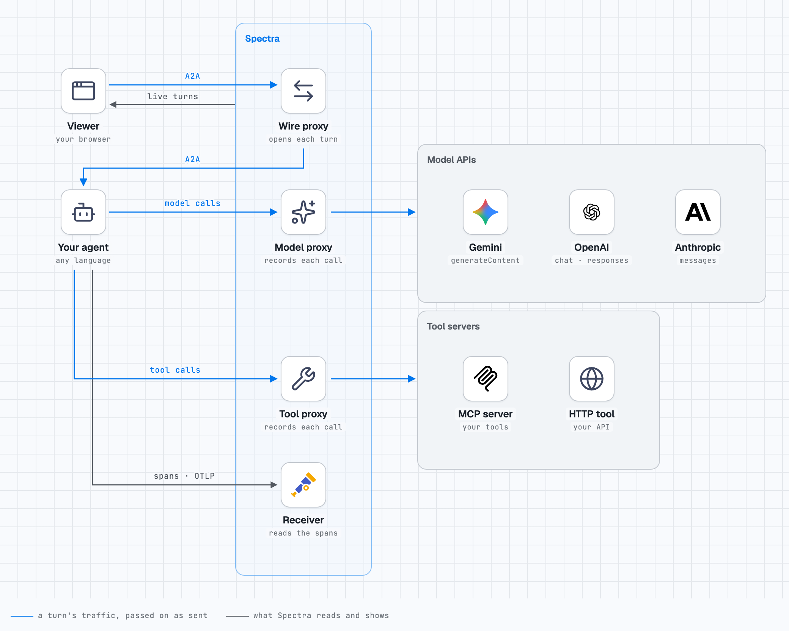
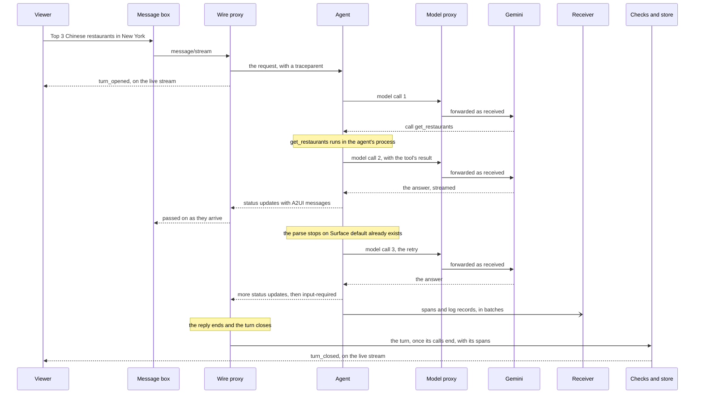
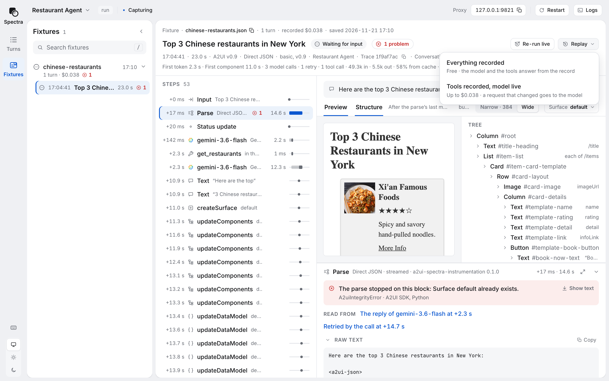

# A turn, end to end: how the parts of Spectra meet

This doc follows one turn of an A2UI agent through Spectra, from the message box to the viewer, and meets each part of Spectra once on the way: the wire proxy and the message box, redirection and the model and tool proxies, the OpenTelemetry receiver, the A2UI step, the checks, the store and a fixture, the preview and the viewer. It is written for the developer of an A2UI agent who is starting with Spectra and wants to know what it is made of and how the parts meet. It is the entry doc: each part gets a few sentences here, and its own design doc holds its rules, linked at every step. It starts with the problem and five ideas, follows the turn part by part, then shows how the parts meet in one turn record, and ends with the design decisions and where the code is.

The running example is upstream's Python restaurant finder, `samples/agent/adk/restaurant_finder`, on Gemini, launched under `a2ui-spectra run` through `opentelemetry-instrument` with the Python wrapper installed, and asked "Top 3 Chinese restaurants in New York" from the message box. The turn makes three model calls and one tool call, and ends waiting for input with one problem: a parse the agent SDK stopped on "Surface default already exists.", after which the agent asked the model again. The sample feeds one stream ADK's partial chunks and then the aggregated copy, so its reply is parsed twice. The screenshots and the animation come from a real run of the restaurant finder on Gemini. The excerpts are cut from the committed records the other design docs cut theirs from, each named where it appears.

<picture>
  <source media="(prefers-color-scheme: dark)" srcset="diagrams/spectra-dark.png">
  
</picture>

## Problem it solves

An A2UI turn crosses four places, and each sees only its own part of it:

1. **The wire** between the host and the agent carries the user's message and the agent's replies, with the A2UI messages inside them.
2. **The network edge** of the agent's process carries its calls to its model provider and its tool servers: the exact model request, the raw reply, the tokens, each tool's arguments and result.
3. **The agent's process** runs its framework's steps. Inside it, upstream's agent SDK writes the UI section of the prompt from the catalog and compiles the model's raw text into A2UI messages, and the agent asks the model again when a block fails.
4. **The host's renderer** draws the surface from the messages, with the catalog's components.

When a surface comes out wrong, the evidence is spread across the agent's logs, the network and the browser, and every run to look again costs a model call.

Spectra is one local process that stands at the edges every agent stack already has: the wire, the model and tool calls, and the telemetry the agent's process exports. It writes what it sees of each turn into one file, the turn record, checks the turn's A2UI, draws its surfaces with the catalog's own renderer, and lays it all out on one page in the browser. A turn saved as a fixture runs again with the model and the tools answering from the record. It works the way HAR, the HTTP Archive format, works for websites: browsers and proxies write it, any HAR viewer reads it, and none of them depends on the language the site was written in.

## Five ideas to hold on to

### 1. Four taps at the edges, and nothing in the agent's code

The wire proxy stands between the host and the agent; the model proxy and the tool proxy between the agent and its model provider and tool servers; and the OpenTelemetry receiver takes what the agent's process exports. Each sees one edge, and none needs the agent in a given language or on a given framework. `a2ui-spectra run` points the agent at them through environment variables its clients already read, and `a2ui-spectra attach` prints the same variables for an agent that is already running.

### 2. Capture works at three depths, and each works without the ones below it

The wire needs no change to the agent. The model and tool calls need the redirection variables, and the agent's own spans need its OpenTelemetry export switched on. The A2UI step needs the wrapper, a dev dependency of the agent. Each depth adds to the view of the same turn, and the turn's record lists the capture paths that saw it.

### 3. The turn's trace id ties everything to its turn

The wire proxy opens each turn with a W3C trace id and adds a `traceparent` carrying it to the request it forwards to the agent; a host that sends its own `traceparent` keeps it, and the turn adopts its trace id. An agent whose OpenTelemetry instrumentation reads the header passes the trace id on to its spans and its outgoing calls, and Spectra places each of them by it. Without it, a call joins the one turn that is open, and a span the turn whose time range holds its start.

### 4. Every part writes and reads one file format

Every capture path writes events of the [turn record](../../specification/turn_record/v0_1/docs/turn_record.md), v0.1: a flat list of events shaped as OpenTelemetry spans, named with OpenTelemetry's GenAI conventions wherever they have a name. The store writes one record per turn, a fixture is one, a replay reads one, and the API serves one.

### 5. The record holds what happened; the viewer works out the rest

The record states what each tap saw. The retry, the model call a parse read, the characters of raw text each component came from, the problems, the estimated cost and the prefix break are worked out in the viewer each time it shows the turn, so a better rule shows on every record already saved.

## The parts

| Part                                            | Where it stands                                                                  | What it adds to a turn                                                                             | Its doc                                         |
| ----------------------------------------------- | -------------------------------------------------------------------------------- | -------------------------------------------------------------------------------------------------- | ----------------------------------------------- |
| The wire proxy and the message box              | Between the host and the agent; the message box is Spectra's own host            | The turn and its trace id, what the host sent, each delivery the agent sent back, and how it ended | [The wire](wire.md)                             |
| Redirection, the model proxy and the tool proxy | Between the agent and its model provider and tool servers                        | Each model call and tool call as it crossed the network, credentials removed                       | [Model and tool calls](model-and-tool-calls.md) |
| The OpenTelemetry receiver                      | Takes the spans and log records the agent's process exports over OTLP/HTTP       | The agent's framework spans, and the calls read from them                                          | [OpenTelemetry](opentelemetry.md)               |
| The wrapper                                     | Inside the agent's process, around upstream's agent SDK                          | The A2UI step: each prompt generation and each parse, sent as spans to the receiver                | [The A2UI step](a2ui-step.md)                   |
| The checks                                      | At the turn's close                                                              | Four check events: the schema, the catalog, the structure and the bindings                         | [The checks](checks.md)                         |
| The store, fixtures and replay                  | Files on disk, and the proxies armed with a record                               | One turn record per turn; a fixture to commit; a replayed turn and its verdict                     | [Replay and fixtures](replay-and-fixtures.md)   |
| The agent's process                             | Under `run`, Spectra starts the agent's command and owns its process             | Restart, restart on save and the agent's output, kept apart from the record                        | [The agent's process](agent-process.md)         |
| The API and the live stream                     | Spectra's server, on loopback                                                    | The routes and the events the viewer reads, open to a script                                       | [The API](api.md)                               |
| The viewer                                      | A page in your browser                                                           | Each turn laid out, with what is worked out from it                                                | [The viewer](viewer.md)                         |
| The preview                                     | A page in an iframe of the viewer, drawn by the catalog's own renderer           | The surface as the host would draw it, and the action a press makes                                | [The preview](preview.md)                       |
| The binary                                      | One file per platform, installed through npm, PyPI, an install script or by hand | Nothing in a turn: it is how Spectra reaches your machine                                          | [Distribution](distribution.md)                 |

## One turn, end to end

The restaurant finder runs from its folder in upstream's repository under `a2ui-spectra run`, launched through `opentelemetry-instrument` with [the recipe for a Python agent](opentelemetry.md#the-recipe-for-a-python-agent) and the Python wrapper, [switched on](a2ui-step.md#switching-it-on) by the same launch. Its model is Gemini's `gemini-3.6-flash`, which ADK calls through Google's SDK, google-genai. You send "Top 3 Chinese restaurants in New York" from the message box. The viewer, from that run:

![The viewer on upstream's Python restaurant finder. The first screen names the agent, Restaurant Agent, capturing, with an example from its card and the wire proxy's address. Then the turn Top 3 Chinese restaurants in New York is open, its timeline marked Live: the input, a status update, the first model call, the tool call get_restaurants and the second model call arrive as steps, then two text parts and the A2UI messages, while the built-in page draws the restaurant list in the preview and the tree grows in Structure. A third model call is tagged Retry 1. The turn closes waiting for input, with one problem, and the view lands on the parse.](../images/turn.gif)

The parts the turn crosses, in order:



### 1. `run` binds everything, then starts the agent

`a2ui-spectra run --agent-url <url> -- <command>` binds every listener before it starts the agent's command: the model proxy, the tool proxy when the config file names tool servers, the OpenTelemetry receiver, the wire proxy and the viewer, each on its own port on loopback. It then starts the command in a process group of its own, with the redirection variables in its environment, opens the viewer in the browser, and waits for the agent's card to name the agent from it. [The agent's process](agent-process.md#what-run-does-at-start-in-order) has the order, the restart and the stop. `a2ui-spectra attach`, for an agent already running, starts nothing; [the wire doc](wire.md#attach-at-start) has what it does at start.

The terminal at start, cut from [the agent's process doc](agent-process.md#one-restart-end-to-end)'s run of the built binary in upstream's sample folder, which started the sample with its own command, `uv run . --port 9964`, with Spectra's ports moved to 9960 to 9963; the folder's path and the agent's own lines are shortened:

```
a2ui-spectra: The viewer is at http://localhost:9960/
a2ui-spectra: Point a host at the wire proxy: http://127.0.0.1:9961/
a2ui-spectra: The OpenTelemetry receiver is at http://127.0.0.1:9963
a2ui-spectra: Turns are saved in …/restaurant_finder/.a2ui-spectra/turns
a2ui-spectra: Fixtures are saved in …/restaurant_finder/a2ui-spectra-fixtures
a2ui-spectra: A save in …/restaurant_finder restarts the agent. Set watch to false in the config file when the agent reloads itself.
a2ui-spectra: Starting the agent: uv run . --port 9964
…
a2ui-spectra: The agent's card answered: Restaurant Agent.
```

### 2. The message box sends, and the wire proxy opens the turn

The viewer's first screen names the agent from its card, offers the card's examples as prompts, and gives the wire proxy's address to point a host app at. You send the request from the composer. The message box, an A2A client inside Spectra, follows the card: to the restaurant finder, on A2A 0.3 with streaming, it posts a `message/stream` holding the text, with every A2UI version Spectra supports offered in its extensions header and in the message's metadata. It sends through the wire proxy, so its turn is captured exactly as a host app's would be.

The wire proxy reads the request, sees one of A2A's send and stream methods, and opens a turn: a new trace id, the start time, and a `wire_input` event holding the text and the offer. It forwards the request to the agent with a `traceparent` naming the turn; apart from that header, `Host` and the agent's card, the proxy passes everything through as it was sent, as the wire doc's [second idea](wire.md#2-the-proxy-passes-everything-through-with-three-edits) says. The live stream says `turn_opened`, and the viewer shows the turn as Open, its timeline marked Live. [The wire](wire.md) has the proxy's rules, [the message box](wire.md#the-message-box) and [the trace context](wire.md#the-trace-context).

### 3. The agent calls Gemini through the model proxy

`run` set `GOOGLE_GEMINI_BASE_URL` in the agent's environment to a path prefix on the model proxy, beside the base-URL variables of OpenAI's and Anthropic's SDKs and of LiteLLM. google-genai reads it, so each of ADK's calls to Gemini goes to the model proxy, which forwards it as received to Gemini's API, the key included, and streams the reply back as it arrives. It keeps a copy with the credentials removed: a `model_call` event holding the request and the reply read into the GenAI names, each chunk with its time, and the tokens as Gemini reported them. The call joins the turn its `traceparent` names, which the agent's HTTP client instrumentation set from the turn's trace id, and failing that the one turn open or waiting for its calls.

The turn makes three calls to `gemini-3.6-flash`: the first asks for the `get_restaurants` tool, the second carries the tool's result and streams the answer, and the third is the agent asking again, as step 5 tells. From each call's tokens and the price table Spectra carries, the viewer works out the share read from the cache and the estimated cost. [Model and tool calls](model-and-tool-calls.md) has the redirection, the proxy's reading of each API and the arithmetic.

The third call, as the model proxy records it. This is cut from the model capture case `gemini_restaurant_finder_google_genai`, [`conformance/test_data/model_capture/v0_1/gemini/restaurant_finder_google_genai.json`](../../conformance/test_data/model_capture/v0_1/gemini/restaurant_finder_google_genai.json), the restaurant finder's booking turn, whose third call is the same kind of retry, after "Surface booking-form already exists."; it is shortened here:

```jsonc
// The model_call event's name and attributes, as recorded
{
  "name": "generate_content gemini-3.6-flash",
  "attributes": {
    "a2ui.event.kind": "model_call",
    "gen_ai.provider.name": "gcp.gemini",
    "gen_ai.request.model": "gemini-3.6-flash",
    "url.full": "https://generativelanguage.googleapis.com/v1beta/models/gemini-3.6-flash:streamGenerateContent?alt=sse",
    "http.request.header.x-goog-api-key": ["REMOVED"],
    "gen_ai.input.messages": [
      …,
      {"role": "user", "parts": [{"type": "text", "content": "Your previous response was invalid. Validation failed: Surface booking-form already exists.. You MUST generate a valid response that strictly follows the A2UI JSON SCHEMA. …"}]}
    ],
    "gen_ai.usage.input_tokens": 18884,
    "gen_ai.usage.cache_read.input_tokens": 15436,
    "gen_ai.usage.output_tokens": 2414,
    …
  }
}
```

The key the agent sent reached Gemini, and is `REMOVED` in the record. The request carries the sample's own words about the failure, but to the proxy it is one more request: that it retries the call before it, and why, Spectra works out from the parse the wrapper reports, in step 5.

### 4. The tool call, seen from inside the agent

`get_restaurants` is a Python function in the agent's process. It never crosses the network, so neither proxy sees it. The tool proxy is for MCP servers and HTTP tools named in the config file's `tools`, each reached through the variable the agent reads its URL from, as [the tool proxy](model-and-tool-calls.md#the-tool-proxy) describes.

The agent's own spans see it. Launched under `opentelemetry-instrument`, the agent exports its spans and log records over OTLP/HTTP to the receiver, at the endpoint `run` set. Its HTTP server instrumentation read the wire proxy's `traceparent`, so the agent's whole span tree carries the turn's trace id and is placed under the turn event. The receiver reads each span in its producer's dialect, here ADK's: `execute_tool get_restaurants` becomes a `tool_call` event, and ADK's model call spans are linked to the model proxy's record of the same calls. An export placed in a turn that is still open shows on the live stream at once, and one that arrives after the turn was written amends its file. The viewer shows the call as `get_restaurants`, "in the agent". [OpenTelemetry](opentelemetry.md) has the dialects, the placing and the late spans.

The tool call as the receiver writes it. This is cut from the receiver capture case `adk_trace_context`, [`conformance/test_data/receiver_capture/v0_1/adk_trace_context/expected.json`](../../conformance/test_data/receiver_capture/v0_1/adk_trace_context/expected.json), the record Spectra wrote for a turn of the restaurant finder asked for "Top 2 Chinese restaurants in New York"; it is shortened here:

```jsonc
// The tool_call event
{
  "traceId": "80e23b6d06a383e256e2f1f04184919e",
  "name": "execute_tool get_restaurants",
  "attributes": {
    "a2ui.event.kind": "tool_call",
    "otel.scope.name": "gcp.vertex.agent",
    "otel.scope.version": "2.3.0",
    "a2ui.received.dialect": "adk",
    "gen_ai.tool.name": "get_restaurants",
    "gen_ai.tool.call.id": "call_170434",
    "gen_ai.tool.call.arguments": {"location": "New York", "cuisine": "Chinese", "count": 2},
    "gen_ai.tool.call.result": {"result": "[{\"name\": \"Xi'an Famous Foods\", \"detail\": \"Spicy and savory hand-pulled noodles.\", …}, …]"},
    "a2ui.received.attributes": {…, "gcp.vertex.agent.tool_call_args": "{\"location\": \"New York\", \"cuisine\": \"Chinese\", \"count\": 2}", …}
  }
}
// The first of its five span events, a log record written while the tool ran
{"name": "INFO", "attributes": {"a2ui.received.log.body": "--- TOOL CALLED: get_restaurants (count: 2) ---", "a2ui.received.log.severity_number": 9, "a2ui.received.log.severity_text": "INFO"}}
```

ADK's own names arrive in `a2ui.received.attributes`, kept as received, and the receiver writes the GenAI names beside them. The trace id is the turn's.

### 5. The A2UI step: the parse fails, and the agent asks again

Inside the agent, upstream's agent SDK, `a2ui-agent-sdk`, does the A2UI step: its prompt generator writes the UI section of the prompt from the catalog, and its parser compiles the model's raw text, here in the Direct JSON format, into A2UI messages. The wire sees only the messages that came out, and the model proxy only the text that went in and came back. The wrapper, `a2ui-spectra-instrumentation`, installed in the agent's environment and switched on by `opentelemetry-instrument`, reports both pieces as spans to the same receiver: a `prompt_generation` span for the UI section, and a `parse` span for each parse, carrying the raw text exactly as the parser was given it, the messages it produced, and each error with the range of the block it belongs to.

The sample feeds the second call's streamed reply to the SDK's stream chunk by chunk, then the whole reply once more. The second copy's `createSurface` for `default` meets the surface the first copy created, and the SDK stops the parse with `A2uiIntegrityError`, "Surface default already exists.". The sample takes it as a bad reply and calls the model again. From the parse span and the turn's model calls, Spectra works out that the parse read the second call's reply and that the third call retried it. [The A2UI step](a2ui-step.md) has the wrapper's rules, and [what Spectra does with the spans](a2ui-step.md#what-spectra-does-with-the-spans).

The parse's error, as the wrapper sends it: the exception span event [the A2UI step doc](a2ui-step.md#one-turn-end-to-end) cuts from the wrapper capture case `surface_already_exists`, [`conformance/test_data/wrapper_capture/v0_1/surface_already_exists/expected.json`](../../conformance/test_data/wrapper_capture/v0_1/surface_already_exists/expected.json), which was recorded by feeding the real wrapper, on `a2ui-agent-sdk` 0.12.0, a restaurant card twice, as this retry does:

```json
{
  "exception.type": "A2uiIntegrityError",
  "exception.message": "Surface default already exists.",
  "a2ui.parse.block.start": 442,
  "a2ui.parse.block.end": 786
}
```

The two numbers are the rejected block's place in the parse's input, in UTF-16 code units, which the viewer draws in red in the raw text.

### 6. The replies cross the wire, and the turn closes

The restaurant finder answers with a stream of A2A status updates. Each A2UI message rides in a data part marked with A2UI's MIME type. The wire proxy passes the stream on to the message box as it arrives and reads a copy: each delivery becomes a `wire_output` event, its A2UI parts kept as the agent wrote them, and each is on the live stream as it is captured. The viewer draws them as steps: two text parts, `createSurface` for `default`, then the `updateComponents` and `updateDataModel` messages that fill it.

The turn closes when the agent's reply ends. Its outcome is the last task state the reply carried, `input-required`, written `waiting_for_input` and shown as "Waiting for input"; its protocol version is its first A2UI message's, `v0.9`. [Where A2UI sits in an A2A message](wire.md#where-a2ui-sits-in-an-a2a-message) and [how a turn closes](wire.md#how-a-turn-closes-and-its-outcome) have the rules.

The turn event of the receiver capture case's turn, as Spectra wrote it, from the same file as the tool call above:

```json
{
  "traceId": "80e23b6d06a383e256e2f1f04184919e",
  "spanId": "269b6fd1a0c41b01",
  "name": "invoke_agent Restaurant Agent",
  "startTimeUnixNano": "1793431303495015000",
  "endTimeUnixNano": "1793431336699628000",
  "attributes": {
    "a2ui.event.kind": "turn",
    "gen_ai.operation.name": "invoke_agent",
    "gen_ai.agent.name": "Restaurant Agent",
    "gen_ai.conversation.id": "666773ce-d0f5-496a-bec6-b7785cf3cabf",
    "a2ui.turn.outcome": "waiting_for_input",
    "a2ui.turn.protocol_version": "v0.9",
    "a2ui.turn.capture_paths": ["wire", "model_proxy", "otel_receiver"],
    "a2ui.turn.writer.name": "a2ui-spectra",
    "a2ui.turn.writer.version": "0.0.1"
  },
  "status": {"code": 1}
}
```

The turn runs 33.2 seconds, from the host's request to the agent's last reply. That run had no wrapper; with one, as in the turn of the screenshots, `a2ui_step` joins the capture paths once a span of the A2UI step is placed in the turn.

### 7. The checks run, and the store writes the turn

Once the wire has closed the turn, Spectra holds it until the calls placed in it have ended, then gives it the spans the receiver has placed in it. The store reads the conversation's earlier turns, and the four checks judge the turn's A2UI: the schema check each message against its protocol version's schema, and the catalog, structural and binding checks the surfaces that stand at the close, after the conversation's messages are fed in order through upstream's web core with the catalogs Spectra knows. Each check writes one `check` event. The restaurant finder's surface is on the v0.9 basic catalog, which is built in, so all four can judge it; the turn's one problem is the parse, so the checks found nothing. [The checks](checks.md) has the four checks and the catalog registry.

The store then writes the turn as one turn record file, `.a2ui-spectra/turns/<conversation>/<time>_<trace id>.json` under the folder Spectra was started in, the conversation's earlier turns embedded, and the live stream says `turn_closed` with the turn whole. Spectra keeps that folder out of git. [The local store](replay-and-fixtures.md#the-local-store) has the file's rules, and [the live stream](api.md#the-live-stream) its events.

### 8. The viewer shows the turn

<picture>
  <source media="(prefers-color-scheme: dark)" srcset="../images/viewer-dark.png">
  
</picture>

The closed turn, from the same run. The viewer reads the session and the turns from Spectra's server, follows the live stream, and works out what it shows from the record. The header gives the request, the outcome, "Waiting for input", and the one problem; then the start, the duration, the A2UI version, the inference format and the catalog the turn used, the agent and the trace and conversation ids; then the time to the first token and to the first component, the 3 model calls, the 1 retry, the 1 tool call, the tokens, the share read from the cache and the estimated cost, with the date of the price table. The turn landed on its first problem: the parse, selected in the timeline among its 39 steps, its detail reading "The parse stopped on this block: Surface default already exists.", "Read from" the reply of the call at +2.6 s, and "Retried by" the call at +13.0 s, over its Raw text tab. The reply strip holds the reply the parse read, muted behind a grey "Failed to parse" tag. The result beside the timeline shows the surface after the parse's last message, the restaurant card in the Preview and its tree in Structure, each node with the path it binds. The composer offers to continue the conversation, the agent waiting for input. [The viewer](viewer.md) takes the page area by area.

### 9. The preview draws the surface

The surface in the Preview is drawn by a preview page loaded in an iframe, which the viewer speaks the preview protocol to: the surface's A2UI messages go in, and what failed to draw, the surface's data model and the action a press makes come out. The viewer sends a surface to the first page whose claims cover its catalogs: the pages the config file's `preview` names, then Spectra's built-in page for the basic catalogs. This surface names the v0.9 basic catalog, so the built-in page draws it with no setup: the result's bar reads "built-in" in the animation. A custom catalog brings its own page: a preview adapter for React, Lit or Angular on the catalog's dev server, so the surface is drawn by the framework and the renderer the real host uses. Pressing Book Now on a card would put the A2UI action the agent would receive into the composer, to send as the next turn. [The preview](preview.md) has the protocol, the adapters and a press.

### 10. The turn, saved as a fixture and replayed for free

Save as fixture copies a turn's record, whole, into the fixtures folder, `a2ui-spectra-fixtures/` by default, as `<name>.json`, a file to commit. Replay sends the recorded conversation to the real agent again through the message box, while the model proxy and the tool proxy answer the agent's calls from the record. With everything recorded, a request that matches nothing in the record is an error and no call leaves the machine; with tools recorded and the model live, a model request that matches nothing goes to the provider. A replayed turn passes when no call missed, its outcome is the recorded one, and the A2UI messages the agent sent equal the recorded ones. `a2ui-spectra replay <file>` does the same from the terminal, and `a2ui-spectra test` replays every fixture for CI. [Replay and fixtures](replay-and-fixtures.md) has the request key, the modes and the verdict.

<picture>
  <source media="(prefers-color-scheme: dark)" srcset="../images/replay-menu-dark.png">
  
</picture>

The same turn, saved as `chinese-restaurants.json`. The fixture line reads 1 turn, recorded $0.034, saved 2026-11-22 16:03, and the Replay menu offers its two modes, "Everything recorded", free, and "Tools recorded, model live", up to $0.034.

<picture>
  <source media="(prefers-color-scheme: dark)" srcset="../images/replay-passed-dark.png">
  
</picture>

Its replay with everything recorded: 198 ms, "3 calls from the record · free", and "Replayed from chinese-restaurants.json · turn 1 of 1 · everything recorded · passed". The served model calls carry a Record tag, and the parse fails as it did in the recording, read from the reply served at +83 ms and retried by the call at +153 ms: the agent's own code runs again on the same replies.

## How the parts meet

### The trace id, from the wire to every call and span

- **The wire proxy makes it** when a turn opens, and sends it to the agent in `traceparent`, the turn event's span id as the parent. A host that sends its own `traceparent` keeps it: the turn adopts its trace id, and the proxy adds nothing. [The trace context](wire.md#the-trace-context) has the rules.
- **The agent carries it on.** Its HTTP server instrumentation reads the header, so its spans carry the trace id; its HTTP client instrumentation puts a `traceparent` on each call it makes, so the calls through the proxies carry it too.
- **The proxies place a call by it,** else in the one turn open or waiting for its calls. A call that fits neither is forwarded and not recorded, and the terminal says why. [Placing a call in its turn](model-and-tool-calls.md#placing-a-call-in-its-turn) has the rules.
- **The receiver places a span by it,** else in the one turn of the run whose time range holds the span's start. [Placing a span](opentelemetry.md#placing-a-span) has the rules.

### When a turn closes

1. The wire proxy closes the turn when the agent's reply ends.
2. Spectra holds the turn until every call placed in it has ended.
3. The turn takes the spans the receiver has placed in it.
4. The store reads the conversation's earlier turns, and the four checks run; their events follow the turn's own.
5. The store writes the turn's file.
6. The live stream says `turn_closed`, with the turn whole.
7. Spans that arrive later amend the file, and the live stream says `turn_amended`, as [late spans](opentelemetry.md#late-spans) describes.

### One turn in one file

Every part writes into the same record. This is the first turn of the shared test data's record of two turns of the restaurant finder, [`conformance/test_data/turn_record/v0_1/full_record_restaurant_finder.json`](../../conformance/test_data/turn_record/v0_1/full_record_restaurant_finder.json), asked "Top 2 Chinese restaurants in New York", its events in the file's order, each cut to its name, its kind, the start of its trace id and its parent, by its number in this list:

| #   | Name                                | Kind                | Trace id    | Parent         | Written by                                       |
| --- | ----------------------------------- | ------------------- | ----------- | -------------- | ------------------------------------------------ |
| 1   | `invoke_agent Restaurant Agent`     | `turn`              | `b573274b…` | none           | The wire proxy                                   |
| 2   | `wire_input`                        | `wire_input`        | `b573274b…` | the turn event | The wire proxy                                   |
| 3   | `wire_output`                       | `wire_output`       | `b573274b…` | the turn event | The wire proxy                                   |
| 4   | `invoke_agent restaurant_agent`     | `framework_span`    | `d8a8cc77…` | none           | The receiver, from ADK's span                    |
| 5   | `prompt_generation`                 | `prompt_generation` | `d8a8cc77…` | event 4        | The receiver, from the wrapper's span            |
| 6   | `call_llm`                          | `model_call`        | `d8a8cc77…` | event 4        | The receiver, from ADK's span; linked to 7 and 8 |
| 7   | `generate_content gemini-3.6-flash` | `model_call`        | `b573274b…` | the turn event | The model proxy; Gemini answered `503`           |
| 8   | `generate_content gemini-3.6-flash` | `model_call`        | `b573274b…` | the turn event | The model proxy; the Gemini client's second try  |
| 9   | `execute_tool get_restaurants`      | `tool_call`         | `d8a8cc77…` | event 4        | The receiver, from ADK's span                    |
| 10  | `call_llm`                          | `model_call`        | `d8a8cc77…` | event 4        | The receiver, from ADK's span; linked to 11      |
| 11  | `generate_content gemini-3.6-flash` | `model_call`        | `b573274b…` | the turn event | The model proxy                                  |
| 12  | `parse`                             | `parse`             | `d8a8cc77…` | event 4        | The receiver, from the wrapper's span            |
| 13  | `wire_output`                       | `wire_output`       | `b573274b…` | the turn event | The wire proxy                                   |
| 14  | `check`                             | `check`             | `b573274b…` | the turn event | The checks: the schema check, passed             |
| 15  | `check`                             | `check`             | `b573274b…` | the turn event | The checks: the catalog check, passed            |
| 16  | `check`                             | `check`             | `b573274b…` | the turn event | The checks: the structural check, passed         |
| 17  | `check`                             | `check`             | `b573274b…` | the turn event | The checks: the binding check, passed            |

The wire's, the proxies' and the checks' events carry the turn's trace id, `b573274b…`, under the turn event. The agent's spans keep their own trace, `d8a8cc77…`, and their own parents under ADK's `invoke_agent restaurant_agent`, which has none: no span of that tree carries the turn's trace id, so they were placed by the turn's time range. ADK's two `call_llm` spans link to the model proxy's record of the same calls, the first to both tries Gemini's client made, so the viewer shows each call once. The kinds, their parents and where each comes from are in the turn record's [kinds](../../specification/turn_record/v0_1/docs/turn_record.md#kinds) and [where events come from](../../specification/turn_record/v0_1/docs/turn_record.md#where-events-come-from).

### The API, the live stream and the viewer

Spectra's server answers the viewer and a script alike, on loopback. The routes under `/api/` answer what stands now: the session, the turns stored and open, a turn's record, the message box's conversations, the fixtures, the catalogs, the prices, and under `run` the agent's process. The live stream, `GET /api/stream`, sends what happens next: for each turn `turn_opened`, its `wire_event`s, its calls' `call_started`, `call_chunk`, `call_progress` and `call_ended`, `turn_amended` whenever the receiver touches it or a replay's verdict reaches it, and `turn_closed`. The viewer has no other way into Spectra, so a script or a coding agent can do whatever the page does. [The API](api.md) has every route and event, and [how the viewer uses them](api.md#how-the-viewer-uses-it).

### Where each setting lives

The config file, `a2ui-spectra.json`, is optional. Where it is found, that it is read strictly, and that the command line takes precedence over it are in [the command's README](../../tools/spectra/README.md), with the commands and their options. Each setting's rules are in its part's doc:

| Setting    | What it sets                                                         | Its rules                                                                 |
| ---------- | -------------------------------------------------------------------- | ------------------------------------------------------------------------- |
| `agent`    | The agent's URL, and the headers the message box sends               | [The wire](wire.md#the-config-files-agent-settings)                       |
| `tools`    | Each tool server's URL, and the variable the agent reads it from     | [Model and tool calls](model-and-tool-calls.md#the-config-files-settings) |
| `prices`   | Prices for models, per million tokens, ahead of the price table      | [Model and tool calls](model-and-tool-calls.md#the-config-files-settings) |
| `catalogs` | The `catalog.json` files of your own catalogs, for the checks        | [The checks](checks.md#the-config-files-catalogs)                         |
| `preview`  | The preview pages that draw your own catalogs, by URL                | [The preview](preview.md#the-config-files-preview-setting)                |
| `fixtures` | The fixtures folder                                                  | [Replay and fixtures](replay-and-fixtures.md#the-fixtures-folder)         |
| `watch`    | What a save restarts the agent on, or `false` for no restart on save | [The agent's process](agent-process.md#the-watch-setting)                 |

## When a part shows nothing

| What is missing                                                  | Where to look                                                                                                                                                                                                    |
| ---------------------------------------------------------------- | ---------------------------------------------------------------------------------------------------------------------------------------------------------------------------------------------------------------- |
| No turn at all                                                   | The host is not pointed at the wire proxy, or the message box cannot send to the agent: [the wire](wire.md#when-things-go-wrong)                                                                                 |
| No model calls, or no tool calls                                 | The agent's clients do not read Spectra's variables, the agent's shell lacks them under `attach`, or the tools run in the agent's process: [model and tool calls](model-and-tool-calls.md#when-nothing-shows-up) |
| No spans from the agent                                          | The agent exports nothing, or not over HTTP: [OpenTelemetry](opentelemetry.md#when-things-go-wrong)                                                                                                              |
| No A2UI step: no "Read from", no ranges in the raw text          | The wrapper is not installed in the agent's environment, or not switched on: [the A2UI step](a2ui-step.md#when-nothing-shows-up)                                                                                 |
| "not fully checked", or "Not checked"                            | A catalog Spectra does not know, or a turn with no protocol version: [the checks](checks.md#when-things-go-wrong)                                                                                                |
| "No preview for catalog"                                         | No preview page claims the surface's catalog: [the preview](preview.md#when-things-go-wrong)                                                                                                                     |
| A replay misses                                                  | A request changed since the recording: [replay and fixtures](replay-and-fixtures.md#when-things-go-wrong)                                                                                                        |
| The agent does not come up under `run`, or restarts at each save | [The agent's process](agent-process.md#when-things-go-wrong)                                                                                                                                                     |
| A part of the page shows nothing                                 | [The viewer](viewer.md#when-something-does-not-show)                                                                                                                                                             |

## Design decisions

The decisions of each part are in its own doc. These are the ones that shape how the parts meet.

| Decision                                                                                                                                    | What it buys                                                                                                                                         | What it costs                                                                                                                                                           |
| ------------------------------------------------------------------------------------------------------------------------------------------- | ---------------------------------------------------------------------------------------------------------------------------------------------------- | ----------------------------------------------------------------------------------------------------------------------------------------------------------------------- |
| Stand at the edges every agent stack shares: the wire, the model and tool calls, OpenTelemetry                                              | Any A2UI agent, in any language and on any framework; the wire needs no change to the agent at all                                                   | Only what crosses an edge is seen: a tool inside the agent's process only through its spans, and the A2UI step only through the wrapper                                 |
| Three capture depths, each working without the ones below it                                                                                | You start with the wire and add depth as you need it, and each turn lists the capture paths that saw it                                              | What a turn shows depends on what the agent was given, so the viewer has to say what is missing, as its hint for switching on the wrapper does                          |
| Redirect the agent's clients through the variables they already read, rather than intercept its traffic                                     | No certificate to trust and no change to the machine's network; `run` sets the variables and `attach` prints them                                    | A client that reads none of them, or an endpoint written into the code, needs a line changed, and Vertex AI is not redirected                                           |
| One transport adapter does both the proxying and the hosting; past it, nothing carries the transport                                        | The turn record, the checks, the preview, the proxies and the receiver serve another transport unchanged; it needs its own adapter                   | A2A is the one adapter today, and the viewer still names A2A's versions, in the transport line of the agent's card and in the form of an action waiting in the composer |
| The turn's trace id, sent to the agent in `traceparent`, places every call and span; the one open turn, or the turn's time range, stands in | With trace context, turns that overlap are told apart exactly; without it, everything still lands while one turn runs at a time                      | Without trace context, a call made while two turns are open is not recorded, nor is a span that starts in two turns' time ranges                                        |
| One file format for every capture path and every use: the turn record, events shaped as OpenTelemetry spans with the GenAI names            | The store, a fixture, a replay, the API and the viewer read one thing, and shared test data holds every capture path in every language to one record | Each producer's dialect has to be translated into it, and a new record version reaches every part                                                                       |
| A turn is written once its calls have ended and its checks have run, and late spans amend the file                                          | A written turn holds its calls whole and its checks once                                                                                             | A turn's close waits for its slowest call, and a file can change after it was written                                                                                   |
| One local process on loopback, with nothing deployed                                                                                        | Credentials, prompts and replies stay on your machine, with nothing to sign up for                                                                   | There is no shared server: a turn travels as a fixture file                                                                                                             |

## Known limits

- A2A is the one transport, at A2A 0.3 and 1.0 over JSON-RPC.
- One Spectra stands in front of one agent: the wire proxy forwards to one agent's URL, and `run` starts one command. A second agent needs a second Spectra on other ports.
- What crosses no edge Spectra stands at is seen only when the agent's spans report it: a model call to Vertex AI, which is not redirected, or to an endpoint written into the code, and a tool server the config file does not name. [Model and tool calls](model-and-tool-calls.md#known-limits) has the rest.
- The A2UI step is reported for upstream's Python and TypeScript agent SDKs, through the wrapper. Another agent reports it by sending the same spans itself, as [the A2UI step](a2ui-step.md#known-limits) says.
- The A2UI versions, the model APIs and the upstream packages Spectra supports are in the root README's [What Spectra supports](../../README.md#what-spectra-supports).

## Trying it

With your own agent, from its folder:

```bash
a2ui-spectra run --agent-url <your agent's URL> -- <your agent's command>    # Spectra starts the agent, and owns its process
a2ui-spectra attach <your agent's URL>                                       # or watches an agent already running
```

`run` takes the agent's URL from `--agent-url`, or from `agent.url` in the config file. The viewer opens in the browser; send a message from the composer. [The command's README](../../tools/spectra/README.md) has the options and the install. The restaurant finder of this doc needs a Gemini key in its environment; for its spans and its A2UI step, add [the recipe for a Python agent](opentelemetry.md#the-recipe-for-a-python-agent) and the [Python wrapper](../../python/a2ui_spectra_instrumentation/README.md).

Without a model: [the viewer doc](viewer.md#trying-it-without-a-model) opens a committed record of the same kind of retry in the viewer as a fixture, and [replay and fixtures](replay-and-fixtures.md#trying-it) names the repository's suites that replay recorded traffic, one of them on the repository's stub agent.

## Where the code is

| What                                                                               | Where                                                                                                                                                                                                                                          |
| ---------------------------------------------------------------------------------- | ---------------------------------------------------------------------------------------------------------------------------------------------------------------------------------------------------------------------------------------------- |
| The contract every part writes: the file, the kinds, where events come from        | [`specification/turn_record/v0_1/docs/turn_record.md`](../../specification/turn_record/v0_1/docs/turn_record.md#where-events-come-from)                                                                                                        |
| The command line and the config file                                               | [`main.ts`](../../tools/spectra/src/main.ts), [`args.ts`](../../tools/spectra/src/args.ts), [`config.ts`](../../tools/spectra/src/config.ts), [`config.schema.json`](../../tools/spectra/src/config.schema.json), in `tools/spectra/src/`      |
| Each part started in order and wired to the others, under `run` and `attach`       | [`tools/spectra/src/session.ts`](../../tools/spectra/src/session.ts)                                                                                                                                                                           |
| The wire proxy and the A2A adapter                                                 | [`tools/spectra/src/a2a/`](../../tools/spectra/src/a2a)                                                                                                                                                                                        |
| The message box                                                                    | [`tools/spectra/src/message_box.ts`](../../tools/spectra/src/message_box.ts), [`tools/spectra/src/a2a/message_box.ts`](../../tools/spectra/src/a2a/message_box.ts), [`tools/spectra/src/a2a/client.ts`](../../tools/spectra/src/a2a/client.ts) |
| The model proxy and the tool proxy                                                 | [`tools/spectra/src/model_proxy/`](../../tools/spectra/src/model_proxy), [`tools/spectra/src/tool_proxy/`](../../tools/spectra/src/tool_proxy)                                                                                                 |
| The OpenTelemetry receiver                                                         | [`tools/spectra/src/receiver/`](../../tools/spectra/src/receiver)                                                                                                                                                                              |
| Placing a call in its turn, and holding a closed turn until its calls end          | [`tools/spectra/src/placement.ts`](../../tools/spectra/src/placement.ts)                                                                                                                                                                       |
| A closed turn checked, then written                                                | [`tools/spectra/src/recorder.ts`](../../tools/spectra/src/recorder.ts), [`tools/spectra/src/check/`](../../tools/spectra/src/check), [`tools/spectra/src/store/store.ts`](../../tools/spectra/src/store/store.ts)                              |
| The open turns and the live stream, and the routes                                 | [`tools/spectra/src/turn_hub.ts`](../../tools/spectra/src/turn_hub.ts), [`tools/spectra/src/api.ts`](../../tools/spectra/src/api.ts), [`tools/spectra/src/server.ts`](../../tools/spectra/src/server.ts)                                       |
| Fixtures and replay, and the commands `replay` and `test`                          | [`tools/spectra/src/fixtures/`](../../tools/spectra/src/fixtures), [`tools/spectra/src/replay/`](../../tools/spectra/src/replay), [`tools/spectra/src/replay_command.ts`](../../tools/spectra/src/replay_command.ts)                           |
| The agent's process under `run`                                                    | [`tools/spectra/src/agent_supervisor.ts`](../../tools/spectra/src/agent_supervisor.ts), [`tools/spectra/src/agent_process.ts`](../../tools/spectra/src/agent_process.ts)                                                                       |
| The viewer                                                                         | [`tools/spectra_viewer/src/`](../../tools/spectra_viewer/src)                                                                                                                                                                                  |
| The preview: the protocol's core, the three adapters and the built-in page         | [`typescript/preview/`](../../typescript/preview), [`tools/spectra_basic_preview/`](../../tools/spectra_basic_preview)                                                                                                                         |
| The wrappers                                                                       | [`python/a2ui_spectra_instrumentation/`](../../python/a2ui_spectra_instrumentation), [`typescript/instrumentation/`](../../typescript/instrumentation)                                                                                         |
| The shared test data and the capture suites the excerpts come from                 | [`conformance/`](../../conformance/README.md)                                                                                                                                                                                                  |
| This doc's diagram, the product's one picture: its two sources and its two exports | [`docs/design/diagrams/`](diagrams), `spectra.html`, `spectra-dark.html`, `spectra.svg` and `spectra-dark.svg`                                                                                                                                 |

## Words used in this doc

| Word         | Meaning                                                                                                                         |
| ------------ | ------------------------------------------------------------------------------------------------------------------------------- |
| Turn         | One request from a host to the agent and everything it caused, up to the end of the agent's reply                               |
| Host         | The program that sends the agent the user's messages and draws its A2UI: Spectra's message box, or your own host app            |
| A2A          | The Agent2Agent protocol, the transport between a host and an agent that Spectra covers                                         |
| Message box  | Spectra's own host: an A2A client inside Spectra, driven from the viewer's composer                                             |
| Wire proxy   | The address a host points at in place of the agent's, through which Spectra sees the wire                                       |
| Model proxy  | The address the agent's model clients are pointed at, which forwards each call to the provider and records it                   |
| Tool proxy   | The addresses the agent's tool servers are reached through, one port per server, which forward each call and record it          |
| Redirection  | Pointing the agent's clients at the proxies through the environment variables they already read                                 |
| Receiver     | Spectra's OpenTelemetry receiver, which takes the agent's spans and log records over OTLP/HTTP                                  |
| OTLP         | OpenTelemetry's protocol for sending spans, logs and metrics                                                                    |
| Span         | OpenTelemetry's record of one operation, with a start, an end, attributes and events                                            |
| Trace id     | The W3C trace id that names a turn, sent to the agent in the `traceparent` header                                               |
| A2UI step    | The part of a turn where the agent SDK writes the prompt's UI section and turns the model's raw text into A2UI messages         |
| Wrapper      | `a2ui-spectra-instrumentation`, the OpenTelemetry instrumentation that reports the A2UI step from upstream's agent SDKs         |
| Capture path | One of the ways a turn was seen, as its record names them: `wire`, `model_proxy`, `tool_proxy`, `otel_receiver` and `a2ui_step` |
| Turn record  | The file format of a turn, the contract every capture path writes and every fixture is                                          |
| Store        | `.a2ui-spectra/turns/` in the folder Spectra was started from, where it writes one turn record per turn                         |
| Fixture      | A turn record saved in the fixtures folder, to replay                                                                           |
| Live stream  | The stream of events Spectra's server sends as a turn happens, `GET /api/stream`                                                |
| Surface      | A UI the agent builds with A2UI messages, named by its surface id, such as `default`                                            |
| Catalog      | The components a surface may use: a definition, `catalog.json`, and an implementation for each renderer                         |
| Preview page | A page that draws surfaces with a catalog's renderer, loaded in the viewer in an iframe                                         |
