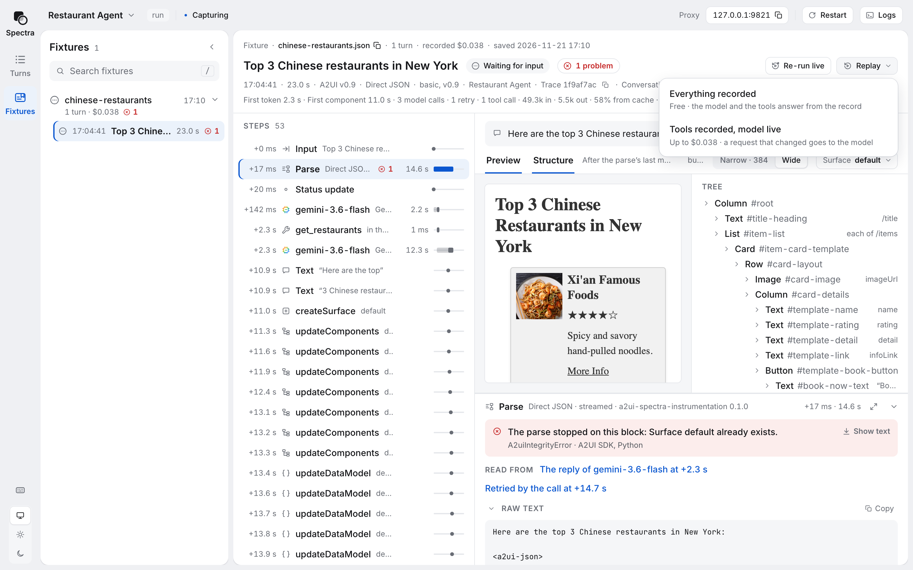
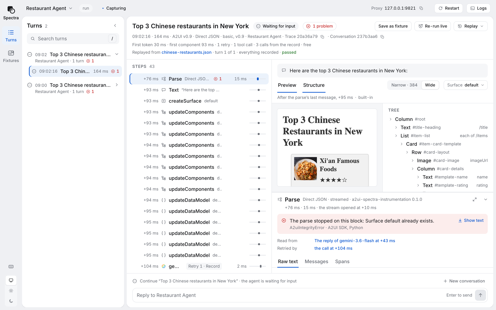

# The viewer: what each area of the page shows, and where it comes from

This doc explains Spectra's viewer, the page Spectra serves on its own port: what each area of it shows, and what each is derived from. It is written for the developer of an A2UI agent who uses Spectra and wants to know what they are looking at, and why a row, a mark or a number reads as it does. It starts with the problem, follows one turn of upstream's Python restaurant finder through the page, then takes the page area by area, and ends with the design decisions and where the code is.

The page is drawn on the design canvas "Spectra viewer UI", <https://claude.ai/artifact/EiYG8HSHhGhPfDkMaRexQ2>, and the build follows the canvas: a change to the page's look is made on the canvas first.

This doc is the home of how each area is drawn. The logic each area shows has its own doc, and this one links to it: how a parse's retry, the model call it read and its component ranges are worked out is in [the A2UI step](a2ui-step.md#what-spectra-does-with-the-spans); the checks and the catalog registry in [the checks](checks.md); the preview protocol and the preview pages in [the preview](preview.md); the request key, the modes and the verdict in [replay and fixtures](replay-and-fixtures.md); tokens, the estimated cost and the price table in [model and tool calls](model-and-tool-calls.md); the message box in [the wire](wire.md); the agent's process under `run` in [the agent's process](agent-process.md); and the routes and the live stream the page reads in [the API](api.md).

<picture>
  <source media="(prefers-color-scheme: dark)" srcset="diagrams/viewer-dark.png">
  
</picture>

## Problem it solves

Spectra keeps each turn as a turn record: the wire messages, the model calls and tool calls its proxies saw, the spans the agent sent, the A2UI step's parses and prompt generations, and the checks' events, each a span with a start, an end and attributes. Read raw, a turn of the restaurant finder is a few hundred lines of JSON with nanosecond timestamps. It answers none of the questions the developer arrives with directly:

- which turn went wrong, and where in it;
- what the agent drew, as a tree and as pixels, after any step;
- what the model was asked, what it answered, how long it took and what it cost;
- which raw text became which component, and which parse error made the agent ask again;
- whether a replay matched its record, and where it did not.

The page answers them. It reads the records and the session from Spectra's server, works out the rows, the problems, the retries, the cost and the surfaces each time it shows a turn, and lays them out in fixed areas, so the same question is always answered in the same place.

## Five ideas to hold on to

### 1. The page reads; Spectra's server holds the facts

At connect the page reads the session, the turn listing, the message box's state, the catalogs and the fixtures listing, under `run` the agent's process and its output, and, once, the price table; then it follows the live stream. It writes nothing back except what a press asks for: a message sent, a fixture saved, a replay or a re-run started, the agent restarted. What it remembers of its own, the layout, the toggles and the theme, it keeps in the browser.

### 2. Everything shown is worked out when it is shown

The timeline's rows, the problems, the retries, the model call a parse read, the estimated cost, the prefix break, the component ranges and the surfaces in Structure are computed in the page from the record, each time it shows the turn. None of it is written into the record, so a better rule shows on every record already saved.

### 3. One list of problems per turn

Everything wrong in a turn is one problem on the step it belongs to: a check's finding, a message web core rejected, a failed call, a parse error, a failed prompt generation, a failed turn's reason, a replay's failed verdict, and what the preview page reports while the turn is in view. The header's count, the turn list's count, the red marks, "Problems only" and the `n` key all walk the same list.

### 4. The address holds the selection

The turn, the step and the tree node selected are in the page address. A reload, the browser's Back and a pasted link land on the same turn, the same step and the same node.

### 5. The preview is the catalog's own renderer, in another page

The surface is drawn by a preview page, the config's or Spectra's built-in one, loaded in an iframe. The viewer sends it the A2UI messages and reads back what it reports: a component that failed to draw, a message it refused, the data model as typed in it, and a press.

## One turn in the viewer, end to end

The restaurant finder runs under `a2ui-spectra run`, with the Python wrapper switched on. You send "Top 3 Chinese restaurants in New York" from the message box. The turn ends on the agent's own retry, and the page lands on it:

<picture>
  <source media="(prefers-color-scheme: dark)" srcset="../images/viewer-dark.png">
  
</picture>

1. **The turn opens.** The live stream says a turn opened. The turn list gains a row with the open turn's spinner, and since the newest turn was selected, the page selects the new one. The timeline is marked Live and follows its newest row.
2. **The steps arrive.** A status update, then the first model call, `gemini-3.6-flash` in Gemini's colours, then the tool call `get_restaurants`, "in the agent", read from the agent's spans, then the second model call, whose bar is lighter until its first token and darker after. The parse row, "Parse · Direct JSON · streamed", comes in at its first chunk, after the second model call, and draws a bar from there to its end. Two text parts and the A2UI messages follow, each a dot at its moment.
3. **The turn closes.** It ends waiting for input. The view lands on its first problem, the parse, and opens the step's detail on it. The header reads "1 problem"; its second line gives the start, the duration, the A2UI version, the inference format and the catalog the turn used; its third line the time to the first token and to the first component, the calls, the retry, the tokens, the share read from the cache and the estimated cost.
4. **The parse's detail says what happened.** "The parse stopped on this block: Surface default already exists." over "A2uiIntegrityError · A2UI SDK, Python", with Show text. "Read from" links the model call whose reply the parse read, "The reply of gemini-3.6-flash at +2.3 s", and "Retried by the call at +14.7 s" links the call that followed. The raw text below has the rejected block in red.
5. **The result shows the surfaces after the parse.** The note reads "After the parse’s last message", the Preview draws the restaurant card through the basic catalog's renderer, and Structure shows its tree, each row with the path it binds.
6. **The retry says why.** Selecting the third model call shows, before its prefix break, a grey sentence naming the call whose reply failed and the error, with "failed to parse" a link back to the parse.

A parse like that of step 4, as a turn record holds it. This is cut from a committed record of the same kind of retry, [`conformance/test_data/turn_record/v0_1/full_record_retried_parse.json`](../../conformance/test_data/turn_record/v0_1/full_record_retried_parse.json): a v1.0 booking turn assembled by hand from the wrapper capture suite's texts, not the screenshot's turn, whose streamed parse fails on a second `createSurface` of the same surface, and the record the viewer's end-to-end test opens. The input, the messages and the chunks are shortened here.

```jsonc
// The parse event's attributes
{
  "a2ui.event.kind": "parse",
  "otel.scope.name": "a2ui-spectra-instrumentation",
  "a2ui.parse.input": "Here is the restaurant card.\n\n<a2ui-json>\n[\n  {\n    \"version\": \"1.0\",…",
  "a2ui.parse.entry_point": "open_stream",
  "a2ui.parse.streamed": true,
  "a2ui.parse.inference_format": "direct_json",
  "a2ui.sdk.name": "a2ui-agent-sdk",
  "error.type": "A2uiIntegrityError"
}
// Its exception event
{
  "exception.type": "A2uiIntegrityError",
  "exception.message": "Surface default already exists.",
  "a2ui.parse.block.start": 442,
  "a2ui.parse.block.end": 786
}
```

And the problem the page works out from it, as the viewer's own test, [`tools/spectra_viewer/src/model/problems.test.ts`](../../tools/spectra_viewer/src/model/problems.test.ts), expects it for that record:

```ts
{
  stepId: 'e9f3a6c15b8d2704',
  sentence: 'The parse stopped on this block: Surface default already exists.',
  code: 'A2uiIntegrityError · A2UI SDK, Python',
  range: {start: 442, end: 786},
}
```

The step is the parse's span id, so the problem sits on the parse's row. The sentence comes from the exception's message, the code from its type and the SDK the parse names, and the range is the block Show text brings into view.

## The page, area by area

### The layout

A left rail runs the page's height. To its right, a context bar runs along the top. Under the bar, the turn list and the turn view sit side by side as panels, with a divider between them; the composer is docked under the turn view, and under `run` the logs drawer rises from the bottom over them. The turn view holds the header, the timeline on its left, and on its right the result above the step's detail.

Every divider can be dragged, and the browser remembers where, the same for every turn:

| What                  | What the browser remembers                                                                                                                                        |
| --------------------- | ----------------------------------------------------------------------------------------------------------------------------------------------------------------- |
| The turn list         | Its width, and whether it is collapsed to the strip. It is at least 240px wide, and the turn view at least 640px                                                  |
| The timeline          | Its width                                                                                                                                                         |
| The step's detail     | Its height when open. It opens at the remembered height, at most half the height it shares with the result; as the window is resized, the result takes the change |
| The Preview pane      | Its width beside Structure, at each preview width                                                                                                                 |
| Preview and Structure | Whether each is shown                                                                                                                                             |
| The preview's width   | Narrow or Wide                                                                                                                                                    |
| The logs drawer       | Its height, and whether it is open                                                                                                                                |
| The theme             | System, Light or Dark                                                                                                                                             |

The page is at least 740px wide, and scrolls sideways below that.

### The rail

The rail holds Spectra's mark and name, the Turns and Fixtures sections, and at its foot the Keys button, whose tooltip is "Keys · ?", and the theme. Each section's link goes back to the address that section was last on. The theme is three icon buttons, "Follow the system", "Light" and "Dark"; while the system is followed, the page changes as the system does.

### The context bar

The bar shows the agent's name, the mode, `run` or `attach`, the live status, and "Proxy" with the wire proxy's address, without its scheme or trailing slash, and a copy button, "Copy the wire proxy's address". Under `run`, Restart and Logs follow the address.

- **The agent's name** is the name on its card. Under `run`, until a card has answered, the agent's command as launched stands for it, in monospace, cut in the bar with the whole command as its tooltip. Before the session has been read, and when the card states no name, it reads "The agent". Before the session has been read, the name is plain text, with no popover, mode or address.
- **The agent's popover**, opened from the name, reads from the card: the agent's URL, "Address"; the A2A versions the card states over JSON-RPC, "Transport", each as its major and minor version, such as "A2A 0.3, 1.0 · JSON-RPC", or "A2A, version not stated · JSON-RPC", the versions being those of its JSON-RPC interfaces in A2A 1.0 and its protocol version in A2A 0.3; each A2UI extension it states, "A2UI" with the version its URI names, such as "v0.9", followed by a "Catalog" row for each of its catalogs, a basic catalog by its short name, "basic, v0.9" or "basic, v1.0", a configured catalog by its definition's title, and any other by its id, or "None advertised" when it states none; and the mode, "Launched by Spectra (run)" or "Attached to a running agent (attach)". Until a card has answered, it has no Transport or A2UI rows.
- **A catalog file that did not read**, when it was read again after a change, adds two muted lines under its catalog: the file's path as the config names it, or the catalog's id, with the time it did not read and the time of the definition still checked against, "`<path>` did not read at `<time>` · checking against the definition read at `<time>`", the second part only when that time is known; then the reader's error. A file whose id the card does not advertise gets a Catalog row of its own while its read stands failed, before any card has answered too. The lines go when a later read succeeds. What a changed catalog file does to the checks is in [the checks](checks.md).

### The live status

The live status, in the bar, reads the first of these that applies:

| Live status                                                 | When                                                                                                                            |
| ----------------------------------------------------------- | ------------------------------------------------------------------------------------------------------------------------------- |
| "Not connected to Spectra · reconnecting"                   | The live stream is down, silent past its heartbeat, or the server fails its check                                               |
| "Starting the agent", with a spinner                        | Under `run`, while the agent's process starts                                                                                   |
| "Waiting for the agent's card · `<reason>`", with a spinner | Under `run`, while the card has not answered. The terminal's wait line, whole, is its tooltip                                   |
| "Restarting the agent", with a spinner                      | Under `run`, during a restart                                                                                                   |
| A red dot, "Agent down · `<exit line>`", and Logs           | Under `run`, when the agent's process has ended. Its tooltip is "The agent's process `<exit line>`.", and Logs opens the drawer |
| "Replaying `<source>` · turn 2 of 3", with a spinner        | While a replay or a re-run runs; see [While a replay runs](#while-a-replay-runs)                                                |
| "Connecting"                                                | Until the live stream is open and the session has been read                                                                     |
| "Capturing"                                                 | Otherwise                                                                                                                       |

A card that fails the transport check leaves the status at "Capturing", and the composer says why it cannot send. Under `run`, the agent's process is read with the session, so the mode, the live status, Restart and Logs enter the bar together. Spinners stop when the system asks for reduced motion.

### Restart and Logs

Under `run`, Restart and Logs are two quiet buttons after the proxy's address.

- **Restart** has no confirmation. Its tooltip says what the press will end, the first that applies: "Restart the agent · not connected to Spectra"; while a replay runs, "Restart the agent · stops the replay, 1 turn not sent", the count being the replay's total less the number of the turn it is on, or "Restart the agent · stops the replay" on its last turn; "Restart the agent · ends the open turn", or "· ends the 2 open turns" with several open; and "Restart the agent". It is off while the page is not connected and in the restarting state alone, with no reason in its tooltip then, and on during every card wait and while the agent is down. A press the server refuses, or whose request fails, opens a popover under the button, named "Restart was refused", with the server's sentence, as [Re-run live's](#re-run-live) does. What a restart does to the agent's process is in [the agent's process](agent-process.md).
- **Logs** opens and closes the [logs drawer](#the-logs-drawer), also while the page is not connected.

### The page address

The selection is in the page address:

| Address                                                                | What it selects                                                                                                                                                                     |
| ---------------------------------------------------------------------- | ----------------------------------------------------------------------------------------------------------------------------------------------------------------------------------- |
| `#/turns/<trace id>`                                                   | A turn in Turns                                                                                                                                                                     |
| `#/turns/<trace id>/steps/<step id>`                                   | A step of it, while a step is selected, picked or landed on                                                                                                                         |
| `#/turns/<trace id>/steps/<step id>/nodes/<surface id>/<component id>` | A tree node, while one is selected; each id encoded                                                                                                                                 |
| `#/fixtures/<name>/turns/<trace id>`                                   | A turn of a fixture in Fixtures, the name being the fixture's path under the fixtures folder, encoded, and the turn its recorded trace id. The step and the node follow as in Turns |
| `#/fixtures/<name>`                                                    | That fixture, on its own turn                                                                                                                                                       |
| `#/fixtures`                                                           | The most recently saved fixture, on its own turn                                                                                                                                    |

- **History.** Changing the section, the fixture or the turn adds an entry to the browser's history. Changing the step or the node, or a move the viewer makes itself, replaces it. Back walks through the turns viewed, each on the step it was left on, and between the sections. Selecting the turn already in view keeps its step and adds no entry.
- **A reload** brings back the node, its parse and its tinted range. A node no longer in the tree shown is dropped.
- **An address that does not hold.** A step that is not in its closed turn opens the turn as an address with no step does, and drops the step; on an open turn, a step not yet in the timeline is kept while it arrives. A trace id the store does not hold shows "No turn has this trace id.". An address that does not read as one of the forms reads as none. A fixture's address naming a turn its record no longer holds opens the fixture's own turn, and a fixture with no turn opens on its own turn.
- **Following the newest turn.** A page opened with no turn in its address selects the newest turn the list shows. While that newest turn is selected, a new turn from any host is selected as it opens; selecting an older turn stops this, and selecting the newest again resumes it. A turn sent from the composer is selected as it opens. Nothing is followed while the page is in Fixtures.
- **Each section** remembers the address it was last on, for as long as the page is open; a reload forgets it.

When a row's id changes, as a row read from spans only merges into its proxy's row once their link arrives, the selection and the address follow it.

### The first screen

With no turns, the turn view holds the first screen:

- **The heading**, the agent's name as the context bar names it: the latest card's name once any card has answered, the agent's command, in monospace, until then, and "The agent" for a card that states no name.
- **The status.** "Capturing", "Connecting", or "Not connected to Spectra · reconnecting" while the agent is ready; under `run`, while it is not, the bar's status.
- **Examples**, under "From the agent's card": the first example of each of the card's skills, as prompts that fill the composer and focus it, unless the message box cannot send to the agent.
- **The wire proxy's address**, to point a host app at, with its copy button.
- **Under `attach`**, the variables to set in the agent's shell, under "To see model and tool calls, set these in the agent’s shell". On macOS and Linux they are `NAME=value` lines with one Copy button, "Copy the variables", that copies them as `export` lines. On Windows they are two blocks, "In PowerShell" and "In cmd", each with its own Copy. Which variables they are is in [model and tool calls](model-and-tool-calls.md).

The composer is focused. While the agent is running and the message box cannot send, the screen says what can still start a turn in place of "Send a message to start your first turn.":

| The box's reason                                                                                                                                                   | The screen                                                                                                                                   |
| ------------------------------------------------------------------------------------------------------------------------------------------------------------------ | -------------------------------------------------------------------------------------------------------------------------------------------- |
| Its own: a configured header's variable that is not set, or a card that lists JSON-RPC only at A2A versions the box does not speak, with no version or with no URL | "To start your first turn, point your host app at", with the wire proxy's address and its copy button                                        |
| The card lists no A2A JSON-RPC interface, the box's state carrying `noJsonRpc`                                                                                     | "No turn can start until the agent’s card lists an A2A JSON-RPC interface. The card is read again when the agent restarts.", with no address |

The line "or point your host app at" shows only while the box can send or the agent is not ready.

Under `run` the screen has three forms, chosen by the state of the agent's process alone:

| Form      | When                                               | What it shows                                                                                                                                                                                                                                                                                                                                                                        |
| --------- | -------------------------------------------------- | ------------------------------------------------------------------------------------------------------------------------------------------------------------------------------------------------------------------------------------------------------------------------------------------------------------------------------------------------------------------------------------ |
| Ready     | The agent is running                               | As above                                                                                                                                                                                                                                                                                                                                                                             |
| Not ready | It is starting, waiting for its card or restarting | The status as the bar reads it, over "The message box opens when the agent’s card answers.", with no examples                                                                                                                                                                                                                                                                        |
| Down      | Its process has ended                              | The red dot and the exit line, with no Logs link; then the output lines the agent wrote since its latest start, the last twelve, each with its time and stream as the drawer shows them, with Open Logs under them; and Restart as the screen's main action, off only while the page is not connected. With no such line, as when the command could not start, the block is left out |

### The turn list

The turn list shows the connected agent's turns, by the name on its card; while no card names the agent, under `run` before a card has answered or when the card states no name, it shows every agent's. Its heading, "Turns", carries the number of turns listed.

- **The agent picker**, in the list's header, appears when the store holds turns of other agents, from earlier runs in the same folder, or a turn that names no agent. It names the agent shown and offers the connected agent first, marked "connected", then each other agent with turns, each with its number of turns, then "All agents" with the total. Picking an agent selects its newest turn. A turn selected by a link, the browser's history or the composer that the list does not show brings its agent's turns, or every agent's for a turn that names none. The pick holds until the page is reloaded.
- **Groups.** The list groups the turns by conversation, newest first. Each group is titled by its conversation's first message, with its agent, its number of turns and problems, "Restaurant Agent · 1 turn", and its newest turn's status and time, the hour and minute today and the date before. A turn with no conversation is a group of its own. A group opens and closes; groups start closed, except the one holding the selection, and a group that gains the selection opens, even one closed by hand.
- **Rows.** Each row shows the turn's status, its time, its input in brief, its duration and its problem count. The input in brief is the text sent; an action reads 'Action “`<name>`”'; another part reads its type and "part", "data part" or "file part"; a turn whose input has not arrived reads "Waiting for its input".
- **The search**, "Search turns", which `/` focuses, matches a turn's input, its conversation's title and its agent, in any case, and a trace or conversation id, whole or by its start. A title or agent that matches keeps every turn of its group, and every group that matches opens. With nothing found it reads 'No turn matches “query”.'; with no turns, "No turns yet."
- **A turn of a newer turn record.** A stored turn whose record is of a turn record version newer than this Spectra reads has a file icon and, muted in its input's place, "Turn record v0.2 · newer than this Spectra reads". It names no agent, so it lists under "All agents". Selected, the turn view holds "Turn record v0.2, newer than this Spectra reads" and "This Spectra reads v0.1. Upgrade a2ui-spectra to open, save or replay this turn." in place of the turn.
- **Restart dividers.** Under `run` the list marks where the agent restarted or exited, with a slim rule row of centred muted text for each of the session's events: "Restarted · prompt_builder.py changed" for a save, "Restarted · Restart pressed" for a press, "Agent exited with code 1" or "Agent was ended by SIGTERM" for an exit the agent took on its own. A divider sits directly above the first turn, reading down the list, that started before its restart, between two groups or between two turn rows of a group, so every turn above it ran after that restart; one that came after every turn sits at the top, one with no earlier turn in the list at the bottom, and several keep their order by time, the newest first. Restarts caused by a save, with no turn and no other event between them, are one row naming the count and the latest file, "Restarted 6 times · prompt_builder.py changed last"; a press and an exit always keep their own row. No divider is drawn inside a closed group, with text in the search, while the list shows an agent other than the connected one, or with no turn row; the keys pass over them.

### A small window, and the collapsed list

Below 1,280px wide, a strip stands in place of the turn list: one status icon per turn, in the list's order, each selecting its turn, with a red dot on a turn with problems and its input and problem count as its tooltip. Each restart divider is one thin rule between two icons, or after the last for one with no earlier turn, its wording as the tooltip; the strip draws the dividers the list hides inside a closed group or while the search holds text. The strip's button, "Open the turn list", opens the full list over the turn view. The arrows select as they move through it, and a turn pressed, Enter on the turn reached, Esc or the button again closes it, focus going back to the button; a press outside it closes it too, leaving focus where the press put it. The list closes by itself when the window grows past 1,280px; `/` opens it and focuses the search.

On a wide window the list collapses to the same strip with the button at the right of its header, "Collapse the turn list", and the browser remembers it. The strip's button, "Expand the turn list", expands it back in place, and so does `/`. It slides between its width and the strip's in 200ms, easing out: the list, held at its width so its text never reflows, is clipped to the card's shape as the panel narrows and revealed as it widens, while the strip fades in over it where it lands, or away as it opens; the turn view's content is held at the width it lands at, so it lays out once, its card revealing or covering it. The list stays mounted while collapsed, hidden under the strip, so opening it replays nothing and keeps its search and open groups. The list and the strip scroll the selected turn into view within their own column, never sideways. The swing happens at once when the system asks for reduced motion. Dragging the divider never collapses the list, and the divider is off while it is collapsed.

### The turn's header

The header leads with the turn's input. Beside it are the outcome, "Completed", "Waiting for input", "Failed", "Cancelled" or "Open", and, once the turn has closed, the check state:

- the number of problems, "1 problem";
- "No problems";
- "No problems · not fully checked", when a check skipped a surface;
- "Not checked · no A2UI in this turn", or "Not checked · no schema check";
- "legacy form" chained after "No problems" when components came in [the legacy form](#the-legacy-form), "No problems · legacy form".

The check state's tooltip, "Checks", lists each check that ran, its protocol version and its result: "Schema check", "A2UI v1.0", "Passed", "Passed, with no A2UI from the agent" or "2 findings". A surface a check skipped adds "not checked for `<surface id>`" and the reason, "surface never created", "no catalog named" or "no definition for catalog", or the row reads "Not checked" and the reason, with no version, when every surface touched was skipped; a catalog id with no definition is listed under its row. With no check event, the tooltip holds one row, "Schema check" and "Not run: the turn names no A2UI version", or "Not run: the record holds no check events" when one of the turn's A2UI messages states a version. Pressing the problem count narrows the timeline to [the problems](#the-problems), and the count takes a red border while it does.

On the right of the first line sit [Save as fixture](#save-as-fixture), [Re-run live](#re-run-live) and [Replay](#replay).

**The second line** holds the start, the duration, counting up on an open turn while a call is in flight, the A2UI version, then, on a turn with A2UI step events, the inference formats its prompt generations and parses used and the catalogs its prompt generations were made on, each once in order of first use, the basic catalog named as the agent's popover names it, "basic, v0.9", and any other by its configured title, else its id, with its version; then the agent, and the trace and conversation ids, their first eight characters with the whole id as the tooltip, with copy buttons.

**The third line**, on a turn with a model call or a full tool call, is quiet and grows on a live turn as its calls end:

| Part                        | What it counts                                                                                                                                         |
| --------------------------- | ------------------------------------------------------------------------------------------------------------------------------------------------------ |
| "First token 2.3 s"         | From the turn's start to the first model call's first chunk, or its end when it did not stream or is read from spans only. A miss gives no first token |
| "First component 11.0 s"    | From the turn's start to the first A2UI message                                                                                                        |
| "3 model calls"             | The model calls, raw ones and those read from spans only included                                                                                      |
| "1 retry"                   | The retries among them, when there are any                                                                                                             |
| "1 tool call"               | The full tool rows: housekeeping and the toolset's calls, shown as their parses, are left out                                                          |
| "49.3k in · 5.5k out"       | The input and output tokens summed over the calls with usage, those read from spans only included, as `9.1k` above a thousand                          |
| "58% from cache"            | The share of the input read from the cache, when the turn read any                                                                                     |
| "Est. $0.038"               | The estimated cost of the priced calls, to two significant figures and at most four decimals                                                           |
| "1 call unpriced"           | How many calls have no price                                                                                                                           |
| "LiteLLM prices 2026-10-28" | The price table's date, or "Prices from the config" when every priced call used the config's price                                                     |
| "1 call recorded raw"       | How many calls were recorded raw                                                                                                                       |

A replayed turn counts the live calls alone, adds "3 calls from the record", and reads "Free" with no tokens or table date when no model call went live; see [A served call](#a-served-call-a-miss-and-a-live-call). A replayed or re-run turn has a fourth line, [its provenance](#a-replayed-or-re-run-turn).

How a call is priced, and what the price table holds, is in [model and tool calls](model-and-tool-calls.md).

### The timeline

The timeline, headed "Steps" with their count, lists the turn's steps and calls by start time, each with its own icon: the input, each status update, text part, data part, file part and A2UI message, each model call and tool call, and the outcome last. The outcome's row reads "Completed", "Waiting for input", "Turn failed" or "Cancelled", beside "the turn ended", or, on a failed turn, beside the reason the agent gave when it gave one.

**Rows.**

- A call a proxy recorded and the received spans linked to it are one row. Nested received spans of one kind with no exchange, such as ADK's `call_llm` around its `generate_content`, are one row too, read from spans only, when the outer span holds no other span of its kind. Framework spans have no rows.
- A model call's row is named by the model id as requested, with the provider as its target, or by the host, with the method and path, for a call recorded raw. One read from spans only adds its source, `Gemini · ADK spans`, or its source alone when its spans name no provider.
- A tool call's row is named by the tool for `tools/call` and by the method otherwise, with "MCP" and the server's host; by the method and the path, with "HTTP" and the host, for an HTTP tool; and by the tool, with "in the agent", when read from spans only.
- An MCP request other than `tools/call`, `resources/read` and `prompts/get`, a `DELETE`, a standalone `response`, and a server's notifications and requests are housekeeping rows, as small and quiet as a delivery's.
- A parse of the A2UI step is a row, "Parse" with its inference format and "streamed" for a stream, with a bar from its start to its end. A streamed parse is placed at its first chunk, its bar from there: an agent can open its stream before its run calls the model, and the stream reads nothing until the model's first text is fed to it, so the row follows the model call that fed it; a stream fed nothing keeps its span's start. The toolset's `send_a2ui_json_to_client` tool call joins its parse's row, "Parse · send_a2ui_json_to_client · Direct JSON", when the parse sits under the tool's span or shares its call id; the row is addressed by the proxy's span id, else the parse's, and takes its offset and its bar from the tool call.
- A prompt generation has a row only when it failed, "Prompt generation" with its format.
- A parse or a failed prompt generation that states no end is an instant, a dot at its start.
- A delivery that carries several steps has a row of its own, "Delivery · 3 parts", with the steps under it, indented and with no offset of their own.

**Icons.** A model call's icon takes its provider's colour, on its row and on its detail's title line:

| Provider                                     | Colour                                                                                                                                                     |
| -------------------------------------------- | ---------------------------------------------------------------------------------------------------------------------------------------------------------- |
| Gemini's API, and Google's on a Gemini model | A gradient of red `#F94543`, yellow `#FABC12`, green `#08B962` and blue `#3186FF`, the colours Lobe Icons' Gemini mark blends                              |
| Anthropic's                                  | Claude's, `#D97757`, the colour Simple Icons records for Claude                                                                                            |
| OpenAI's own host                            | The text colour, since OpenAI's brand guidelines add no colour to its mark. Only for a call to OpenAI's own host, as other servers speak OpenAI's APIs too |
| Any other provider                           | Grey                                                                                                                                                       |

A call recorded raw is grey, unless a span linked to it names its provider, whose colour it then takes.

**Tags and marks.** A model call that is a retry carries a grey "Retry 1" tag before the problem mark's column; which calls are retries is worked out as [the A2UI step](a2ui-step.md#what-spectra-does-with-the-spans) describes. Each step with a problem carries a red mark and its count, and a step whose message carried components in the legacy form carries an hourglass after it. A call served from the record carries "Record"; see [A served call](#a-served-call-a-miss-and-a-live-call).

**The time lane.** Every row ends in a narrow lane, drawn against the length of the whole turn, from its start to the latest of its end and every row's end, the present on a live turn. A call is a bar: a model call's lighter until a streamed call's first token and darker after; a tool call's, a call's read from spans only and a model call's that did not stream, darker throughout; with its duration beside the lane. A step or a delivery is a dot at its moment. The lane is grey, blue on the selected row and red on a row with a problem. An in-flight call's duration counts up and its bar grows. An offset or a duration of a minute or more reads `1m 27s` in the timeline's columns, and so does an event's offset in the spans' events. As the timeline narrows, the target gives way first, then the name; the problem mark, the duration and the lane keep their width.

**What the result shows for a row.** Selecting a step shows the surfaces as they stood right after it. Selecting a parse shows them after the last wire message traced to it, "After the parse’s last message", or, when none is, as they stood at the parse's end, "Right after the parse at" its start. Selecting a call shows them at its end, or the latest state while it is in flight. A call's step in the page address is its proxy's span id, else its innermost span's.

**Following a live turn.** While the turn is open, the timeline is marked Live and follows its newest row, and the result shows the latest state. Picking a step stops following, and Jump to latest, or `l` or End, resumes it. When a turn the view followed closes, the view lands on its first problem, or on its final state when it has none.

**Problems only.** Pressing the header's problem count narrows the timeline to the steps with problems, "Steps", "1 of 43" and "Problems only", with Show all to undo it. Each turn opens with all its steps. A step picked that the filter hides gives way to the first problem.

### The problems

Each problem sits on the step it belongs to, as a block with a red mark: a first line, the sentence, and a second line, its code.

| Source                                                                                               | Where                      | What it says                                                                                                                                                                                                                                                                                                                                                                                                                                                                                |
| ---------------------------------------------------------------------------------------------------- | -------------------------- | ------------------------------------------------------------------------------------------------------------------------------------------------------------------------------------------------------------------------------------------------------------------------------------------------------------------------------------------------------------------------------------------------------------------------------------------------------------------------------------------- |
| A finding of one of the four checks                                                                  | The message its path names | The finding, its JSON line tinted; Show line unfolds and scrolls to it. The checks themselves are in [the checks](checks.md)                                                                                                                                                                                                                                                                                                                                                                |
| A message web core's message processor rejected                                                      | That message's step        | The rejection, over its code and "A2UI web core". On a message a finding already points into, it folds under the findings as a quiet line, "A2UI web core also rejected this message · …", and is not counted                                                                                                                                                                                                                                                                               |
| A failed model call                                                                                  | Its row                    | One problem whichever of its sources failed. The first line says the status the model API answered, "The model API answered 429 Too Many Requests.", the error the stream carried, that the provider could not be reached, or "The connection closed before the response ended."; the second line the code, the provider's own status and the API                                                                                                                                           |
| A failed tool call                                                                                   | Its row                    | The first line says the tool server answered a JSON-RPC error or an HTTP status, could not be reached, that the stream carried an error, "The agent cancelled the request before it was answered.", or "The connection closed before the request was answered."; the second line the code and "MCP" or "HTTP", "JSON-RPC `<code>` · MCP"                                                                                                                                                    |
| A failed call read from spans only, or one whose proxy's exchange did not fail but a linked span did | Its row                    | "The agent's span ended in error.", over "Span status error" and its source                                                                                                                                                                                                                                                                                                                                                                                                                 |
| Any failed call                                                                                      | Its row                    | A third line: the status message recorded, a failed span's joining the proxy's                                                                                                                                                                                                                                                                                                                                                                                                              |
| An error a parse raised                                                                              | The parse's row            | "The parse stopped on this block: …" for the error that ended the parse, "The stream rejected this block and read on: …" for a block a stream read past, "The parse stopped: …" for an error placed in no block, and "The parse failed: …" for a failed parse that states no exception. The second line is the error's class and the SDK, "A2uiIntegrityError · A2UI SDK, Python". Show text brings the rejected block's red mark into view, from its start when it is taller than the pane |
| A failed prompt generation                                                                           | Its row                    | "The SDK could not write the prompt's UI section: …"                                                                                                                                                                                                                                                                                                                                                                                                                                        |
| A failed turn's reason                                                                               | The outcome                | The reason the agent gave, or "The turn failed."                                                                                                                                                                                                                                                                                                                                                                                                                                            |
| A finding that names no message                                                                      | The outcome                | The finding                                                                                                                                                                                                                                                                                                                                                                                                                                                                                 |
| A replay's failed verdict                                                                            | The call, or the outcome   | See [A replayed or re-run turn](#a-replayed-or-re-run-turn) and [A served call, a miss and a live call](#a-served-call-a-miss-and-a-live-call)                                                                                                                                                                                                                                                                                                                                              |
| What the preview page reports                                                                        | The step, or the outcome   | While the turn is in view; see [The preview pane](#the-preview-pane)                                                                                                                                                                                                                                                                                                                                                                                                                        |

What is not a problem:

- A retry is marked with the error that caused it and is not counted.
- The tool span under a toolset parse is not counted beside the parse's errors in the header and the timeline. The turn list's count, which comes from the listing, counts a failed toolset tool call among the failed calls.
- A tool's own `isError` shows in its Result and is not a problem.
- A failed framework span is not a problem.
- [The legacy form](#the-legacy-form) is marked and not counted.

The turn list counts what the listing gives: the findings, the rejections not folded under a finding, the failed calls, the A2UI step's errors, a replay's differences and a failed outcome. A render error the preview page reports counts in the header, on the turn's row and in the surface switcher, marks its step and is reached with `n`; "Problems only" keeps every step a render error has been on while the turn is in view. It is not part of the record, nor of where a turn lands.

### The legacy form

The legacy form is a v1.0 component's bare envelope key, such as `checks` for `@checks`, that the catalog check accepted as the `@` key and listed in its event's `a2ui.check.legacy_form`; why it is accepted is in [the checks](checks.md). It is marked and not counted: it is not a problem, the problem count, the turn list's row, "Problems only" and the keys that step through problems pass it, and a turn with only the legacy form opens as a clean turn does. A catalog check event without the attribute reads as one with none, and a stored turn is shown as its record says.

The marks are muted. The header and its tooltip carry words alone; the timeline, the message and Structure carry an hourglass whose tooltip is "Legacy form":

| Where                     | The mark                                                                                                                                                                                                                                                                                                                                                                                                                                                                                                 |
| ------------------------- | -------------------------------------------------------------------------------------------------------------------------------------------------------------------------------------------------------------------------------------------------------------------------------------------------------------------------------------------------------------------------------------------------------------------------------------------------------------------------------------------------------- |
| The header's check state  | "No problems · legacy form"                                                                                                                                                                                                                                                                                                                                                                                                                                                                              |
| The check state's tooltip | On the Catalog check's row, directly after its result, "Passed · 3 components in the legacy form", counting distinct components by surface and id; the tooltip is 440px wide while a row carries it                                                                                                                                                                                                                                                                                                      |
| The timeline              | The hourglass on the row of each step whose message carried components in it, after its problem mark                                                                                                                                                                                                                                                                                                                                                                                                     |
| That step's detail        | After any problem and the lines folded under it, two lines. The first counts the components of the step's own message and names their bare keys in the order they first appear in it, "3 components carry bare envelope keys, the legacy form: `checks`, `accessibility`", the verb following the number of components and the noun the number of keys. The quieter second gives the v1.0 form, "The v1.0 form is `@checks`, `@accessibility`. The bare keys are accepted during upstream’s transition." |
| The message               | The line holding a bare key, or a folded line hiding one, on a band in the border grey with the hourglass at its end; a line a finding's path also marks keeps its soft red and the hourglass                                                                                                                                                                                                                                                                                                            |
| Structure                 | The hourglass on the node whose standing component object a message of the turn carried in the legacy form, its opened properties ending in a quiet line, "Legacy form: `checks`"                                                                                                                                                                                                                                                                                                                        |

A component sent again later in the turn with the `@` key has no hourglass after that step, and one standing from an earlier turn has none. A fixture's turn is marked as any turn is.

### The result

The result sits on the right of the timeline, above the step's detail. A strip at its top holds the agent's reply text, the turn's text parts up to the step, and is left out when there are none. Under it, the Preview and Structure panes sit side by side, each shown or hidden by its toggle in the result's header, both on by default, with a divider between them; at least one always shows, so pressing the toggle of the only pane shown does nothing. The browser remembers the toggles.

Both panes show the selected surface as it stood right after the step selected. A note in the header says when that is: "Live" while following, or "After the step at …", "After the delivery at …", "Right after the parse at …", "After the parse’s last message, …", "At the end of the call, …" or "Live · the call is in flight".

**The surface switcher**, "Surface" and the id, lists the surfaces the turn touched, "Touched in this turn", then those it did not change, "Not changed in this turn", each with its catalog id, or "No catalog named", and its problems, then the surfaces the turn deleted, "Deleted in this turn", which cannot be picked.

When nothing builds a surface, the result says why: "No surfaces yet.", "No surfaces yet at this step.", "No surfaces: the turn deleted every surface it had.", "No surfaces: the agent sent no A2UI that builds one.", "No surfaces: the turn failed before any A2UI arrived." or "No surfaces: the agent sent no A2UI in this turn.". While the conversation's earlier turns are read, it reads "Reading the conversation’s earlier turns…".

### Structure

Structure is the surface's tree, "Tree", above its data model, "Data model". The page builds both by replaying the conversation: the agent's A2UI messages of the conversation's earlier turns, then the turn's own up to the step, go one by one into upstream web core's message processor in its relaxed validation mode. The processor holds the catalogs of [the catalog registry](checks.md): the built-in basic catalogs, v0.9's under each of its ids and v1.0's, the configured catalogs, and the inline catalogs the conversation's hosts sent; and a stand-in catalog with no component schemas under any other catalog id the messages name, under `catalogId` or `@catalogId` at any depth.

- **A tree row** shows the component's type and id, and on its right the first that applies: a literal text, in quotation marks; the path the text binds; "each of `/items`" for a list repeated over a path; the action's event name; or the first path the component binds. The tree's shape, its children and the bound path are web core's.
- **A node's properties**, opened with its chevron, are the component as the message that set it wrote it: its keys but `id` and `component`, in the agent's order, or "No properties.".
- **Selecting a node**, by clicking its row, or Enter or Space on it, selects the parse it came from, opening the parse's detail with the component's range tinted and scrolled into view; the node stays selected and the surface in view follows it. A wire message is traced to a parse of the turn that started before it was sent and holds an equal message. The turn's messages are traced in the order they were sent, and each parse's in the order it produced them, from its first not yet traced: a message goes to the parse whose next message it is, else to the one passing over the fewest, and between equals to the latest started. Failing that, a component is traced to the latest parse started before its message that holds a component of the same surface and id. A node traced to no parse is selected and nothing else happens.
- **A child id no component has** shows as missing: "not received yet" while the turn is open, and "no component has this id" once it has closed. The components no parent reaches are listed under "Not under the root".
- **A surface whose catalog, or one of whose components' catalogs, is a stand-in catalog** lists its components in the order they came instead, "Nested once the catalog’s schemas are known", since its catalog's schemas, which say which properties hold child ids, are not known.
- **A surface whose `updateComponents` were all rejected** reads "No components: this surface’s only updateComponents was rejected.", or the count of them.
- **The data model** is the surface's, as web core holds it after the step, or "Empty.".

### The preview pane

The preview draws the surface with its catalog's own renderer, in a page loaded in an iframe: the config's preview pages, in config order, then Spectra's built-in page for the basic catalogs. How a page is built, the protocol it speaks and the built-in page are in [the preview](preview.md); this section is what the pane shows.

**Routing.** Every page is loaded at connect and stays loaded, laid over the pane's frame when a surface is routed to it. A page says when it is ready which catalogs it renders, and the surface goes to the first page whose claims cover the catalogs its messages name, under `catalogId` or `@catalogId`, at its protocol version, matched with web core's compatibility rule. A page that has not answered yet, ahead of it, holds the surface: until its document answers or runs out of its time to answer, and for five seconds while its iframe has not loaded, after which the surface passes it by while it goes on loading, and moves to it when it answers. While a page ahead holds the surface, the pane reads "Loading the preview pages…".

**What the page is sent.** Every message that names the surface, the conversation's earlier turns' and the turn's own up to the step, and it keeps up with a live turn.

**The frame.** Narrow, 384px, or Wide, the pane's width, switched in the header and remembered in the browser; Wide is the default. The frame is white in both themes, and the page draws over it with its own background. The header's note names the page drawing the surface, by its configured URL or "built-in", whose tooltip is "Spectra’s built-in preview page". The width switch and the note show only while a page draws the surface. A strip above the frame lists what the page reported: "`<Type> <id>` did not render.", "A component did not render.", "The preview page refused this message." or the error web core reported.

**No preview.** A surface no page claims shows "No preview for catalog" and its id, and "Add a page built with a Spectra preview adapter to the config’s preview pages.", with a line for each page, the built-in one included, that is still loading, has not answered or speaks another protocol version:

| Line                                                                                                                                               | When                                                                                            |
| -------------------------------------------------------------------------------------------------------------------------------------------------- | ----------------------------------------------------------------------------------------------- |
| "`<page>` is still loading"                                                                                                                        | Its iframe has not loaded after five seconds                                                    |
| "`<page>` has not answered"                                                                                                                        | Its document did not answer in time                                                             |
| "`<page>`: preview page speaks protocol `<n>`, this Spectra speaks `<m>` · upgrade the page's a2ui-spectra-preview and its adapter to `<version>`" | The page speaks the lower version of the preview protocol; the version is left out when unknown |
| "`<page>`: preview page speaks protocol `<n>`, this Spectra speaks `<m>` · upgrade a2ui-spectra"                                                   | The page speaks the higher                                                                      |

A surface that names no catalog shows "No preview: the surface names no catalog." in its place, over the same "Add a page…" line and page lines. Why a version mismatch draws nothing is in [the preview](preview.md).

**Loads and answers.** A page whose iframe has not loaded is left alone, however long the load takes. A page that has not answered, or speaks another version, has its address set again five seconds after each load that brought no answer. A page that reloads itself, as its dev server makes it after a save, says it is ready again and is sent the surface again. At each load of a page's iframe the viewer asks the document which load it is, as [the preview](preview.md) describes, since a page's ready and its iframe's load come in either order and the viewer cannot see a page on another origin begin to reload:

- A ready that arrives while a load is unanswered is a document whose adapter had not started when it was asked: the viewer asks again, and sends the surface once the answer comes.
- A ready that arrives with no load unanswered makes the page ready at once, as for a page whose ready comes before its load, and for a React page in development mode, which mounts twice and says it is ready twice.
- A document has five seconds from its load to answer. A ready page whose iframe loads is reloading until its document answers. Once it has been for 200ms, the header's note reads its URL, or "built-in", and "· reloading" with a spinner, so a healthy page, which answers within milliseconds of its load, does not flicker; the frame stays on the page and shows what the reloaded document draws, the dev server's own error when it has one. Meanwhile the page keeps its claims, so a surface it was drawing stays with it. With no answer within five seconds, it has not answered, claims nothing, and its address is set again like any such page's.

**What the page reports becomes problems**, while the turn is in view, each block's third line reading "Preview page · not recorded":

| Report                          | Where                                                                                                                                                                                                  |
| ------------------------------- | ------------------------------------------------------------------------------------------------------------------------------------------------------------------------------------------------------ |
| A component that failed to draw | The step of the turn's own message that last carried the component, marking the line of the component's id. A component only an earlier turn carried goes to the turn's last step, with no line marked |
| A message the page refused      | That message's step; the code line reads the code and the error                                                                                                                                        |
| An error web core reported      | The component's step, or the turn's last step; the code line ends "A2UI web core in the preview page"                                                                                                  |
| A component failure with no id  | The turn's last step                                                                                                                                                                                   |

The turn's last step is its outcome once it has closed, and its latest step while it is open. A refused message or a web core error on a step that already has a problem of the viewer's own folds under it as a quiet line, "The preview page also refused this message · …" or "The preview page also reported · …", as web core's rejections fold under findings. A refused message of an earlier turn, which that turn counts, folds on the last step, "The preview page also refused an earlier turn's message · …".

**Focus.** The page's controls take the pane's place in the Tab order: Tab from the pane's header enters the page, and Tab past its last control, or Shift+Tab past its first, comes back beside the pane.

### The step's detail

The step's detail sits in a split under the result that can be resized and collapsed. It is collapsed to its title line until a step is selected or the view lands on a problem. It shows the step's problems, then what the step holds:

| Step                          | What it shows                                                                                                                                 |
| ----------------------------- | --------------------------------------------------------------------------------------------------------------------------------------------- |
| An A2UI message               | "Message", as JSON                                                                                                                            |
| A data part                   | "Data", as JSON                                                                                                                               |
| A text part                   | "Text", as text                                                                                                                               |
| A file part                   | "File": its name, MIME type, size worked out from its content, "N bytes", or URI, and its file id                                             |
| Any part                      | Its metadata, "Metadata"                                                                                                                      |
| The Input step                | The host's message, "The host’s capabilities" and "The host’s data model", each "The host sent none." when absent, and the message's metadata |
| A status update with no parts | "A status update with no parts."; one with parts has a row for each part in its place                                                         |
| The outcome                   | One sentence, such as "The turn ended with the agent waiting for input."; a failed turn's reason is its problem                               |
| A delivery's row              | The delivery as the turn record holds it: its parts in order and its metadata                                                                 |

A step ends with the delivery it arrived in, folded, "Delivery" with its offset and part count.

- **Folding.** Every labelled block of a detail, a text, a JSON block, keys and values, a list, folds on its label line. A block folded stays folded by its label on every step for the session, so a long system prompt folded once stays out of the way on every call; blocks with the same label fold together, and a block that starts folded stays open on every step once opened. A model call's Request, Response and Exchange fold per step, and "From the agent’s spans" does not fold. Every JSON block folds its objects and arrays. A labelled JSON block, a text block, the raw text and a prompt have a copy button.
- **Maximize**, "Maximize the step’s detail · m" on every step's detail, and `m`, gives the detail the result pane's height, the pane folded to its header line. Selecting another step, or another turn, keeps it; maximizing while following a live turn selects its latest step. Maximized, the button reads "Restore the split · m"; dragging the divider, collapsing the detail or a reload brings the split back too.
- **A link** in a step's detail that selects another step, a parse's, a retry's or a prefix break's, gives the timeline focus, so the keys go on from it.

### A model call's detail

The title line holds the model id, the API and where the call was seen, the model proxy and the agent's spans linked to it, then its start, duration and time to the first token. Under it:

1. **The usage.** Input, Output, Reasoning and Cache read on every API, and Cache write on Anthropic's, with the hit ratio, the share of the input read from the cache, and the estimated cost, noted "LiteLLM prices · 2026-10-28", "Price from the config" or "No price for `<model>`". The usage is left out when the call states no input tokens, and the hit ratio when the input is 0. The estimated cost is computed in the page, from the price table read once from `GET /api/prices`.
2. **On a retry**, a grey sentence saying why, "Retry 1 · the reply of the call at +2.0 s failed to parse · Surface default already exists", "failed to parse" a link that selects the failed parse.
3. **The prefix break**, "Prefix", against the earlier call of the same model in the conversation, this turn's or an earlier turn's, that shares the longest prefix: "First gemini-3.6-flash call in this conversation"; "Shares all of the earlier call’s request"; "Shares all of its request with the call at `<time>`"; or "Prefix breaks in the system prompt · against the call at `<time>`", the part being the tool definitions, the system prompt or a message. The earlier call's time is a link that selects it, a time of day, or an offset for a call of a record; in the "Shares all of the earlier call’s request" form the link is the words themselves, the time in its tooltip. A call of a record reads "the recorded call at" its offset, then "in" and its source, and the marker's first line reads "Recorded call" in place of "Earlier call".
4. **The request**, "Request": its settings, "Settings"; the system prompt; the tool definitions, each a name and description opening to its JSON; and the messages, "Message 1" and on. A grey marker, "Shared prefix ends", sits where the shared prefix ends, with the earlier call's and this call's differing lines under it, "Earlier call" and "This call". The request starts folded while the call is in flight or after it failed, its line reading what it holds, "system prompt, 4 tools, 3 messages".
5. **The UI section** the A2UI SDK generated, kept in its place in the system prompt, or in a message of one text part, as a bounded region; in a message of several parts it is drawn as the parts are, with no region. It is folded by default behind its label, "Generated by the A2UI SDK · Express · basic, v1.0", on a faint neutral tint holding its label line and, unfolded, its text under the label ending in a thin line. Every occurrence is marked; the prefix break's marker falling inside a section opens it. The section is found as a string of the request that holds the whole section text, as [the A2UI step](a2ui-step.md#what-spectra-does-with-the-spans) describes.
6. **The response**, "Response", filling as chunks arrive while the call is in flight, with its finish reason, and an "Error" block on a failed call. First under its label:
   - one link per parse that read the call, "Read by the parse at +4.8 s · Express";
   - or, on a turn with A2UI messages but no A2UI step events, the grey sentence "No A2UI step recorded · switch the wrapper on to see which text became which component", with the hint folded under it;
   - or, on a turn whose A2UI step was reported under a turn record version newer than this Spectra reads, kept as framework spans, "A2UI step reported under turn record v0.2 · this Spectra reads v0.1 · upgrade a2ui-spectra to see which text became which component", with nothing to fold.
7. **The exchange**, "Exchange", folded: its headers, a removed credential as "Removed by Spectra", its URL parameters, its bodies and its chunks, each with its offset, "N so far" while in flight.
8. **The agent's spans**, last; see [From the agent's spans](#from-the-agents-spans).

**The hint**, "How to switch it on", folds the two wrappers' install, launch and one-line forms, Python's and TypeScript's side by side, each with Copy and a link to its wrapper's README at this Spectra's version. Under `attach`, each launch line's caption adds "with the variables on the first screen set in the agent’s shell", and the launch is the agent's own command, what follows `a2ui-spectra run`'s `--`. It closes again on every call. The forms themselves are in [the A2UI step](a2ui-step.md#switching-it-on).

**Empty parts.** In the messages and the response, a part with nothing in it, text or reasoning that is empty, has no block, and a message of such parts alone is its label line with "empty text" or "empty reasoning".

**A call recorded raw** says so in one sentence, "Recorded raw · Spectra reads Gemini, OpenAI and Anthropic on their own hosts only.", and opens on its exchange.

**A call read from spans only**, or one whose proxy side was recorded raw, fills its usage, request and response from its chain's spans, each name from the innermost span that carries it and the token counts together from one span, each section's label adding "· from ADK spans". With no content in its spans, one grey sentence, "No prompt or response in this span · its producer’s content capture is off.", takes the place of the request and the response, and with them the parse links and the hint. Its provider and price come from the chain too: `gcp.gemini` shows as Gemini and `gcp.gen_ai` as Google, both priced as `gemini`, and a LiteLLM span's `gemini/` model id meets its own key. The title line names the API the provider implies. It has no prefix break.

### A tool call's detail

The title line holds the tool's name or the method, "MCP" or "HTTP" and the host, or "in the agent", where the call was seen, and its start and duration. Under it:

- **Arguments**, as JSON; a housekeeping request's params, "Params", in their place.
- **Result**: a text block as text, moved first, an empty one with no block, every other block as JSON, `structuredContent` as JSON, and a resource's contents with its media type and URI. It is labelled "Error" for the tool's own `isError` or a JSON-RPC error, whose code reads "JSON-RPC" and the code. "No result yet." while in flight.
- **The exchange**, folded on MCP, its line naming the server's `GET` stream by its path, "reply on GET /sse", when the reply came on it; open on an HTTP tool.
- **MCP's names**: the method, the protocol version, the session and the request id, then any other `mcp.`, `jsonrpc.` and `rpc.` names.

A call read from spans only, and an HTTP tool's call recorded raw that has linked spans, takes its arguments and result from its span, the labels adding "· from" and the source. In flight, a call shows the arguments from its start, the result at its end and the exchange's chunks as they arrive.

### A parse's detail

The title line holds "Parse", on a toolset parse the tool's name, its format, "streamed" and its scope, "a2ui-spectra-instrumentation 0.1.0", or "A2UI step spans" without one, then its start and duration, a streamed parse's from its first chunk, with "the stream opened at" and the span's start where that offset reads otherwise. Under its problems:

1. **"Read from"**, the model call the parse read, as a link: "The reply of gemini-3.6-flash at +2.0 s"; "The tool call of gemini-3.6-flash at +1.4 s" when the input sits in one of its tool calls' arguments and in none of its text; or "Tied to no model call". Which call that is, is worked out as [the A2UI step](a2ui-step.md#what-spectra-does-with-the-spans) describes: the one of its turn whose reply text, or one of whose tool-call arguments, holds the parse's input or is held in it; when several, the one accounting for the most of the input, as a reply the input holds over a tool call's argument the input quotes, then the latest started before the parse, else the latest of them. Failing that, it is the latest model call started before the parse, unless two started at once.
2. **"Retried by the call at +5.0 s"**, on a failed parse that was retried, on its own line, a link that selects the retry.
3. **"Raw text"**, open, monospace, plain at rest, each rejected block in red. Each component's characters are worked out by a reader of the parse's inference format, as [the A2UI step](a2ui-step.md#what-spectra-does-with-the-spans) describes. Hovering outlines the innermost component under the pointer; clicking selects it, its whole range taking the blue tint, scrolled into view, and its tree node selected. Text outside any component stays plain. A grey sentence above says when the ranges are not all worked out: "No component ranges · the parse names no inference format", also for a format no reader reads; "No component ranges · the Express reader could not read this text"; or "Component ranges up to character 1,204 · the Express reader stopped there".
4. **"Returned to the model"**, what the toolset's tool returned, on its call, its `validated_a2ui_json` folded.
5. **"Messages"**, the messages the parse produced, folded on their label line with their count, those a failed parse produced before its error included.
6. **The spans**: "From the agent’s spans", with the step span's scope as its source line; on a toolset parse, the parse's span first with its translated names, then the tool call's chain, "Above this tool call".

**What a reader knows.** A reader knows the catalogs the parse names in `a2ui.parse.catalogs`, in its order, from the definitions the page holds, matched by id or alias. A component's positional order and its children come from the catalog a call names, Express's `catalogId=` or Atom's `:catalogId`, else from the first of them that defines the name. A name none defines is a component, its order and children unknown, when it is capitalised, is not one of the SDKs' helpers and one of the named catalogs is not held; it is no component when every one is held. A parse naming no catalog is read that way throughout. Where Python's and TypeScript's compilers give the same text other ids, the reader follows the SDK the parse names in `a2ui.sdk.name`: TypeScript's for `@a2ui/agent`, and Python's for any other name or none.

**A failed prompt generation's detail** is its problem and its spans.

### From the agent's spans

Last in a call's detail, when a span is linked or read:

- one line per source and scope of the call's chain, such as "ADK spans · gcp.vertex.agent 2.3.0";
- **"Above this call"**, every span above the chain within the turn, root first, then the chain itself, marked "this call", each indented by its depth, with its duration and "· status error" for a span that failed, folding open to its attributes as received;
- **"Translated"**, each translated name once, the innermost span's value winning; a value over 160 characters is cut, with "Show all";
- **"Events"**, the chain's span events in time order, each with its offset and folding open to its attributes, a received log record marked "log record";
- **"As received"**, one folded block per span of the chain, named by the span, with its attribute count.

Which names are translated from each producer's dialect is in [OpenTelemetry](opentelemetry.md).

### Late spans

A span the receiver places after its turn has closed comes as `turn_amended` on the live stream. The page replaces or adds each event by its span id in every form of the turn it holds, its open form, the closed turn and every record that embeds it, and the timeline, the header's third line, the problems and the turn's list row follow; an open turn's list row catches up at its next wire event or at its close. Following a live turn stays on its newest row by start time; a late span with an earlier start does not move it. A turn the page holds in no form has its record read once, and its list row from it. Nothing is announced. Why a span comes late is in [OpenTelemetry](opentelemetry.md).

### The composer

The composer, docked under the turn view, is one line until typing and grows with its text up to six lines. Enter sends, and Shift+Enter starts a new line; Enter while an input method is composing does not send. "Enter to send" shows beside the field while it can send.

- **Which conversation.** It continues the conversation of the turn in view, whichever of its turns is selected, when the message box started it. The line above the field names it by its first message, 'Continue “Top 3 Chinese restaurants in New York”', adds "· the agent is waiting for input" when the agent is, and reads "A turn is open" while that conversation's turn is open. A conversation the box did not start in this run, and one whose agent named none, is not continued: sending starts a new conversation, and the line says so, "Started by another host or in an earlier run · sending starts a new conversation" or "The agent named no conversation · sending starts a new conversation". New conversation starts one from the composer alone, "New conversation", until a turn is selected or a press lands, and focuses the field.
- **The placeholder** is "Reply to `<agent>`" in a continued conversation whose agent is waiting for input, and "Message `<agent>`" otherwise, the agent's name, or its command cut at 48 characters, or "the agent"; "Waiting for the turn to finish"; and "Not connected to Spectra", the field disabled.
- **The data model.** A text that continues a conversation carries the data model of every surface that asked for it with `sendDataModel`, as the surfaces stood after the step in view, the shown one's from its preview page with what was typed in it; only the surfaces of the protocol line, v0.9 or v1.0, of the first such surface go. A text that starts a new conversation carries none. Where the data models go in the message is in [the wire](wire.md).
- **A send that fails** shows its error under the composer, and the text is kept.

#### A press in the preview

A press in the preview lands in the composer as a pending action, in place of the field, its text kept for when the action goes: a line naming the action, its component and its surface, 'Action “`<name>`”' and "from `<Type> <id>` on surface `<surface id>`", with Copy, Discard and Send, and the wire message the agent would receive, in the turn record's form, its data models folded. The message's shape in each A2UI and A2A version is in [the wire](wire.md). Its data models are the pressed surface's from the page, and the others' at the step of the render it was pressed in, even after a newer render went out.

- Focus moves to Send, so Enter sends it, or to Discard while Send is off. Escape, or Discard, takes it out, and focus goes back to the text. Copy copies the message as JSON.
- A newer press replaces it. A turn of another conversation, New conversation, or no turn selected drops it.
- It is sent only in a conversation the message box started and the agent named. Otherwise the composer says why, "Started by another host or in an earlier run · an action can only be sent in a conversation the message box started" or "The agent named no conversation · an action can only be sent in a conversation the agent named".
- A send that fails leaves it pending.

A press in a fixture's preview is dropped.

#### While the message box cannot send

Under `run` and `attach` alike, and whatever the reason, the composer has one form while the message box cannot send: the line above the field carries the box's reason, the server's line as it is, such as "Can't send · the agent is down"; the field stays disabled with its text kept; and a pending action stays, with Send off and Discard live. A long reason wraps. The placeholder keeps the agent's name, or its command, cut, before any card has answered. The unset header variable keeps its own form: the line reads "Can't send · `<VAR>` is not set in Spectra's environment", naming every variable not set, "`<A>` and `<B>` are not set" for two; the field stays editable with Send off; and while a replay runs, the replay's line stands in its place. When several reasons apply, the line shows the box's reason first, then the replay's, "Can't send · a replay is running", then the open turn's. Why the box cannot send is in [the wire](wire.md).

### Fixtures, replay and Re-run

#### The Fixtures section

The Fixtures section switches the panels: the fixtures list and the fixture view stand in the places of the turn list and the turn view, the context bar stays, and the composer is not shown, its text kept for the way back.

- **The list** holds every file of the fixtures folder, whatever agent recorded it, with no agent picker. It is read again when the live stream says the folder changed, so a file dropped in or removed shows at once.
- **A group** per fixture, titled by its name, when it was saved, its turn count and its recorded cost, read from its record once that has been read, or "nothing recorded" when it has nothing to serve; its icon is its own turn's status. Its turns are rows in the turn row's form, in order, its own turn last.
- **A file that does not read as a turn record** is a group under its name, with a file icon and "Not a turn record" in place of its turn count, open from the start, with the reader's reason, or "The file does not read as a turn record.", in place of its rows.
- **The search**, "Search fixtures", matches names and inputs: a name keeps its whole group, an input its row. The list collapses to the same strip and opens over the view on a small window, as the turn list does.
- An empty folder reads "No fixtures yet."; a folder whose files all fail reads "None of the files in the folder reads as a turn record."

#### The fixture view

The fixture view is the turn view's shape, under a fixture line: "Fixture", the file's name as a copy button, the turn count, the recorded estimated cost, priced as the header's third line prices it, "recorded $0.038" or "recorded cost unknown", left out until the prices are read, or "nothing recorded to serve" on a record with nothing to serve, and when it was saved, "saved 2026-11-21 17:10".

<picture>
  <source media="(prefers-color-scheme: dark)" srcset="../images/replay-menu-dark.png">
  
</picture>

- A press in its preview is dropped.
- **When the file leaves the folder**, the view keeps what it holds, its row leaves the list, and "no longer in the folder" stands in the saved time's place.
- **When it is rewritten**, its record is read again and the view follows it: the turn kept by its trace id, else the fixture's own turn; the step by its id, else the turn lands as a closed turn lands, on its first problem.
- **When it no longer reads as a record**, the view keeps the record it held and shows the reason in the saved time's place.
- A fixture named in the address that never read shows the reader's error in place of the view. Nothing is announced.

#### Save as fixture

Save as fixture sits on the right of the header's first line, in Turns alone. It opens a name field, "The fixture’s name", prefilled with the slug of the turn's input in brief by the server's rule, with ".json" beside it and Save, the folder under it, and the turns the fixture will hold under that, "1 turn", or "3 turns, the earlier two embedded". Enter saves and Escape closes. A name outside the rule, or one the folder holds, is said under the folder: "A name does not start with a dot.", "A name holds letters, digits, -, _ and . only.", or "The folder already holds this name." with the numbered name offered in one press, "Use" and the name. Saved, the popover's content becomes one line, "Saved as" and the path as a copy button, with Open going to the fixture; a failure stays as a problem-style line with the system's reason. An open turn's button is off. The name's rule and where the file is written are in [replay and fixtures](replay-and-fixtures.md).

#### Replay

Replay sits on the right of the header's first line, in Turns and in the fixture view, and opens the two modes as rows, each with its cost label:

| Row                          | Cost label                                                                                                                                                                                                                    |
| ---------------------------- | ----------------------------------------------------------------------------------------------------------------------------------------------------------------------------------------------------------------------------- |
| "Everything recorded"        | "Free · the model and the tools answer from the record"; on a record with nothing to serve, by the server's rule, the row is off and reads "No model or tool calls were recorded"                                             |
| "Tools recorded, model live" | "Up to $0.038 · a request that changed goes to the model", the record's recorded cost; "Cost unknown · a request that changed goes to the model" with no priced call; "Cost unknown · nothing recorded" with nothing to serve |

Both rows are off, with Re-run's note under their label, whenever [Re-run live](#re-run-live) is. The server is the authority on a refusal: its answer is shown in the popover, with nothing moved. Pressing a row starts the replay; the rows are off while the request is on its way, and the popover closes once the first turn has opened. The page switches to Turns and follows the replayed turns as they open, until another turn is selected or the address moves. In the fixture view, Replay replays the whole fixture, whatever turn is in view. What the two modes do is in [replay and fixtures](replay-and-fixtures.md).

#### Re-run live

Re-run live is one press: the turn's conversation is sent again up to and including the turn in view, into a new conversation, every model and tool call live, and the page follows the new turns as it follows a replay. A store turn is re-run by its trace id, a fixture's turn by the fixture's name and its recorded trace id. Its tooltip reads "Sends the conversation again up to this turn · every model and tool call goes live".

Off, it keeps its label in muted text, stays reachable by Tab, and its tooltip carries why under its first line, the first that applies:

1. "Not connected to Spectra";
2. "Save it as a fixture first", on a turn whose record was not written to the store, which the turn listing marks;
3. the message box's reason it cannot send, the server's line without "Can't send · " and capitalised, "The agent is down", "Waiting for the agent's card", or the box's one line that does not start so, whole;
4. "A replay is running";
5. "A turn is open".

A press the server refuses, or whose request fails, shows the server's sentence in a popover named "Re-run was refused", that opens only then, anchored under the button, in the failure line the Replay popover uses. When the request itself fails, the popover shows the browser's error; when the server refuses without a sentence, "The server answered" and its status, such as "The server answered 500.". It closes on a press outside, on Escape, or on the next press of the button, which does the press's work again. While a press is on its way, further presses do nothing.

#### A replayed or re-run turn

A replayed turn has a fourth quiet line under its header: "Replayed from", the source, its number of the total, the mode and, once it has closed, the verdict, "passed" in green or "failed" in red.

<picture>
  <source media="(prefers-color-scheme: dark)" srcset="../images/replay-passed-dark.png">
  
</picture>

A re-run turn's line reads "Re-run of", its source, its number of the total and "live", with no verdict and no colour, and its header's third line counts every call as live.

**The source** resolves in this order, here, in a served call's sentence, in a miss's comparison and in the context bar:

1. a listed fixture at the recorded path, named by its file and linking to the recorded turn in Fixtures;
2. a store turn carrying the recorded trace id, named by its input in brief, a text in quotation marks, and linking into Turns, its record read through the turn route;
3. gone: the path's base name as plain text, with the turn's number alone, or in the session that heard the replay, its number of the total.

A recorded call of a store-turn source, in a served call's sentence and in a prefix break against the record, is named by the turn that holds the call, as the turn list names it: a replay sends the conversation, so the call may sit in another of its turns than the one the replayed turn stands for.

**A failed verdict.** Each reason joins the one problem count, the list row's and the `n` key's. A miss is its call's problem, on its row. A different outcome and different A2UI are problems of the whole turn, on the outcome step, each a sentence over its code, "Outcome differs · replay" or "A2UI differs · replay"; the A2UI sentence's message is a link that selects that step, with the recorded message under it, folded, "Recorded message", "message 2 of 9". How the verdict is taken is in [replay and fixtures](replay-and-fixtures.md).

#### A served call, a miss and a live call

| Call                                              | Its row                                                                            | Its detail                                                                                                                                                                                                                                                                                                                                                                                                                                                                                                                                                                                                                                                             |
| ------------------------------------------------- | ---------------------------------------------------------------------------------- | ---------------------------------------------------------------------------------------------------------------------------------------------------------------------------------------------------------------------------------------------------------------------------------------------------------------------------------------------------------------------------------------------------------------------------------------------------------------------------------------------------------------------------------------------------------------------------------------------------------------------------------------------------------------------- |
| Served from the record                            | A grey "Record" tag, housekeeping's included; "Retry 1 · Record" on a served retry | "Served from the record · the call at +2.6 s in chinese-restaurants.json", the recorded call a link into its source, or the source alone when it no longer holds the call; its estimated cost reads "Free · served from the record"                                                                                                                                                                                                                                                                                                                                                                                                                                    |
| A miss                                            | A problem                                                                          | "This request matched nothing in the record." over "replay_miss" and its provider, or its host when it names none, or "MCP" or "HTTP". Its Error block holds the line the proxy answered with. A model miss shows the prefix break against the source record's call of the same model that shares the longest prefix with it, its marker naming the recorded call, or "No recorded call of" the model "to compare with." A tool miss lists the recorded requests of the same method and, for `tools/call`, the same tool name, an HTTP tool's by method and path, each its arguments in brief and a link to it, or "No recorded request of this tool to compare with." |
| A live model call of a replay with the model live | Bare                                                                               | "Went to the model · matched nothing in the record". Its prefix break's candidates widen to the source record's calls of the same model                                                                                                                                                                                                                                                                                                                                                                                                                                                                                                                                |
| A re-run turn's model call                        | Bare                                                                               | No sentence. Its prefix break takes the source's calls of the same model as candidates beside its own conversation's, so the conversation's first call reads its prefix break against the recorded call, linking to it in the source                                                                                                                                                                                                                                                                                                                                                                                                                                   |

The header's third line counts the live calls alone, a miss among them, and adds how many came from the record. With no live model call and at least one served, it reads "Free", with no tokens or price table's date: a live tool call, such as a function in the agent's process, costs nothing. A miss gives no first token. The count of recorded calls never asked for is not shown.

#### While a replay runs

While a replay or a re-run runs, the context bar's live status reads "Replaying", the source, named and linked by the same rule, and "· turn 2 of 3", the turn it is on of the total, from the first turn's opening, with the open turn's spinner; it returns to "Capturing" as the replay ends. The composer shows "Can't send · a replay is running" in place of its line, with Send off and no New conversation. Once it ends, the replayed conversation is a message box conversation like any other, and the composer can continue it.

### The logs drawer

Under `run`, the logs drawer rises from the bottom of the page over the panels and the composer, under the context bar, a third of the window tall until its top edge is dragged, or moved with the arrow keys, 24px a press. It is at least 120px tall, and a shorter window shrinks it to fit under the bar. The browser remembers its height, and whether it is open; under `attach`, where there is no drawer, the choice shows nothing and is kept for the next `run`.

Its header, "Logs", names the agent's command, cut, and counts the lines held and the buffer's cap, "412 lines · 1,000 kept". It draws the buffer as it stands, read from `GET /api/agent/logs` at each stream open and merged with the stream's `agent_log` events by number, the cap being Spectra's alone:

- **Each output line**, with its time to the millisecond in the page's time zone, its stream as `out` or `err`, and its text, the ANSI escape codes stripped and only what follows the line's last carriage return shown, the carriage returns the line ends in not counted. A long line scrolls sideways while the dividers and markers stay in view.
- **Each divider** the buffer holds, "Started · uv run ." and "Stopped · prompt_builder.py changed · exited with code 143", the session's first start included; a long one is cut, with its whole text as its tooltip.
- **"No output yet."**, under the dividers for as long as no output line is held.
- **Turn markers.** Each listed turn, whatever agent the turn list is showing, is marked where it opened, "Turn opened ·" and its name as the turn list names it, or "A turn" before its input has come, a link that selects it in Turns and leaves the drawer open; and where it closed, "Turn closed ·" with its outcome in the header's words, lower-case, and its duration, "Turn closed · waiting for input · 23.0 s". A marker is drawn only when its moment is not earlier than the oldest entry the buffer holds; among the entries of its millisecond, an opened marker comes first and a closed one last.

The drawer follows its end until the reader scrolls up, and Jump to latest resumes. It closes by its close button, "Close the logs", or by Logs; Escape does not close it. While the page is not connected, it keeps what it held.

A press of Restart, as the route gives it and as the drawer draws it. This is cut from a run of the built binary on the repository's fake agent, `a2ui-spectra run --agent-url http://127.0.0.1:9974 --port 9970 … -- node tools/spectra/dist/testing/fake_agent.js --port 9974 --log`, with Restart pressed through `POST /api/agent/restart`; the command is shortened here.

```jsonc
// GET /api/agent/logs
{
  "entries": [
    {
      "n": 1,
      "time": "2026-11-21T04:23:31.070Z",
      "type": "started",
      "command": "node …/fake_agent.js --port 9974 --log",
    },
    {
      "n": 2,
      "time": "2026-11-21T04:23:31.126Z",
      "type": "line",
      "stream": "stderr",
      "text": "Fake agent listening on port 9974",
    },
    {
      "n": 3,
      "time": "2026-11-21T04:23:40.100Z",
      "type": "stopped",
      "exit": "was ended by SIGTERM",
      "cause": {"kind": "press"},
    },
    {
      "n": 4,
      "time": "2026-11-21T04:23:40.101Z",
      "type": "started",
      "command": "node …/fake_agent.js --port 9974 --log",
    },
    {
      "n": 5,
      "time": "2026-11-21T04:23:40.147Z",
      "type": "line",
      "stream": "stderr",
      "text": "Fake agent listening on port 9974",
    },
  ],
  "lines": 2,
  "cap": 1000,
}
```

The drawer draws it as "Started · node …/fake_agent.js --port 9974 --log", an `err` line, "Stopped · Restart pressed · was ended by SIGTERM", a second "Started" divider and a second `err` line, under "2 lines · 1,000 kept". What Spectra keeps of the agent's output is in [the agent's process](agent-process.md).

### Keys

The turn list, the strip and the timeline are each one Tab stop. `?` and the Keys button open the list of keys, "Keys", and Esc closes it.

| Where     | Key                     | What it does                                                                                           |
| --------- | ----------------------- | ------------------------------------------------------------------------------------------------------ |
| Turn list | ↑ ↓                     | Select the turn they land on. They land on the group headers too                                       |
| Turn list | → ←                     | → opens a group; ← closes it, or moves from a turn to its header                                       |
| Turn list | `/`                     | Focus the search, opening the full list on a small window and expanding a collapsed one                |
| Turn list | Enter, Esc              | On a small window: choose the turn and close the list; close the list                                  |
| Timeline  | ↑ ↓                     | Select the step they land on                                                                           |
| Timeline  | Home, End               | Select the first row; select the last, following a live turn again                                     |
| Timeline  | `l`                     | Jump to the latest step                                                                                |
| Timeline  | `m`                     | Maximize the step's detail, or restore the split. On a followed live turn it selects the followed step |
| Problems  | `n`, Shift+`n`          | The next and the previous problem of the turn, wrapping around, opening the step's detail on it        |
| Composer  | Enter, Shift+Enter, Esc | Send; a new line; discard the pending action                                                           |

A key of one character does nothing while typing in a field, with focus in a dialog or popover, or with Ctrl, Cmd or Alt held. Shift+`l` and Shift+`m` do nothing, and Caps Lock changes nothing.

### When the live stream drops

Spectra's server sends a heartbeat on the live stream every two seconds, and the page checks every five seconds that the server answers, by reading the message box's state. When the stream reports an error, stays silent for seven seconds, or the check fails, the page is not connected: the context bar says "Not connected to Spectra · reconnecting". A stream the browser is still retrying opens again by itself; one the browser has given up on, one gone silent and one whose check failed, the page closes and opens again after two seconds. When it comes back, the page reads again the listing, the message box, the session, the catalogs, the fixtures listing and each fixture's record that is new or whose saved time changed, and the prices if it has none, and under `run` the agent's process and its output. The open turns are cleared and caught up from the stream; a turn that closed while the stream was down is listed as closed, and its record is read when the page shows it. A closed turn's record the page already holds, the selected turn's included, is not read again.

## When something does not show

| What you see                                                      | Why                                                                                                                                                                      |
| ----------------------------------------------------------------- | ------------------------------------------------------------------------------------------------------------------------------------------------------------------------ |
| "Not connected to Spectra · reconnecting"                         | Spectra has stopped, or a proxy in front of it, such as a tunnel, is holding the stream open after it stopped. The page reconnects by itself                             |
| "Can't send · …" in the composer                                  | The message box cannot send to the agent; the line is the server's reason. The first screen says what can still start a turn                                             |
| A turn has no "Read from", no ranges, and "No A2UI step recorded" | The wrapper is not switched on. "How to switch it on" in the model call's response gives the forms                                                                       |
| "A2UI step reported under turn record v0.2"                       | The wrapper is newer than this Spectra. Upgrade a2ui-spectra                                                                                                             |
| "Turn record v0.2 · newer than this Spectra reads" in the list    | A stored turn was written by a newer Spectra. It cannot be opened, saved or replayed here                                                                                |
| "No preview for catalog" and an id                                | No configured page claims the surface's catalog. Add a page built with a preview adapter to the config's preview pages, as [the preview](preview.md) describes           |
| "`<page>` is still loading" or "has not answered"                 | The page's server is not reachable from the browser, or its adapter did not start. The viewer sets its address again five seconds after each load that brought no answer |
| "preview page speaks protocol …"                                  | The page and Spectra speak different preview protocol versions; the line names the side to upgrade                                                                       |
| "Nested once the catalog’s schemas are known"                     | The surface's catalog is in no catalog Spectra knows. Configure its `catalog.json`, as [the checks](checks.md) describes                                                 |
| Re-run live is off                                                | Its tooltip gives the first reason that applies                                                                                                                          |
| "Save it as a fixture first"                                      | The turn's record was not written to the store                                                                                                                           |
| A fixture's group reads "Not a turn record"                       | The file in the fixtures folder does not read as a turn record; the reader's reason replaces its rows                                                                    |
| No Restart, Logs or logs drawer                                   | Spectra was started with `attach`, and does not own the agent's process                                                                                                  |
| A render error's count changes as you move between turns          | What the preview page reports is not part of the record; it counts while its turn is in view                                                                             |

## Design decisions

| Decision                                                                                                | What it buys                                                                                                          | What it costs                                                                                                                              |
| ------------------------------------------------------------------------------------------------------- | --------------------------------------------------------------------------------------------------------------------- | ------------------------------------------------------------------------------------------------------------------------------------------ |
| The page reads the records and the session, and works out rows, problems and costs when it shows a turn | A record holds facts; a better rule shows on every record already saved; a script reading the API gets the same facts | The rules live in the page: a script reading the API works out rows, retries and costs itself                                              |
| The selection lives in the page address                                                                 | A reload, Back and a pasted link land on the same turn, step and node                                                 | A step or a node no longer there is dropped, and the address changes as rows merge                                                         |
| One list of problems per turn, on the step each belongs to                                              | The count, the red marks, "Problems only" and `n` agree, and a problem is read where it happened                      | What the preview page reports is the page's own and not in the record, so a turn's count can differ while it is in view                    |
| The legacy form is marked, not counted                                                                  | A turn upstream's transition allows opens clean, and the bare keys are still visible                                  | The marks are muted, and easy to pass over                                                                                                 |
| The preview is drawn by a page in an iframe, the catalog's own renderer                                 | The surface draws as the real host draws it, on its framework and renderer version                                    | A page that does not answer, or speaks another protocol version, draws nothing; the viewer has to hold, time out and set its address again |
| Follow the newest turn only while the newest is selected                                                | New turns show without a click, and reading an older turn is never interrupted                                        | A new turn of another agent than the one shown is not followed                                                                             |
| A closed turn lands on its first problem                                                                | The first thing shown is the thing to look at                                                                         | A turn's final state is one press away when it has a problem                                                                               |
| Restart has no confirmation, and its tooltip says what it will end                                      | One press restarts the agent                                                                                          | A press ends the open turns and stops a replay                                                                                             |
| The layout is remembered in the browser                                                                 | Each developer's panes stay where they put them, with nothing on the server                                           | It is per browser and per origin: a second browser starts from the defaults                                                                |
| The Fixtures section stands in the panels' places                                                       | A fixture's turn reads in the same turn view as a captured one                                                        | The turn list and a fixture's turn are not side by side                                                                                    |
| The logs drawer rises over the panels                                                                   | The agent's output sits beside the turns that produced it, with markers linking the two                               | It covers the composer and the panels' lower part while open                                                                               |
| The page fetches nothing from outside Spectra but the config's preview pages                            | It works offline, behind a tunnel, and with no third party seeing what is debugged                                    | Its fonts are bundled into the page                                                                                                        |

## Known limits

- What a preview page reports, a component that failed to draw, a refused message, an error web core reported, is not part of the record. It counts while its turn is in view, and not in where a turn lands.
- On a reconnect, a closed turn's record the page already holds is not read again.
- A turn of a newer turn record version cannot be opened, saved or replayed.
- A surface whose catalog Spectra does not know is shown unnested in Structure.
- Re-run live and Replay need a turn whose record was written to the store; an open turn cannot be saved.
- The logs drawer exists under `run` alone, and shows what Spectra's buffer still holds, the last 1,000 lines.
- The count of recorded calls a replay never asked for is not shown.
- The section a page was last on in Turns and Fixtures is forgotten on a reload.

## Trying it without a model

Any turn record placed in the fixtures folder opens in the Fixtures section, whatever agent recorded it, with no model call. Run Spectra on your agent as you do, then copy the committed record of the same kind of retry, assembled by hand, into the folder Spectra prints at start:

```bash
a2ui-spectra run --agent-url <your agent's address> -- <your agent's command>
cp conformance/test_data/turn_record/v0_1/full_record_retried_parse.json a2ui-spectra-fixtures/
```

The terminal prints the viewer's address and the folder first. These lines are cut from a run of the built binary on the repository's fake agent, with `--port 9970`; the folder paths are shortened here:

```
a2ui-spectra: The viewer is at http://localhost:9970/
a2ui-spectra: Point a host at the wire proxy: http://127.0.0.1:9971/
a2ui-spectra: The OpenTelemetry receiver is at http://127.0.0.1:9973
a2ui-spectra: Turns are saved in …/.a2ui-spectra/turns
a2ui-spectra: Fixtures are saved in …/a2ui-spectra-fixtures
```

The fixture shows in the list at once. Opened, it lands on the failed parse: its problem, "Read from", "Retried by", the red block in the raw text, the retry's sentence on the next model call, and the tree. Replaying it sends its input to the agent Spectra runs, as [replay and fixtures](replay-and-fixtures.md) describes.

## Where the code is

All paths are under [`tools/spectra_viewer/src/`](../../tools/spectra_viewer/src).

| What                                                                                   | Where                                                                                                                                                                                                                                                                                                                                                                                                                                                                                                                                                                                                                                                                                    |
| -------------------------------------------------------------------------------------- | ---------------------------------------------------------------------------------------------------------------------------------------------------------------------------------------------------------------------------------------------------------------------------------------------------------------------------------------------------------------------------------------------------------------------------------------------------------------------------------------------------------------------------------------------------------------------------------------------------------------------------------------------------------------------------------------- |
| The page, its sections, the address, the small window and the swing                    | [`App.tsx`](../../tools/spectra_viewer/src/App.tsx), [`model/address.ts`](../../tools/spectra_viewer/src/model/address.ts), [`model/follow.ts`](../../tools/spectra_viewer/src/model/follow.ts), [`state/window.ts`](../../tools/spectra_viewer/src/state/window.ts), [`state/layout.ts`](../../tools/spectra_viewer/src/state/layout.ts), [`state/view_settings.ts`](../../tools/spectra_viewer/src/state/view_settings.ts)                                                                                                                                                                                                                                                             |
| The page's store, the routes it reads and the live stream                              | [`state/spectra.ts`](../../tools/spectra_viewer/src/state/spectra.ts), [`state/live.ts`](../../tools/spectra_viewer/src/state/live.ts), [`state/selectors.ts`](../../tools/spectra_viewer/src/state/selectors.ts), [`api.ts`](../../tools/spectra_viewer/src/api.ts)                                                                                                                                                                                                                                                                                                                                                                                                                     |
| The rail, the theme and the keys                                                       | [`components/Rail.tsx`](../../tools/spectra_viewer/src/components/Rail.tsx), [`state/theme.ts`](../../tools/spectra_viewer/src/state/theme.ts), [`components/KeysDialog.tsx`](../../tools/spectra_viewer/src/components/KeysDialog.tsx), [`model/keys.ts`](../../tools/spectra_viewer/src/model/keys.ts), [`model/list_keys.ts`](../../tools/spectra_viewer/src/model/list_keys.ts)                                                                                                                                                                                                                                                                                                      |
| The context bar, the agent's popover and the live status                               | [`components/ContextBar.tsx`](../../tools/spectra_viewer/src/components/ContextBar.tsx), [`model/agent_card.ts`](../../tools/spectra_viewer/src/model/agent_card.ts), [`model/catalogs.ts`](../../tools/spectra_viewer/src/model/catalogs.ts)                                                                                                                                                                                                                                                                                                                                                                                                                                            |
| The first screen, Restart, Re-run's and the Replay rows' reasons, the restart dividers | [`components/FirstScreen.tsx`](../../tools/spectra_viewer/src/components/FirstScreen.tsx), [`model/dev_loop.ts`](../../tools/spectra_viewer/src/model/dev_loop.ts), [`model/paste.ts`](../../tools/spectra_viewer/src/model/paste.ts), [`model/restarts.ts`](../../tools/spectra_viewer/src/model/restarts.ts), [`components/Refusal.tsx`](../../tools/spectra_viewer/src/components/Refusal.tsx)                                                                                                                                                                                                                                                                                        |
| The turn list, its groups, search and picker, and the strip                            | [`components/TurnList.tsx`](../../tools/spectra_viewer/src/components/TurnList.tsx), [`components/Strip.tsx`](../../tools/spectra_viewer/src/components/Strip.tsx), [`model/turn_groups.ts`](../../tools/spectra_viewer/src/model/turn_groups.ts), [`model/agents.ts`](../../tools/spectra_viewer/src/model/agents.ts), [`model/input_brief.ts`](../../tools/spectra_viewer/src/model/input_brief.ts)                                                                                                                                                                                                                                                                                    |
| The turn view, its header and its timeline                                             | [`components/TurnView.tsx`](../../tools/spectra_viewer/src/components/TurnView.tsx), [`components/TurnHeader.tsx`](../../tools/spectra_viewer/src/components/TurnHeader.tsx), [`components/Timeline.tsx`](../../tools/spectra_viewer/src/components/Timeline.tsx), [`model/summary.ts`](../../tools/spectra_viewer/src/model/summary.ts), [`model/steps.ts`](../../tools/spectra_viewer/src/model/steps.ts), [`model/call_rows.ts`](../../tools/spectra_viewer/src/model/call_rows.ts), [`model/lanes.ts`](../../tools/spectra_viewer/src/model/lanes.ts), [`model/turn_calls.ts`](../../tools/spectra_viewer/src/model/turn_calls.ts)                                                   |
| The problems, the check state and the legacy form                                      | [`model/problems.ts`](../../tools/spectra_viewer/src/model/problems.ts), [`model/check_state.ts`](../../tools/spectra_viewer/src/model/check_state.ts), [`model/legacy_form.ts`](../../tools/spectra_viewer/src/model/legacy_form.ts), [`state/render_errors.ts`](../../tools/spectra_viewer/src/state/render_errors.ts)                                                                                                                                                                                                                                                                                                                                                                 |
| The result and Structure                                                               | [`components/ResultPane.tsx`](../../tools/spectra_viewer/src/components/ResultPane.tsx), [`model/replay.ts`](../../tools/spectra_viewer/src/model/replay.ts), [`model/messages.ts`](../../tools/spectra_viewer/src/model/messages.ts), [`model/bindings.ts`](../../tools/spectra_viewer/src/model/bindings.ts)                                                                                                                                                                                                                                                                                                                                                                           |
| The preview pane, its pages and what they report                                       | [`components/PreviewPane.tsx`](../../tools/spectra_viewer/src/components/PreviewPane.tsx), [`state/preview_host.ts`](../../tools/spectra_viewer/src/state/preview_host.ts), [`model/preview.ts`](../../tools/spectra_viewer/src/model/preview.ts), [`model/frame_focus.ts`](../../tools/spectra_viewer/src/model/frame_focus.ts)                                                                                                                                                                                                                                                                                                                                                         |
| The step's detail and its folds                                                        | [`components/StepDetail.tsx`](../../tools/spectra_viewer/src/components/StepDetail.tsx), [`components/JsonBlock.tsx`](../../tools/spectra_viewer/src/components/JsonBlock.tsx), [`model/json_lines.ts`](../../tools/spectra_viewer/src/model/json_lines.ts), [`state/block_folds.ts`](../../tools/spectra_viewer/src/state/block_folds.ts)                                                                                                                                                                                                                                                                                                                                               |
| A model call's detail: usage, cost, prefix break, UI section, hint                     | [`components/ModelCallDetail.tsx`](../../tools/spectra_viewer/src/components/ModelCallDetail.tsx), [`components/CallParts.tsx`](../../tools/spectra_viewer/src/components/CallParts.tsx), [`components/SectionedText.tsx`](../../tools/spectra_viewer/src/components/SectionedText.tsx), [`components/SwitchOnHint.tsx`](../../tools/spectra_viewer/src/components/SwitchOnHint.tsx), [`model/model_calls.ts`](../../tools/spectra_viewer/src/model/model_calls.ts), [`model/cost.ts`](../../tools/spectra_viewer/src/model/cost.ts), [`model/prefix.ts`](../../tools/spectra_viewer/src/model/prefix.ts), [`model/empty_parts.ts`](../../tools/spectra_viewer/src/model/empty_parts.ts) |
| A tool call's detail                                                                   | [`components/ToolCallDetail.tsx`](../../tools/spectra_viewer/src/components/ToolCallDetail.tsx), [`model/tool_calls.ts`](../../tools/spectra_viewer/src/model/tool_calls.ts)                                                                                                                                                                                                                                                                                                                                                                                                                                                                                                             |
| A parse's detail, the raw text and its readers                                         | [`components/ParseDetail.tsx`](../../tools/spectra_viewer/src/components/ParseDetail.tsx), [`components/RawText.tsx`](../../tools/spectra_viewer/src/components/RawText.tsx), [`model/a2ui_step.ts`](../../tools/spectra_viewer/src/model/a2ui_step.ts), [`model/ranges.ts`](../../tools/spectra_viewer/src/model/ranges.ts), [`model/readers/`](../../tools/spectra_viewer/src/model/readers)                                                                                                                                                                                                                                                                                           |
| From the agent's spans                                                                 | [`components/AgentSpans.tsx`](../../tools/spectra_viewer/src/components/AgentSpans.tsx)                                                                                                                                                                                                                                                                                                                                                                                                                                                                                                                                                                                                  |
| The composer and a press                                                               | [`components/Composer.tsx`](../../tools/spectra_viewer/src/components/Composer.tsx), [`state/press.ts`](../../tools/spectra_viewer/src/state/press.ts), [`model/host_message.ts`](../../tools/spectra_viewer/src/model/host_message.ts)                                                                                                                                                                                                                                                                                                                                                                                                                                                  |
| Fixtures, Save as fixture, Replay and Re-run                                           | [`components/FixturesList.tsx`](../../tools/spectra_viewer/src/components/FixturesList.tsx), [`components/FixtureView.tsx`](../../tools/spectra_viewer/src/components/FixtureView.tsx), [`components/FixtureControls.tsx`](../../tools/spectra_viewer/src/components/FixtureControls.tsx), [`model/fixtures.ts`](../../tools/spectra_viewer/src/model/fixtures.ts), [`state/fixtures.ts`](../../tools/spectra_viewer/src/state/fixtures.ts)                                                                                                                                                                                                                                              |
| A replayed turn's provenance, served calls and misses                                  | [`model/provenance.ts`](../../tools/spectra_viewer/src/model/provenance.ts)                                                                                                                                                                                                                                                                                                                                                                                                                                                                                                                                                                                                              |
| The logs drawer and the agent's process                                                | [`components/LogsDrawer.tsx`](../../tools/spectra_viewer/src/components/LogsDrawer.tsx), [`model/logs.ts`](../../tools/spectra_viewer/src/model/logs.ts), [`state/agent.ts`](../../tools/spectra_viewer/src/state/agent.ts)                                                                                                                                                                                                                                                                                                                                                                                                                                                              |
| The viewer's end-to-end tests, which drive the page in Chromium                        | [`tools/spectra/src/viewer_end_to_end.test.ts`](../../tools/spectra/src/viewer_end_to_end.test.ts)                                                                                                                                                                                                                                                                                                                                                                                                                                                                                                                                                                                       |
| This doc's diagram, its source and its two exports                                     | [`docs/design/diagrams/`](diagrams)                                                                                                                                                                                                                                                                                                                                                                                                                                                                                                                                                                                                                                                      |

## Words used in this doc

| Word                 | Meaning                                                                                                                                           |
| -------------------- | ------------------------------------------------------------------------------------------------------------------------------------------------- |
| Turn                 | One request from a host to the agent and everything it caused, up to the agent's answer                                                           |
| Turn record          | The file format of a turn, the contract every capture path writes and every fixture is                                                            |
| Step                 | One row of the timeline that is not a call: the input, a status update, a part, an A2UI message, the outcome                                      |
| Delivery             | One message or event from the agent that carried several steps                                                                                    |
| Call                 | A model call or a tool call, recorded by a proxy, read from the agent's spans, or both                                                            |
| Read from spans only | A call no proxy saw, known from the spans the agent sent                                                                                          |
| Housekeeping row     | A small row for every MCP exchange that is not a tool call, a resource read or a prompt get, a server's own notifications and requests among them |
| Problem              | Anything wrong in a turn, on the step it belongs to                                                                                               |
| Finding              | A problem one of the four checks reported                                                                                                         |
| Legacy form          | A v1.0 component's bare envelope key, such as `checks` for `@checks`, accepted during upstream's transition                                       |
| Prefix break         | Where a model call's request stops sharing its beginning with the earlier call of the same model                                                  |
| UI section           | The part of a prompt the A2UI SDK's prompt generator wrote                                                                                        |
| Message box          | Spectra's own host, which sends the composer's messages to the agent                                                                              |
| Wire proxy           | The address a host app points at, through which Spectra sees the wire                                                                             |
| Live stream          | The stream of events the page follows, `GET /api/stream`                                                                                          |
| Preview page         | A page that draws surfaces with a catalog's renderer, loaded in the viewer in an iframe                                                           |
| Fixture              | A turn record saved in the fixtures folder, to replay                                                                                             |
| Served call          | A call a replay answered from the record                                                                                                          |
| Miss                 | A request a replay found nothing for in the record                                                                                                |
| Re-run               | A conversation sent again up to a turn, every call live                                                                                           |
