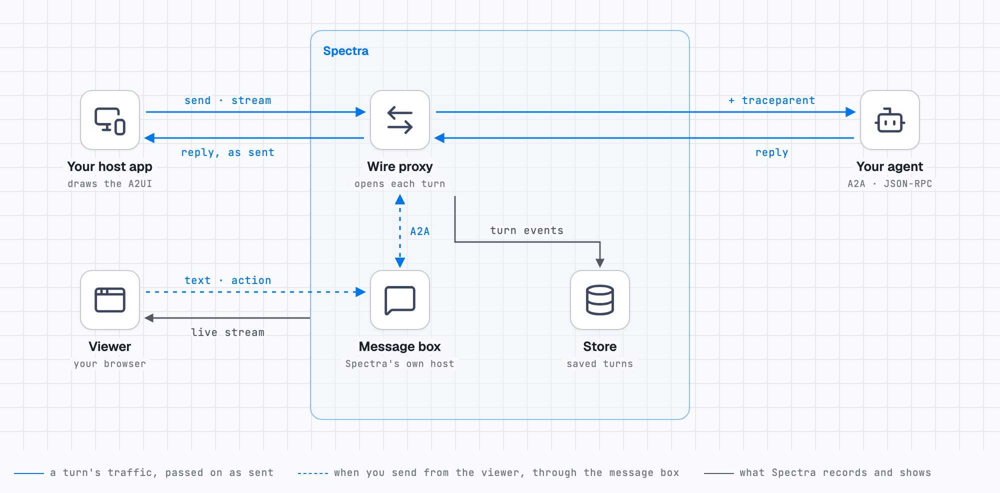

# The wire: how Spectra stands between a host and the agent

This doc explains the wire, the first of Spectra's capture depths: the wire proxy, which stands between a host and the agent and captures each turn from the A2A traffic that crosses it, and the message box, Spectra's own host. It covers where A2UI sits in an A2A message, how a turn opens and closes, the trace context the proxy adds to each turn request, and what `a2ui-spectra attach` does in order at start. It is written for the developer of an A2UI agent who uses Spectra and wants to know what the wire proxy does to their traffic and what Spectra makes of it. It starts with the problem, follows one turn of upstream's Python restaurant finder from the host's request to its close, then opens up the proxy's rules and the message box's, and ends with the design decisions and where the code is.

The running example is upstream's Python restaurant finder, `samples/agent/adk/restaurant_finder`, asked "Top 3 Chinese restaurants in New York" by upstream's Angular sample client. It speaks A2A 0.3 over JSON-RPC, answers with a stream, sends A2UI v0.9 one message per part inside status updates, and ends the turn waiting for input. What it does not exercise, A2A 1.0 and the message box, is shown on the repository's stub agent.

<picture>
  <source media="(prefers-color-scheme: dark)" srcset="diagrams/wire-dark.png">
  
</picture>

## Problem it solves

A2UI defines its messages and leaves the transport open. On A2A, the transport Spectra covers, a host and an agent talk JSON-RPC 2.0 over HTTP:

- The agent publishes a **card**, a JSON document at `/.well-known/agent-card.json` under its base address, naming the agent, its skills, the A2UI extensions it supports and where it listens for each transport.
- The host sends a message with `message/send` or `message/stream` in A2A 0.3, `SendMessage` or `SendStreamingMessage` in A2A 1.0. A send gets one JSON-RPC response; a stream gets a server-sent event stream of them.
- The agent answers with a message, or with a task that moves through states such as `working`, `input-required` and `completed`, reported in status updates and artifact updates.
- Every message and artifact carries **parts**: text, files and data. An A2UI message rides in a data part, marked with A2UI's MIME type.

The two A2A versions spell all of this differently: the method names, how a reply says what it is, the part shapes, the roles and the task states.

To show a turn, Spectra needs what crossed the wire: what the host sent, its text or action, its A2UI capabilities and its data model; every delivery the agent sent back, in order and with its time; and how the turn ended. It needs this from any host, the developer's own as well as its own message box, and from any agent, in any language, without a change to either. And it needs every later observation, the agent's model calls, its tool calls and its spans, to land in the same turn.

The wire proxy is a reverse proxy in front of the agent. A host pointed at it reaches the agent as before, and the proxy writes each turn it sees as turn record v0.1 events: a turn event, a `wire_input` for the host's message and a `wire_output` for each delivery. Together with the message box it is Spectra's transport adapter for A2A, the one transport covered today: past the adapter, the turn record, the checks and the viewer carry nothing of A2A, so another transport needs only an adapter of its own.

## Six ideas to hold on to

### 1. A turn is one send or stream request

A turn opens when a host's request for one of the four send and stream methods reaches the proxy, and closes when the agent's reply to it ends. Every other request, a card fetch, a `tasks/get`, a `tasks/cancel`, passes through without a turn.

### 2. The proxy passes everything through, with three edits

Requests reach the agent and replies reach the host as they were sent. Beside the headers that belong to one connection, which no proxy passes on, the proxy changes three things: `Host`, which it sets to the agent's; a `traceparent` on each turn request; and the agent's card, whose JSON-RPC endpoints it points at itself. What it reads, it reads from a copy.

### 3. A2UI is a data part marked with A2UI's MIME type

A data part carrying `application/a2ui+json`, or the older `application/json+a2ui`, in its metadata or on the part itself, is an A2UI part, kept as the agent wrote it: one message or an array. Any other data part is recorded as data.

### 4. A turn ends when the reply ends, on its last task state

The turn closes when the agent's reply body ends, whatever A2A 0.3's `final` flag said on the way. Its outcome is the last task state the reply carried, unless the reply failed.

### 5. The turn's trace id ties the turn together

Every turn has a W3C trace id. The proxy sends it to the agent in the `traceparent` header, so the agent's spans and the calls it makes during the turn carry it, and Spectra places them in the turn by it. A host that sends its own `traceparent` keeps it, and the turn adopts its trace id.

### 6. The message box is a host like any other

The message box is an A2A client inside Spectra. It sends through the wire proxy, so its turns are captured exactly as a host app's are.

## One turn, end to end

The restaurant finder runs as its roster entry ran it, `uv run . --port 10012`. Upstream's Angular sample client reads its agent's card from `http://localhost:10002`, so Spectra's wire proxy takes that port: `a2ui-spectra attach http://localhost:10012 --proxy-port 10002`. The client is not changed. The pair was recorded once, with a recording proxy in the wire proxy's place on 10002, in [`conformance/test_data/a2a_capture/v0_1/angular_client/python_restaurant_finder_booking.har`](../../conformance/test_data/a2a_capture/v0_1/angular_client/python_restaurant_finder_booking.har), and the A2A capture suite replays the recording through the wire proxy and holds what it captures to the expected record beside it, [`python_restaurant_finder_booking.json`](../../conformance/test_data/a2a_capture/v0_1/angular_client/python_restaurant_finder_booking.json). The trace ids, span ids and times in that record, and the writer's version, `0.0.0`, are stand-ins the suite does not compare; the rest is what the proxy writes.

1. **The host reads the card.** The client fetches `/.well-known/agent-card.json` from the proxy. The proxy forwards the fetch and rewrites the card's `url`, `http://localhost:10012`, to its own origin, so the client's next request comes back through it.
2. **The host sends.** The client posts a `message/stream` with the user's text and its A2UI capabilities in the message's metadata, and the `X-A2A-Extensions` header naming A2UI v0.9:

   ```json
   {
     "jsonrpc": "2.0",
     "method": "message/stream",
     "params": {
       "message": {
         "messageId": "74fbfe33-…",
         "role": "user",
         "parts": [{"kind": "text", "text": "Top 3 Chinese restaurants in New York"}],
         "kind": "message",
         "metadata": {
           "a2uiClientCapabilities": {
             "v0.9": {
               "supportedCatalogIds": [
                 "https://a2ui.org/specification/v0_9/catalogs/basic/catalog.json"
               ]
             }
           }
         }
       }
     },
     "id": 1
   }
   ```

3. **The turn opens.** The proxy reads the whole body, sees a turn request and opens a turn: a new trace id and the turn event's span id, the start time, and the `wire_input`. The live stream says `turn_opened`, and the viewer shows the turn as open. The capabilities leave the metadata for an attribute of their own:

   ```json
   {
     "a2ui.event.kind": "wire_input",
     "a2ui.wire.message": {
       "role": "user",
       "parts": [{"type": "text", "content": "Top 3 Chinese restaurants in New York"}]
     },
     "a2ui.wire.capabilities": {
       "v0.9": {
         "supportedCatalogIds": ["https://a2ui.org/specification/v0_9/catalogs/basic/catalog.json"]
       }
     }
   }
   ```

4. **The request goes on.** The proxy forwards it to the agent with `Host` set to the agent's and a `traceparent` naming the turn.
5. **The deliveries come back.** The agent answers `text/event-stream`. The proxy passes the stream to the client as it arrives and reads a copy: each event is one delivery, and each delivery is one `wire_output`. The first, a task in `submitted` whose history holds only the client's own message, is an empty `wire_output`. Then come the status updates, two of text and then the A2UI messages, each in its own data part marked with the older MIME type:

   ```json
   {"id":1,"jsonrpc":"2.0","result":{"contextId":"0cf495b2-…","final":false,"kind":"status-update","status":{"message":{…,"parts":[{"data":{"version":"v0.9","createSurface":{"surfaceId":"default","catalogId":"https://a2ui.org/specification/v0_9/catalogs/basic/catalog.json","theme":{"primaryColor":"#FF0000","font":"Roboto"}}},"kind":"data","metadata":{"mimeType":"application/json+a2ui"}}],"role":"agent",…},"state":"working",…},…}}
   ```

   The `wire_output` holds the part as an A2UI part, the message unchanged and the MIME type, once read, left out:

   ```json
   {
     "a2ui.event.kind": "wire_output",
     "a2ui.wire.message": {
       "role": "assistant",
       "parts": [
         {
           "type": "a2ui",
           "content": {
             "version": "v0.9",
             "createSurface": {
               "surfaceId": "default",
               "catalogId": "https://a2ui.org/specification/v0_9/catalogs/basic/catalog.json",
               "theme": {"primaryColor": "#FF0000", "font": "Roboto"}
             }
           }
         }
       ]
     }
   }
   ```

   A comment line in the stream, `: ping - 2026-10-24 04:07:30.637465+00:00`, is no event and writes nothing. The surface arrives twice in this stream, once as the reply streams and once more before its end, and the proxy records both copies as they came.

6. **The reply ends.** The last event moves the task to `input-required`, its status message empty, with `final` still `false`; then the agent ends the body. The proxy closes the turn: 24 wire outputs, the outcome from the last state, the conversation from the `contextId` the reply named, and the protocol version from the first A2UI message:

   ```json
   {
     "a2ui.event.kind": "turn",
     "gen_ai.operation.name": "invoke_agent",
     "gen_ai.agent.name": "Restaurant Agent",
     "gen_ai.conversation.id": "0cf495b2-ed8e-40db-b0f1-2d8bb99a630b",
     "a2ui.turn.outcome": "waiting_for_input",
     "a2ui.turn.protocol_version": "v0.9",
     "a2ui.turn.capture_paths": ["wire"],
     "a2ui.turn.writer.name": "a2ui-spectra",
     "a2ui.turn.writer.version": "0.0.0"
   }
   ```

   The event's `name` is `invoke_agent Restaurant Agent`, from the card, and its status is OK, `code` `1`.

7. **The turn is checked and written.** Spectra places the turn's model and tool calls and its spans, runs the four checks on it, writes it to the store and says `turn_closed` on the live stream with the turn whole.
8. **The user books a restaurant.** The client's next `message/stream` carries the `contextId` of the conversation and its `book_restaurant` action in a data part marked `application/a2ui+json`, written in the client's older form, `{"userAction": {…}}`, with no `version`. A new turn opens in the same conversation, and its `wire_input` holds the action as an A2UI part all the same: the MIME type makes the part A2UI, whatever it holds.

## Inside the machinery

### Pointing a host at the proxy

The proxy listens on `127.0.0.1`, at `--proxy-port`, 9821 by default. Its address is its origin followed by the agent's base path, and Spectra prints it at start after `Point a host at the wire proxy:`, as the run under [`attach` at start](#attach-at-start) shows. The viewer shows the same address in its context bar with a copy button, and on its first screen as the address to point a host app at, as [`viewer.md`](viewer.md) describes. A host takes it in place of the agent's URL. A host that reads the card from a fixed address, as the Angular sample client does, is reached by giving the proxy that port.

The proxy speaks A2A 0.3 and A2A 1.0 over JSON-RPC, and it forwards to an agent at `http://` or `https://`, while it serves plain HTTP itself.

### What the proxy does with each request

**Who it answers.** The proxy answers a request by its `Host` header as the viewer's server does, as [the API doc](api.md#who-the-server-answers) describes: `localhost`, `127.0.0.1`, `[::1]` and the names given with `--allow-host`. Any other name is answered `403`, `Blocked request: this host is not allowed. To allow it, start Spectra with --allow-host <name>.` A request carrying `Origin`, a page's, is answered when its origin is `http` or `https` on one of those names, as a host app on `localhost` is; any other, `null` included, is answered `403`, `Blocked request: this origin is not allowed. To allow it, start Spectra with --allow-host <name>.` A request refused is not forwarded and opens no turn, and the terminal prints nothing for it.

The proxy holds each request until its body has been read, then decides what it is:

| The request                                                                                                                                                                              | What the proxy does                                                                          |
| ---------------------------------------------------------------------------------------------------------------------------------------------------------------------------------------- | -------------------------------------------------------------------------------------------- |
| A `GET` at any path ending in `/.well-known/agent-card.json`, or the deprecated `/.well-known/agent.json`                                                                                | Forwards it, and passes the card back with its JSON-RPC endpoints pointed at the proxy       |
| A JSON-RPC call for the extended card: `agent/getAuthenticatedExtendedCard` in A2A 0.3, `GetExtendedAgentCard` in A2A 1.0                                                                | Forwards it, and rewrites the card in the response's `result` the same way                   |
| A single JSON-RPC 2.0 request, at any path, for `message/send` or `message/stream` in A2A 0.3, or `SendMessage` or `SendStreamingMessage` in A2A 1.0                                     | Opens a turn, adds a `traceparent`, forwards it, and reads a copy of the reply into the turn |
| Anything else: another method, such as `tasks/get`, `tasks/cancel` or `tasks/resubscribe`; a JSON-RPC batch; a body that is not JSON; a request with no body, such as a `GET` for a file | Forwards it and passes the reply back, with no turn and no `traceparent`                     |

A request body in `gzip`, `x-gzip`, `deflate` or `br` is decoded to read it, and forwarded as it came.

Every request is forwarded to the agent's origin at the path and query the host sent, with its body as received and its headers as received, credentials included, but three:

- `Host` is set to the agent's host.
- The headers that belong to one connection are not passed on, as for any proxy: `Connection`, `Keep-Alive`, `Proxy-Authenticate`, `Proxy-Authorization`, `Proxy-Connection`, `TE`, `Trailer`, `Transfer-Encoding`, `Upgrade`, and any the `Connection` header names. `Content-Length` is set to the body's length whenever the request has a body or names a length.
- A turn request gets the turn's `traceparent`, as [The trace context](#the-trace-context) says.

No `X-Forwarded-*` header is added. The reply comes back with its status, its headers, less those of one connection, and its body as the agent sent them: a stream chunk by chunk, a compressed body still compressed. A reply that breaks off breaks off for the host too, and a host that closes its connection ends the proxy's request to the agent.

When the agent cannot be reached, the host gets a `502` with one plain-text line, cut from a run with the stub agent stopped:

```
a2ui-spectra's wire proxy could not reach the agent: connect ECONNREFUSED 127.0.0.1:9904
```

A turn request that gets it is captured as a failed turn, its status message the error, `connect ECONNREFUSED 127.0.0.1:9904`. The proxy knows nothing of the agent's process: it forwards the same way whether or not an agent is listening.

### The card

The proxy rewrites each card it passes back so that a host following the card comes back through it. It replaces the scheme, host and port of each JSON-RPC endpoint with its own origin, `http://127.0.0.1:<proxy-port>`, and keeps the path and the query as written:

- in A2A 0.3, the card's `url`, and each entry of `additionalInterfaces` whose `transport` is `JSONRPC`;
- in A2A 1.0, each entry of `supportedInterfaces` whose `protocolBinding` is `JSONRPC`.

Entries of other transports are left as they are, and so is a URL that is not absolute. The card's `url` is rewritten whatever transport the card prefers. The rewritten card is sent as compact JSON, with no `Content-Encoding`; a reply that is not a 2xx JSON object passes back as received. This pair is cut from a run of `a2ui-spectra attach` against the stub agent on port 9904, the wire proxy on 9901, the card fetched with `curl` from the agent and then from the proxy:

```jsonc
// From the agent, http://127.0.0.1:9904/.well-known/agent-card.json
"url": "http://127.0.0.1:9904/a2a/jsonrpc",
"supportedInterfaces": [
  {"url": "http://127.0.0.1:9904/a2a/jsonrpc", "protocolBinding": "JSONRPC", "tenant": "", "protocolVersion": "1.0"},
  {"url": "http://127.0.0.1:9904/a2a/jsonrpc", "protocolBinding": "JSONRPC", "tenant": "", "protocolVersion": "0.3"}
]
// Through the proxy, http://127.0.0.1:9901/.well-known/agent-card.json
"url": "http://127.0.0.1:9901/a2a/jsonrpc",
"supportedInterfaces": [
  {"url": "http://127.0.0.1:9901/a2a/jsonrpc", "protocolBinding": "JSONRPC", "tenant": "", "protocolVersion": "1.0"},
  {"url": "http://127.0.0.1:9901/a2a/jsonrpc", "protocolBinding": "JSONRPC", "tenant": "", "protocolVersion": "0.3"}
]
```

**The transport check.** Each time a card answers, at start under `attach` and at each start of the agent's command under `run`, Spectra reads the card's transports in preference order: an A2A 1.0 card's `supportedInterfaces` in order; an A2A 0.3 card's `preferredTransport`, JSON-RPC when it names none and has a `url`, then its `additionalInterfaces`.

| Where the card puts JSON-RPC                | What Spectra says                                                                                                                                                                                           | What it does                                                                                                                                                                  |
| ------------------------------------------- | ----------------------------------------------------------------------------------------------------------------------------------------------------------------------------------------------------------- | ----------------------------------------------------------------------------------------------------------------------------------------------------------------------------- |
| First                                       | Nothing                                                                                                                                                                                                     | Goes on                                                                                                                                                                       |
| Listed, after another transport             | `The agent's card prefers GRPC to JSON-RPC. Hosts that follow the card's preference bypass the wire proxy, and their turns are not captured.`                                                               | Goes on                                                                                                                                                                       |
| Not listed; other transports are            | `The agent's card lists no A2A JSON-RPC interface, only GRPC. Spectra captures A2A over JSON-RPC only.`, as an error                                                                                        | `attach`, `replay` and `test` stop, exiting 1. `run` carries on, the agent left up and the message box refusing with the check's line, as [The refusals](#the-refusals) lists |
| No interface at all                         | `The agent's card lists no interface to reach it at. A2A 1.0 requires the card's supportedInterfaces, and A2A 0.3 its url, so hosts that follow the card cannot reach the agent either.`, as an error       | As above                                                                                                                                                                      |
| Only at A2A versions other than 0.3 and 1.0 | The message box's line, `The message box cannot send to this agent: its card lists A2A JSON-RPC only at version 2.0, and the box speaks A2A 0.3 and 1.0. Hosts pointed at the wire proxy are not affected.` | Goes on; the message box refuses                                                                                                                                              |
| Listed with no URL                          | The message box's line, `The message box cannot send to this agent: its card lists A2A JSON-RPC with no URL to send to. Hosts pointed at the wire proxy are not affected.`                                  | Goes on; the message box refuses                                                                                                                                              |

A JSON-RPC interface that states no version is named in the versions' line as `with no protocolVersion`: `… its card lists A2A JSON-RPC only at version 2.0 and with no protocolVersion, and the box speaks A2A 0.3 and 1.0. …`.

The transport names in these lines are the card's own. The card's `name` names the agent on every turn captured from then on, `invoke_agent <name>` and `gen_ai.agent.name`; a card with no name leaves both out, and a turn captured under `run` before any card has answered carries none.

### Where A2UI sits in an A2A message

A turn's deliveries come in four shapes, and the proxy takes the parts the agent wrote for this turn from each:

| What the agent sends                         | The parts its `wire_output` holds                                                                                                                                    | Its `a2ui.wire.metadata`      |
| -------------------------------------------- | -------------------------------------------------------------------------------------------------------------------------------------------------------------------- | ----------------------------- |
| A message                                    | The message's parts                                                                                                                                                  | The message's metadata        |
| A task, as a send's result or a stream event | The agent's messages in its history after the host's request message, then its status message when the history does not hold it already, then every artifact's parts | The task's metadata           |
| A status update                              | Its status message's parts; none when it carries no message                                                                                                          | The status message's metadata |
| An artifact update                           | The artifact's parts                                                                                                                                                 | The artifact's metadata       |

A message whose role is the user's is left out wherever it appears, so a task that echoes the host's message adds nothing. A task's history is matched to the request by `messageId`; when the request named none, or the history does not hold it, the whole history counts. A JSON-RPC error, or a delivery that is neither a response nor a reply the proxy reads, is an empty `wire_output`.

Each part becomes a part of GenAI's message shape, as the turn record's [`wire_input` and `wire_output`](../../specification/turn_record/v0_1/docs/turn_record.md#wire_input-and-wire_output) defines it:

| The A2A part                      | In A2A 0.3                               | In A2A 1.0        | In the record                                                                                                 |
| --------------------------------- | ---------------------------------------- | ----------------- | ------------------------------------------------------------------------------------------------------------- |
| Text                              | `{"kind": "text", "text": …}`            | `{"text": …}`     | `{"type": "text", "content": …}`, with `mime_type` from a 1.0 part's `mediaType`                              |
| A file's bytes                    | `{"kind": "file", "file": {"bytes": …}}` | `{"raw": …}`      | `{"type": "blob", …}`, its modality `image`, `video` or `audio` by the MIME type's top level, else `document` |
| A file's address                  | `{"kind": "file", "file": {"uri": …}}`   | `{"url": …}`      | `{"type": "uri", …}`, its modality as for a blob                                                              |
| Data marked with A2UI's MIME type | `{"kind": "data", "data": …}`            | `{"data": …}`     | `{"type": "a2ui", "content": …}`, the data as delivered: one A2UI message or an array of them                 |
| Any other data                    | `{"kind": "data", "data": …}`            | `{"data": …}`     | `{"type": "a2ui.data", "content": …}`, with `mime_type` from the part's own                                   |
| Anything else                     | another `kind`                           | none of the above | Its `kind`, or `unknown`, as the type, the whole part as its content                                          |

A data part is A2UI when its MIME type, compared without regard to case and with any parameter after `;` left out, is `application/a2ui+json`, the A2UI extension specification's, or `application/json+a2ui`, the spelling upstream's Python A2A extension still writes. The proxy looks in the part's metadata, `metadata.mimeType`, and on the part itself, `mimeType` in A2A 0.3 as upstream's Lit sample client sends it and `mediaType` in A2A 1.0. Once read, the A2UI MIME type is left out of the record. A file's name, from `name` or `filename`, and the rest of a part's metadata stay on the part. The content of an A2UI part is not judged here: a data part marked as A2UI is an A2UI part whatever it holds, and [`checks.md`](checks.md) is where it is judged.

### The host's message

The `wire_input` holds the host's message in the same part shape, with the role `user`. Its metadata is split into three attributes:

| Metadata key                                                             | Attribute                                                                                                                                                       |
| ------------------------------------------------------------------------ | --------------------------------------------------------------------------------------------------------------------------------------------------------------- |
| `a2uiClientCapabilities`, v0.9's, and `a2uiRendererCapabilities`, v1.0's | `a2ui.wire.capabilities`: both merged into one object keyed by A2UI version                                                                                     |
| `a2uiClientDataModel`, v0.9's, and `a2uiRendererDataModel`, v1.0's       | `a2ui.wire.data_model`. When both are sent, the one whose `version` matches the version of the message's own A2UI, else v0.9's; the other stays in the metadata |
| Every other key                                                          | `a2ui.wire.metadata`, unchanged                                                                                                                                 |

The request's `contextId` becomes the turn's conversation. Its `taskId`, its `messageId` and its headers are not recorded.

### How a turn closes, and its outcome

The turn closes when the agent's reply ends: the end of a send's body, or of a stream. A reply whose `Content-Type` is `text/event-stream` is read as server-sent events, as the HTML standard reads them: each event is dispatched at its blank line, its `data` lines joined, a comment line passed over, and an event still unfinished when the stream ends dropped. Each event's data is one delivery, and a data that is not JSON is still a delivery, with no parts. Any other reply is one delivery when its body ends. A body in `gzip`, `x-gzip`, `deflate` or `br` is decoded for the copy; the host still gets it encoded.

A failure of the reply makes the turn `failed` whatever states it carried, and the first failure's message is the turn's. Without one, the last task state decides:

| The reply                                                                | `a2ui.turn.outcome` | The turn event's status                                                 |
| ------------------------------------------------------------------------ | ------------------- | ----------------------------------------------------------------------- |
| An HTTP status outside 200 to 299                                        | `failed`            | `code` `2`, `HTTP 401 Unauthorized`                                     |
| A JSON-RPC error in any delivery                                         | `failed`            | `code` `2`, the error's `message`, or `JSON-RPC error` when it has none |
| The agent could not be reached                                           | `failed`            | `code` `2`, the connection's error                                      |
| The connection broke before the reply ended                              | `failed`            | `code` `2`, `The connection to the agent broke before the reply ended.` |
| A content encoding the proxy cannot read                                 | `failed`            | `code` `2`, `The reply's content encoding, <encoding>, cannot be read.` |
| The host closed its connection before the reply ended                    | `failed`            | `code` `2`, `The host closed the connection.`                           |
| The last task state any task or status update carried: `completed`       | `completed`         | `code` `1`                                                              |
| `input-required` or `auth-required`                                      | `waiting_for_input` | `code` `1`                                                              |
| `canceled`                                                               | `cancelled`         | `code` `1`                                                              |
| `failed` or `rejected`                                                   | `failed`            | `code` `2`                                                              |
| `submitted`, `working`, `unknown`, or A2A 1.0's `TASK_STATE_UNSPECIFIED` | `failed`            | `code` `2`                                                              |
| No task state, and a message among the replies                           | `completed`         | `code` `1`                                                              |
| No task state and no message                                             | `failed`            | `code` `2`                                                              |

A2A 1.0's states, `TASK_STATE_COMPLETED` and the rest, are read as A2A 0.3's. A2A 0.3's `final` flag is not read: a turn closes when the agent ends the body, and its outcome is the last state it saw. A host's `tasks/cancel` is a request of its own, passed through; the turn whose stream then carries `canceled` ends `cancelled`. Under `run`, a restart of the agent's process first ends the connections of the turns open, and each ends `failed`, `The connection to the agent broke before the reply ended.`; [`agent-process.md`](agent-process.md) has the restart.

**What else the turn event says.** Beside the outcome, the proxy writes the turn event's:

- **conversation**, `gen_ai.conversation.id`: the request's `contextId`, else the first `contextId` a reply names;
- **protocol version**, `a2ui.turn.protocol_version`, in the record's form such as `v0.9` or `v1.0`: the `version` of the turn's first A2UI message, the host's included; else the one A2UI version the reply's extensions header, `X-A2A-Extensions` or `A2A-Extensions`, names, when it names exactly one; else the one version the host's capabilities offer, when they offer exactly one; else none, and the turn is written without check events;
- **capture path**, `wire` in `a2ui.turn.capture_paths`, on every turn;
- **writer**, `a2ui-spectra` and its version.

The rest of the turn event is in the turn record's [`turn`](../../specification/turn_record/v0_1/docs/turn_record.md#turn).

### After the turn closes

A turn is open on the live stream from its `turn_opened` until it has been written. In between:

1. Each wire event goes out as `wire_event` as it is written, with the turn's conversation once the host's message or a reply has named it.
2. When the reply ends, the turn waits for the model and tool calls still in flight in it, and takes the spans the receiver placed in it while it was open; [`model-and-tool-calls.md`](model-and-tool-calls.md) and [`opentelemetry.md`](opentelemetry.md) have both.
3. The store reads the conversation's earlier turns, and the four checks run on the turn, as [`checks.md`](checks.md) describes. A check that throws is one error line, and the turn is written unchecked.
4. The turn is written to the store. A write that fails is one error line ending `The turn is kept in memory until Spectra stops.`, and the turn is shown for this run.
5. The live stream says `turn_closed`, with the turn and its check events. [`api.md`](api.md) has the stream's events.

When Spectra stops, it ends the connections of the turns still open and waits for every turn to be written.

### The trace context

The proxy adds a W3C `traceparent` to each turn request, the message box's included, and to no other request:

```ts
return `00-${traceId}-${parentId}-01`;
```

That line is `formatTraceparent` in [`trace_context.ts`](../../tools/spectra/src/proxying/trace_context.ts): version `00`, the turn's trace id, the turn event's span id as the parent id, and the flags `01`, sampled. An agent whose OpenTelemetry HTTP server instrumentation reads the header continues that trace, so its spans and the calls its clients make carry the turn's trace id, and a call or a span carrying a turn's trace id belongs to that turn. Whenever Spectra's own `traceparent` goes on a request, any `tracestate` the host sent is dropped.

**A host's own trace.** A host that sends its own `traceparent` keeps it, with its `tracestate`, and the turn adopts its trace id, so the host's trace and the turn are one. The proxy then adds nothing. Spectra's own replaces the host's in three cases:

- The header does not parse. It parses when its four fields are lowercase hex of the right lengths, the version is not `ff`, the trace id and the parent id are not all zeros, and a version `00` header has nothing after the flags. A later version is read by its first four fields, as the standard asks.
- A turn already has that trace id, open or in the store. The terminal then says so once per run. This line is cut from a run in which a host sent the same `traceparent` twice:

  ```
  a2ui-spectra: The host reuses trace ids: a turn request's traceparent named a trace id another turn already has, so the wire proxy replaced it with Spectra's own.
  ```

- Whether a turn has that trace id cannot be told, as when the store's folder was deleted while Spectra runs. The terminal says nothing.

How a span carrying the trace id joins its turn is [`opentelemetry.md`](opentelemetry.md)'s subject, and how a model or tool call does is [`model-and-tool-calls.md`](model-and-tool-calls.md)'s.

### The message box

The message box is Spectra's own host: an A2A client inside Spectra that sends one part per message, a text or an A2UI action, with the data model of the surfaces that asked for it. It posts to the card's JSON-RPC endpoint as the proxy rewrote it, so every request it makes crosses the wire proxy, and a send answers once the proxy has opened the send's turn.

- **The interface.** It follows the card: the one fetched at start under `attach`, and under `run` the latest, read at each start of the agent's command, its interface, its A2A version and its choice of send or stream being that card's from then on. With `supportedInterfaces`, it speaks to the first JSON-RPC entry whose `protocolVersion` is 0.3 or 1.0, compared on major and minor, and sets that entry's `tenant` in each A2A 1.0 request when it names one. A card without `supportedInterfaces` is spoken to as A2A 0.3, at its `url` unless it prefers another transport, then at the first JSON-RPC entry of its `additionalInterfaces`.
- **The method.** `message/stream` in A2A 0.3 and `SendStreamingMessage` in A2A 1.0 when the card's `capabilities.streaming` is `true`, with `Accept: text/event-stream`; else `message/send` and `SendMessage`, with `Accept: application/json`.
- **The offer.** Every A2UI version Spectra supports, for the agent to choose from: the v0.9, v0.9.1 and v1.0 extension URIs, `https://a2ui.org/a2a-extension/a2ui/v0.9` and the rest, in `X-A2A-Extensions` in A2A 0.3, or in `A2A-Extensions` with `A2A-Version: 1.0` in A2A 1.0; and in the message's metadata, `a2uiClientCapabilities` for v0.9 and v0.9.1 and `a2uiRendererCapabilities` for v1.0, keyed `1.0` as v1.0 names itself. Each version names its basic catalog, v0.9.1 by both its URLs, and every configured catalog whose protocol version matches: one naming 1.0 under v1.0, one naming no version or 0.9 under v0.9 and, with its aliases, under v0.9.1. The ids are the catalog registry's as they stand at each send, so they follow a changed catalog file, as [`checks.md`](checks.md) describes. It advertises only, and sends no catalog inline.
- **A text.** One text part, `{"kind": "text", "text": …}` in A2A 0.3 and `{"text": …}` in A2A 1.0.
- **An action.** One A2UI action message, `{"version": …, "action": {…}}`, as the viewer builds it from a press in the preview, in one data part with the MIME type `application/a2ui+json`: in A2A 0.3 the part's `data` is the message and the type is its metadata's `mimeType`; in A2A 1.0 its `data` is a list of the one message and the type is its `mediaType`. An action only continues a conversation the box started.
- **The data model.** The map the viewer builds, `{"version": …, "surfaces": {…}}`, goes in the message's metadata beside the capabilities, under `a2uiClientDataModel` for v0.9 and v0.9.1 and `a2uiRendererDataModel` for v1.0, with a text as with an action.
- **The headers.** The configured headers, as [The config file's `agent` settings](#the-config-files-agent-settings) gives them, on every request, the card fetch included. The box's own transport headers, `Content-Type`, `Accept`, the extensions header and `A2A-Version`, win over a configured header of the same name.
- **The conversations.** It holds each one it starts: the `contextId` the agent's first reply names, or, when that reply broke off, the conversation its turn was recorded in; and the `taskId` to send back after a turn that ended waiting for input, `input-required` or `auth-required`. A send continues one of them by its id, or else starts a new conversation. Each run of Spectra starts with none, and a conversation whose agent names no id is not continued.
- **One turn at a time in each conversation.** While a conversation's last turn is open, a send in it is refused; a send in another conversation, or in a new one, goes ahead.
- **Across a restart.** Under `run` the box keeps each conversation's id and drops its task id whenever the agent's process ends, by a restart or on its own, so the next send carries the conversation id alone; a reply read across the end carries no task on either. A task id names state that lived in the stopped process: the A2A Python SDK, 0.3.25, refuses a send naming a task its store does not hold.
- **A replayed conversation** is one of the box's: a replay re-sends a record's host messages as a new conversation the box holds, and once it ends the composer can continue it. While a replay runs the box refuses every send. [`replay-and-fixtures.md`](replay-and-fixtures.md) has the replay.

This is the `wire_input` of a message box turn, cut from the store of a run of `a2ui-spectra attach` against the stub agent, `node dist/stub_agent/stub_agent.js --port 9904 --canned-a2ui`, after `Hello` was sent from the box; the card listed A2A 1.0 first, so the box spoke A2A 1.0:

```json
{
  "a2ui.event.kind": "wire_input",
  "a2ui.wire.message": {"role": "user", "parts": [{"type": "text", "content": "Hello"}]},
  "a2ui.wire.capabilities": {
    "v0.9": {
      "supportedCatalogIds": ["https://a2ui.org/specification/v0_9/catalogs/basic/catalog.json"]
    },
    "v0.9.1": {
      "supportedCatalogIds": [
        "https://a2ui.org/specification/v0_9/catalogs/basic/catalog.json",
        "https://a2ui.org/specification/v0_9_1/catalogs/basic/catalog.json"
      ]
    },
    "1.0": {
      "supportedCatalogIds": ["https://a2ui.org/specification/v1_0/catalogs/basic/catalog.json"]
    }
  }
}
```

The agent chose v1.0, and its reply's A2UI came as one A2A 1.0 data part holding an array of three messages, recorded as one A2UI part: `{"type": "a2ui", "content": [{"version": "1.0", "createSurface": {…}}, {"version": "1.0", "updateComponents": {…}}, {"version": "1.0", "updateDataModel": {…}}]}`.

#### The refusals

Spectra owns every line the box refuses a send or a replay with, and `GET /api/message-box` carries it as `unavailable`. The first that applies wins, in this order:

1. By the state of the agent's process under `run`: `Can't send · the agent is starting`, `Can't send · waiting for the agent's card`, `Can't send · the agent is restarting` and `Can't send · the agent is down`. Under `attach` the box is not told the agent's state.
2. For a card that fails the transport check under `run`: `Can't send · the agent's card lists no interface to reach it at`, and `Can't send · the agent's card lists no A2A JSON-RPC interface, only GRPC`, the transports the card does list in place of `GRPC`.
3. For a card that lists JSON-RPC only at versions the box does not speak, or only with no version or no URL, the lines in [The card](#the-card).
4. For a configured header's variable that is not set: `Can't send · SPECTRA_AGENT_TOKEN is not set in Spectra's environment`, naming each such variable.

A send the box refuses for anything else answers with one of these, cut from the send route, `POST /api/message-box/messages`, in a run against the stub agent:

| Status | The send                                         | The answer                                                                                                            |
| ------ | ------------------------------------------------ | --------------------------------------------------------------------------------------------------------------------- |
| `400`  | An action with no conversation                   | `An action continues a conversation the message box started. Send it with that conversationId.`                       |
| `404`  | A conversation the box did not start in this run | `The message box did not start this conversation while Spectra runs. Send without a conversation to start a new one.` |
| `409`  | One in a conversation whose turn is open         | `A turn is still open in this conversation. Wait for it to close, or start a new conversation.`                       |
| `409`  | Any send while a replay runs                     | `A replay is running. The message box sends again once it ends.`                                                      |
| `422`  | Any send while the box cannot send               | The line above                                                                                                        |
| `502`  | One whose request could not reach the wire proxy | `The message box could not reach the wire proxy: …`                                                                   |

Every line in the table is the box's own words, in [`a2a/message_box.ts`](../../tools/spectra/src/a2a/message_box.ts); [`api.md`](api.md) has the route, with its own checks of the request's body.

#### What the viewer sends through the box

The composer and a press in the preview are the viewer's, and [`viewer.md`](viewer.md) describes how they look and behave. What they hand the box:

- **A text** continues the conversation of the turn in view, whichever of its turns is selected, when the box started it. A conversation the box did not start in this run, and one whose agent named none, is not continued: sending starts a new conversation. New conversation starts one. The text carries the data model of every surface that asked for it with `sendDataModel`, as the surfaces stood after the step in view, the shown one's from its preview page with what was typed in it, in the A2UI version of the first such surface.
- **A press** becomes a pending action: the A2UI action message in the pressed surface's version, shown as the agent would receive it, in the turn record's form, the part's content an object in A2A 0.3 and a list in 1.0. Its data models go under their version's key: the pressed surface's from the page, and the other surfaces' as they stood at the step of the render it was pressed in, even after a newer render went out. A data model map holds the surfaces of the message's protocol, v0.9 and v0.9.1 together or v1.0, and a surface whose data model is not an object sends `{}`. The action is sent only in a conversation the box started, and a send that fails leaves it pending.
- **While the box cannot send**, under `run` and `attach` alike, the composer shows the box's reason as the server gives it, `unavailable` above.

### `attach` at start

`a2ui-spectra attach [<agent-url>]` attaches to an agent that is already running at `<agent-url>`, its base address. Spectra does not start or stop the agent, and does not know when it stops. `run`'s start, which owns the agent's process, is [`agent-process.md`](agent-process.md)'s subject. At start, `attach`, in order:

1. **Reads its settings.** The agent's URL is the argument, else the config file's `agent.url`; with neither, it stops with a usage error naming both, exit code 2.
2. **Opens the store** in the working directory, and loads the configured catalogs; a catalog that does not load stops it. It prints the config file it read settings from, and the ids of the catalogs configured.
3. **Resolves the agent's headers.** A configured header whose variable is not set is one error line, and is not sent; the card fetch goes ahead without it.
4. **Starts the model proxy, the tool proxy and the OpenTelemetry receiver**, the tool proxy only when the config file names a tool server, and watches the configured catalog files and the fixtures folder. A port that is taken stops it here.
5. **Waits for the agent's card**, with no time limit, at `<agent-url>/.well-known/agent-card.json`, sending the configured headers. Each attempt runs out after two seconds, and the next comes half a second after a miss. Spectra says why it waits, once and again whenever the reason changes: the status the card answered with, `it answered 404`; `it answered 200 with no JSON object`; `connection refused`; `no answer within 2 seconds`; or, for any other failure, `it did not answer (…)` with the runtime's message. The card wait is how a wrong URL shows.
6. **Checks the card's transports**, as [The card](#the-card) says. A card with no JSON-RPC interface, or no interface, stops it, exit code 1.
7. **Starts the wire proxy** on `--proxy-port`, with the card's name as the agent's, and opens the message box on the card. When the box cannot send, it says why.
8. **Starts the viewer** on `--port`, and prints the addresses: the viewer, the wire proxy, each tool server's proxy, the receiver, the store's turns folder and the fixtures folder; then the variables to set in the agent's shell, which [`model-and-tool-calls.md`](model-and-tool-calls.md) explains.
9. **Opens the browser** at the viewer, unless `--no-open`, and runs until it is stopped, by Ctrl-C or a stop signal.

Since the wire proxy and the viewer start only once the card has answered, a port of theirs that is taken shows only then. This line is cut from a run with `--proxy-port 9901` held by another server, printed after the stub agent's card had answered, exit code 1:

```
a2ui-spectra: Port 9901 is taken. Choose another port with --proxy-port.
```

This is the terminal of a run started before the stub agent was, then the agent started on port 9904, with `a2ui-spectra attach http://127.0.0.1:9904 --port 9900 --proxy-port 9901 --model-proxy-port 9902 --receiver-port 9903 --tool-proxy-port 9904 --no-open`. No tool server is configured, so no tool proxy listens; the folders are shortened:

```
a2ui-spectra: Waiting for the agent's card at http://127.0.0.1:9904/.well-known/agent-card.json: connection refused. The agent's URL is attach's <agent-url> argument, or agent.url in the config file.
a2ui-spectra: The viewer is at http://localhost:9900/
a2ui-spectra: Point a host at the wire proxy: http://127.0.0.1:9901/
a2ui-spectra: The OpenTelemetry receiver is at http://127.0.0.1:9903
a2ui-spectra: Turns are saved in …/.a2ui-spectra/turns
a2ui-spectra: Fixtures are saved in …/a2ui-spectra-fixtures
a2ui-spectra: To see model and tool calls, set these in the agent's shell and restart it:
export GOOGLE_GEMINI_BASE_URL=http://127.0.0.1:9902/GOOGLE_GEMINI_BASE_URL  # forwards to https://generativelanguage.googleapis.com
…
export OTEL_EXPORTER_OTLP_ENDPOINT=http://127.0.0.1:9903  # for Spectra's OpenTelemetry receiver
…
a2ui-spectra: If the agent's shell already sets one of the model or tool variables to another address, start Spectra with that value set as well, so the proxy forwards there.
```

While it waited, only the model proxy and the receiver listened, on 9902 and 9903. Status lines go to stdout and errors to stderr, each with the `a2ui-spectra:` prefix; the `export` lines carry none, so they can be pasted.

### The config file's `agent` settings

The config file's general rules, where it is found, that it is read strictly and that the command line takes precedence over it, are in the command's [README](../../tools/spectra/README.md). Its `agent` object holds two settings, shown here as the command README's example writes them, with the schema's address as its `$id` gives it:

```json
{
  "$schema": "https://raw.githubusercontent.com/retz8/a2ui-spectra/main/tools/spectra/src/config.schema.json",
  "agent": {
    "url": "http://localhost:10002",
    "headers": {"Authorization": "Bearer ${SPECTRA_AGENT_TOKEN}"}
  }
}
```

**`agent.url`** is the agent's base address, a URL starting with `http://` or `https://`. With it, `attach`'s argument and `run`'s `--agent-url` may be left out; given, they take precedence. Any other scheme, or a value that is not a URL, stops Spectra at start naming the file and the setting. The card is fetched at the base address with `/.well-known/agent-card.json` added after its path, the address's query and fragment left out, and the wire proxy's address carries the base address's path.

**`agent.headers`** are headers the message box adds to every request it makes to the agent, the card fetch at start included. The wire proxy forwards them like any host's.

- A `${VAR}` in a value is replaced from Spectra's environment once, at start, so the file holds variable names, never values. Only the bare form is read, a name of letters, digits and underscores not starting with a digit; `$VAR`, `${a-b}` and `${}` are left as written, and substitution runs on header values only. A variable set to an empty value counts as set.
- A header that reads a variable is sent only to an address on this machine, or to one given on the command line. When the file's `agent.url` names another host and the command line gives none, Spectra stops at start, as a usage error, naming the header, the variable and the host: `The Authorization header in a2ui-spectra.json reads ${SPECTRA_AGENT_TOKEN} from your environment, and the file's agent.url would send it to staging.example. To send it there, give the agent's URL with --agent-url.`, or under `attach`, `as attach's <agent-url> argument.` A header the command line replaces is not counted.
- A variable that is not set is reported at start. The header naming it is not sent, the card fetch goes ahead with the headers that resolved, and the box refuses to send, naming the variable, until Spectra is started with it set. These two lines are cut from a run with the example's header and `SPECTRA_AGENT_TOKEN` unset, the first on stderr:

  ```
  a2ui-spectra: SPECTRA_AGENT_TOKEN is not set in Spectra's environment, so the Authorization header is not sent and the message box cannot send.
  a2ui-spectra: Can't send · SPECTRA_AGENT_TOKEN is not set in Spectra's environment
  ```

- A header given on the command line, `--header "Name: value"` or `-H`, takes the place of the file's header of the same name, compared without regard to case, and the file's other headers are still sent. Its value is sent as written, with no `${VAR}` replaced, the shell having expanded what it was given, and a file's header it replaces is not read for its variables. The later of a name given twice is used.
- A `--header` written with no colon, no name or no value is a usage error, `--header takes 'Name: value'.`, and a name that is not an HTTP token is `'<name>' is not a header name.`. Neither repeats the value.
- The box's own transport headers win over a configured header of the same name, as [The message box](#the-message-box) says.
- Headers are never recorded.

## When things go wrong

| What happens                                                                                | What you see                                                                                                                                            |
| ------------------------------------------------------------------------------------------- | ------------------------------------------------------------------------------------------------------------------------------------------------------- |
| `attach` is given no agent URL and the config file has none                                 | `a2ui-spectra: attach needs the agent's URL: its <agent-url> argument, or agent.url in a2ui-spectra.json.`, then the usage hint; exit code 2            |
| The agent's URL is wrong, or the agent is not up                                            | The card wait's line, such as `…: it answered 404.` or `…: connection refused.`, and Spectra goes on waiting                                            |
| The card prefers another transport to JSON-RPC                                              | One line at start. A host that follows the card's preference reaches the agent directly, and its turns are not captured                                 |
| The card lists no JSON-RPC interface                                                        | One error line; `attach` stops                                                                                                                          |
| The host is pointed at the agent, not at the proxy                                          | No turn appears. Point it at the address Spectra prints, or give the proxy the port the host reads the card from                                        |
| The agent's A2UI arrives as data parts with no A2UI MIME type                               | The turn holds data parts and no A2UI messages, so nothing of it is checked or drawn. Mark the parts `application/a2ui+json`                            |
| The agent is stopped while Spectra runs under `attach`                                      | A host's request gets a `502` with the proxy's line, and the turn is written `failed` with the connection's error. The message box still offers to send |
| The agent answers a turn request with an HTTP error, such as `401` for a missing token      | The host gets the error as sent; the turn is `failed`, its status `HTTP 401 Unauthorized`                                                               |
| A configured header's variable is not set                                                   | One error line at start, and the message box refuses every send naming the variable                                                                     |
| The host sends a `traceparent` whose trace id another turn has                              | Spectra's own trace id replaces it, and the terminal says once that the host reuses trace ids                                                           |
| The agent holds a stream open after its last state                                          | The turn stays open until the agent ends the stream, and the message box refuses a send in that conversation until then                                 |
| A turn has no A2UI message, no single-version extensions header and no single-version offer | No protocol version; the turn is written without check events                                                                                           |

## Design decisions

| Decision                                                                   | What it buys                                                                                                                           | What it costs                                                                                                                           |
| -------------------------------------------------------------------------- | -------------------------------------------------------------------------------------------------------------------------------------- | --------------------------------------------------------------------------------------------------------------------------------------- |
| A reverse proxy in front of the agent, not a hook in the host or the agent | Any host and any agent, in any language and on any framework, with no change to either                                                 | A host has to be pointed at the proxy, and one that follows another transport on the card goes around it                                |
| Rewrite the card's JSON-RPC endpoints                                      | A host that reads the card from the proxy, at a fixed address or not, sends its turns back through it                                  | The card a host sees is not byte for byte the agent's; endpoints of other transports are left alone, so those hosts go around the proxy |
| Read the whole request body before forwarding                              | The turn opens, and its `traceparent` is set, before the agent sees the request                                                        | Every request is held in memory until it has arrived whole                                                                              |
| Pass the reply through and read a copy                                     | The host gets what the agent sent, stream for stream and byte for byte, compressed or not                                              | The proxy decodes a second copy of every turn's reply                                                                                   |
| A turn is one send or stream request                                       | One unit across hosts, A2A versions and wire forms, closed by an event every reply has: its end                                        | Traffic outside those four methods, such as a resubscribed stream, is not captured                                                      |
| A2UI by its MIME type, in either spelling and either place                 | A data part that only looks like A2UI is never misread; an agent writing the older spelling, or marking the part itself, is still read | An agent that marks nothing has its A2UI recorded as data                                                                               |
| The outcome from the last task state, not from `final`                     | Agents that send `final` wrongly, or not at all, still get the outcome they reached                                                    | A turn stays open as long as the agent keeps its stream open                                                                            |
| A `traceparent` on every turn request                                      | The agent's spans and its model and tool calls carry the turn's trace id, which places them without guessing by time                   | The agent sees a header its host did not send                                                                                           |
| Adopt a host's trace id unless it is taken                                 | A host's own trace and Spectra's turn are one trace                                                                                    | A host that reuses trace ids gets Spectra's in their place, and its `tracestate` is dropped                                             |
| The message box sends through the wire proxy                               | Its turns are captured by the same path as any host's, with nothing special-cased                                                      | The box sends only while the proxy is up; a send that cannot reach it fails with `502`                                                  |
| The message box offers every A2UI version Spectra supports                 | The agent picks its version, as it would for a host that speaks them all                                                               | The agent sees an offer wider than a real host's                                                                                        |
| `attach` waits for the card with no time limit                             | Spectra can start before the agent, and a wrong URL shows as the wait's line                                                           | A mistyped URL waits until it is stopped                                                                                                |
| Headers in the config file by variable name                                | The config file can be committed with no secret in it                                                                                  | A variable missing from Spectra's environment stops the box from sending                                                                |

## Known limits

- A2A is captured over JSON-RPC alone. A host that speaks gRPC or HTTP+JSON to the agent is not seen.
- A2UI in a data part with no A2UI MIME type is recorded as a data part, and is not checked or drawn.
- Only `message/send`, `message/stream`, `SendMessage` and `SendStreamingMessage` open turns. A stream reopened with `tasks/resubscribe`, a task polled with `tasks/get` and a JSON-RPC batch are passed through and not captured.
- The wire proxy listens on `127.0.0.1` alone, so a host on another machine cannot reach it directly.
- Under `attach` the message box does not know whether the agent is up; a send to a stopped agent fails as a turn.
- The host's `taskId` and its request headers are not in the record.

## Trying it without a model

The repository's stub agent answers in A2UI with no model. From a clone, build it, run it with its canned conversation, and attach to it:

```bash
yarn workspace a2ui-spectra-conformance build
node conformance/dist/stub_agent/stub_agent.js --canned-a2ui          # listens on 127.0.0.1:10013
a2ui-spectra attach http://127.0.0.1:10013
```

Send "Hello" from the message box, then the name it asks for. To be a host yourself, send a turn to the wire proxy:

```bash
curl -s -X POST http://127.0.0.1:9821/a2a/jsonrpc -H 'content-type: application/json' \
  --data '{"jsonrpc":"2.0","id":1,"method":"message/send","params":{"message":{"kind":"message","messageId":"m-1","role":"user","parts":[{"kind":"text","text":"Hello"}]}}}'
```

The stub's other conversations, `--flawed-booking`, `--v1-booking` and its default wait for a cancel, and `--bearer-token`, which answers `401` without the token, are in [`conformance/README.md`](../../conformance/README.md#the-stub-agent).

The A2A capture suite replays each recording of its coverage roster through the wire proxy and compares what it captures with the expected record. It runs in the tool's test target:

```bash
yarn workspace a2ui-spectra test
```

Its recordings are under [`conformance/test_data/a2a_capture/v0_1/`](../../conformance/test_data/a2a_capture/v0_1), and the roster, with the wire forms and the outcomes each recording covers, is in [`conformance/README.md`](../../conformance/README.md#a2a-capture-a2a_capture).

## Where the code is

| What                                                                                       | Where                                                                                                                                                                                                                                                                  |
| ------------------------------------------------------------------------------------------ | ---------------------------------------------------------------------------------------------------------------------------------------------------------------------------------------------------------------------------------------------------------------------- |
| The contract: the turn event and the wire events                                           | [`specification/turn_record/v0_1/docs/turn_record.md`](../../specification/turn_record/v0_1/docs/turn_record.md#wire_input-and-wire_output)                                                                                                                            |
| The wire proxy: forwarding, the card's rewrite, the reply's copy                           | [`tools/spectra/src/a2a/proxy.ts`](../../tools/spectra/src/a2a/proxy.ts)                                                                                                                                                                                               |
| The card: its rewrite, the transport check, what the viewer reads from it                  | [`tools/spectra/src/a2a/card.ts`](../../tools/spectra/src/a2a/card.ts)                                                                                                                                                                                                 |
| The two A2A versions read into one shape: turn requests, replies, task states              | [`tools/spectra/src/a2a/protocol.ts`](../../tools/spectra/src/a2a/protocol.ts)                                                                                                                                                                                         |
| A turn: its events, its outcome, its protocol version and conversation                     | [`tools/spectra/src/a2a/turn.ts`](../../tools/spectra/src/a2a/turn.ts)                                                                                                                                                                                                 |
| Parts, the A2UI MIME types, and the host's metadata split                                  | [`tools/spectra/src/a2a/parts.ts`](../../tools/spectra/src/a2a/parts.ts), [`tools/spectra/src/a2a/metadata.ts`](../../tools/spectra/src/a2a/metadata.ts)                                                                                                               |
| Server-sent events and the `traceparent`                                                   | [`tools/spectra/src/proxying/sse.ts`](../../tools/spectra/src/proxying/sse.ts), [`tools/spectra/src/proxying/trace_context.ts`](../../tools/spectra/src/proxying/trace_context.ts)                                                                                     |
| The message box: its interface, its requests and its offer; its conversations and refusals | [`tools/spectra/src/a2a/client.ts`](../../tools/spectra/src/a2a/client.ts), [`tools/spectra/src/a2a/message_box.ts`](../../tools/spectra/src/a2a/message_box.ts)                                                                                                       |
| The card fetch and its wait                                                                | [`tools/spectra/src/a2a/agent_card.ts`](../../tools/spectra/src/a2a/agent_card.ts)                                                                                                                                                                                     |
| A turn open on the live stream, then checked and written                                   | [`tools/spectra/src/turn_hub.ts`](../../tools/spectra/src/turn_hub.ts), [`tools/spectra/src/recorder.ts`](../../tools/spectra/src/recorder.ts)                                                                                                                         |
| `attach`'s start, in order                                                                 | [`tools/spectra/src/session.ts`](../../tools/spectra/src/session.ts)                                                                                                                                                                                                   |
| The `agent` settings and the headers' variables                                            | [`tools/spectra/src/config.ts`](../../tools/spectra/src/config.ts), [`tools/spectra/src/config.schema.json`](../../tools/spectra/src/config.schema.json)                                                                                                               |
| What the viewer hands the box: a press, the data models                                    | [`tools/spectra_viewer/src/model/host_message.ts`](../../tools/spectra_viewer/src/model/host_message.ts)                                                                                                                                                               |
| The A2A capture suite: its harness, its cases and its recordings                           | [`tools/spectra/src/a2a/capture.conformance.test.ts`](../../tools/spectra/src/a2a/capture.conformance.test.ts), [`conformance/a2a_capture/`](../../conformance/a2a_capture), [`conformance/test_data/a2a_capture/v0_1/`](../../conformance/test_data/a2a_capture/v0_1) |
| The stub agent                                                                             | [`conformance/stub_agent/stub_agent.ts`](../../conformance/stub_agent/stub_agent.ts)                                                                                                                                                                                   |
| This doc's diagram, its source and its two exports                                         | [`docs/design/diagrams/`](diagrams)                                                                                                                                                                                                                                    |

## Words used in this doc

| Word               | Meaning                                                                                                                      |
| ------------------ | ---------------------------------------------------------------------------------------------------------------------------- |
| Host               | The program that sends the user's messages and actions to the agent and draws its A2UI: a host app, or Spectra's message box |
| Wire proxy         | Spectra's reverse proxy in front of the agent, which captures each turn from the A2A traffic crossing it                     |
| Message box        | Spectra's own host: an A2A client that sends through the wire proxy, with the viewer's composer as its face                  |
| Base address       | The agent's URL, under which its card sits at `/.well-known/agent-card.json`                                                 |
| Card               | The agent's A2A card: its name, skills, extensions and the endpoints of each transport                                       |
| Turn request       | A JSON-RPC request for `message/send`, `message/stream`, `SendMessage` or `SendStreamingMessage`                             |
| Turn               | One turn request and the agent's reply to it, from the request to the end of the reply                                       |
| Delivery           | One object the agent sends: a send's response, or one event of a stream                                                      |
| Part               | One piece of content in an A2A message or artifact: text, a file or data                                                     |
| A2UI part          | A data part marked with A2UI's MIME type, recorded as `{"type": "a2ui", "content": …}`                                       |
| Task state         | Where an A2A task stands: `submitted`, `working`, `input-required`, `completed` and the rest                                 |
| Conversation       | The turns that share an A2A `contextId`                                                                                      |
| Extensions header  | `X-A2A-Extensions` in A2A 0.3 or `A2A-Extensions` in A2A 1.0, naming the extensions a request or reply uses                  |
| Trace context      | W3C's `traceparent` and `tracestate` headers, which carry a trace id from one process to the next                            |
| Server-sent events | The `text/event-stream` format a streamed reply uses: events of `data:` lines, each ended by a blank line                    |
| Live stream        | The viewer's server's stream of events, `turn_opened`, `wire_event`, `turn_closed` and the rest                              |
| Turn record        | The file format of a turn, the contract every capture path writes and every fixture is                                       |
