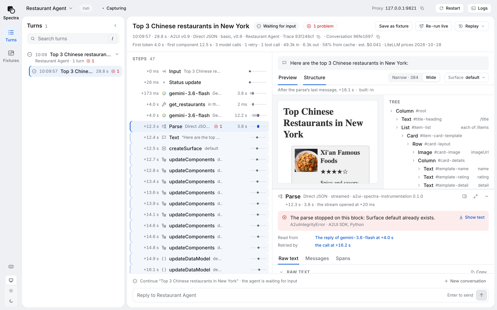
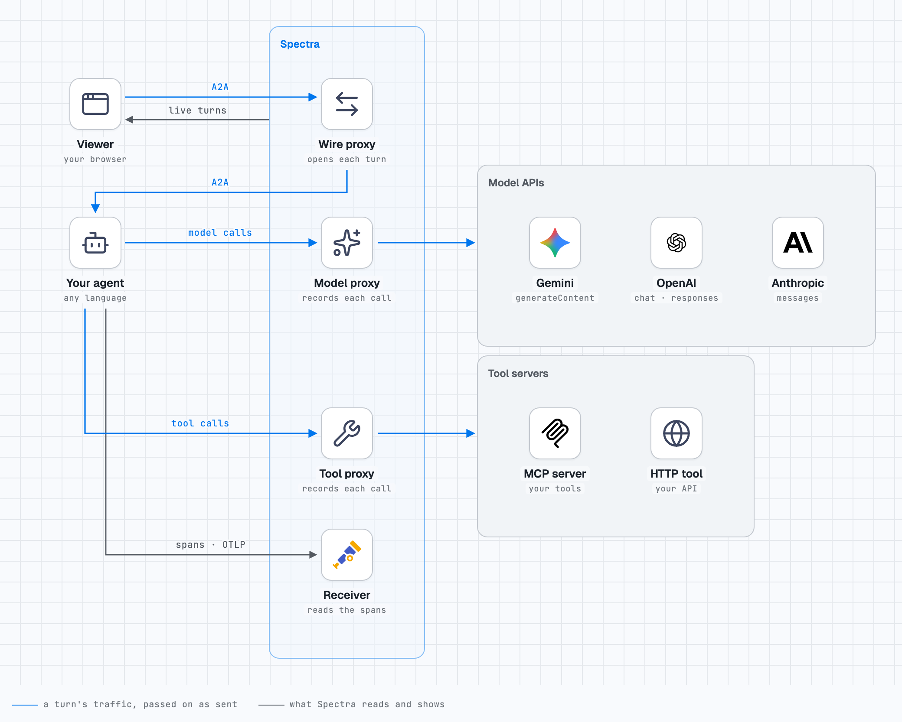

# a2ui-spectra

The command of [Spectra for A2UI](../../README.md), a debugging and observation tool for the developer of an A2UI agent: attach to the running agent, see every turn, check and preview it, record and replay it. It works with any A2A agent, in any language and on any framework, and runs as one local process.

<picture>
  <source media="(prefers-color-scheme: dark)" srcset="../../docs/images/viewer-dark.png">
  
</picture>

## Install

One binary, the same through every channel, for macOS arm64 and x64, Linux x64 and arm64 on glibc, and Windows x64.

**npm**, with Node 22 or later:

```sh
npx a2ui-spectra
```

**PyPI**, with [uv](https://docs.astral.sh/uv/):

```sh
uvx a2ui-spectra
```

**macOS and Linux**, from the GitHub release into `~/.local/bin`, or `$XDG_BIN_HOME` when it is set, its checksum verified:

```sh
curl -fsSL https://raw.githubusercontent.com/retz8/a2ui-spectra/main/scripts/public/install.sh | sh
```

**Windows**, from the GitHub release into `%LOCALAPPDATA%\Programs\a2ui-spectra\bin` and onto your `PATH`, its checksum verified:

```powershell
irm https://raw.githubusercontent.com/retz8/a2ui-spectra/main/scripts/public/install.ps1 | iex
```

Not supported: Windows on arm64, and Linux on musl, such as Alpine. To download the binary by hand from the release page, see the root README's [Install](../../README.md#install).

## First run

From your agent's folder, start the agent under Spectra, naming the address it serves A2A on:

```sh
a2ui-spectra run --agent-url http://localhost:10002 -- uv run .
```

Through npm or PyPI, put `npx` or `uvx` in front: `npx a2ui-spectra run …`.

Spectra starts its listeners, then the agent, and opens the viewer in your browser. These are the first lines of a run of upstream's Python restaurant finder, its folder shortened:

```text
a2ui-spectra: The viewer is at http://localhost:9820/
a2ui-spectra: Point a host at the wire proxy: http://127.0.0.1:9821/
a2ui-spectra: The OpenTelemetry receiver is at http://127.0.0.1:9823
a2ui-spectra: Turns are saved in …/restaurant_finder/.a2ui-spectra/turns
a2ui-spectra: Fixtures are saved in …/restaurant_finder/a2ui-spectra-fixtures
a2ui-spectra: A save in …/restaurant_finder restarts the agent. Set watch to false in the config file when the agent reloads itself.
```

Send a message from the viewer's message box, and the turn arrives step by step. Saving a file in the folder restarts the agent. Ctrl-C stops Spectra and the agent.

For an agent already running, attach to it instead, and set the variables Spectra prints in the agent's shell before restarting the agent:

```sh
a2ui-spectra attach http://localhost:10002
```

<picture>
  <source media="(prefers-color-scheme: dark)" srcset="../../docs/design/diagrams/spectra-dark.png">
  
</picture>

## Commands

```
a2ui-spectra attach [<agent-url>] [options]
a2ui-spectra run [--agent-url <url>] [options] -- <command> [args...]
a2ui-spectra replay <file> [--model-live | --live] [--agent-url <url>] [options] [-- <command> [args...]]
a2ui-spectra test [<folder>] [--agent-url <url>] [options] [-- <command> [args...]]
a2ui-spectra <command> --help
a2ui-spectra --version
```

- `<command> --help` prints the command's forms, its options and examples; on Windows its examples are written for PowerShell and for cmd.
- `run` starts the agent's command with Spectra's variables set and owns its process: it restarts it on save and from the viewer, and shows its output. The command after `--` starts without a shell. See [The agent's process](../../docs/design/agent-process.md).
- `attach` watches an agent that is already running at `<agent-url>`, and prints the variables to set in its shell; see [The wire](../../docs/design/wire.md#attach-at-start).
- `replay` replays one record, a fixture or a stored turn, with everything recorded, with the model live under `--model-live`, or with every call live under `--live`. `test` replays every fixture under the folder, the fixtures folder by default, with everything recorded, and exits 0 when every one passes. See [Replay and fixtures](../../docs/design/replay-and-fixtures.md#the-commands-replay-and-test).

`replay` and `test` run headless, under the config file as `run` is, and take the agent either way: a command after `--`, started as `run` starts it, or `--agent-url <url>`, else the config file's `agent.url`, naming an agent already running whose shell has the variables `attach` prints. Both take `--config`, `--header` and the four port options other than `--port`, with `run`'s defaults; the viewer's `--port`, `--no-open` and `--allow-host` are refused as unknown options. Their status lines go to stderr with the `a2ui-spectra:` prefix, and stdout carries the result lines alone, so `a2ui-spectra test > results.txt` keeps the verdicts.

## Options

| Option                    | Meaning                                                                                                                                       | Default                                                         |
| ------------------------- | --------------------------------------------------------------------------------------------------------------------------------------------- | --------------------------------------------------------------- |
| `--agent-url <url>`       | The agent's base address. `run`, `replay` and `test`; takes precedence over the config file's `agent.url`.                                    |                                                                 |
| `--config <path>`         | The config file, relative to the working directory when relative.                                                                             | `a2ui-spectra.json` in the working directory, when there is one |
| `-H`, `--header <header>` | A header for every request the message box makes to the agent, written `Name: value` as curl takes one; see `agent.headers`. Can be repeated. |                                                                 |
| `--port <n>`              | The viewer's port.                                                                                                                            | 9820                                                            |
| `--proxy-port <n>`        | The wire proxy's port.                                                                                                                        | 9821                                                            |
| `--model-proxy-port <n>`  | The model proxy's port.                                                                                                                       | 9822                                                            |
| `--receiver-port <n>`     | The OpenTelemetry receiver's port.                                                                                                            | 9823                                                            |
| `--tool-proxy-port <n>`   | The tool proxy's port for the config file's first tool server; each further one takes the next port, in config order.                         | 9824                                                            |
| `--no-open`               | Do not open the browser.                                                                                                                      |                                                                 |
| `--allow-host <name>`     | Also answer requests addressed to `<name>`, a host name without a port, such as a tunnel's. Can be repeated.                                  |                                                                 |

A port that is taken is an error at start, and Spectra's ports must differ, each tool server's included. The viewer's server listens on loopback only and answers requests addressed to `localhost`, `127.0.0.1` and `[::1]`, plus the names given with `--allow-host`. Ports and allowed hosts are command-line only.

## The config file

`a2ui-spectra.json`, optional, in the directory Spectra is launched from, or the file `--config` names. It is meant to be committed in your agent's repository; it holds variable names, never secrets.

```json
{
  "$schema": "https://raw.githubusercontent.com/retz8/a2ui-spectra/main/tools/spectra/src/config.schema.json",
  "agent": {
    "url": "http://localhost:10002",
    "headers": {"Authorization": "Bearer ${SPECTRA_AGENT_TOKEN}"}
  },
  "catalogs": ["./catalogs/catalog.json"],
  "preview": ["http://localhost:5174/spectra-preview"],
  "tools": [{"variable": "FLOOR_PLAN_SERVER_URL", "url": "http://127.0.0.1:8000/sse"}],
  "prices": {"my-gemini-tune": {"input": 0.75, "output": 3.75, "cacheRead": 0.075}},
  "fixtures": "./fixtures/spectra",
  "watch": [".", "../shared", "!sessions.db"]
}
```

| Setting                      | What it is                                                                                                               | Its rules                                                                                   |
| ---------------------------- | ------------------------------------------------------------------------------------------------------------------------ | ------------------------------------------------------------------------------------------- |
| `agent.url`, `agent.headers` | The agent's base address, and headers the message box sends the agent, `${VAR}` read from your environment               | [The wire](../../docs/design/wire.md#the-config-files-agent-settings)                       |
| `catalogs`                   | Your catalogs' definition files, for the checks                                                                          | [The checks](../../docs/design/checks.md#the-config-files-catalogs)                         |
| `preview`                    | Your preview pages, built with a preview adapter                                                                         | [The preview](../../docs/design/preview.md#the-config-files-preview-setting)                |
| `tools`, `prices`            | Your tool servers, by the variable your agent reads each one's URL from; prices for models the price table does not know | [Model and tool calls](../../docs/design/model-and-tool-calls.md#the-config-files-settings) |
| `fixtures`                   | The fixtures folder, `a2ui-spectra-fixtures/` beside the config file by default                                          | [Replay and fixtures](../../docs/design/replay-and-fixtures.md#the-fixtures-folder)         |
| `watch`                      | What restart on save watches under `run`, the working directory by default                                               | [The agent's process](../../docs/design/agent-process.md#the-watch-setting)                 |
| `$schema`                    | The schema's address, for your editor's completion and checks; Spectra ignores it                                        | The running tool also serves the schema at `GET /api/config.schema.json`                    |

The file is read strictly. A `--config` file that does not exist, a file that is not valid JSON or does not hold an object, a setting of the wrong type, a key Spectra does not know, such as `header` for `headers`, a `watch` entry that names no path and a catalog path that does not load each stop Spectra at start with a message naming the file, the setting and the problem. Only the default file being absent is quiet. Spectra prints the file it read settings from, and the ids of the catalogs configured. The command line takes precedence over the file: `--agent-url` over `agent.url`, and a `--header` over the file's header of the same name.

## Going deeper

Each step is optional, and each adds to what you see:

| Add                                                                                                                                                                              | And see                                                                              |
| -------------------------------------------------------------------------------------------------------------------------------------------------------------------------------- | ------------------------------------------------------------------------------------ |
| Nothing                                                                                                                                                                          | Turns, checks, the basic catalog's preview, model calls with tokens and cost, replay |
| The config file: your catalogs, your tool servers                                                                                                                                | Your own catalog's checks, and your tool calls recorded                              |
| The wrapper, for [Python](../../python/a2ui_spectra_instrumentation/README.md) or [TypeScript](../../typescript/instrumentation/README.md)                                       | The A2UI step: raw text to components, retries, parse errors                         |
| [OpenTelemetry](../../docs/design/opentelemetry.md#the-recipe-for-a-python-agent) in your agent                                                                                  | Your framework's spans: tools in the agent's process, its own retries                |
| A preview adapter, for [React](../../typescript/preview/react/README.md), [Lit](../../typescript/preview/lit/README.md) or [Angular](../../typescript/preview/angular/README.md) | Your own components, drawn by your own renderer, and pressing them                   |

How each part works, its rules and why, is in the design docs; start with [A turn, end to end](../../docs/design/turn-end-to-end.md). The scripts and coding agents that drive Spectra have [The API](../../docs/design/api.md), and a coding agent has the skill in [`skills/a2ui-spectra/`](../../skills/a2ui-spectra/SKILL.md).

## Development

Spectra is TypeScript on Node's standard APIs, compiled by Bun into one binary per platform with the viewer embedded. With [Node.js](https://nodejs.org/en) 22 and Yarn through Corepack, `corepack enable`, from the repository root after `yarn install`:

```sh
yarn workspace a2ui-spectra build            # compiles src/ into dist/, the viewer and the built-in preview page beside it
yarn workspace a2ui-spectra build:binary     # the binary for this machine, dist/a2ui-spectra
yarn workspace a2ui-spectra test             # the unit, command-line and end-to-end tests under Node
yarn workspace a2ui-spectra lint
yarn workspace a2ui-spectra format:check
node tools/spectra/dist/cli.js run -- …      # the built tool under Node
```

- `SPECTRA_BINARY=dist/a2ui-spectra yarn test`, from `tools/spectra/`, runs the command-line and end-to-end tests against the binary; `SPECTRA_TEST_PART` runs `wrapper-capture`, `command-line` or `others` alone. The browser end-to-end tests need Playwright's Chromium, once: `npx playwright@1.58.1 install chromium chromium-headless-shell`.
- On macOS, `build:binaries` builds the five platforms' binaries, `build:packages` and `check:packages` make and check their npm packages, wheels and archives, with [uv](https://docs.astral.sh/uv/), and `pack:libraries` and `check:libraries` pack and check the six libraries. `set:version` and `check:version` set and check the release's version in every place it is stated. `generate:otlp` generates the receiver's OTLP code from `proto/`. The price table in `src/prices/` is copied from a LiteLLM release by a script that is not in this repository. How these make a release is in [Distribution](../../docs/design/distribution.md).
